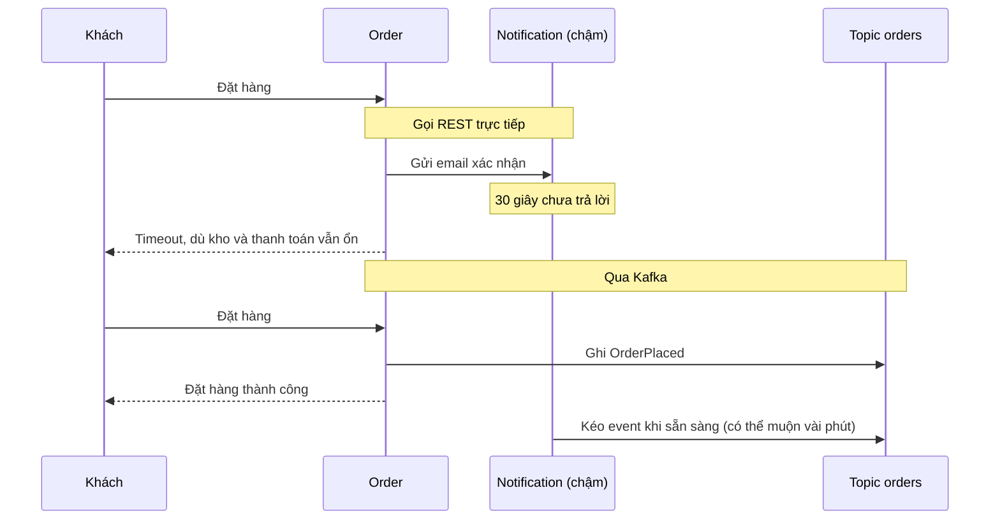
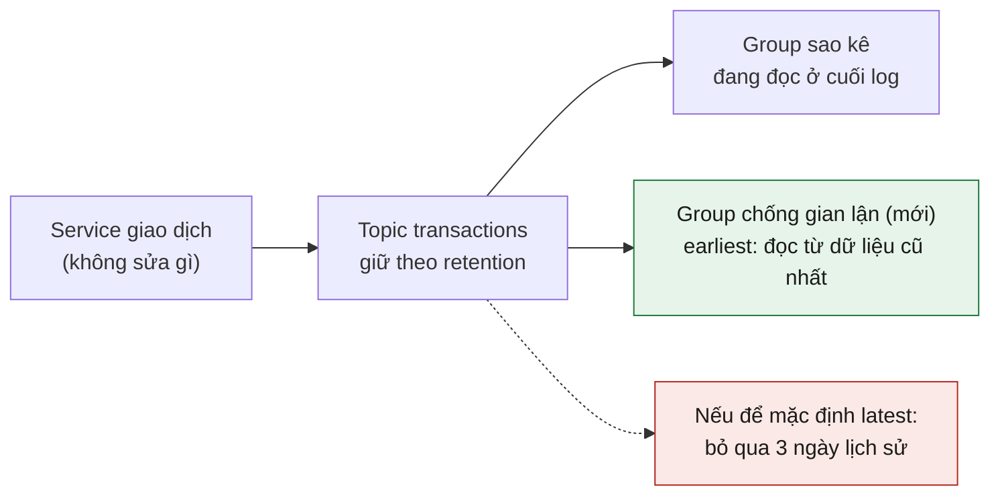

<!-- Tự sinh từ 0001-kafka-big-picture.html bằng scripts/html2md.py. Đừng sửa tay. -->

[Kafka](../README.md) / Bài 1 · [Bảng tra: bức tranh & khái niệm](../reference/0001-core-concepts.md)

# Bài 1: Kafka là gì và nó giải quyết vấn đề gì?

Bức tranh toàn cảnh trước, từng bộ phận sau.

> **Liên quan tới mission** Mục tiêu của bạn là hiểu *cách cấu hình Kafka để giải quyết từng loại vấn đề*, rồi áp vào bất kỳ lĩnh vực nào (kể cả ngân hàng sau này). Các bài dùng usecase từ nhiều lĩnh vực. Trước khi bàn key, acks hay rebalance, bạn cần một bản đồ trong đầu: Kafka giải quyết vấn đề gì, gồm những thành phần nào, và một event đi qua nó ra sao. Mọi bài sau sẽ treo vào bản đồ này.

**Thắng lợi của bài này:** sau ~15 phút bạn kể lại được, không nhìn tài liệu, hành trình của một event đơn hàng từ service gửi tới các service nhận, gọi đúng tên 5 thành phần, và giải thích Kafka khác "gọi API trực tiếp" ở đâu.

## Kafka là gì? (định nghĩa ngắn, trước khi vào bài)

**Apache Kafka là một nền tảng "event streaming" phân tán:** một hệ thống để các ứng dụng *ghi* các sự kiện (event) vào, *lưu* chúng bền vững, và để các ứng dụng khác *đọc* chúng, theo thời gian thực hoặc đọc lại sau. Một **event** ghi lại một điều đã xảy ra: "đơn hàng #123 vừa được đặt lúc 10:02", "tài xế DRV-001 ở toạ độ này". Trang giới thiệu chính thức liệt kê ba khả năng cốt lõi: publish/subscribe các luồng event, lưu chúng bền vững trong bao lâu tuỳ ý, và xử lý chúng ngay khi xảy ra hoặc sau đó. [[Kafka intro]](https://kafka.apache.org/intro)

**Cách nhớ nhanh:** Kafka giống một *cuốn nhật ký chung, chỉ ghi thêm vào cuối*, mà nhiều ứng dụng cùng đọc theo tốc độ của riêng mình (mục 2). Nó không phải database để truy vấn linh hoạt, và không phải hộp thư lấy ra là hết. Nó nằm *giữa* các service để chúng không phải gọi thẳng nhau (mục 1 ngay dưới). Phần còn lại của bài giải thích từng chữ trong định nghĩa này.

## 1. Vấn đề mà Kafka sinh ra để giải quyết

Kịch bản minh hoạ (do mình dựng): một cửa hàng online. Khi khách đặt hàng xong, service **Order** cần báo cho **Notification** (gửi email xác nhận), **Inventory** (trừ kho) và **Analytics** (cập nhật thống kê doanh thu).

*Bên trái: thêm một service nhận thì phải sửa Order, và một service nhận chậm hay chết sẽ kéo theo Order. Bên phải: Kafka đứng giữa.*

Tài liệu chính thức mô tả đúng ý này: "producers and consumers are fully decoupled and agnostic of each other" và "producers never need to wait for consumers." [[Kafka intro]](https://kafka.apache.org/intro) Trang giới thiệu liệt kê nhiều lĩnh vực dùng Kafka; một mục trong đó là "To process payments and financial transactions in real-time, such as in stock exchanges, banks, and insurances."

## 2. Ý tưởng lõi: một cuốn nhật ký chỉ ghi thêm vào cuối

Đừng hình dung Kafka là hộp thư lấy thư ra là hết. Tài liệu thiết kế viết rằng nó "more akin to a database log than a traditional messaging system." [[Kafka design: Motivation]](https://kafka.apache.org/44/design/design/) Ba hệ quả bạn sẽ dùng mãi:

1. **Event không bị xoá khi đã đọc**: "events are not deleted after consumption". Bạn đặt thời gian giữ lại (retention). [[Kafka intro]](https://kafka.apache.org/intro) Nhờ vậy một service mới *có thể* đọc lại lịch sử, và một service lỗi có thể đọc lại sau khi sửa bug. (Lưu ý: "có thể" chứ không tự động. Consumer group mới mặc định bắt đầu từ cuối, vì `auto.offset.reset` mặc định là `latest`; muốn đọc từ đầu phải cấu hình khác. [[Consumer configs]](https://kafka.apache.org/44/configuration/consumer-configs/) Bài 5 sẽ làm rõ.)
2. **Consumer tự kéo (pull), không bị đẩy.** "A pull-based system has the nicer property that the consumer simply falls behind and catches up when it can." [[Kafka design: push vs pull]](https://kafka.apache.org/44/design/design/) Service nhận chậm không làm sập ai.
3. **Mỗi bên đọc theo tốc độ và vị trí của riêng mình.** Vị trí đó chỉ là một con số (offset), bài 2 sẽ đi sâu.

## 3. Năm thành phần trong bức tranh

*P0, P1, P2 là 3 partition của topic `orders`. Cụm có 3 broker và replication factor 3, nên broker nào cũng giữ một bản của mọi partition; với 6 broker, mỗi partition chỉ nằm trên 3 trong 6 broker. Leader (★) của ba partition nằm ở ba broker khác nhau nên việc ghi được chia tải. Sơ đồ này rút gọn: mũi tên từ cluster tới một group chỉ có nghĩa "group đọc topic". Ai trong group đọc partition nào thì xem hình ở mục "Một group chia partition thế nào?" ngay dưới bảng.*

**Đừng lẫn partition với bản sao (replica).** Hai chiều của hình là hai khái niệm khác nhau:

- **Theo cột dọc, trong một broker (P0 so với P1 so với P2): khác nội dung.** Topic được *chia* thành partition; mỗi đơn hàng chỉ vào *một* partition (đơn #1 vào P0, đơn #2 vào P1...). Gộp P0 + P1 + P2 mới ra toàn bộ topic.
- **Theo hàng ngang, qua các broker (P0 ở Broker 1, 2, 3): cùng nội dung.** Đó là 3 *bản sao* của cùng một partition P0, để một broker chết không mất dữ liệu. Chỉ bản leader (★) nhận ghi; follower chép lại từ leader. Consumer đọc *partition*, không đọc từng bản sao: đọc P0 là đọc nội dung của P0, dù nằm ở broker nào.

| Thành phần | Vai trò (một câu) | Nguồn |
|---|---|---|
| **Producer** | Ứng dụng client ghi (publish) event vào Kafka. | [intro](https://kafka.apache.org/intro) |
| **Broker** | Máy chủ thuộc tầng lưu trữ ("the storage layer, called the brokers"). Nhiều broker hợp thành cluster. | [intro](https://kafka.apache.org/intro) |
| **Topic & partition** | Topic chia thành partition rải trên các broker. Mỗi partition có một *leader* nhận ghi và các *follower* sao chép từ leader. | [design: replication](https://kafka.apache.org/44/design/design/) |
| **Consumer & group** | Ứng dụng client đọc (subscribe) event; "một consumer" ở đây là một *instance đang chạy* (một process hoặc thread), không phải một máy. Trong một group, mỗi partition do đúng một consumer đọc ("consumed by exactly one consumer within each subscribing consumer group"). Các group khác nhau đọc độc lập. | [design: consumer](https://kafka.apache.org/44/design/design/) |
| **Controller (KRaft)** | Nhóm server chạy đồng thuận (quorum) để giữ metadata của cụm, không cần hệ thống điều phối bên ngoài. Thường 3 hoặc 5 controller. | [KRaft overview](https://kafka.apache.org/44/operations/kraft/) |

Bạn chưa cần nhớ chi tiết từng ô: bảng này là "khung treo". Các bài sau điền dần nội dung vào đúng từng ô.

### Một group chia partition thế nào?

*Hai group đọc cùng một topic và *độc lập* nhau: group nào cũng nhận đủ mọi message. Trong group Notification, C1 xử lý đơn #1 #4 #2 #5, C2 xử lý #3 #6: hai consumer chia nhau công việc, không làm trùng. Trong từng group, mỗi partition có đúng một consumer; một consumer có thể giữ nhiều partition.*

**Đọc hình:**

- **Trong một group, mỗi partition do một consumer đọc** tại một thời điểm. Consumer là một *instance* (process hoặc thread), không phải một máy. Một consumer có thể giữ nhiều partition (C1 giữ P0, P1).
- **Số partition là trần song song của một group:** 4 consumer trên 3 partition thì C4 ngồi không (Bài 8).
- **Lý do:** thứ tự chỉ được đảm bảo trong một partition (Bài 2); hai consumer cùng đọc một partition sẽ xử lý song song và mất thứ tự.
- **Việc chia thay đổi** khi consumer vào hoặc rời group: Kafka chia lại, gọi là **rebalance** ([Bài 5b](0011-rebalance.md)).
- **Các group độc lập:** mỗi group có offset riêng trên cùng partition.
- Ngoại lệ: **Share Groups** (Kafka 4.2 trở đi) cho nhiều consumer hơn partition, đổi lại không giữ thứ tự. [[KIP-932]](https://cwiki.apache.org/confluence/display/KAFKA/KIP-932%3A+Queues+for+Kafka)

## 4. Hành trình của một đơn hàng

1. **Order** (producer) tạo event `OrderPlaced` và gửi vào topic `orders`.
2. Event được ghi vào **leader** của một partition; các **follower** sao chép lại. Tài liệu: một ghi được coi là committed khi mọi bản sao trong tập ISR đã nhận. [[design: replicated logs]](https://kafka.apache.org/44/design/design/)
3. Order **không chờ ai đọc**; nó làm việc tiếp.
4. Group **Notification** và group **Inventory** mỗi nhóm **tự kéo** event, mỗi nhóm nhận đủ mọi event, theo tốc độ của mình.
5. Event vẫn nằm đó sau khi đọc, cho tới hết thời gian retention. Thêm group **Analytics** vào sau cũng đọc được.
6. Nếu một broker chết, các server còn lại tiếp quản ("if any of its servers fails, the other servers will take over their work"). [[intro]](https://kafka.apache.org/intro)

### Sáu điều cần nhớ

| Thứ | Điều cần nhớ | Hệ quả khi thiết kế |
|---|---|---|
| Producer và consumer | Tách rời, producer không chờ consumer | Bên nhận chậm hay chết không kéo bên gửi theo |
| Event | Không bị xoá khi đọc, giữ theo retention | Service mới đọc lại được lịch sử còn trong retention |
| Consumer đọc | Tự kéo (pull) theo tốc độ riêng | Chậm thì tụt lại rồi đuổi kịp, không làm sập ai |
| Partition và bản sao | Topic chia thành partition; mỗi partition có bản sao trên broker khác | Partition là đơn vị song song, bản sao là đơn vị độ bền |
| Consumer group | Mỗi group nhận đủ; trong group, mỗi partition một consumer | Số partition là trần số consumer có việc trong group |
| Controller (KRaft) | Giữ metadata của cụm | Nội dung message nằm ở broker, không ở controller |

## 5. Bản đồ: câu hỏi trong họp → bài sẽ học

| Bạn sẽ nghe | Khái niệm | Bài |
|---|---|---|
| "Sự kiện của cùng một đơn hàng sao bị lộn thứ tự?" | key, partition, offset | [Bài 2](0002-key-partition-offset.md) |
| "Dựng cụm thế nào? Broker chết thì sao?" | cluster, leader, KRaft | [Bài 3](0003-build-cluster.md) |
| "Broker chết thì có mất đơn hàng không?" | acks, ISR, min.insync.replicas | [Bài 4](0004-producer-durability.md) |
| "Producer gửi lại thì có ghi trùng không?" | idempotent producer | [Bài 4b](0010-idempotent-producer.md) |
| "Sao khách nhận hai email xác nhận?" / "sao kho bị trừ hai lần?" | consumer group, commit offset, at-least-once | [Bài 5](0005-consumer-offset-commit.md) |
| "Deploy xong consumer đứng hình vài chục giây" | rebalance | [Bài 5b](0011-rebalance.md) |
| "Exactly-once có thật không?" | delivery semantics | [Bài 5c](0012-delivery-semantics.md) |
| "Một message lỗi làm kẹt cả hàng" | poison pill, retry, DLT | [Bài 6](0006-error-handling-dlt.md) |
| "Làm sao để không trừ tiền hai lần?" | idempotent consumer, outbox, transaction | [Bài 7](0007-idempotent-consumer-transactions.md) |
| "Topic này cần bao nhiêu partition, key là gì?" | thiết kế topic | [Bài 8](0008-topic-design.md) |
| "Giờ mở cửa phiên hệ thống chậm hẳn" | thông lượng, độ trễ, lag | [Bài 8b](0014-throughput-latency.md) |
| "Đọc lại dữ liệu tuần trước được không?" | retention, compaction, replay | [Bài 8c](0015-replay-retention.md) |
| "Thêm field có làm hỏng consumer không?" | schema, Schema Registry | [Bài 8d](0016-schema-evolution.md) |

## 6. Usecase: gọi API trực tiếp hỏng ở đâu

[Xem mọi usecase của khoá học](../reference/0005-usecase-index.md)

### (a) Thương mại điện tử: email chậm làm hỏng đặt hàng

Kịch bản minh hoạ (do mình dựng). Order gọi REST lần lượt tới Notification, Inventory, Analytics rồi mới trả lời khách. Một sáng, máy chủ email chậm và Notification mất 30 giây cho mỗi request. Thread của Order nằm chờ, pool thread cạn dần, khách đặt hàng nhận timeout, dù kho và thanh toán vẫn bình thường. Một service phụ đã kéo sập luồng chính.

**Xử lý:** Order ghi `OrderPlaced` vào topic `orders` rồi trả lời khách ngay. Notification tự kéo event khi sẵn sàng; chậm thì tụt lại rồi đuổi kịp, event vẫn nằm trong log. Cái giá: email có thể đến muộn vài phút, vì hệ thống giờ là nhất quán sau (eventual), không còn đồng bộ.

*Sequence: gọi trực tiếp làm khách chờ service chậm nhất; qua Kafka, Order chỉ cần ghi được vào topic.*

### (b) Ngân hàng: thêm service chống gian lận cần lịch sử giao dịch

Kịch bản minh hoạ (do mình dựng). Team chống gian lận cần giao dịch của 3 ngày gần nhất để chạy thử bộ quy tắc mới, rồi đọc tiếp giao dịch theo thời gian thực. Với REST, team giao dịch phải viết thêm API xuất lịch sử, thêm một lời gọi mới và chịu thêm tải. Với Kafka, team chống gian lận chỉ cần tạo một consumer group mới đọc topic giao dịch có sẵn; service giao dịch không sửa dòng nào.

**Xử lý:** group mới đặt `auto.offset.reset=earliest` để bắt đầu từ dữ liệu cũ nhất còn trong retention. Hai cái bẫy: mặc định là `latest`, nên group mới chỉ thấy giao dịch từ lúc nó chạy ([Bài 5](0005-consumer-offset-commit.md)); và dữ liệu cũ hơn retention đã bị xoá, Kafka không giữ mãi ([Bài 8c](0015-replay-retention.md)). [[Consumer configs]](https://kafka.apache.org/44/configuration/consumer-configs/)

*Flow: thêm bên đọc mới không đụng tới bên ghi; vị trí bắt đầu của group mới do `auto.offset.reset` quyết định.*

### Hỏi nhanh, đáp gọn

- **Kafka có thay được mọi lời gọi API không?** Không. Khi bên gọi cần câu trả lời ngay để đi tiếp (ví dụ kiểm tra số dư trước khi cho chuyển tiền), gọi đồng bộ vẫn hợp lý. Kafka hợp với thông báo "việc này đã xảy ra", không hợp với câu hỏi "tôi có được làm việc này không".
- **Kafka có phải message queue không?** Dùng được như queue (các consumer cùng group chia nhau partition) và như pub/sub (mỗi group nhận đủ), nhưng bản chất là một log chỉ ghi thêm: đọc không xoá, đọc lại được, song song bị giới hạn bởi số partition.
- **Một broker chết thì sao?** Partition có leader trên broker đó được bầu leader mới từ các bản sao còn bám kịp (ISR); cụm chạy tiếp. Chi tiết ở Bài 3 và 4.

## 7. Tự nói thành lời (30 giây, rồi mới làm quiz)

Che màn hình hoặc nhìn ra chỗ khác. Nói to (hoặc viết ra giấy): *"Order gửi event, Kafka ... , Notification và Inventory ..."* Gọi đúng tên 5 thành phần. Khoảng trống bạn gặp chính là chỗ cần xem lại. Cố truy hồi trước khi nhìn lại luôn giúp nhớ lâu hơn là đọc lại.

**Ôn nhanh:** [tóm tắt Bài 1](../summaries/0001-kafka-big-picture.md) (đọc sau khi đã tự nói).

## 8. Kiểm tra

<!-- quiz:quiz -->

**1. Service Order vừa ghi event OrderPlaced vào Kafka. Nó cần làm gì tiếp theo với Notification?**

- **A.** Chờ Notification đọc xong rồi mới tiếp tục
- **B.** Không cần chờ, hai bên độc lập nhau
- **C.** Gọi REST sang Notification để xác nhận lại
- **D.** Xoá event ngay khi Notification đọc xong hẳn

Đáp án

**B. Không cần chờ, hai bên độc lập nhau**

Producer và consumer được tách rời hoàn toàn; producer không phải chờ consumer.

**2. Notification và Inventory là hai consumer group khác nhau cùng đọc topic orders. Điều gì đúng?**

- **A.** Hai group chia nhau, mỗi message chỉ một group
- **B.** Group nào đọc trước thì xoá message khỏi topic
- **C.** Chỉ group đầu tiên đăng ký mới được đọc
- **D.** Mỗi group nhận đủ mọi message, độc lập nhau

Đáp án

**D. Mỗi group nhận đủ mọi message, độc lập nhau**

Event không bị xoá khi đọc. Mỗi group có vị trí đọc riêng và nhận đủ mọi event.

**3. Cụm 3 broker, topic orders có 3 partition, RF=3. Broker 1 và Broker 2 đều có P0. Điều nào đúng?**

- **A.** P0 và P1 chứa cùng các đơn hàng
- **B.** Hai bản P0 giống nhau, P1 thì khác P0
- **C.** Hai bản P0 khác nhau vì broker khác
- **D.** Consumer phải đọc cả hai bản của P0

Đáp án

**B. Hai bản P0 giống nhau, P1 thì khác P0**

P0, P1, P2 chia nhau dữ liệu của topic (khác nội dung). Các bản P0 trên nhiều broker là bản sao của cùng một partition (cùng nội dung). Consumer đọc partition (mặc định từ bản leader), không đọc gộp các bản sao.

**4. Topic có 3 partition. Một consumer group chạy 5 instance trên 5 máy khác nhau. Điều gì đúng?**

- **A.** Cả 5 instance cùng đọc mọi partition
- **B.** Mỗi máy đọc một phần của mỗi partition
- **C.** Hai instance còn lại có thể ngồi chờ không
- **D.** Kafka tự tăng partition lên đủ năm cái

Đáp án

**C. Hai instance còn lại có thể ngồi chờ không**

Trong một group mỗi partition chỉ có một consumer; 3 partition nên tối đa 3 instance có việc, 2 instance còn lại nhàn rỗi (cho tới khi rebalance giao việc lại).

**5. Trong cùng một consumer group, một partition được bao nhiêu consumer đọc tại một thời điểm?**

- **A.** Chính xác một consumer trong group đó
- **B.** Tất cả consumer trong group cùng lúc
- **C.** Hai consumer, một chính một dự phòng
- **D.** Tuỳ broker, chọn ngẫu nhiên mỗi lần

Đáp án

**A. Chính xác một consumer trong group đó**

Tài liệu thiết kế: mỗi partition được đọc bởi đúng một consumer trong mỗi group đăng ký.

**6. Một event đã được mọi consumer đọc xong. Kafka làm gì với nó?**

- **A.** Xoá ngay để giải phóng dung lượng ổ đĩa
- **B.** Chuyển sang một topic khác để lưu trữ lại
- **C.** Giữ lại theo thời gian retention bạn cấu hình
- **D.** Đánh dấu đã xử lý rồi ẩn khỏi consumer

Đáp án

**C. Giữ lại theo thời gian retention bạn cấu hình**

Event không bị xoá sau khi đọc; nó được giữ theo thời gian retention.

**7. Producer ghi message của partition P0. Nó ghi vào đâu?**

- **A.** Broker nào đang ít việc nhất lúc gửi
- **B.** Chỉ broker đang giữ leader của partition đó
- **C.** Mọi broker có bản sao, ghi đồng thời
- **D.** Broker controller, sau đó nó chuyển cho follower

Đáp án

**B. Chỉ broker đang giữ leader của partition đó**

Producer chỉ ghi vào leader; follower sao chép từ leader.

**8. Controller trong KRaft giữ thông tin nào?**

- **A.** Nội dung các message của mọi topic
- **B.** Mật khẩu đăng nhập của các service
- **C.** Siêu dữ liệu (metadata) của cả cụm
- **D.** Danh sách đơn hàng của mọi khách

Đáp án

**C. Siêu dữ liệu (metadata) của cả cụm**

Controller tạo quorum để giữ metadata cụm. Nội dung message nằm ở các broker.

**9. Team mới cần đọc giao dịch 3 ngày qua từ topic transactions đang chạy. Cách nào đúng tinh thần Kafka?**

- **A.** Sửa producer để gửi thêm bản sao
- **B.** Gọi API của service giao dịch cũ
- **C.** Tạo topic mới rồi chép dữ liệu
- **D.** Group mới, đọc từ offset sớm nhất

Đáp án

**D. Group mới, đọc từ offset sớm nhất**

Event không bị xoá khi đọc, nên một group mới với auto.offset.reset=earliest đọc lại được dữ liệu còn trong retention mà không phải sửa bên ghi. Mặc định latest sẽ bỏ qua lịch sử.

<!-- /quiz -->

## Nguồn nên đọc

> **Chính:** [Apache Kafka: Introduction](https://kafka.apache.org/intro), đọc từ đầu đến hết mục Main Concepts and Terminology (khoảng 10 phút).
>
> **Bổ trợ:** [Confluent Developer: Apache Kafka 101](https://developer.confluent.io/courses/apache-kafka/events/), module Introduction (3 phút), Brokers (4), Replication (3). Sau khi làm xong bài này, mục Design trong [tài liệu thiết kế](https://kafka.apache.org/44/design/design/) sẽ dễ đọc hơn nhiều.

**Bài tiếp theo:** [Bài 2: key, partition, offset](0002-key-partition-offset.md), phóng to vào cách Kafka quyết định message nằm ở đâu và thứ tự được giữ tới đâu. Bảng tra: [bức tranh & khái niệm](../reference/0001-core-concepts.md).

> **Còn chỗ nào mơ hồ?** Hỏi thẳng giáo viên (agent) trong phiên này, ví dụ: "Kafka khác RabbitMQ chỗ nào?", "vì sao không dùng database làm hàng đợi?". Dán dòng kết quả quiz vào cuộc trò chuyện để bài sau điều chỉnh đúng mức.
