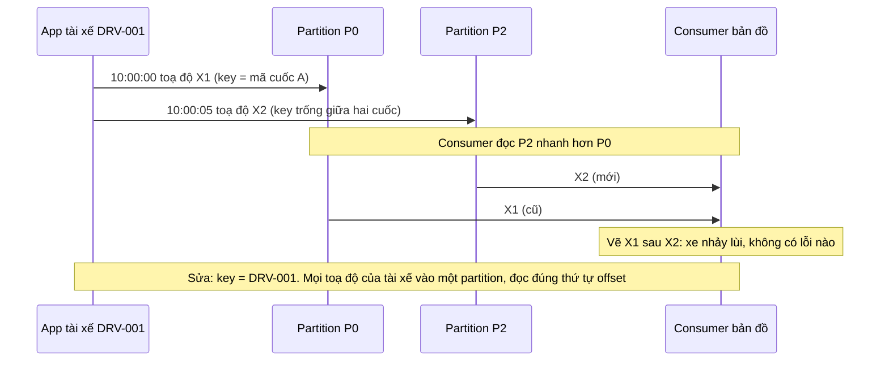
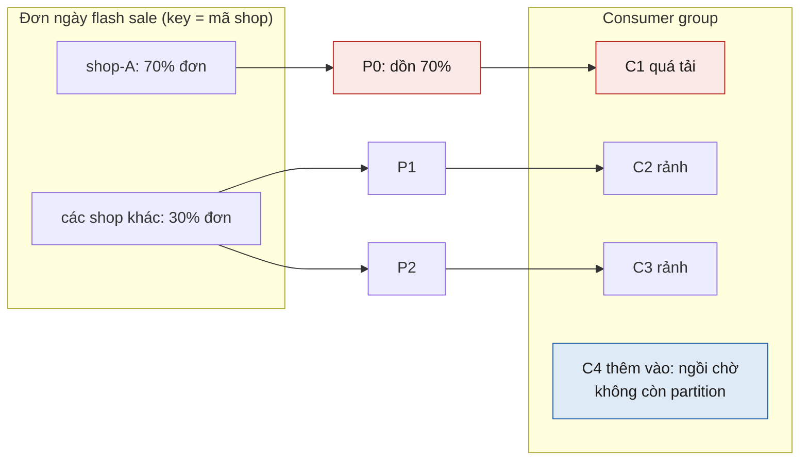
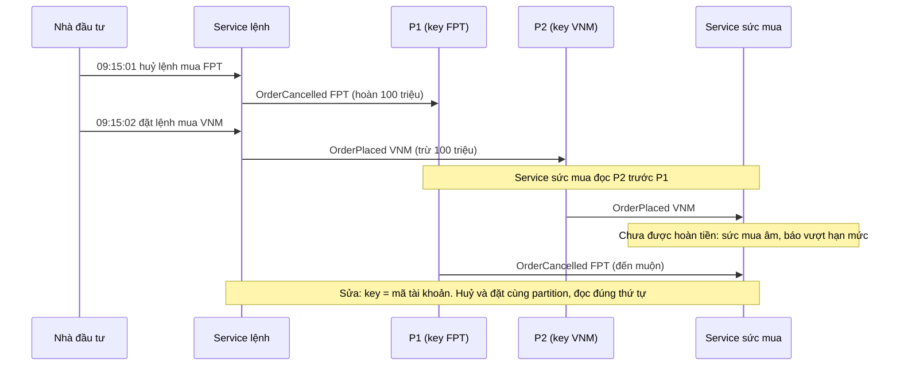

<!-- Tự sinh từ 0002-key-partition-offset.html bằng scripts/html2md.py. Đừng sửa tay. -->

[Kafka](../README.md) / [Bài 1: Bức tranh tổng thể](0001-kafka-big-picture.md) / Bài 2 · [Bảng tra](../reference/0001-core-concepts.md)

# Bài 2: Một giao dịch đi vào Kafka nằm ở đâu?

Key, partition và offset: ba thứ quyết định thứ tự và vị trí của mọi message. Đây là phóng to vào một chi tiết của [bức tranh ở Bài 1](0001-kafka-big-picture.md).

> **Liên quan tới mission** Phần lớn lỗi "lạ" khi dùng Kafka (dữ liệu lộn thứ tự, một partition quá tải) đến từ việc chọn key. Hiểu cơ chế key → partition → offset giúp bạn lường trước lỗi ở bất kỳ lĩnh vực nào: gọi xe, thương mại điện tử, thanh toán, chứng khoán.

**Thắng lợi của bài này:** sau ~20 phút bạn nói được "message của một tài xế (hay một tài khoản chứng khoán) nằm ở partition nào, thứ tự được đảm bảo tới đâu, và vì sao đổi số partition là chuyện nguy hiểm", rồi chọn đúng key cho một consumer cụ thể.

## 1. Ba khái niệm

Một message đi vào topic qua ba bước: producer nhìn **key**, key quyết định **partition**, partition gắn cho message một **offset**. Mỗi bước chỉ có vài ý cần nhớ.

*Key → partition → offset: cùng key `DRV-001` luôn rơi vào cùng một partition; trong partition, message xếp theo offset tăng dần.*

### 1.1. Key: chọn partition cho message

- **Cùng key thì cùng partition.** "Events with the same event key (e.g., a customer or vehicle ID) are written to the same partition." [[Kafka intro]](https://kafka.apache.org/intro)
- **Có key:** producer "choose a partition based on a hash of the key". **Không có key:** producer dùng "sticky partition", ghi dồn vào một partition rồi mới đổi. [[Producer configs: partitioner.class]](https://kafka.apache.org/44/configuration/producer-configs/)
- **Hệ quả:** key là *mã của đối tượng cần giữ thứ tự* (tài xế, đơn hàng, tài khoản). Không có key thì bạn không kiểm soát được message nào vào đâu.

### 1.2. Partition: đơn vị của thứ tự

- **Topic được chia thành partition**, nằm rải trên các broker khác nhau. [[Kafka intro]](https://kafka.apache.org/intro)
- **Thứ tự chỉ được đảm bảo trong một partition**, không phải cả topic: Kafka "will always read that partition's events in exactly the same order as they were written." [[Kafka intro]](https://kafka.apache.org/intro)
- **Số partition chỉ tăng, không giảm**, và tăng thì một key có thể sang partition khác: "messages with the same key may be routed to different partitions after the expansion". [[Basic operations: modifying topics]](https://kafka.apache.org/44/operations/basic-kafka-operations/)

### 1.3. Offset: vị trí trong một partition

- **Offset** là số thứ tự của message trong *một partition*. Hai partition đều có "offset 0" riêng.
- **Vị trí (position) của consumer** ở mỗi partition chỉ là một số nguyên: offset của message *kế tiếp* sẽ đọc. Lưu một con số thì rất rẻ. [[Kafka design: consumer position]](https://kafka.apache.org/44/design/design/)
- **Mỗi consumer group có vị trí riêng** trên cùng một partition, nên hai group đọc cùng topic không ảnh hưởng nhau (Bài 1). Lưu vị trí đó thế nào là chuyện commit, ở [Bài 5](0005-consumer-offset-commit.md).

### Năm điều cần nhớ

| Thứ | Quy tắc | Hệ quả khi thiết kế |
|---|---|---|
| Key | Cùng key, cùng partition | Key = mã đối tượng mà consumer cần thứ tự |
| Không key | Sticky partition, rải theo lô | Chỉ dùng cho sự kiện độc lập nhau |
| Thứ tự | Chỉ trong một partition | Không có thứ tự giữa hai key khác partition |
| Số partition | Chỉ tăng; tăng thì key có thể đổi partition | Tính trước ở giai đoạn thiết kế ([Bài 8](0008-topic-design.md)) |
| Offset | Số thứ tự trong partition; position = offset kế tiếp | Mỗi group nhớ vị trí riêng của mình |

## 2. Tự thử: gửi message vào các partition

Bộ mô phỏng bên dưới dùng hàm băm đơn giản của riêng mình (không nhất thiết trùng hàm băm của Kafka) chỉ để thấy quy luật; với message không key, nó đổi partition sau mỗi 4 message cho dễ nhìn.

1. Chọn `key = DRV-001`, bấm **Gửi có key** 3 lần. Mọi message nằm cùng một partition, offset tăng dần.
2. Gửi thêm vài message cho `DRV-002` và `DRV-004`. Mỗi tài xế có "ngăn" riêng.
3. Bấm **Gửi không key** khoảng 10 lần: các message dồn vào một partition một lúc rồi mới chuyển sang partition khác. Bạn không kiểm soát được message nào vào đâu.
4. Đổi sang **6 partition** (Kafka cho phép tăng, "does not currently support reducing the number of partitions" [[Basic operations]](https://kafka.apache.org/44/operations/basic-kafka-operations/)) rồi gửi tiếp `DRV-001`. Quan sát cảnh báo.

Điều bạn vừa thấy: sau khi đổi số partition, `DRV-001` có thể sang partition khác, nên các event cũ và mới của cùng một tài xế *nằm ở hai partition khác nhau*, không còn thứ tự chung. Muốn thấy offset thật trên cụm thật, xem [Bài 3](0003-build-cluster.md).

## 3. Đi sâu: chi tiết cho ba khái niệm

Đọc sau khi đã chạy mô phỏng. Không cần nhớ hết; đây là chỗ tra lại khi gặp trong công việc.

### Một record gồm gì (bên cạnh key)

"Conceptually, an event has a key, value, timestamp, and optional metadata headers." [[Kafka intro]](https://kafka.apache.org/intro) Ba hệ quả thiết kế:

- **Broker chỉ lưu byte.** Key và value được lưu dưới dạng `byte[]`; broker không hiểu JSON hay Avro. [[Message format]](https://kafka.apache.org/44/implementation/message-format/)
- **Chuyển đổi nằm ở client:** producer bắt buộc có `key.serializer`/`value.serializer`, consumer bắt buộc có `key.deserializer`/`value.deserializer`. Hai đầu phải dùng *cùng định dạng*; lệch là consumer lỗi giải mã (poison pill, [Bài 6](0006-error-handling-dlt.md); giữ hợp đồng định dạng, [Bài 8d](0016-schema-evolution.md)). [[Producer configs]](https://kafka.apache.org/44/configuration/producer-configs/) [[Consumer configs]](https://kafka.apache.org/44/configuration/consumer-configs/)
- **Header** là cặp khoá-giá trị đi kèm record, thứ tự được giữ khi gửi và đọc. Chỗ tự nhiên cho `eventId` (chống trùng, [Bài 7](0007-idempotent-consumer-transactions.md)) hay trace id mà không phải sửa value. [[Message format]](https://kafka.apache.org/44/implementation/message-format/) Header *không* tham gia chọn partition; chỉ key làm việc đó.

### Sticky partition: vì sao không rải đều từng message

Khi không có key, producer đổi partition khi đã ghi ít nhất `batch.size` byte vào partition hiện tại. [[Producer configs: partitioner.class]](https://kafka.apache.org/44/configuration/producer-configs/) Dồn theo lô thì mỗi request mang nhiều message hơn, nên thông lượng cao hơn ([Bài 8b](0014-throughput-latency.md)). Đổi lại, nhìn ngắn hạn thì tải không đều giữa các partition.

### Tăng partition: hai cái bẫy

- **Dữ liệu cũ không di chuyển:** Kafka "will not attempt to automatically redistribute existing data". Event cũ của một key ở partition cũ, event mới ở partition mới, consumer có thể đọc lẫn thứ tự. [[Basic operations: modifying topics]](https://kafka.apache.org/44/operations/basic-kafka-operations/)
- **Partition mới với `auto.offset.reset=latest`:** tài liệu consumer cảnh báo có thể mất message âm thầm, vì consumer có thể bắt đầu đọc partition mới từ cuối, bỏ qua những gì đã được ghi vào trước khi nó kịp phát hiện. [[Consumer configs]](https://kafka.apache.org/44/configuration/consumer-configs/)

## 4. Usecase: ba lĩnh vực, cùng một bài học về key

[Xem mọi usecase của khoá học](../reference/0005-usecase-index.md)

### (a) Gọi xe: tài xế "nhảy lùi" trên bản đồ

Mỗi vài giây, app tài xế gửi `DriverLocationUpdated` vào topic `driver-locations` (3 partition). Team làm bản đồ muốn hiển thị vị trí mới nhất của từng tài xế, nhưng lại dùng **mã cuốc xe** làm key (và giữa hai cuốc, key trống). Toạ độ của cùng một tài xế rơi vào nhiều partition; consumer đọc các partition với tốc độ khác nhau nên một toạ độ cũ có thể được xử lý *sau* toạ độ mới. Trên bản đồ, xe nhảy lùi. Không có exception nào, mọi thứ "chạy bình thường".

Sửa: key = **mã tài xế**. Toạ độ của một tài xế luôn cùng partition, theo thứ tự offset.

*Sequence: key theo mã cuốc làm toạ độ của một tài xế rải trên nhiều partition, nên thứ tự đọc không còn theo thời gian.*

### (b) Flash sale: một shop làm nghẽn một partition

Topic `orders` dùng **mã shop** làm key để giữ thứ tự đơn theo shop. Ngày flash sale, một shop nhận 70% đơn, nên 70% message dồn vào một partition. Consumer của partition đó quá tải trong khi các consumer khác rảnh; thêm consumer cũng không giúp vì mỗi partition chỉ một consumer trong group đọc. Đây là đánh đổi giữa *thứ tự* và *phân tải*: key càng "to" càng dễ nghẽn.

**Xử lý:** chọn key theo đối tượng thật sự cần giữ thứ tự và tránh key quá "to"; thêm consumer không giúp được partition nóng ([Bài 8](0008-topic-design.md), đo trên cụm thật ở [Bài 8b](0014-throughput-latency.md)).

*Flow: một key "to" dồn 70% tải vào một partition; consumer thêm vào không có partition để nhận.*

### (c) Chứng khoán: tiền huỷ lệnh về sau lệnh mua mới

Kịch bản minh hoạ (do mình dựng). Service quản lý lệnh gửi `OrderPlaced` và `OrderCancelled` vào topic `stock-orders` với key = **mã chứng khoán**, để lệnh của từng mã giữ đúng thứ tự. Service sức mua đọc topic này để giữ sức mua của từng tài khoản: trừ tiền khi đặt lệnh mua, hoàn tiền khi huỷ. Nhà đầu tư huỷ lệnh mua FPT (hoàn 100 triệu) rồi đặt ngay lệnh mua VNM (trừ 100 triệu). Hai sự kiện khác key nên vào hai partition; service sức mua đọc partition của VNM trước, sức mua tạm âm và tài khoản bị báo vượt hạn mức, dù nhà đầu tư đã huỷ lệnh trước đó. Thứ tự theo từng mã vẫn đúng; thứ tự bị vỡ là thứ tự theo *tài khoản*, đúng thứ consumer này cần.

**Xử lý:** key theo đối tượng mà *consumer* cần thứ tự: service sức mua cần thứ tự theo tài khoản, nên key = mã tài khoản. Key "to" bao trùm key "nhỏ": mọi lệnh của một tài khoản cùng partition thì các sự kiện của từng lệnh cũng giữ thứ tự. Nếu một consumer khác lại cần thứ tự theo mã chứng khoán, một topic không có hai key được; đó là câu hỏi thiết kế topic ở [Bài 8](0008-topic-design.md). Và tài khoản giao dịch cực nhiều cũng có thể thành key nóng như shop ở (b).

*Sequence: key theo mã chứng khoán giữ thứ tự theo mã, nhưng consumer sức mua cần thứ tự theo tài khoản.*

### Hỏi nhanh, đáp gọn

- **Dùng một partition cho chắc thứ tự được không?** Được thứ tự toàn topic nhưng mất song song: một group chỉ có một consumer làm việc. Thường chỉ cần thứ tự theo đối tượng, nên chọn key đúng là đủ.
- **Không gửi key thì sao?** Message được rải theo sticky partition; không có thứ tự giữa các message, hợp với sự kiện độc lập nhau.
- **Hai consumer cần hai thứ tự khác nhau thì sao?** Chọn key "to" nếu nó bao trùm cả hai (tài khoản bao trùm lệnh); nếu không bao trùm được, cần thêm topic với key khác (Bài 8).

## Tự nói thành lời (60 giây)

Không nhìn tài liệu, nói to: *"Một message có key đi vào partition nào, thứ tự được giữ tới đâu, offset là gì, và vì sao tăng số partition là chuyện lớn."*

**Ôn nhanh:** [tóm tắt Bài 2](../summaries/0002-key-partition-offset.md) (đọc sau khi đã tự nói).

## 5. Kiểm tra (truy hồi từ trí nhớ)

<!-- quiz:quiz -->

**1. Bản đồ cần vị trí mới nhất của từng tài xế, kể cả qua nhiều cuốc xe, theo đúng thứ tự gửi. Bạn chọn key nào?**

- **A.** Mã cuốc xe, mỗi cuốc một mã riêng
- **B.** Thời điểm gửi tin, tính bằng mili giây
- **C.** Mã tài xế, chung cho mọi vị trí
- **D.** Không đặt key, để Kafka tự động chia

Đáp án

**C. Mã tài xế, chung cho mọi vị trí**

Cùng key thì cùng partition, và thứ tự chỉ được giữ trong một partition. Key phải là mã đối tượng cần giữ thứ tự (tài xế), không phải mã của một cuốc cụ thể.

**2. Topic driver-locations có 3 partition. Đảm bảo thứ tự của Kafka áp dụng ở phạm vi nào?**

- **A.** Trong từng partition, không xuyên suốt topic
- **B.** Trên toàn bộ topic, qua mọi partition
- **C.** Trong từng broker, qua mọi topic khác
- **D.** Trong từng consumer, theo thời gian nhận

Đáp án

**A. Trong từng partition, không xuyên suốt topic**

Tài liệu: thứ tự được giữ trong một partition. Giữa các partition của một topic không có thứ tự chung.

**3. Offset là gì?**

- **A.** Số thứ tự message trong toàn bộ topic
- **B.** Thời điểm message được ghi vào ổ disk
- **C.** Mã định danh của consumer đang đọc tin
- **D.** Số thứ tự của message trong một partition

Đáp án

**D. Số thứ tự của message trong một partition**

Offset chỉ có nghĩa trong một partition; hai partition đều có "offset 0" riêng.

**4. Consumer vừa đọc xong message offset 41 của một partition. Vị trí (position) của nó là gì?**

- **A.** Offset 41, chính message vừa đọc xong
- **B.** Offset 42, message sẽ đọc kế tiếp
- **C.** Offset 40, message đọc ngay trước đó
- **D.** Offset 0, vì luôn đọc từ đầu

Đáp án

**B. Offset 42, message sẽ đọc kế tiếp**

Position là offset của message kế tiếp sẽ đọc. Nó chỉ là một số nguyên, nên rất rẻ để lưu (checkpoint).

**5. Bạn tăng topic từ 3 lên 6 partition, key vẫn là mã tài xế. Điều gì có thể xảy ra?**

- **A.** Mọi message cũ tự động chuyển sang partition mới
- **B.** Không có gì, key luôn gắn chặt với partition
- **C.** Key cũ có thể đổi partition, vỡ thứ tự
- **D.** Kafka khoá topic tới khi consumer xử lý xong

Đáp án

**C. Key cũ có thể đổi partition, vỡ thứ tự**

Vị trí của key phụ thuộc số partition. Message mới của cùng tài xế có thể sang partition khác, thứ tự với message cũ không còn được đảm bảo.

**6. Service sức mua cần mọi lệnh đặt và huỷ của một tài khoản đúng thứ tự, dù lệnh thuộc nhiều mã chứng khoán. Chọn key nào?**

- **A.** Mã chứng khoán của từng lệnh đặt
- **B.** Mã tài khoản, chung mọi lệnh đặt
- **C.** Mã lệnh, mỗi lệnh một mã riêng
- **D.** Không đặt key, để Kafka tự chia

Đáp án

**B. Mã tài khoản, chung mọi lệnh đặt**

Key theo đối tượng mà consumer cần thứ tự. Mã chứng khoán chỉ giữ thứ tự theo mã; mã lệnh chỉ giữ thứ tự trong một lệnh. Mã tài khoản bao trùm mọi lệnh của tài khoản đó.

**7. Service A gửi đơn hàng dạng JSON, service B đọc bằng deserializer Avro. Broker xử lý chuyện này thế nào?**

- **A.** Broker tự chuyển JSON sang Avro cho B
- **B.** Broker từ chối message vì sai định dạng
- **C.** Broker chỉ lưu byte, B sẽ lỗi giải mã
- **D.** Broker gửi kèm schema để B tự đổi lại

Đáp án

**C. Broker chỉ lưu byte, B sẽ lỗi giải mã**

Broker lưu key/value dạng byte và không hiểu định dạng. Serializer ở producer và deserializer ở consumer phải khớp; lệch thì consumer lỗi giải mã.

<!-- /quiz -->

## Nguồn nên đọc

> **Chính:** [Apache Kafka: Introduction](https://kafka.apache.org/intro) (đọc phần Main Concepts and Terminology, khoảng 10 phút).
>
> **Bổ trợ (video/khoá ngắn):** [Confluent Developer: Apache Kafka 101](https://developer.confluent.io/courses/apache-kafka/events/), các module Topics và Partitions (9 + 4 phút).

**Bài tiếp theo:** [Bài 3: dựng cụm 3 broker](0003-build-cluster.md) trên máy bạn (Docker trong WSL2) và gửi message đầu tiên bằng dòng lệnh để thấy offset thật. Xem [bảng tra bài này](../reference/0001-core-concepts.md) để ôn.

> **Còn chỗ nào mơ hồ?** Hỏi thẳng giáo viên (agent) trong phiên này: ví dụ "vì sao không đảm bảo thứ tự giữa các partition?", "shop chiếm 70% đơn thì xử lý thế nào?", "key theo tài khoản có làm nghẽn không?". Dán dòng kết quả quiz ở trên vào cuộc trò chuyện để bài sau điều chỉnh đúng mức.
