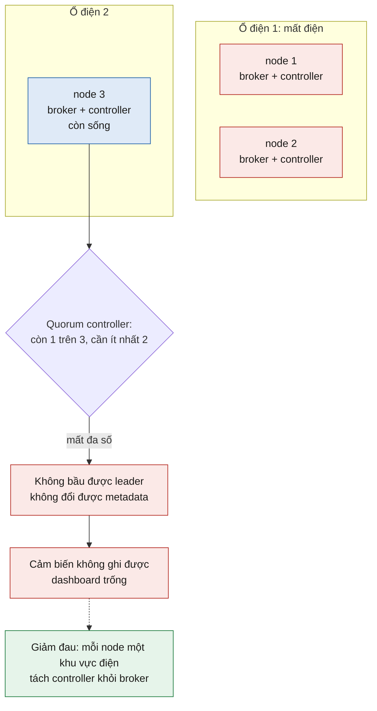
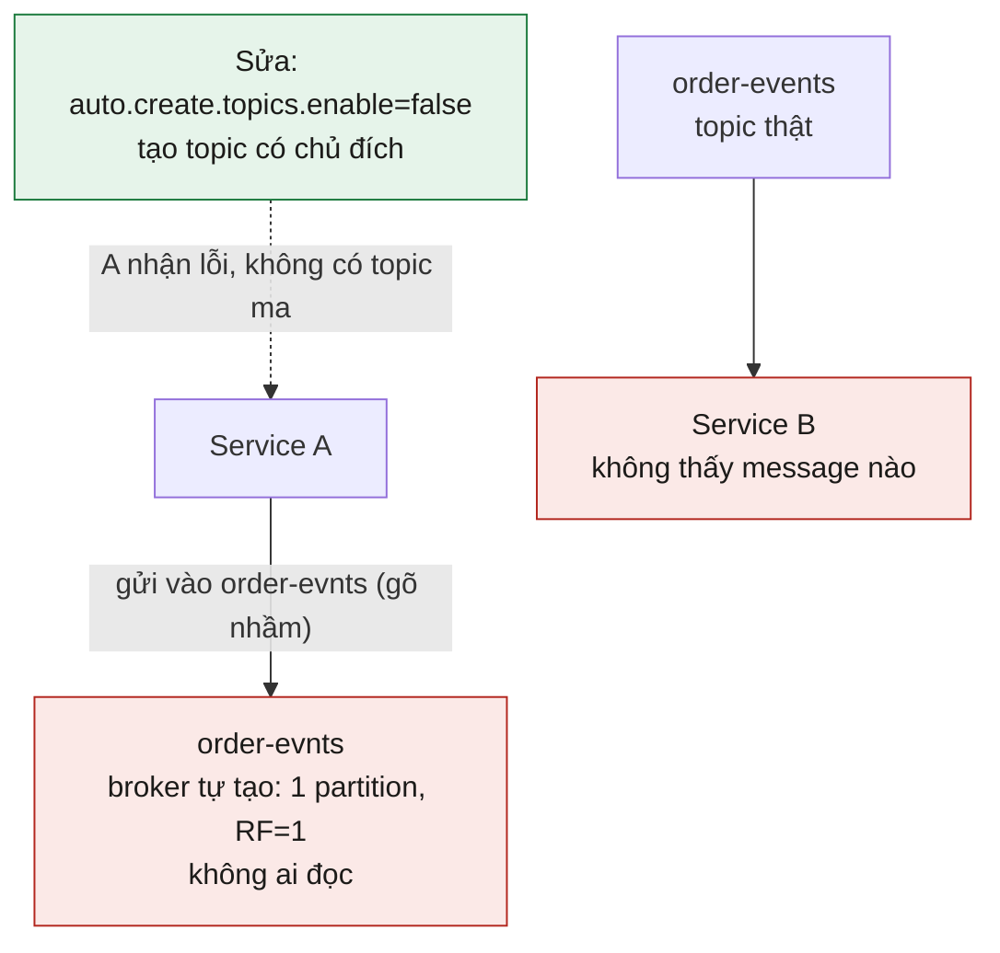

<!-- Tự sinh từ 0003-build-cluster.html bằng scripts/html2md.py. Đừng sửa tay. -->

[Kafka](../README.md) / [Bài 2](0002-key-partition-offset.md) / Bài 3 · [Bảng tra](../reference/0001-core-concepts.md)

# Bài 3: Dựng cụm 3 broker và nhìn tận mắt leader, ISR

Đọc về leader và replica thì dễ quên. Kill một broker và thấy leader đổi thì nhớ lâu.

> **Liên quan tới mission** Mục tiêu của bạn là "chém" được về Kafka sau onboarding. Câu như "broker chết thì chuyện gì xảy ra?" gần như chắc chắn xuất hiện trong buổi họp. Sau bài này bạn trả lời được bằng thứ bạn đã thấy tận mắt, không phải bằng sách.

**Thắng lợi của bài này:** bạn có cụm 3 broker chạy trên máy, tạo được topic có RF=3, đọc được `--describe`, và giải thích được vì sao kill 1 broker thì cụm vẫn chạy còn kill 2 thì không.

## 1. Kiến thức tối thiểu (có nguồn)

1. **Mỗi node có thể vừa là broker vừa là controller.** `process.roles` nhận `broker`, `controller` hoặc cả hai (combined mode). Combined mode đơn giản cho lab nhưng "is not recommended in critical deployment environments." [[KRaft overview]](https://kafka.apache.org/44/operations/kraft/)
2. **Controller giữ metadata của cụm theo kiểu đồng thuận (quorum), và quorum cần *đa số* controller còn sống.** Tài liệu: "3 controllers tolerate 1 failure and 5 tolerate 2"; muốn chịu được N controller hỏng thì cần 2N+1 controller. [[KRaft overview]](https://kafka.apache.org/44/operations/kraft/) Áp vào cụm lab (3 node, node nào cũng là controller):
   - Chết 1 node: còn 2/3, vẫn là đa số, cụm bầu được leader mới và chạy tiếp.
   - Chết 2 node: còn 1/3, không còn đa số. Node còn lại vẫn "sống" nhưng cụm không đổi được metadata, không bầu được leader: coi như không dùng được.
   - Hệ quả: số controller nên là số lẻ (3, 5). Thêm node thứ 4 không giúp chịu thêm lỗi (4 cần đa số 3, vẫn chỉ chịu được 1).
3. **Mỗi partition có một leader và các follower.** Producer chỉ ghi vào leader; follower chép lại từ leader. Một ghi được coi là committed khi mọi replica trong ISR đã nhận; chỉ thành viên của ISR mới được bầu làm leader. [[Design: replication]](https://kafka.apache.org/44/design/design/)
4. **ISR (in-sync replicas) co giãn theo thời gian, không tức thì.** ISR là tập replica đang bám kịp leader. Follower bị loại khỏi ISR khi tụt lại quá `replica.lag.time.max.ms` (mặc định 30000, tức 30 giây), chứ không bị loại ngay khi nó chết. Nên ngay sau khi kill một broker, `--describe` có thể vẫn hiện ISR đủ 3; khoảng 30 giây sau mới co còn 2. Khi broker sống lại và bám kịp, nó vào lại ISR. [[Broker configs]](https://kafka.apache.org/44/configuration/broker-configs/)
5. **Giá trị mặc định phía broker rất "mỏng":** `num.partitions=1`, `default.replication.factor=1`, `min.insync.replicas=1` và `auto.create.topics.enable=true`. Vì bạn là người tạo topic, bạn phải tự đặt những giá trị này. [[Broker configs]](https://kafka.apache.org/44/configuration/broker-configs/) [[Topic configs]](https://kafka.apache.org/44/configuration/topic-configs/)
6. **Vì sao lab đặt RF=3 và `min.insync.replicas=2`, không phải 3.** Khi producer dùng `acks=all`, broker từ chối ghi nếu ISR nhỏ hơn `min.insync.replicas`. [[Topic configs]](https://kafka.apache.org/44/configuration/topic-configs/) Với RF=3:
   - `min.insync.replicas=2`: mất 1 broker, ISR còn 2, vẫn ghi được, và mỗi ghi có ít nhất 2 bản sao.
   - `min.insync.replicas=3`: mất 1 broker là ISR còn 2 < 3, mọi ghi bị từ chối. Bền hơn không đáng kể mà mất sẵn sàng.
   - `min.insync.replicas=1`: luôn ghi được, nhưng một ghi có thể chỉ nằm ở một bản sao. Bài 4 đi sâu vào cái bẫy này.
7. **Bootstrap chỉ là cửa vào.** `bootstrap.servers` dùng cho kết nối đầu tiên: client hỏi một broker trong danh sách để biết toàn bộ cụm ("discover the full set of Kafka brokers"), nên danh sách không cần đủ mọi broker, nhưng nên có hơn một để vẫn vào được khi một broker chết. [[Producer configs]](https://kafka.apache.org/44/configuration/producer-configs/) Sau đó client nói chuyện thẳng với broker giữ leader của từng partition, theo địa chỉ mà broker đó **quảng bá** trong `advertised.listeners`; cấu hình này dùng khi địa chỉ broker lắng nghe không phải địa chỉ client nên dùng (ví dụ môi trường cloud). [[Broker configs]](https://kafka.apache.org/44/configuration/broker-configs/)
   - Ví dụ ngay trong lab: `kafka-1` quảng bá hai địa chỉ, `kafka-1:19092` cho các container trong mạng Docker và `localhost:29092` cho máy của bạn (xem `labs/03-cluster/docker-compose.yml`). Vì vậy lệnh CLI chạy *trong* container dùng `kafka-1:19092`, còn ứng dụng Spring chạy trên Windows dùng `localhost:29092,39092,49092`.
   - Hệ quả khi gỡ rối (suy ra): "kết nối được bootstrap nhưng gửi không được" thường là client không tới được địa chỉ được quảng bá. Ở nơi mới, chuỗi bootstrap do devops đưa: MSK là danh sách vài broker, Confluent Cloud là một endpoint.
8. **Sửa cấu hình của topic đã tạo, không cần xoá topic:** `kafka-configs.sh --entity-type topics --entity-name <topic> --alter --add-config <key>=<value>`; `--delete-config <key>` để quay về mặc định của broker; `--describe` để xem các giá trị đang ghi đè. [[Basic operations: modifying topics]](https://kafka.apache.org/44/operations/basic-kafka-operations/)

## 2. Thực hành (mỗi bước có kết quả mong đợi)

Ghi lại điều bạn *thật sự thấy*. Các "mong đợi" dưới đây suy ra từ tài liệu; nếu bạn thấy khác, đó là thông tin quý, hãy báo lại cho giáo viên.

### Bước 1. Chạy wizard dựng cụm

Mở Ubuntu (WSL), vào thư mục repo (đường dẫn dạng `/mnt/d/Workspace/study/kafka`) và chạy:

```
bash scripts/wizard-03-docker-kafka.sh
```

Wizard dẫn 6 stage: kiểm tra systemd, cài Docker Engine, chạy docker không cần sudo, chạy cụm, tạo topic và kiểm tra, kết nối từ Windows. Nó hỏi mật khẩu sudo và xác nhận ở từng bước.

**Máy đã có Docker** (máy bạn: Docker 29.9.3, Compose v5.7.0 trong `Ubuntu-24.04`, user đã ở nhóm `docker`): stage 2 thấy lệnh `docker` thì bỏ qua phần cài, chỉ chạy `hello-world` để kiểm tra; stage 3 chỉ bật lại dịch vụ và nhóm, chạy lại cũng không sao. Chạy wizard từ terminal Ubuntu, đứng ở thư mục repo (`cd /mnt/d/Workspace/study/kafka`). Cụm gồm 3 node, mỗi node dùng heap mặc định 1 GB (`KAFKA_HEAP_OPTS="-Xmx1G -Xms1G"` trong `/opt/kafka/bin/kafka-server-start.sh` của image `apache/kafka:4.4.0`, đã kiểm tra), nên WSL cần còn trống khoảng 3 GB.

Mong đợi: cuối cùng wizard báo "Setup complete" và liệt kê những việc còn lại phải làm tay (nếu có).

Nếu wizard yêu cầu `wsl.exe --shutdown` (bật systemd lần đầu), làm theo rồi chạy lại. Script mới được kiểm tra cú pháp, chưa chạy thật trên máy bạn: nếu nó lỗi ở đâu, dán lỗi cho giáo viên.

Tôi đã chạy xong wizard

### Bước 2. Đọc `--describe`

```
docker exec kafka-1 /opt/kafka/bin/kafka-topics.sh --bootstrap-server kafka-1:19092 --describe --topic lab-orders
```

Mong đợi: 3 dòng partition. Mỗi dòng có `Leader` là một trong 1,2,3; `Replicas` gồm 3 broker; `Isr` gồm 3 broker. Dòng đầu có `min.insync.replicas=2`.

Câu tự hỏi: leader của 3 partition có cùng một broker không? Vì sao điều đó (không) quan trọng?

Tôi đã đọc được Leader, Replicas, Isr

### Bước 3. Gửi và nhận message bằng Spring Boot

Ứng dụng thật ở nơi mới là Spring Kafka, nên từ đây mọi producer/consumer trong lab là ứng dụng Spring Boot. Lab `labs/03-spring-clients` có một producer và một consumer, bật bằng profile. Build một lần:

```
cd labs/03-spring-clients
mvn -q -DskipTests package          # Maven chạy bằng JDK 17+ (đặt JAVA_HOME như README của lab)
J="java -jar target/spring-clients-0.0.1-SNAPSHOT.jar"
```

Terminal A chạy consumer, terminal B chạy producer:

```
# A: consumer, group g1, in mỗi record nhận được và mỗi lần group chia lại partition
$J --spring.profiles.active=consumer --lab.instance=c1
# B: producer gửi 9 message xoay vòng 3 key, in partition và offset broker trả về
$J --spring.profiles.active=producer --lab.count=9
```

Ba đoạn code và cấu hình cần đọc:

```
// labs/03-spring-clients/.../ProducerRunner.java (rút gọn)
CompletableFuture<SendResult<String, String>> future = template.send(topic, key, value);
future.whenComplete((result, ex) -> {
    if (ex == null) {
        var md = result.getRecordMetadata();   // broker trả về partition và offset thật
        System.out.printf("key=%s -> partition=%d offset=%d%n", key, md.partition(), md.offset());
    } else {
        System.out.printf("GỬI LỖI key=%s: %s%n", key, ex);
    }
});
```

```
// labs/03-spring-clients/.../ConsumerListener.java (rút gọn)
@KafkaListener(topics = "${lab.topic}", groupId = "${lab.group:g1}")
void onMessage(ConsumerRecord<String, String> rec) {
    System.out.printf("[%s] partition=%d offset=%d key=%s%n",
            instance, rec.partition(), rec.offset(), rec.key());
}
```

```
# labs/03-spring-clients/src/main/resources/application.yml (phần Kafka)
spring:
  kafka:
    bootstrap-servers: localhost:29092,localhost:39092,localhost:49092
    producer:
      acks: all
      properties:
        "[enable.idempotence]": true
    consumer:
      auto-offset-reset: earliest   # group mới đọc từ đầu (mặc định Kafka: latest)
    listener:
      ack-mode: batch               # mặc định của Spring: commit sau khi xử lý xong lô poll
```

Mong đợi (code đã biên dịch và khởi động được, chưa chạy với cụm): B in 9 dòng `key=... -> partition=... offset=...`; cùng key luôn cùng partition, offset tăng dần trong từng partition (Bài 2). A in đúng các record đó. Dừng A (Ctrl-C), chạy lại với `--lab.group=g2`: group mới đọc lại từ đầu vì message không bị xoá khi đã đọc (Bài 1) và `auto-offset-reset: earliest`.

Tôi đã thấy message đi qua cụm

### Bước 3b. Sửa cấu hình topic đã có

Giả sử ai đó đã tạo topic với `min.insync.replicas=1`. Bạn sửa mà không xoá topic (chạy trong Ubuntu):

```
K="docker exec kafka-1 /opt/kafka/bin"
$K/kafka-topics.sh --bootstrap-server kafka-1:19092 --create --topic lab-weak --partitions 3 --replication-factor 3 --config min.insync.replicas=1
$K/kafka-configs.sh --bootstrap-server kafka-1:19092 --entity-type topics --entity-name lab-weak --describe
$K/kafka-configs.sh --bootstrap-server kafka-1:19092 --entity-type topics --entity-name lab-weak --alter --add-config min.insync.replicas=2
$K/kafka-configs.sh --bootstrap-server kafka-1:19092 --entity-type topics --entity-name lab-weak --describe
$K/kafka-configs.sh --bootstrap-server kafka-1:19092 --entity-type topics --entity-name lab-weak --alter --delete-config min.insync.replicas
```

Mong đợi (theo docs, chưa chạy thử trên cụm này): lần `--describe` đầu thấy `min.insync.replicas=1`; sau `--alter` thấy `2`; sau `--delete-config` giá trị ghi đè biến mất và topic dùng mặc định của broker. Đây cũng là cách đặt `unclean.leader.election.enable=false` cho từng topic (Bài 4).

Tôi đã sửa rồi trả lại config của topic

### Bước 4. Kill một broker, xem leader và ISR đổi

```
docker kill kafka-3
# chạy ngay, rồi chạy lại sau ~40 giây
docker exec kafka-1 /opt/kafka/bin/kafka-topics.sh --bootstrap-server kafka-1:19092 --describe --topic lab-orders
```

Mong đợi: partition từng do broker 3 làm leader chuyển sang broker khác. Lần chạy đầu `Isr` có thể vẫn còn 3; sau khoảng 30 giây (`replica.lag.time.max.ms` mặc định 30000) broker 3 bị loại khỏi `Isr`. Producer ở terminal B vẫn gửi được. [[Broker configs]](https://kafka.apache.org/44/configuration/broker-configs/)

Tôi đã thấy leader đổi và ISR co lại

### Bước 5. Bật lại broker

```
docker start kafka-3
# chờ vài chục giây rồi describe lại
```

Mong đợi: `Isr` trở lại 3 broker. Leader có thể quay về broker ưu tiên (`auto.leader.rebalance.enable` mặc định bật, theo broker configs); ghi lại bạn có thấy không.

Tôi đã thấy ISR phục hồi

### Bước 6. Kill hai broker: cụm "sống" mà không dùng được

```
docker kill kafka-2 kafka-3
docker exec kafka-1 /opt/kafka/bin/kafka-topics.sh --bootstrap-server kafka-1:19092 --describe --topic lab-orders
# xong thì bật lại
docker start kafka-2 kafka-3
```

Mong đợi (suy ra từ tài liệu KRaft, chưa kiểm chứng): vì cả 3 node đều là controller, mất 2 node là mất đa số quorum, nên lệnh quản trị treo hoặc lỗi và cụm không bầu được leader mới. Ghi lại chính xác bạn thấy gì.

Tôi đã thử kill hai broker và ghi lại kết quả

## 3. Usecase oái oăm

### (a) Kho lạnh mất điện cả giá đỡ (IoT)

Hệ thống cảm biến kho lạnh chạy 3 node Kafka combined. Hai node cắm chung một ổ điện và cùng tắt. Còn đúng một node "sống", nhưng dashboard trống và không cảm biến nào ghi được. Lý do: mất đa số controller thì cụm không đổi được metadata, không bầu được leader. Sống một node không có nghĩa là cụm còn dùng được. Cách giảm đau (khái niệm): đặt các node ở các khu vực mất điện khác nhau, và tách controller khỏi broker ở môi trường quan trọng (tài liệu khuyến nghị tránh combined mode).



*Kiến trúc: còn một node sống nhưng quorum controller mất đa số, nên cụm không dùng được.*

### (b) Topic "ma" do gõ sai tên (microservices dùng chung cụm)

Service A gửi vào `order-evnts` (gõ nhầm), service B đọc `order-events`. Không ai báo lỗi vì broker tự tạo `order-evnts` với 1 partition và RF=1 (giá trị mặc định ở mục 1). Message không mất, nhưng không ai đọc, và topic đó không chịu nổi việc broker chết. Cách xử lý: tắt `auto.create.topics.enable` và tạo topic có chủ đích (lab của bạn đã làm đúng việc này; Stage 5 của wizard có kiểm tra).



*Flow: gõ sai tên topic thì broker tự tạo topic "ma"; tắt auto-create để lỗi lộ ra ở bên gửi.*

### Hỏi nhanh, đáp gọn

- **Vì sao min.insync.replicas=2 mà không phải 3?** Đặt 2 thì mất một broker vẫn ghi được an toàn; đặt 3 thì mất một broker là ngừng ghi (thấy ở Bài 4).
- **Production có chạy combined mode không?** Tài liệu không khuyến nghị; ở nơi làm mới cụm do dịch vụ managed và devops lo, mình chỉ cần biết hệ quả.

## 4. Tự nói thành lời

Không nhìn tài liệu, giải thích trong 30 giây: *"Cụm 3 node, một node chết thì ... vì ...; hai node chết thì ... vì ..."* Dùng đúng các từ: leader, follower, ISR, controller, quorum.

**Ôn nhanh:** [tóm tắt Bài 3](../summaries/0003-build-cluster.md) (đọc sau khi đã tự nói).

## 5. Kiểm tra

<!-- quiz:quiz -->

**1. Cụm lab có 3 node, mỗi node vừa là broker vừa là controller. Cụm chịu mất tối đa mấy node mà vẫn bầu được leader mới?**

- **A.** Một node, vì cần đa số controller sống
- **B.** Hai node, vì chỉ cần một controller sống
- **C.** Không node nào, mọi bản sao phải sống
- **D.** Ba node, vì dữ liệu đã sao lưu

<details><summary>Đáp án</summary>

**A. Một node, vì cần đa số controller sống**

Quorum cần đa số controller còn sống: 3 controller chịu được 1 lỗi (chịu N lỗi cần 2N+1 controller).

</details>

**2. Cụm đang có 3 controller. Bạn thêm controller thứ 4. Cụm giờ chịu mất tối đa mấy controller mà vẫn hoạt động?**

- **A.** Hai controller, vì đã có thêm một node
- **B.** Một controller, vì đa số của bốn là ba
- **C.** Ba controller, chỉ cần một node còn sống
- **D.** Không controller nào, phải đủ cả bốn

<details><summary>Đáp án</summary>

**B. Một controller, vì đa số của bốn là ba**

Quorum cần đa số: 4 controller cần 3 còn sống, nên vẫn chỉ chịu được 1 lỗi như cụm 3. Muốn chịu 2 lỗi cần 5 controller (2N+1). Vì vậy số controller nên là số lẻ.

</details>

**3. Một follower bị kill. Khi nào broker loại nó khỏi ISR?**

- **A.** Ngay lập tức khi container dừng chạy
- **B.** Sau khi producer gửi thêm một message
- **C.** Sau khi nó tụt lại quá replica.lag.time.max.ms
- **D.** Khi controller khởi động lại toàn cụm

<details><summary>Đáp án</summary>

**C. Sau khi nó tụt lại quá replica.lag.time.max.ms**

Follower bị loại khỏi ISR khi tụt lại quá replica.lag.time.max.ms (mặc định 30000, tức 30 giây), không phải ngay lập tức.

</details>

**4. Producer gõ nhầm tên topic order-evnts; broker để auto.create.topics.enable mặc định. Chuyện gì xảy ra?**

- **A.** Producer báo lỗi vì topic không tồn tại
- **B.** Broker tự sửa lại tên về order-events đúng
- **C.** Message được chuyển thẳng vào topic dead letter
- **D.** Broker tạo topic mới với 1 partition, RF=1

<details><summary>Đáp án</summary>

**D. Broker tạo topic mới với 1 partition, RF=1**

Tự tạo topic bật sẵn; topic mới lấy num.partitions=1 và default.replication.factor=1 mặc định, nên lỗi gõ tên không ai thấy.

</details>

**5. Vì sao topic lab-orders (RF=3) đặt min.insync.replicas=2 chứ không đặt 3?**

- **A.** Vì Kafka không cho đặt giá trị bằng ba
- **B.** Để mất một broker vẫn ghi được an toàn
- **C.** Để mỗi message được ghi nhanh gần gấp đôi
- **D.** Vì controller cần đúng hai bản sao dữ liệu

<details><summary>Đáp án</summary>

**B. Để mất một broker vẫn ghi được an toàn**

Với acks=all, ghi bị từ chối khi ISR nhỏ hơn giá trị này. Đặt 2 cho phép mất 1 broker mà vẫn ghi được; đặt 3 thì mất 1 broker là ngừng ghi.

</details>

**6. Ứng dụng trên Windows đặt bootstrap.servers=localhost:29092 (chỉ một broker). Điều nào đúng?**

- **A.** Ứng dụng chỉ ghi được vào broker kafka-1
- **B.** Ứng dụng tìm ra cả cụm qua broker đó
- **C.** Ứng dụng phải liệt kê đủ ba broker
- **D.** Ứng dụng gửi mọi message qua kafka-1

<details><summary>Đáp án</summary>

**B. Ứng dụng tìm ra cả cụm qua broker đó**

Bootstrap chỉ dùng để khám phá cụm; sau đó client nói chuyện thẳng với leader của từng partition theo advertised.listeners. Vẫn nên ghi hơn một broker để còn vào được khi kafka-1 chết.

</details>

<!-- /quiz -->

## Nguồn nên đọc

> **Chính:** [KRaft overview](https://kafka.apache.org/44/operations/kraft/) (khoảng 10 phút), và mục "Replication" trong [Design](https://kafka.apache.org/44/design/design/).
>
> **Bổ trợ:** [Confluent Developer: Kafka 101](https://developer.confluent.io/courses/apache-kafka/events/), module Brokers và Replication.
>
> **Mã nguồn bài này:** `labs/03-cluster/docker-compose.yml` (dựa trên [ví dụ chính thức](https://github.com/apache/kafka/tree/trunk/docker/examples)) và `scripts/wizard-03-docker-kafka.sh`.

**Bài tiếp theo:** [Bài 4, producer và độ bền](0004-producer-durability.md): mô phỏng để tự làm mất message, rồi chạy `labs/04-producer-durability` (Spring Kafka) trên cụm này.

> **Còn chỗ nào mơ hồ?** Hỏi thẳng giáo viên (agent), ví dụ "ISR khác replica ở chỗ nào?", "vì sao combined mode không khuyến nghị?". Nếu wizard lỗi, dán nguyên thông báo lỗi. Dán dòng kết quả quiz để bài sau điều chỉnh đúng mức.
