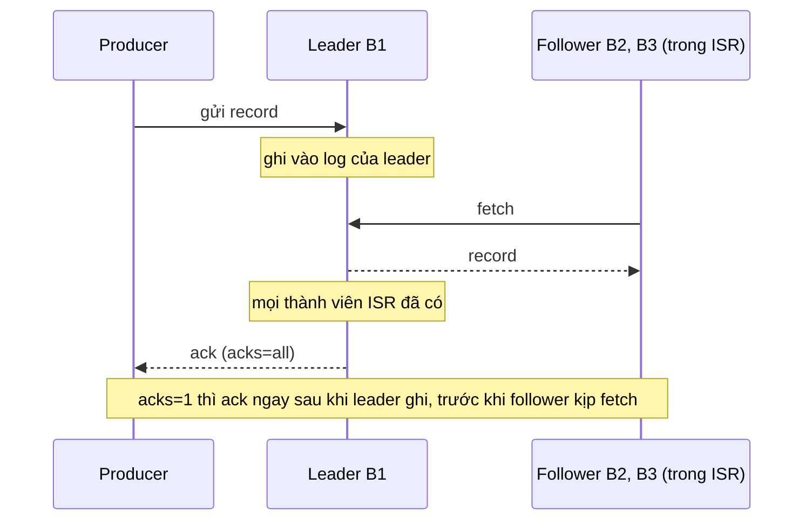
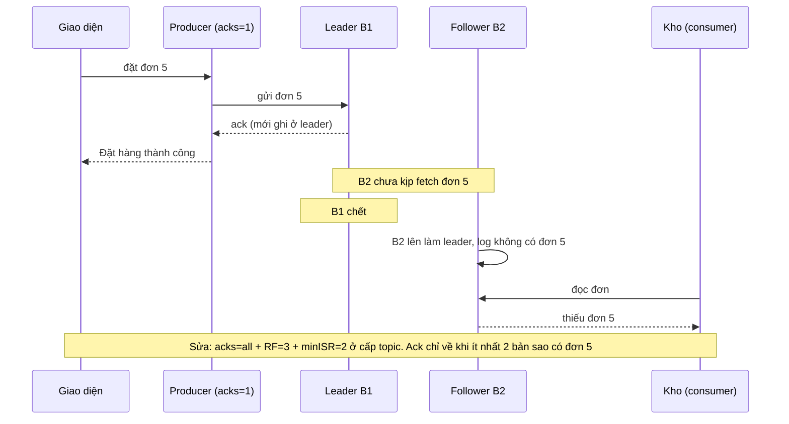
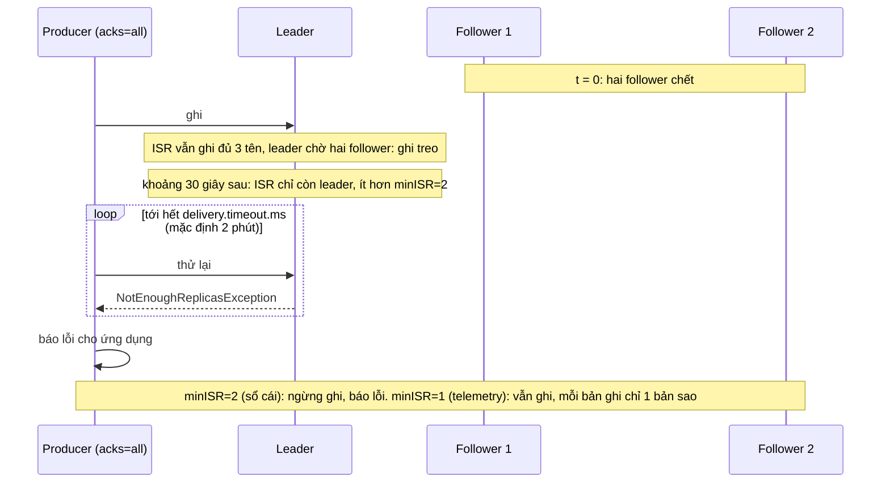
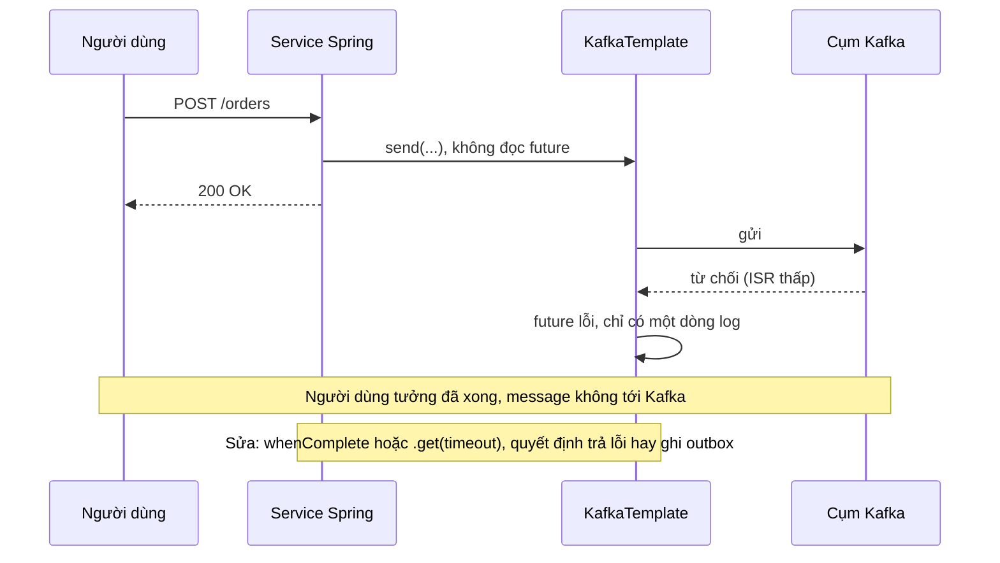
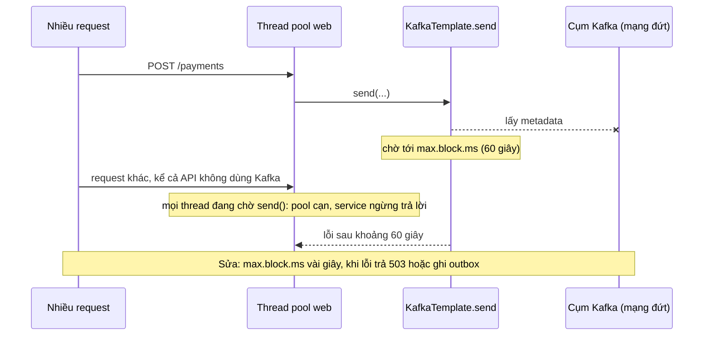
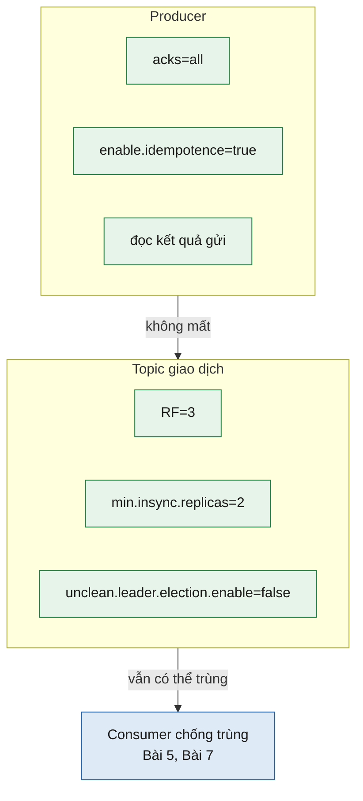

<!-- Tự sinh từ 0004-producer-durability.html bằng scripts/html2md.py. Đừng sửa tay. -->

[Kafka](../README.md) / [Bài 3](0003-build-cluster.md) / Bài 4 · [Bảng tra](../reference/0001-core-concepts.md) · [Sổ tay tình huống](../reference/0003-tricky-scenarios.md)

# Bài 4: Producer và độ bền

"Đã báo thành công" không có nghĩa là "không mất". Bài này tách yêu cầu *không mất message* ở phía ghi thành bốn núm vặn: `acks`, `min.insync.replicas`, retry/timeout, idempotence.

> **Liên quan tới mission** Câu hỏi bạn sẽ nghe nhiều nhất trong buổi họp thiết kế: "topic này cấu hình thế nào để không mất?". Sau bài này bạn trả lời được bằng bốn giá trị cụ thể, nói được từng giá trị đổi lấy gì, và biết chỗ nào Spring Kafka có thể làm bạn mất message mà không báo lỗi.

**Thắng lợi của bài này:** với một cấu hình producer + topic bất kỳ, bạn dự đoán đúng "kill leader lúc này thì message nào mất" (bằng mô phỏng ở mục 2), và có sẵn lab chạy trên cụm 3 broker để kiểm chứng (mục 4).

## 1. Bốn núm vặn của "không mất"

Producer nhận ack chưa chắc dữ liệu đã an toàn. Ở phía ghi, "không mất" là bốn núm vặn, mỗi núm trả lời một câu hỏi: ack khi nào, tối thiểu mấy bản sao, lỗi thì làm gì, gửi lại có trùng không.



*Sequence: với acks=all, leader chỉ ack khi mọi replica trong ISR đã có record.*

### 1.1. `acks`: ack khi nào?

- **`acks=1`**: leader ack ngay khi ghi vào log của nó. Leader chết trước khi follower fetch là mất message đã báo thành công.
- **`acks=all`**: leader chỉ ack khi mọi replica trong **ISR** (các bản sao đang bám kịp leader) đã nhận. Message như vậy là "committed" và không mất "as long as there is at least one in sync replica alive". [[Design: replication]](https://kafka.apache.org/44/design/design/)
- **Bẫy:** "all" là mọi thành viên ISR *hiện tại*, không phải cả 3 replica. ISR co lại còn {B1} thì `acks=all` ack khi mới có 1 bản sao.
- Client 4.x mặc định `acks=all`. [[Producer configs]](https://kafka.apache.org/44/configuration/producer-configs/)

### 1.2. `min.insync.replicas`: tối thiểu mấy bản sao?

- **Là cái sàn cho `acks=all`:** ISR nhỏ hơn giá trị này thì broker *từ chối ghi* bằng `NotEnoughReplicasException`, thay vì ghi vào một bản rồi báo thành công. [[Javadoc]](https://kafka.apache.org/44/javadoc/org/apache/kafka/common/errors/NotEnoughReplicasException.html)
- **Đặt ở topic**, thường RF=3 và `min.insync.replicas=2`. Mặc định của broker là 1 (RF mặc định cũng là 1), nên phải ghi rõ trong tài liệu thiết kế topic (Bài 8) và kiểm lại sau khi topic được tạo. [[Topic configs]](https://kafka.apache.org/44/configuration/topic-configs/) [[Broker configs]](https://kafka.apache.org/44/configuration/broker-configs/)
- **Đánh đổi sẵn sàng lấy bền:** minISR=2 thì mất 2 trên 3 broker là ngừng nhận ghi; minISR=1 thì vẫn ghi, nhưng mỗi message chỉ còn 1 bản sao.
- **Khi mọi replica trong ISR đều chết:** `unclean.leader.election.enable=false` (mặc định Apache) thì chờ, partition offline; `true` thì bầu replica tụt hậu lên leader, message nó thiếu mất vĩnh viễn. MSK Standard mặc định `true`. Chi tiết ở mục 3. [[Design: unclean leader election]](https://kafka.apache.org/44/design/design/)

### 1.3. Retry và timeout: lỗi thì làm gì?

- **Lỗi tạm thời** (như `NotEnoughReplicasException`) thì producer tự thử lại tới hết `delivery.timeout.ms` (mặc định 120000, tức 2 phút), rồi mới báo lỗi cho ứng dụng. [[Producer configs]](https://kafka.apache.org/44/configuration/producer-configs/)
- **`send()` có thể chặn thread** tới `max.block.ms` (60 giây) khi chờ metadata hoặc khi bộ đệm đầy. Gọi trên thread HTTP thì cụm sự cố là API treo.
- **Spring:** `KafkaTemplate.send` trả `CompletableFuture`. Không đọc future thì lỗi chỉ nằm trong log, ứng dụng vẫn báo thành công. [[Sending messages]](https://docs.spring.io/spring-kafka/reference/kafka/sending-messages.html)

### 1.4. Idempotence: gửi lại có trùng không?

- **Retry có thể tạo bản trùng** khi lần gửi trước thật ra đã được ghi: ack bị mất trên đường về, hoặc leader đã ghi rồi ISR mới co lại nên trả `NotEnoughReplicasAfterAppendException` ("Producer retries will cause duplicates"). [[Javadoc]](https://kafka.apache.org/44/javadoc/org/apache/kafka/common/errors/NotEnoughReplicasAfterAppendException.html)
- **Idempotence chặn loại trùng này** trong một session của producer: broker nhận ra số thứ tự (sequence number) cũ và không ghi lại. Mặc định bật. [[Design: idempotent producer]](https://kafka.apache.org/44/design/design/)
- **Cần `acks=all`, `retries` > 0, `max.in.flight.requests.per.connection` ≤ 5.** Ghi tường minh `enable.idempotence=true` cùng `acks=1` thì `ConfigException` lúc tạo producer; không ghi thì idempotence âm thầm tắt. [[Producer configs]](https://kafka.apache.org/44/configuration/producer-configs/)
- **Không chặn trùng do ứng dụng gửi lại** sau khi restart: cơ chế ở [Bài 4b](0010-idempotent-producer.md), cách chống ở consumer ở Bài 7.

### Bảy giá trị cần nhớ

| Cấu hình | Phía | Mặc định | Dữ liệu không được mất | Núm |
|---|---|---|---|---|
| `acks` | producer | `all` | `all` | 1.1 |
| `replication.factor` | topic | 1 (`default.replication.factor`) | 3 | 1.2 |
| `min.insync.replicas` | topic | 1 | 2 | 1.2 |
| `unclean.leader.election.enable` | topic | `false` (MSK Standard: `true`) | `false` | 1.2 |
| `delivery.timeout.ms` | producer | 120000 | giữ mặc định | 1.3 |
| `max.block.ms` | producer | 60000 | vài giây nếu gọi từ API | 1.3 |
| `enable.idempotence` | producer | `true` | `true`, ghi tường minh | 1.4 |

[[Producer configs]](https://kafka.apache.org/44/configuration/producer-configs/) [[Topic configs]](https://kafka.apache.org/44/configuration/topic-configs/) [[Broker configs]](https://kafka.apache.org/44/configuration/broker-configs/)

## 2. Mô phỏng: tự làm mất message

Mô phỏng này theo đúng mô hình ở mục 1 (không phải broker thật). Đọc hình thế này:

- **B1, B2, B3 là ba broker.** Mô phỏng chỉ vẽ *một* partition có RF=3, nên mỗi cột là bản sao (replica) của partition đó trên một broker. Ban đầu B1 giữ bản leader, B2 và B3 giữ bản follower.
- **Trong Kafka thật, follower tự đồng bộ:** nó liên tục gửi yêu cầu fetch tới leader, giống một consumer, rồi ghi vào log của mình; không ai phải ra lệnh. [[Design: replication]](https://kafka.apache.org/44/design/design/)
- **Nút "Follower fetch từ leader"** gom việc tự động đó thành một bước để bạn dừng thời gian ở khoảnh khắc "leader đã ghi, follower chưa kịp fetch". Ngoài đời khoảnh khắc đó rất ngắn nhưng không bằng 0; leader chết đúng lúc đó là chuyện mà `acks` và `min.insync.replicas` quyết định có mất hay không. Không bấm nút nghĩa là "leader chết trước khi follower kịp fetch".
- **Nút "Chờ 30 giây"** là cho thời gian trôi qua `replica.lag.time.max.ms`: broker chết bị loại khỏi ISR.
- **Hình động phía trên bảng** phát lại từng bước vừa xảy ra. Viên xám là message đi tới leader. Viên xanh dương là follower fetch. Viên xanh lá là ack quay về producer, viên đỏ là bị từ chối. Đường liền là đường đang dùng, broker viền xanh đậm là leader, broker tô đỏ là đã chết. Đổi tốc độ nếu muốn xem kỹ. Nếu không thấy gì chuyển động, có thể hệ điều hành đang tắt hiệu ứng: tick ô "Hiệu ứng chuyển động".

Thử lần lượt:

### Thử 1. `acks=1` mất sau khi đã báo thành công

Chọn `acks=1`. Bấm "Gửi message" 3 lần, *không* bấm "Follower fetch từ leader", rồi "Kill B1" (leader). Đọc dòng tổng: bao nhiêu message "ACK NHƯNG MẤT"? Bấm "Start B1": B1 quay lại có lấy được chúng không?

Mong đợi: cả 3 message đã ack nhưng mất, vì leader mới (B2) chưa kịp fetch chúng, và B1 sống lại phải cắt log theo leader mới.

### Thử 2. `acks=all`, minISR=2: cùng cú kill

Làm lại với `acks=all`. Gửi 3 message (chúng ở trạng thái "chờ ack"), kill B1 trước khi follower fetch. Message nào mất? Message nào đã được ack?

Mong đợi: không có message nào "ACK NHƯNG MẤT". Ba message chưa từng được ack nên producer thử lại; không có gì đã hứa mà bị phá.

### Thử 3. Cái bẫy "acks=all mà vẫn yếu" (minISR=1)

Đặt `acks=all`, `min.insync.replicas=1`. Kill B2 và B3, bấm "Chờ 30 giây" (ISR co còn {1}). Gửi 2 message: chúng được ack ngay. Kill B1, rồi Start B2. Partition ở trạng thái nào? Bây giờ bật ô `unclean.leader.election.enable` và làm lại từ đầu.

Mong đợi: unclean=false thì partition **offline** (không mất dữ liệu, mất sẵn sàng); unclean=true thì B2 lên làm leader và 2 message đã ack mất. Đây là lý do hỏi platform team giá trị `unclean.leader.election.enable` (xem [bảng managed](../reference/0004-managed-kafka-msk-vs-confluent.md): MSK Standard mặc định true).

### Thử 4. Đánh đổi sẵn sàng lấy bền (minISR=3) và trùng sau append

`acks=all`, minISR=3. Kill B3 rồi gửi ngay: lúc ISR còn {1,2,3} ghi được nhưng chờ ack. Bấm "Chờ 30 giây". Quan sát thông báo, rồi gửi thêm một message.

Mong đợi: sau khi ISR co còn 2 < 3, message chờ ack chuyển thành `NotEnoughReplicasAfterAppend` (retry sẽ trùng), và message mới bị từ chối. Một broker chết là ngừng ghi: vì thế AWS khuyến nghị minISR ≤ RF-1.

## 3. Đi sâu: chi tiết và ví dụ cho bốn núm vặn

Đọc sau khi đã chạy mô phỏng. Mỗi khối dưới đây mở rộng một ý ở mục 1.

### Sẵn sàng và bền; unclean leader election

- **Sẵn sàng (availability) và bền (durability) kéo về hai phía.** *Sẵn sàng* = lúc này còn ghi được không. *Bền* = message đã báo thành công có còn sau sự cố không. Khi thiếu replica, Kafka phải chọn một:
   - minISR=2 với RF=3: còn 1 broker thì **ngừng nhận ghi** (mất sẵn sàng), đổi lại không có message nào được ack khi chỉ có 1 bản sao (giữ bền).
   - minISR=1: còn 1 broker vẫn **nhận ghi** (giữ sẵn sàng), đổi lại các message đó chỉ có 1 bản sao; broker đó hỏng ổ đĩa là mất (mất bền).
- **`unclean.leader.election.enable`: khi mọi replica trong ISR đều chết, có cho replica "tụt hậu" làm leader không?** Replica ngoài ISR là replica đã bị loại vì không bám kịp, nên có thể thiếu các message mới nhất, kể cả message đã ack. Docs mô tả hai lựa chọn: chờ một replica trong ISR sống lại, hoặc chọn replica đầu tiên sống lại dù không thuộc ISR. [[Design: Unclean leader election]](https://kafka.apache.org/44/design/design/)
   - `false` (mặc định Apache): **chờ**. Partition offline (không đọc, không ghi) cho tới khi một replica trong ISR quay lại. Không mất dữ liệu; mất sẵn sàng.
   - `true`: **không chờ**. Replica tụt hậu lên làm leader ngay, partition chạy lại, nhưng các message nó thiếu **mất vĩnh viễn**; khi replica cũ quay lại, nó phải cắt log theo leader mới. Giữ sẵn sàng; mất bền.
   - Ví dụ: B1 là leader, ISR = {B1}. B2 bị loại khỏi ISR từ trước nên thiếu message #4, #5 (đã ack). B1 chết. `false`: chờ B1. `true`: B2 lên leader, #4 và #5 mất. Thử 3 ở mục 2 diễn đúng kịch bản này.
   - Bẫy thực tế: trên MSK Standard giá trị mặc định là `true` (xem [bảng managed](../reference/0004-managed-kafka-msk-vs-confluent.md)). Với dữ liệu không được mất, đặt `false` ở topic. [[Topic configs]](https://kafka.apache.org/44/configuration/topic-configs/)

### Trùng sau append; điều kiện của idempotence

- **Biến thể gây trùng: `NotEnoughReplicasAfterAppendException`.** Khác lỗi ở ý trên ở *thời điểm* phát hiện. [[Javadoc]](https://kafka.apache.org/44/javadoc/org/apache/kafka/common/errors/NotEnoughReplicasAfterAppendException.html)
   - `NotEnoughReplicasException`: broker kiểm tra ISR *trước* khi ghi, thấy thiếu nên không ghi. Producer thử lại: an toàn, không trùng.
   - `NotEnoughReplicasAfterAppendException`: lúc nhận, ISR còn đủ, nên leader đã *ghi (append) bản ghi vào log*; trong lúc chờ follower, ISR co lại dưới `min.insync.replicas`, nên leader trả lỗi. Bản ghi **đã nằm trong log** nhưng producer nhận về lỗi.
   - Producer thử lại thì leader ghi thêm một bản nữa: **trùng**. Javadoc ghi đúng ý này: "Producer retries will cause duplicates".
   - Idempotence chặn được loại trùng này *trong cùng một session*: lần gửi lại mang cùng số thứ tự (sequence number), broker nhận ra đã có và không ghi thêm. [[Design: idempotent producer]](https://kafka.apache.org/44/design/design/) Đó là một lý do nữa để không tắt idempotence. Thử 4 ở mục 2 diễn đúng kịch bản này.
- **Idempotence đòi ba điều kiện: `acks=all`, `retries` > 0, `max.in.flight.requests.per.connection` ≤ 5.** Nếu cấu hình vi phạm một điều kiện, kết quả phụ thuộc bạn có *tự đặt* `enable.idempotence` hay không: [[Producer configs]](https://kafka.apache.org/44/configuration/producer-configs/)
   - Bạn **tự ghi** `enable.idempotence=true` cùng `acks=1`: client hiểu là bạn đòi hai thứ mâu thuẫn, nên **ném `ConfigException`** ngay khi tạo producer.
   - Bạn **không ghi** gì về idempotence (dùng mặc định) mà đặt `acks=1`: client **âm thầm tắt idempotence** và chạy tiếp, không báo gì.
   - Hệ quả: hạ `acks` là tắt luôn idempotence. Lab 04 profile `risky` ghi tường minh cả `acks=1` và `enable.idempotence=false` để rõ ý.

### Timeout và `send()` bị chặn

- **Quan hệ timeout:** `delivery.timeout.ms` phải ≥ `request.timeout.ms + linger.ms`. Docs khuyên dùng `delivery.timeout.ms` để giới hạn thời gian thử lại thay vì chỉnh `retries`. [[Producer configs]](https://kafka.apache.org/44/configuration/producer-configs/)
- **`send()` có thể chặn thread gọi nó.** Bình thường `send()` trả ngay, nhưng nó phải chờ metadata của topic và chờ chỗ trống trong bộ đệm (`buffer.memory`, mặc định 33554432 byte, khoảng 32 MB). Thời gian chờ tối đa là `max.block.ms`, mặc định 60000 (60 giây); quá hạn thì ném lỗi. [[Producer configs]](https://kafka.apache.org/44/configuration/producer-configs/)

### Spring Kafka và mặc định đầy đủ của producer 4.x

- **Spring Kafka:** `KafkaTemplate.send` trả `CompletableFuture`; nếu bạn bỏ qua future, lỗi chỉ nằm trong log (mặc định `LoggingProducerListener`). `TopicBuilder` *không có* `minInsyncReplicas()`, dùng `.config("min.insync.replicas","2")`. Topic đã tồn tại thì config không bị sửa trừ khi `spring.kafka.admin.modify-topic-configs=true`. [[Sending messages]](https://docs.spring.io/spring-kafka/reference/kafka/sending-messages.html) [[research/0002, mục 2.1 và 2.6]](../research/0002-spring-kafka.md)
- **Client 4.x đã mặc định an toàn.** `acks=all`, `enable.idempotence=true`, `retries=2147483647`, `delivery.timeout.ms=120000`, `request.timeout.ms=30000`, `linger.ms=5` (đổi từ 0 ở 4.0), `max.in.flight.requests.per.connection=5`. Muốn thấy mất message, bạn phải *tự hạ* cấu hình. [[Producer configs]](https://kafka.apache.org/44/configuration/producer-configs/) [[Upgrade notes]](https://kafka.apache.org/44/getting-started/upgrade/)

## 4. Lab thật trên cụm 3 broker

Mô phỏng cho bạn trực giác; cụm thật cho bạn bằng chứng. Mã ở `labs/04-producer-durability` (Spring Boot 4.1.2 + Spring Kafka 4.1.2); README có lệnh đầy đủ. Ba topic cùng RF=3 chỉ khác `min.insync.replicas` (1, 2, 3); profile `risky` hạ `acks=1` và tắt idempotence; `safe` dùng `acks=all`; `verify` đọc lại toàn bộ topic và đối chiếu với danh sách seq đã được ack, nên "mất" là con số đo được, không phải cảm giác.

Code và cấu hình chính (đọc trước khi chạy):

```
# labs/04-producer-durability/.../application-risky.yml  ("dễ mất")
spring:
  kafka:
    producer:
      acks: "1"
      properties:
        "[enable.idempotence]": false

# labs/04-producer-durability/.../application-safe.yml  (hướng "không mất")
spring:
  kafka:
    producer:
      acks: all
      properties:
        "[enable.idempotence]": true
        "[request.timeout.ms]": 10000
        "[delivery.timeout.ms]": 20000   # >= request.timeout.ms + linger.ms; rút ngắn để thấy lỗi nhanh
```

```
// labs/04-producer-durability/.../TopicsConfig.java (rút gọn): trên cụm lab, ứng dụng tự tạo topic
@Bean NewTopic safe() {
    return TopicBuilder.name("lab-orders-safe").partitions(3).replicas(3)
            .config("min.insync.replicas", "2")   // TopicBuilder không có minInsyncReplicas()
            .build();
}
```

```
// labs/04-producer-durability/.../SenderRunner.java (rút gọn): đọc kết quả gửi, không fire-and-forget
template.send(topic, key, Integer.toString(seq)).whenComplete((result, ex) -> {
    if (ex == null) acked.add(seq);          // broker đã ack: đối chiếu với topic ở profile verify
    else record(failed, failuresByType, ex); // đếm lỗi theo loại (NotEnoughReplicasException...)
});
```

**Trạng thái trung thực:** lab 04 đã biên dịch và đã chạy thử nạp cấu hình, nhưng **chưa được chạy với cụm 3 broker** (máy chưa có Docker). Các "mong đợi" dưới đây suy ra từ tài liệu. Mất message do kill leader *không tất định*: có thể phải chạy vài lần hoặc tăng `--lab.per-second`. Ghi lại điều bạn thật sự thấy; nếu khác mong đợi, đó là thông tin quý, hãy báo cho giáo viên.

### Bước 1. Chạy `risky` và kill leader

```
cd labs/04-producer-durability
# describe để biết leader
docker exec kafka-1 /opt/kafka/bin/kafka-topics.sh --bootstrap-server kafka-1:19092 --describe --topic lab-orders-risky
mvn -q spring-boot:run -Dspring-boot.run.profiles=risky     # terminal A
docker kill kafka-2                                          # terminal B, khi thấy "[sender] đã gửi ..."
docker start kafka-2
mvn -q spring-boot:run -Dspring-boot.run.profiles=verify -Dspring-boot.run.arguments="--lab.topic=lab-orders-risky"
```

Mong đợi (chưa kiểm chứng): `ACKED NHƯNG MẤT` > 0 có thể xuất hiện. Nhớ đặt `JAVA_HOME` là JDK 17+ (xem README).

Tôi đã chạy risky + verify và ghi lại số "mất"

### Bước 2. Cùng cú kill với `safe`

Lặp lại với profile `safe` và `--lab.topic=lab-orders-safe`.

Mong đợi: `ACKED NHƯNG MẤT` = 0. Gửi có thể khựng một lúc trong lúc bầu leader mới.

Tôi đã chạy safe + verify

### Bước 3. `strict`: kill một broker

Chạy profile `strict` (topic minISR=3), `docker kill kafka-3` và đọc phần "KẾT QUẢ GỬI" theo từng loại lỗi.

Mong đợi (suy ra): ban đầu ghi treo; sau khoảng 30 giây ISR co lại còn 2 < 3 và ghi bị từ chối `NotEnoughReplicasException` cho tới hết `delivery.timeout.ms`. Không kill 2 broker: cụm combined mode mất đa số controller (xem Bài 3).

Tôi đã chạy strict và ghi lại các loại lỗi

## 5. Usecase (mỗi cái một miền)

[Xem mọi usecase của khoá học](../reference/0005-usecase-index.md)

### (a) Flash sale: "đơn đã nhận" rồi biến mất

Giao diện báo đặt hàng thành công vì producer nhận ack. Sau sự cố một broker, kho đếm thiếu đơn. Nguyên nhân thường gặp: `acks=1`, hoặc `acks=all` nhưng topic `min.insync.replicas=1` và ISR đã co còn leader (Thử 3). Cách xử lý: `acks=all` + RF=3 + minISR=2 *ở cấp topic*, kiểm bằng `--describe`. Từ Kafka 4.1 docs nói giá trị đặt ở cấp broker "sẽ bị gỡ" và ELR đổi nghĩa của config này, nên đừng dựa vào default broker. [[Upgrade notes]](https://kafka.apache.org/44/getting-started/upgrade/)



*Sequence: với acks=1, ack về khi mới có một bản sao; leader chết trước khi follower fetch thì đơn biến mất.*

### (b) Telemetry kho lạnh: cụm sống mà không ghi được

Topic cảm biến RF=3, minISR=2, `acks=all`. Hai broker giữ partition đó chết (giả sử cụm có controller riêng nên vẫn bầu được leader). Diễn biến:

1. Ngay sau khi hai broker chết: danh sách ISR vẫn còn đủ 3 tên nên leader còn chờ hai follower không bao giờ trả lời, ghi bị treo.
2. Khoảng 30 giây sau: hai broker chết bị loại khỏi ISR, ISR = {leader}. 1 < minISR=2, broker từ chối mọi ghi bằng `NotEnoughReplicasException`.
3. Producer coi lỗi này là tạm thời và thử lại liên tục tới hết `delivery.timeout.ms` (mặc định 2 phút), rồi mới báo lỗi cho ứng dụng.

Đó là "đổi sẵn sàng lấy bền": Kafka *có thể* nhận ghi vào broker còn lại, nhưng chọn từ chối, vì nhận thì mỗi bản ghi chỉ có 1 bản sao và hứa "đã lưu" là hứa suông. Cấu hình quyết định phía nào thắng:

- Telemetry nhiệt độ, mất vài điểm không sao: chọn minISR=1, dữ liệu tiếp tục chảy khi chỉ còn 1 broker.
- Sổ cái, thanh toán: giữ minISR=2; thà ngừng ghi và báo lỗi cho người dùng còn hơn báo thành công rồi mất.

Trong họp bạn sẽ phải nói được lựa chọn này, kèm hệ quả cho người dùng cuối (lỗi gì, trong bao lâu).

**Xử lý:** chọn theo loại dữ liệu: telemetry mất vài điểm không sao thì `min.insync.replicas=1`; sổ cái, thanh toán giữ `min.insync.replicas=2` và báo lỗi cho người dùng.



*Sequence: hai follower chết; ghi treo tới khi ISR co lại, rồi bị từ chối và producer thử lại tới hết delivery.timeout.ms.*

### (c) Spring: lỗi gửi nằm im trong log

Service gọi `template.send(...)` không đọc future. Topic bị từ chối (ISR thấp), ứng dụng vẫn trả 200 cho người dùng. Đây là mất message *phía ứng dụng*, không phải phía Kafka. Xử lý: `whenComplete` hoặc `.get(timeout)` khi cần chắc chắn, và quyết định ứng dụng làm gì khi lỗi (trả lỗi cho người dùng, hoặc ghi outbox, Bài 7). Xem cách `SenderRunner` làm.



*Sequence: không đọc future thì người dùng nhận 200 trong khi message không tới Kafka.*

### (d) API thanh toán treo 60 giây khi cụm có sự cố

Controller REST nhận yêu cầu, gọi `template.send(...)` rồi trả 202. Một sáng, mạng tới cụm Kafka đứt. Không có exception nào ngay; mọi request treo khoảng 60 giây rồi mới lỗi, thread pool của web server cạn, cả service ngừng trả lời, kể cả các API không dính tới Kafka. Nguyên nhân: `send()` chờ metadata tới hết `max.block.ms`. Tương tự khi producer gửi nhanh hơn khả năng giao: bộ đệm `buffer.memory` đầy và `send()` chờ. Cách xử lý:

- Hạ `max.block.ms` xuống mức API chịu được (vài giây) để lỗi nhanh thay vì treo lâu.
- Quyết định trước API làm gì khi Kafka không nhận: trả lỗi 503, hoặc ghi outbox trong DB rồi gửi sau (Bài 7).
- Theo dõi bộ đệm; nếu thường xuyên đầy thì vấn đề là thông lượng, không phải timeout.

Lưu ý: "API treo 60 giây" là suy ra từ mô tả `max.block.ms`; chưa kiểm trong docs Spring xem `KafkaTemplate.send` có chặn giống hệt hay không. Tự kiểm: tắt cả 3 broker rồi chạy profile `safe` của lab 04, đo thời gian tới lỗi đầu tiên.



*Sequence: send() chờ metadata tới hết max.block.ms, làm cạn thread pool của cả service.*

### (e) Nếu là ngân hàng

Một dòng cho buổi họp: "Topic giao dịch: RF=3, minISR=2, `acks=all`, idempotence bật, `unclean.leader.election.enable=false`, và producer đọc kết quả gửi". Đó là câu trả lời chuẩn cho "không mất"; phần còn lại (trùng) giải ở consumer.



*Kiến trúc: bốn núm vặn ở producer và topic cho "không mất"; phần trùng để consumer xử lý.*

### Hỏi nhanh, đáp gọn

- **Idempotence có chống được trùng khi service restart rồi gửi lại không?** Không. Nó chỉ phủ retry trong một session của producer; gửi lại ở tầng ứng dụng là record mới, phải chống trùng ở consumer (Bài 7).
- **Telemetry có cần cấu hình như vậy không?** Không nhất thiết. Nếu mất vài điểm chấp nhận được, có thể chọn minISR=1 hoặc acks=1 để đổi lấy sẵn sàng và độ trễ. Quyết định theo domain.

## 6. Tự nói thành lời

Không nhìn tài liệu, trong 45 giây: *"Để một message đã báo thành công không mất khi một broker chết, mình cần ... vì ...; cái giá phải trả là ..."* Dùng đủ các từ: ISR, `acks=all`, `min.insync.replicas`, leader, retry.

**Ôn nhanh:** [tóm tắt Bài 4](../summaries/0004-producer-durability.md) (đọc sau khi đã tự nói).

## 7. Kiểm tra

<!-- quiz:quiz -->

**1. Topic RF=3, min.insync.replicas=1, producer acks=all. ISR đã co còn mình leader, leader chết. Điều nào đúng?**

- **A.** Bản ghi vẫn an toàn nhờ acks bằng all
- **B.** Bản ghi chỉ có một bản sao đáng tin
- **C.** Producer luôn nhận lỗi trước khi ghi
- **D.** Follower tự giữ đủ mọi bản ghi mới

<details><summary>Đáp án</summary>

**B. Bản ghi chỉ có một bản sao đáng tin**

acks=all chỉ đợi các replica TRONG ISR. Khi ISR chỉ còn leader, ack nghĩa là một bản sao; min.insync.replicas=1 không chặn điều đó.

</details>

**2. Cấu hình nào làm broker TỪ CHỐI ghi khi ISR quá nhỏ, thay vì ghi vào một bản sao rồi báo thành công?**

- **A.** acks=1 ở phía producer
- **B.** retries=0 ở phía producer
- **C.** linger.ms=0 ở phía producer
- **D.** min.insync.replicas=2 ở topic cùng acks=all

<details><summary>Đáp án</summary>

**D. min.insync.replicas=2 ở topic cùng acks=all**

min.insync.replicas chỉ có tác dụng cùng acks=all: ISR nhỏ hơn giá trị này thì broker trả NotEnoughReplicasException.

</details>

**3. Producer nhận NotEnoughReplicasAfterAppendException rồi tự thử lại. Rủi ro gì?**

- **A.** Message bị trùng vì đã được append
- **B.** Message bị mất vì leader đã đổi
- **C.** Message bị đảo thứ tự giữa partition
- **D.** Message bị từ chối vĩnh viễn ở broker

<details><summary>Đáp án</summary>

**A. Message bị trùng vì đã được append**

Javadoc: ISR thấp được phát hiện sau khi đã append; thử lại có thể tạo bản trùng. Idempotence trong một session giảm rủi ro này; resend của ứng dụng thì không.

</details>

**4. Service gọi template.send(...) và không đọc kết quả. Broker từ chối ghi. Chuyện gì xảy ra phía ứng dụng?**

- **A.** Spring tự ném exception ngay tại dòng gọi
- **B.** Spring tự gửi lại vô hạn cho tới khi được
- **C.** Lỗi chỉ hiện trong log, ứng dụng vẫn chạy
- **D.** Spring tự chuyển message sang topic dự phòng

<details><summary>Đáp án</summary>

**C. Lỗi chỉ hiện trong log, ứng dụng vẫn chạy**

send trả CompletableFuture; nếu không đọc, mặc định chỉ LoggingProducerListener ghi log. Cần whenComplete hoặc get(timeout).

</details>

**5. Bạn đặt enable.idempotence=true tường minh cùng acks=1. Client 4.x làm gì?**

- **A.** Tự đổi acks thành all rồi chạy tiếp
- **B.** Âm thầm tắt idempotence rồi chạy tiếp
- **C.** Ném ConfigException khi tạo producer
- **D.** Chạy bình thường và chỉ cảnh báo log

<details><summary>Đáp án</summary>

**C. Ném ConfigException khi tạo producer**

Docs: đặt tường minh enable.idempotence=true cùng cấu hình xung đột thì ném ConfigException; chỉ khi không đặt tường minh thì idempotence mới bị tắt âm thầm.

</details>

<!-- /quiz -->

## Nguồn nên đọc

> **Chính:** mục "Replication" và "Message Delivery Semantics" trong [Design](https://kafka.apache.org/44/design/design/) (khoảng 20 phút), rồi [Producer configs](https://kafka.apache.org/44/configuration/producer-configs/) (chỉ các mục `acks`, `delivery.timeout.ms`, `enable.idempotence`).
>
> **Mã nguồn bài này:** `labs/04-producer-durability` (README có kết quả dự kiến và cách đọc code).
>
> **Tra nhanh khi họp:** [Sổ tay tình huống](../reference/0003-tricky-scenarios.md), nhóm A.

**Bài tiếp theo:** [Bài 4b: idempotent producer](0010-idempotent-producer.md): cơ chế, cấu hình Spring tường minh, mô phỏng bốn kiểu gửi lại. Sau đó là [Bài 5: consumer, offset, commit](0005-consumer-offset-commit.md).

> **Còn chỗ nào mơ hồ?** Hỏi thẳng giáo viên (agent), ví dụ "vì sao acks=all mà minISR=1 vẫn yếu?", "retry của producer khác retry của ứng dụng chỗ nào?". Dán dòng kết quả quiz và những gì bạn thấy ở lab để bài sau điều chỉnh đúng mức.
