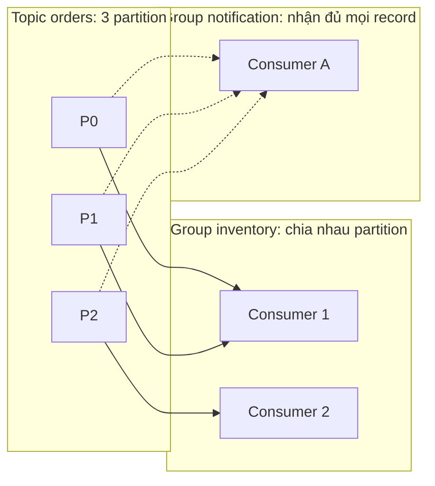
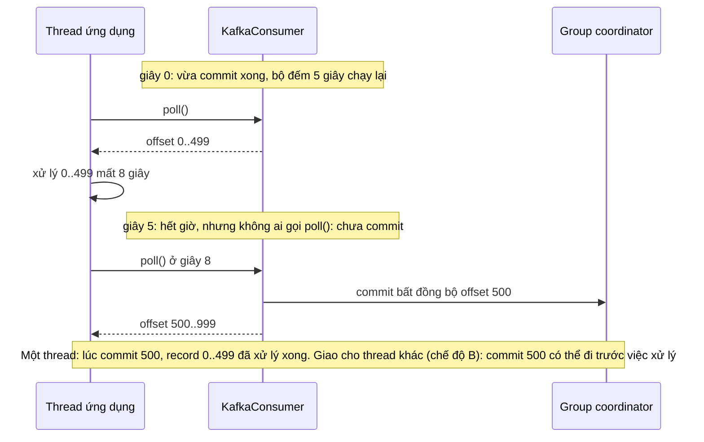
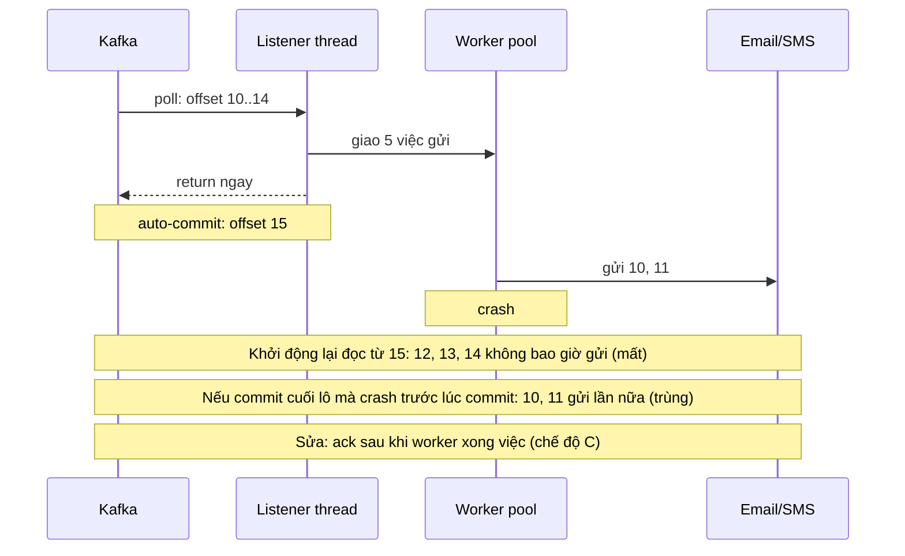
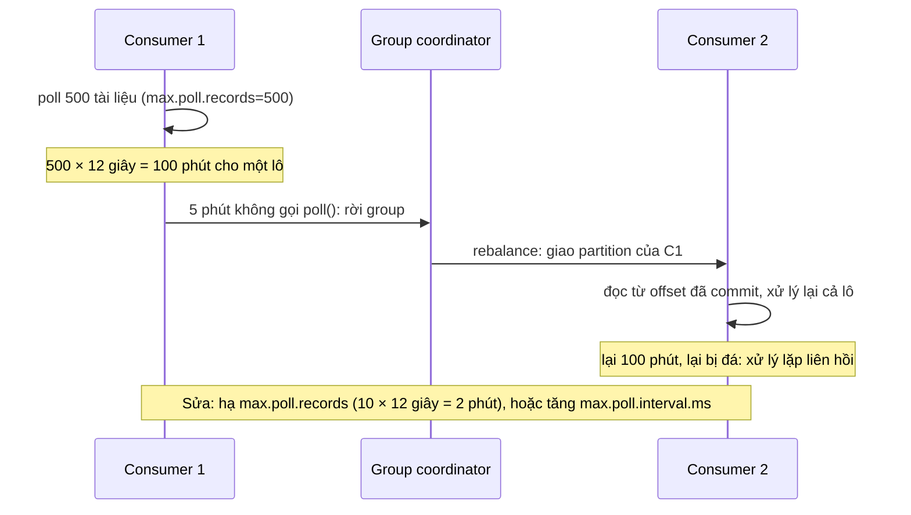
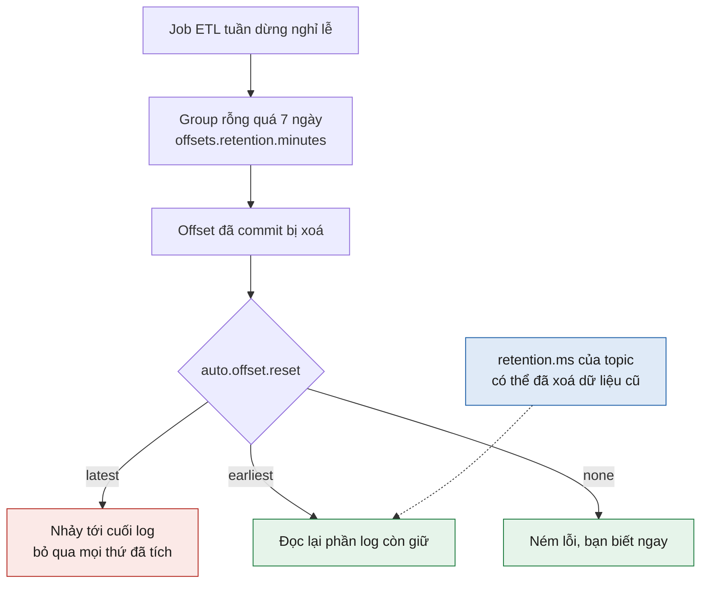
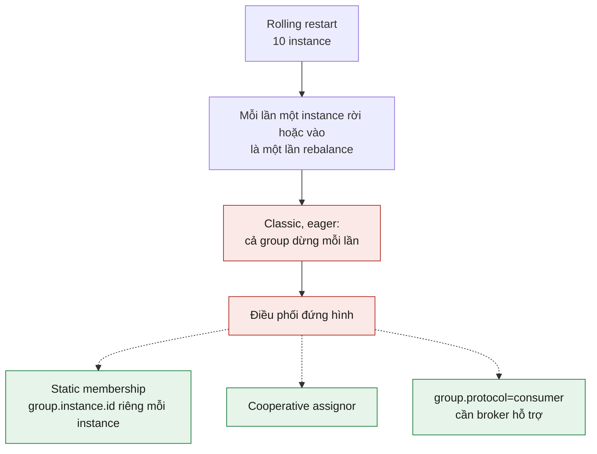
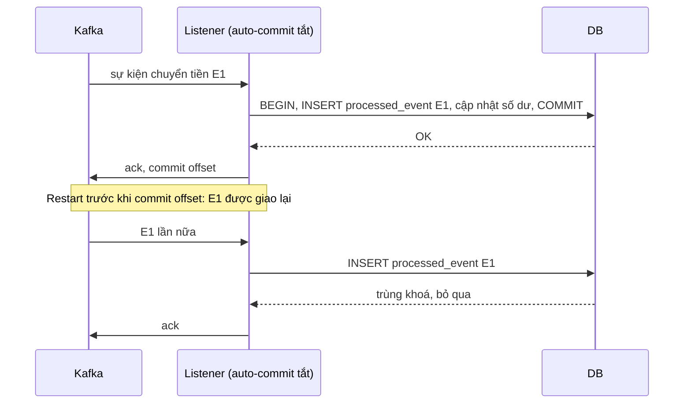

<!-- Tự sinh từ 0005-consumer-offset-commit.html bằng scripts/html2md.py. Đừng sửa tay. -->

[Kafka](../README.md) / [Bài 4](0004-producer-durability.md) / Bài 5 · [Bảng tra](../reference/0001-core-concepts.md) · [Sổ tay tình huống](../reference/0003-tricky-scenarios.md)

# Bài 5: Consumer, offset, commit, rebalance

Producer hoàn hảo vẫn có thể bị consumer làm mất message. Commit là lời hứa "tôi đã xử lý tới đây", và lời hứa đó có thể được đưa ra sớm hơn sự thật.

> **Liên quan tới mission** "Không mất" là một chuỗi: producer ghi bền (Bài 4), broker giữ, consumer xử lý rồi mới ghi nhận. Bài này lo mắt xích cuối. Câu bạn sẽ gặp: "service này restart thì có mất hoặc xử lý lại message không?". Bạn trả lời được bằng chế độ commit và vị trí của lệnh commit trong code.

**Thắng lợi của bài này:** với một consumer cho trước, bạn chỉ ra được khi nào commit xảy ra, "crash ở đây thì mất hay trùng", và chọn cấu hình Spring Kafka đảm bảo at-least-once. Bạn cũng gỡ rối được một group bị rebalance liên tục bằng CLI.

## 1. Bốn khái niệm

Bài này đi qua bốn khái niệm theo đúng thứ tự chúng phụ thuộc nhau: **consumer** đọc dữ liệu, **offset** đánh dấu đọc tới đâu, **commit** lưu dấu đó lại, **rebalance** là lúc việc đọc được chia lại. Mỗi khái niệm chỉ có vài ý cần nhớ.

### 1.1. Consumer và consumer group

- **Consumer kéo dữ liệu** bằng vòng lặp `poll()`: lấy một lô record, xử lý, rồi `poll()` tiếp. Broker không đẩy dữ liệu tới consumer. [[Design: push vs pull]](https://kafka.apache.org/44/design/design/)
- **Consumer cùng `group.id` là một group**, chia nhau các partition của topic: mỗi partition chỉ một consumer trong group đọc. Thêm consumer thì chia được việc, nhưng không quá số partition. [[Introduction]](https://kafka.apache.org/intro)
- **Hai group khác nhau đọc độc lập**, mỗi group nhận đủ mọi record, theo tốc độ riêng.



*Kiến trúc: trong một group mỗi partition chỉ một consumer đọc; hai group đọc cùng topic một cách độc lập.*

### 1.2. Offset

- **Offset** là số thứ tự của record trong một partition, tăng dần từ 0. [[Introduction]](https://kafka.apache.org/intro)
- **Vị trí (position)** của consumer là offset của record *kế tiếp* sẽ đọc. **Offset đã commit** là vị trí đã được lưu lại an toàn. Hai số này khác nhau: consumer đọc tới đâu thì vị trí tới đó, còn offset đã commit chỉ đổi khi có commit. [[KafkaConsumer javadoc]](https://kafka.apache.org/44/javadoc/org/apache/kafka/clients/consumer/KafkaConsumer.html)
- **Lag** là khoảng cách từ offset đã commit tới cuối log: còn bao nhiêu record chưa xử lý xong. Xem bằng `kafka-consumer-groups.sh --describe`. [[Basic operations]](https://kafka.apache.org/44/operations/basic-kafka-operations/)
- **Khi không có offset đã commit** (group mới, hoặc offset đã hết hạn sau 7 ngày group rỗng), `auto.offset.reset` quyết định đọc từ đâu: `latest` (mặc định, bỏ qua dữ liệu cũ) hoặc `earliest` (đọc từ đầu). [[Consumer configs]](https://kafka.apache.org/44/configuration/consumer-configs/) [[Broker configs: offsets.retention.minutes]](https://kafka.apache.org/44/configuration/broker-configs/)

| offset | 0 | 1 | 2 | 3 | 4 | 5 | 6 | 7 | 8 | 9 |
|---|---|---|---|---|---|---|---|---|---|---|
| trạng thái | commit ✓ | commit ✓ | commit ✓ | đã đọc | đã đọc | đã đọc | chưa đọc | chưa đọc | chưa đọc | chưa đọc |

"commit ✓": đã xử lý và đã commit. "đã đọc": consumer đã nhận và xử lý, nhưng chưa commit. Ở ví dụ trên: offset đã commit = 3, vị trí = 6, cuối log = 10, lag = 7. Crash lúc này thì consumer mới đọc lại từ 3, nên 3, 4, 5 bị xử lý lại.

### 1.3. Commit

- **Commit** là lưu vị trí vào topic nội bộ `__consumer_offsets`. Restart hay đổi consumer thì đọc tiếp từ offset đã commit. [[Design: consumer position]](https://kafka.apache.org/44/design/design/)
- **Mọi câu hỏi "có mất không" quy về một câu: commit trước hay sau khi xử lý xong?** Commit trước rồi crash: record chưa xử lý bị bỏ qua, tức là **mất**. Xử lý xong rồi mới commit: crash chỉ làm **xử lý lại** (at-least-once).
- **Ai commit, khi nào:** Kafka client thuần mặc định tự commit định kỳ (`enable.auto.commit=true`, 5 giây, xét trong `poll()`). Spring Boot tắt cơ chế đó; *container* commit sau khi listener xử lý xong lô (`AckMode.BATCH`). Muốn commit từng record sau khi xử lý: `ack-mode: manual_immediate`. [[Spring: message listener container]](https://docs.spring.io/spring-kafka/reference/kafka/receiving-messages/message-listener-container.html)

### 1.4. Rebalance

- **Rebalance** là lúc group chia lại partition giữa các consumer: khi có consumer vào, rời, chết, hoặc xử lý quá chậm. Trong lúc chia, partition đang đổi chủ không ai đọc. [[KafkaConsumer javadoc]](https://kafka.apache.org/44/javadoc/org/apache/kafka/clients/consumer/KafkaConsumer.html)
- **Hai đồng hồ quyết định "consumer còn sống":** heartbeat phải tới trong `session.timeout.ms` (45 giây), và hai lần `poll()` không được cách nhau quá `max.poll.interval.ms` (5 phút). Quá đồng hồ thứ hai thì consumer bị coi là chết dù process vẫn chạy, và commit sau đó bị từ chối (`CommitFailedException`). [[Consumer configs]](https://kafka.apache.org/44/configuration/consumer-configs/)
- **Rebalance gây xử lý lại:** consumer nhận partition đọc từ offset đã commit, nên phần đã xử lý mà chưa commit bị làm lại. Cách giảm số lần rebalance (cooperative, static membership) ở [Bài 5b](0011-rebalance.md).

### Sáu giá trị mặc định cần nhớ

| Cấu hình (Kafka client 4.4) | Mặc định | Thuộc khái niệm |
|---|---|---|
| `enable.auto.commit` | `true` (Spring Boot đặt `false`) | Commit |
| `auto.commit.interval.ms` | 5000 | Commit |
| `auto.offset.reset` | `latest` | Offset |
| `max.poll.records` | 500 | Consumer |
| `max.poll.interval.ms` | 300000 (5 phút) | Rebalance |
| `session.timeout.ms` | 45000 (45 giây) | Rebalance |

[[Consumer configs]](https://kafka.apache.org/44/configuration/consumer-configs/)

## 2. Mô phỏng: chỗ nào của dòng thời gian thì crash gây mất?

Partition có 9 record, mỗi `poll()` trả 3 (như `max.poll.records=3`). Mô phỏng theo mô hình ở mục 1 (không phải client thật).

### Thử 1. Chế độ A (auto-commit, xử lý trong thread consumer)

`poll()`, xử lý 2 trong 3 record, bấm "Crash". Rồi chạy lại: `poll()` và xử lý hết. Đọc dòng tổng.

Mong đợi: không mất, có *trùng* (2 record đầu xử lý hai lần). Đó là at-least-once.

### Thử 2. Chế độ B (auto-commit, giao việc cho worker rồi return)

`poll()` hai lần (lần hai commit lô đầu), mỗi lần giao cho worker; xử lý đúng 1 record; bấm "Crash". Offset nào bị đánh dấu MẤT?

Mong đợi: các offset của lô đầu mà worker chưa làm xong: đã commit nhưng chưa từng được xử lý. Đây là C1 trong sổ tay: đúng kiểu "email không bao giờ gửi".

### Thử 3. Chế độ C (ack thủ công sau xử lý)

Làm lại mọi kịch bản crash ở chế độ C. Có lúc nào mất không? Trùng thì sao?

Mong đợi: không bao giờ mất; trùng nhiều nhất một record (record đang xử lý lúc crash). Muốn hết trùng phải chống trùng ở phía xử lý (Bài 7).

## 3. Đi sâu: commit xảy ra lúc nào, chọn chế độ nào

Phần này mở rộng khái niệm commit (mục 1.3) cho câu hỏi "chính xác lúc nào thì commit", ở cả Kafka client thuần và Spring Kafka. Đọc sau khi đã chạy mô phỏng.

### Kafka client và Spring Kafka commit lúc nào

**Kafka client với `enable.auto.commit=true`** (mặc định của client thuần). Offset được commit:

- **khi đã hết chu kỳ, và chỉ trong lần gọi `poll()` kế tiếp**: `auto.commit.interval.ms` (mặc định 5000) chỉ là một bộ đếm giờ. Consumer kiểm tra nó bên trong `poll()` (và khi đổi assignment). Hết giờ trong lúc ứng dụng còn đang xử lý thì chưa có gì xảy ra. Tới lần `poll()` sau, consumer gửi commit bất đồng bộ cho *vị trí* hiện tại: offset kế tiếp sau record cuối cùng mà `poll()` đã trả cho ứng dụng. Xử lý ngay trong thread gọi `poll()` thì tới lúc đó mọi record ấy đã xong. Giao record cho thread khác rồi gọi `poll()` tiếp thì vị trí đã vượt qua record chưa xử lý, đúng điều javadoc cảnh báo: "committed offset to get ahead of the consumed position, which results in missing records";
- **khi `close()`**: "If auto-commit is enabled, this will commit the current offsets" (commit đồng bộ). Tắt auto-commit thì `close()` không commit gì thêm, xem câu hỏi 2 bên dưới;
- **trước khi partition bị chia lại**: "an async commit (based on the old assignment) will be triggered before the new assignment replaces the old one".

[[KafkaConsumer javadoc]](https://kafka.apache.org/44/javadoc/org/apache/kafka/clients/consumer/KafkaConsumer.html) [[Consumer configs]](https://kafka.apache.org/44/configuration/consumer-configs/) Docs không nói thẳng "commit trong `poll()`"; điều đó được kiểm trong source kafka-clients 4.2.0: giao thức classic gọi `maybeAutoCommitOffsetsAsync` từ `ConsumerCoordinator.poll` [[ConsumerCoordinator]](https://github.com/apache/kafka/blob/4.2.0/clients/src/main/java/org/apache/kafka/clients/consumer/internals/ConsumerCoordinator.java); giao thức consumer (KIP-848) cập nhật bộ đếm và commit khi xử lý sự kiện poll của ứng dụng (`updateTimerAndMaybeCommit`) [[ApplicationEventProcessor]](https://github.com/apache/kafka/blob/4.2.0/clients/src/main/java/org/apache/kafka/clients/consumer/internals/events/ApplicationEventProcessor.java). Cả hai commit `subscriptions.allConsumed()`, tức vị trí đã trả cho ứng dụng.

**Spring Boot + Spring Kafka.** Framework đặt `enable.auto.commit=false` "unless explicitly set", và *container* commit theo `AckMode` (mặc định `BATCH`), dùng `commitSync` vì `syncCommits` mặc định `true`. Bẫy đã gặp khi chạy lab: khai báo tham số `Acknowledgment` trong listener mà ack-mode *không* phải manual thì Spring ném `IllegalStateException`, không phải truyền `null` (đã đính chính ở [research/0002](../research/0002-spring-kafka.md)). Các thời điểm commit theo docs: [[Message listener container]](https://docs.spring.io/spring-kafka/reference/kafka/receiving-messages/message-listener-container.html)

| AckMode | Container commit khi nào (docs) | Crash giữa chừng thì xử lý lại tối đa |
|---|---|---|
| `BATCH` (mặc định) | "when all the records returned by the poll() have been processed" | cả lô của lần poll đó (tới `max.poll.records`, mặc định 500) |
| `RECORD` | "when the listener returns after processing the record" | một record |
| `TIME` / `COUNT` / `COUNT_TIME` | xử lý xong lô, và đã qua `ackTime` hoặc đủ `ackCount` record kể từ lần commit trước | nhiều lô |
| `MANUAL` | listener gọi `acknowledge()`, sau đó "the same semantics as BATCH" | các record đã ack nhưng lô chưa xong |
| `MANUAL_IMMEDIATE` | "immediately when the Acknowledgment.acknowledge() method is called" | record đang xử lý dở |

Thêm hai thời điểm: khi partition bị thu hồi trong rebalance, container commit các offset đang chờ (giữa hai callback `onPartitionsRevokedBeforeCommit` và `onPartitionsRevokedAfterCommit`, [[Rebalance listeners]](https://docs.spring.io/spring-kafka/reference/kafka/receiving-messages/rebalance-listeners.html), xem [Bài 5b](0011-rebalance.md)). Còn nếu bạn đặt tường minh `enable-auto-commit: true` thì "Kafka auto-commits the offsets according to its configuration", nghĩa là quay về hành vi của client thuần ở trên: đó chính là profile `s6`.

```
# 1) Mặc định của Spring Boot: không cần ghi gì (ghi ra đây cho rõ)
spring.kafka.listener.ack-mode: batch          # commit sau khi listener xử lý xong mọi record của một lần poll

# 2) Commit sau từng record
spring.kafka.listener.ack-mode: record

# 3) Tự quyết thời điểm commit trong code
spring.kafka.listener.ack-mode: manual_immediate   # listener nhận Acknowledgment, commit ngay khi gọi ack.acknowledge()

# 4) Auto-commit thật của Kafka (container không còn quyết thời điểm commit)
spring.kafka.consumer.enable-auto-commit: true
spring.kafka.consumer.auto-commit-interval: 5s
```

Ví dụ dòng thời gian với `BATCH`: `poll()` trả offset 0..499; listener xử lý lần lượt; xử lý xong 499 thì container commit `500`. Crash ở record 300 thì chưa có commit nào cho lô này, nên lần chạy lại xử lý lại 0..299: không mất, trùng 300 record. Với `RECORD` hoặc `MANUAL_IMMEDIATE` (ack sau xử lý), crash ở record 300 chỉ làm lại record 300.

### Hai câu hỏi hay gặp về thời điểm commit

**1. Với `enable.auto.commit=true`, hết chu kỳ mà consumer chưa xử lý xong lô vừa `poll()` thì có commit không?** Không, chưa. Commit chỉ được gửi ở lần `poll()` kế tiếp, nên chu kỳ thực tế là "ít nhất `auto.commit.interval.ms`, và không sớm hơn lần `poll()` sau". Nếu xử lý trong cùng thread thì giá trị commit chỉ gồm record đã xử lý: auto-commit khi đó là at-least-once, đúng như chế độ A của mô phỏng. Mất message chỉ xảy ra khi offset "đi trước" việc xử lý, tức chế độ B.



*Sequence: bộ đếm auto-commit chỉ được xét trong poll(); hết giờ giữa lúc xử lý thì commit lùi tới lần poll() sau.*

**2. Tắt auto-commit thì `close()` có commit không?** Kafka client thì không: `close()` chỉ commit khi auto-commit bật; tắt thì nó chỉ chờ các commit bất đồng bộ mà ứng dụng đã gửi trước đó hoàn tất. Spring thì khác, vì chính container commit chứ không phải Kafka client:

| Trường hợp | Có commit khi đóng không? |
|---|---|
| Kafka client, `enable.auto.commit=false` | Không commit thêm. Record đã xử lý mà ứng dụng chưa tự commit sẽ bị đọc lại |
| Kafka client, `enable.auto.commit=true` | Có: commit đồng bộ vị trí hiện tại |
| Spring, container dừng bình thường (stop, tắt ứng dụng) | Có: `commitPendingAcks()` commit offset của record đã xử lý xong (hoặc đã `acknowledge()` với `MANUAL`), rồi mới `consumer.close()` |
| Spring, lỗi fatal, hoặc dùng `KafkaTransactionManager` | Container không commit thêm lúc đóng; với transaction, offset đi cùng transaction |
| `kill -9`, OOM, mất điện | Không ai commit. Instance khác đọc lại từ offset đã commit cuối cùng |

Nguồn: [[KafkaConsumer javadoc]](https://kafka.apache.org/44/javadoc/org/apache/kafka/clients/consumer/KafkaConsumer.html), `ConsumerCoordinator.close` gọi `maybeAutoCommitOffsetsSync` chỉ khi auto-commit bật [[ConsumerCoordinator]](https://github.com/apache/kafka/blob/4.2.0/clients/src/main/java/org/apache/kafka/clients/consumer/internals/ConsumerCoordinator.java), `wrapUp` và `ackCurrent` trong [[KafkaMessageListenerContainer 4.1.2]](https://github.com/spring-projects/spring-kafka/blob/v4.1.2/spring-kafka/src/main/java/org/springframework/kafka/listener/KafkaMessageListenerContainer.java). Hệ quả thiết kế: tắt ứng dụng đúng cách (SIGTERM, để container dừng) thì ít trùng; crash thì trùng phần chưa commit. Consumer vẫn phải chịu được trùng.

### Chọn chế độ nào?

| Chế độ | Ngữ nghĩa khi crash | Dùng khi | Spring Kafka |
|---|---|---|---|
| **A**. Auto-commit, xử lý xong trong thread consumer | Không mất; có thể xử lý lại cả lô kể từ lần commit trước (at-least-once) | Xử lý nhanh, chịu được trùng hoặc vốn idempotent: cập nhật cache, đếm thống kê, ghi đè trạng thái mới nhất | Gần với mặc định (`AckMode.BATCH`: container commit sau khi xử lý hết lô), nhưng do container commit chứ không phải đồng hồ 5 giây |
| **B**. Auto-commit, giao việc cho thread khác rồi return | **Có thể mất** việc đã commit mà chưa làm xong | Gần như không bao giờ khi yêu cầu "không mất". Chỉ chấp nhận được nếu mất vài message không sao (log mẫu, metric), hoặc khi bạn tự quản lý offset theo việc đã xong | Đừng giao việc sang thread pool rồi return trong `@KafkaListener` nếu không tự quản lý ack |
| **C**. Ack thủ công sau khi xử lý từng record | Không mất; xử lý lại nhiều nhất record đang làm dở | Dữ liệu không được mất và có tác dụng phụ: thanh toán, đơn hàng, gửi thông báo. Kết hợp consumer idempotent (Bài 7) để hết cả trùng | `ack-mode: manual_immediate` + tham số `Acknowledgment`, gọi `ack.acknowledge()` sau khi xử lý xong |

Đánh đổi của C: nhiều lần commit hơn nên thông lượng thấp hơn A. Nếu đo thấy chậm, có thể commit theo nhóm nhỏ (`COUNT`/`TIME`) và chấp nhận xử lý lại nhiều hơn một record khi crash; điều kiện là consumer idempotent. Ba chế độ này là ba điểm trên cùng một trục: commit sớm thì nhanh và có thể mất, commit muộn thì chậm hơn và có thể trùng. Ghép với phía producer thành ngữ nghĩa của cả luồng: [Bài 5c](0012-delivery-semantics.md).

## 4. Lab thật: `labs/05-scenarios`

Cùng code nền, mỗi tình huống là một profile. Dữ liệu và `group.id` của mỗi lần chạy gắn mã riêng nên chạy lại không bị nhiễu. Chạy trên cụm 3 broker của Bài 3 (Maven phải dùng JDK 17+, xem README).

**Trạng thái trung thực:** `s7` và `s6fix` đã chạy trên broker nhúng 1 node: s7 cho thấy cả 3 offset đầu được xử lý **3 lần**; s6fix cho MẤT 0, TRÙNG 0 (crash giả lập đóng êm). `s6` (profile gây mất) đã sửa lỗi sau lần chạy thử nhưng **chưa chạy lại**, nên kết quả dưới đây là dự đoán. Cả hai chưa chạy với cụm 3 broker. Lệnh `spring-boot.run.*` chưa kiểm chứng trên máy bạn; README có cách dự phòng bằng `java -jar`.

### Bước 1. S6: auto-commit làm mất message (dự đoán trước khi chạy)

Cấu hình và code của hai profile:

```
# labs/05-scenarios/src/main/resources/application-s6.yml  (KHÔNG an toàn)
spring:
  kafka:
    consumer:
      enable-auto-commit: true      # đặt tường minh: Spring không ép false nữa, Kafka tự commit
      auto-commit-interval: 500ms

# labs/05-scenarios/src/main/resources/application-s6fix.yml  (an toàn)
spring:
  kafka:
    consumer:
      enable-auto-commit: false
    listener:
      ack-mode: manual_immediate    # commit ngay khi gọi ack.acknowledge()
```

```
// labs/05-scenarios/.../S6AutoCommit.java (rút gọn)
// s6: giao việc cho thread pool rồi return ngay -> offset có thể được commit trước khi việc xong
@KafkaListener(topics = "s6-autocommit", groupId = "s6-#{@run.id}")
void on(ConsumerRecord<String, String> rec) {
    pool.submit(() -> process(rec.value()));
}

// s6fix: xử lý xong mới ack (listener phải nhận Acknowledgment, và ack-mode phải là manual)
@KafkaListener(topics = "s6-autocommit", groupId = "s6-#{@run.id}")
void on(ConsumerRecord<String, String> rec, Acknowledgment ack) {
    process(rec.value());
    ack.acknowledge();
}
```

Mở `S6AutoCommit.java`, đọc listener `Unsafe` và `Fixed`. Viết ra giấy: "crash lúc này thì seq nào mất?". Rồi chạy hai pha cùng profile:

```
cd labs/05-scenarios
mvn -q spring-boot:run -Dspring-boot.run.profiles=s6                                   # pha crash: process tự halt như kill -9
mvn -q spring-boot:run -Dspring-boot.run.profiles=s6 -Dspring-boot.run.arguments="--lab.phase=resume"   # pha chạy tiếp, in báo cáo
```

Mong đợi (dự đoán, chưa chạy lại): báo cáo in `MẤT` > 0 vì offset auto-commit trước khi thread pool xử lý xong. Rồi chạy `s6fix` với cùng hai pha: kỳ vọng MẤT = 0, và có thể TRÙNG > 0 nếu crash cứng.

Tôi đã dự đoán, chạy s6 và s6fix, ghi lại MẤT/TRÙNG

### Bước 2. S7: xử lý chậm hơn `max.poll.interval.ms`

```
mvn -q spring-boot:run -Dspring-boot.run.profiles=s7     # ~100 giây
```

Profile `s7` đặt `max-poll-records=3`, `max-poll-interval=10s`, mỗi record xử lý 12 giây. Quan sát log rebalance và số lần mỗi offset được xử lý. Rồi sửa: `--spring.kafka.consumer.max-poll-records=1 --spring.kafka.consumer.max-poll-interval=30s` và so sánh.

Đã quan sát trên broker nhúng: cả 3 offset đầu xử lý 3 lần. Với cụm của bạn ghi lại số bạn thấy.

Tôi đã chạy s7 và thử cấu hình sửa

### Bước 3. Lag và reset offset với consumer Spring Boot

Consumer là ứng dụng Spring (`labs/03-spring-clients`, xem Bài 3 bước 3); xem lag và reset offset dùng công cụ quản trị `kafka-consumer-groups.sh`, vì đó là thao tác vận hành chứ không phải code.

```
cd labs/03-spring-clients
mvn -q -DskipTests package          # Maven chạy bằng JDK 17+ (đặt JAVA_HOME như README của lab)
J="java -jar target/spring-clients-0.0.1-SNAPSHOT.jar"
$J --spring.profiles.active=producer --lab.count=20                       # có dữ liệu
$J --spring.profiles.active=consumer --lab.instance=c1 --lab.group=g1     # đọc hết rồi Ctrl-C
docker exec kafka-1 /opt/kafka/bin/kafka-consumer-groups.sh --bootstrap-server kafka-1:19092 --describe --group g1
$J --spring.profiles.active=producer --lab.count=5                        # tạo lag: g1 đang dừng
docker exec kafka-1 /opt/kafka/bin/kafka-consumer-groups.sh --bootstrap-server kafka-1:19092 --describe --group g1
# reset về đầu (group phải không có consumer đang chạy): xem trước rồi áp dụng
docker exec kafka-1 /opt/kafka/bin/kafka-consumer-groups.sh --bootstrap-server kafka-1:19092 --group g1 --topic lab-orders --reset-offsets --to-earliest --dry-run
docker exec kafka-1 /opt/kafka/bin/kafka-consumer-groups.sh --bootstrap-server kafka-1:19092 --group g1 --topic lab-orders --reset-offsets --to-earliest --execute
$J --spring.profiles.active=consumer --lab.instance=c1 --lab.group=g1     # đọc lại toàn bộ
```

Mong đợi (theo docs, chưa chạy thử trên cụm này): lần `--describe` đầu LAG = 0 ở mọi partition; sau khi gửi thêm 5 message, LAG tổng = 5; sau reset, consumer in lại từ offset 0. Nếu consumer còn chạy, `--reset-offsets` báo lỗi. Đây là thao tác bạn sẽ cần khi "message cũ phải xử lý lại".

Tôi đã xem lag và reset offset bằng CLI

## 5. Usecase oái oăm (mỗi cái một miền)

### (a) Gửi email/SMS thông báo: vừa mất vừa trùng

Listener đẩy việc gửi email sang thread pool rồi return để "nhanh". Auto-commit đẩy offset đi; crash giữa chừng làm vài email không bao giờ đi (mất), và nếu bạn commit cuối lô thì vài cái khác đi hai lần. Xử lý: ack sau khi xong (Thử 3), nhưng nếu việc gửi cần song song thì phải *đợi* worker xong trước khi ack (hoặc quản lý offset theo worker). Đánh đổi: tốc độ lấy an toàn.



*Sequence: listener return trước khi worker gửi xong, auto-commit đẩy offset đi trước; crash là mất.*

### (b) OCR chứng từ: bị đá khỏi group

Mỗi tài liệu 12 giây, `max.poll.records=500` mặc định, `max.poll.interval.ms` 5 phút: một lô 500 record cần 100 phút. Consumer bị coi là chết, rebalance, và cả lô bị xử lý lại bởi người khác: "xử lý lặp liên hồi". Xử lý: hạ `max.poll.records` cho vừa với thời gian xử lý, hoặc tăng `max.poll.interval.ms` (đánh đổi: phát hiện consumer thật sự chết chậm hơn).



*Sequence: một lô 500 tài liệu cần 100 phút, vượt max.poll.interval.ms 5 phút, nên lô bị xử lý lại mãi.*

### (c) ETL báo cáo tuần: nghỉ lễ quay lại thì "không có gì để đọc"

Group rỗng quá 7 ngày: offset đã commit bị xoá; `auto.offset.reset=latest` làm job nhảy tới cuối và bỏ qua mọi thứ đã tích. Xử lý: `earliest` (đọc lại hết) hoặc `none` (ném lỗi cho bạn biết); tăng `offsets.retention.minutes` theo chu kỳ job. Đừng quên `retention.ms` của chính topic cũng có thể đã xoá dữ liệu.



*Flow: offset đã commit hết hạn sau 7 ngày; auto.offset.reset quyết định job đọc lại hay bỏ qua.*

### (d) Gọi xe: deploy làm cả đội điều phối đứng hình

Rolling restart 10 instance, mỗi lần một instance rời/vào là một lần rebalance; giao thức classic có rào chắn toàn group. Xử lý theo mức: static membership (instance về lại đúng chỗ cũ, đừng để trùng `group.instance.id`), cooperative assignor, `group.protocol=consumer` (cần broker hỗ trợ; Kafka Connect chưa dùng được). Trên MSK, AWS khuyên luôn đặt `group.instance.id`.



*Flow: mỗi instance rời hoặc vào là một lần rebalance; ba mức xử lý. Dòng thời gian chi tiết ở Bài 5b.*

### (e) Nếu là ngân hàng

"Service nhận sự kiện chuyển tiền: tắt auto-commit, ack sau khi ghi DB xong, chống trùng bằng mã sự kiện": ba cụm từ này là câu trả lời đầy đủ cho "restart có sao không".



*Sequence: ack sau khi transaction DB commit, chống trùng bằng mã sự kiện; restart giao lại thì bỏ qua.*

### Hỏi nhanh, đáp gọn

- **Tại sao không commit sau mỗi record cho chắc?** Được, đổi lại nhiều lần commit hơn nên chậm hơn; và vẫn có thể trùng một record nếu crash giữa xử lý và commit.
- **Muốn xử lý lại message cũ thì làm sao?** Dừng group rồi dùng `kafka-consumer-groups.sh --reset-offsets` (xem trước, rồi `--execute`).

## 6. Tự nói thành lời

Trong 45 giây: *"Consumer crash giữa chừng thì ... vì offset được commit ... Để không mất, mình ... và chấp nhận ... Để hết trùng thì ..."* Dùng: poll, commit, at-least-once, rebalance, `max.poll.interval.ms`.

**Ôn nhanh:** [tóm tắt Bài 5](../summaries/0005-consumer-offset-commit.md) (đọc sau khi đã tự nói).

## 7. Kiểm tra

<!-- quiz:quiz -->

**1. Consumer Kafka thuần đang auto-commit, và hàm xử lý chỉ giao việc cho thread pool rồi trả về. Crash xảy ra. Điều gì đúng?**

- **A.** Việc chưa làm xong có thể bị mất vĩnh viễn
- **B.** Mọi việc chưa xong sẽ được nhận lại
- **C.** Broker tự đợi worker rồi mới commit
- **D.** Offset chỉ commit sau khi worker xong

<details><summary>Đáp án</summary>

**A. Việc chưa làm xong có thể bị mất vĩnh viễn**

Auto-commit chạy trong poll(): offset có thể đi trước việc xử lý thực sự, nên việc đã commit mà worker chưa làm xong thì mất.

</details>

**2. Với Boot + Spring Kafka không cấu hình gì thêm, commit offset do ai làm và khi nào?**

- **A.** Kafka client, mỗi năm giây một lần
- **B.** Ứng dụng, khi bạn gọi commitSync
- **C.** Container, sau khi xử lý hết lô poll
- **D.** Broker, khi nhận đủ số ack cấu hình

<details><summary>Đáp án</summary>

**C. Container, sau khi xử lý hết lô poll**

Spring đặt enable.auto.commit=false trừ khi bạn đặt tường minh, và AckMode mặc định là BATCH: container commit sau khi xử lý xong lô.

</details>

**3. Listener của bạn khai báo tham số Acknowledgment nhưng ack-mode là mặc định. Spring Kafka 4.1.2 làm gì?**

- **A.** Đưa null vào tham số rồi chạy tiếp
- **B.** Tự đổi ack-mode sang manual cho bạn
- **C.** Bỏ qua tham số và commit như thường
- **D.** Ném IllegalStateException khi gọi listener

<details><summary>Đáp án</summary>

**D. Ném IllegalStateException khi gọi listener**

Đã gặp khi chạy lab s6: cần AckMode MANUAL để Acknowledgment có mặt; nếu không, record bị xử lý như lỗi listener.

</details>

**4. Mỗi record xử lý 12 giây, max.poll.records=3, max.poll.interval.ms=10 giây. Triệu chứng nào hợp lý nhất?**

- **A.** Lag giảm đều và không có lỗi nào
- **B.** Producer nhận NotEnoughReplicasException
- **C.** Broker xoá offset đã commit của group
- **D.** Consumer rời group, record bị xử lý lặp

<details><summary>Đáp án</summary>

**D. Consumer rời group, record bị xử lý lặp**

Khoảng giữa hai lần poll vượt max.poll.interval.ms nên consumer bị coi là chết, rebalance xảy ra và record được giao lại (đã quan sát ở s7: mỗi offset xử lý 3 lần).

</details>

**5. Job ETL chạy lại sau 10 ngày nghỉ, group rỗng suốt thời gian đó, auto.offset.reset mặc định. Chuyện gì?**

- **A.** Job nhảy tới cuối, bỏ qua dữ liệu tích
- **B.** Job đọc lại topic từ offset đầu tiên
- **C.** Job báo lỗi và không khởi động được
- **D.** Job tiếp tục đúng chỗ đã dừng trước đó

<details><summary>Đáp án</summary>

**A. Job nhảy tới cuối, bỏ qua dữ liệu tích**

Offset commit hết hạn sau 7 ngày kể từ khi group rỗng; không còn offset hợp lệ thì auto.offset.reset=latest nhảy tới cuối. Dùng earliest hoặc none, và tăng offsets.retention.minutes.

</details>

<!-- /quiz -->

## Nguồn nên đọc

> **Chính:** phần mở đầu của [KafkaConsumer javadoc](https://kafka.apache.org/44/javadoc/org/apache/kafka/clients/consumer/KafkaConsumer.html) (mục offsets and consumer position, mục "Detecting Consumer Failures", "Manual Offset Control"), khoảng 25 phút.
>
> **Spring:** [Message listener container](https://docs.spring.io/spring-kafka/reference/kafka/receiving-messages/message-listener-container.html) (AckMode, static membership).
>
> **Tra nhanh:** [Sổ tay](../reference/0003-tricky-scenarios.md), nhóm B.

**Bài tiếp theo:** [Bài 5b: rebalance](0011-rebalance.md): khi nào group chia lại partition, ai dừng, và vì sao rebalance gây trùng. Sau đó là [Bài 6: poison pill, retry, DLT](0006-error-handling-dlt.md).

> **Còn chỗ nào mơ hồ?** Hỏi thẳng giáo viên, ví dụ "vì sao commit là offset+1?", "static membership khác cooperative ở đâu?". Dán kết quả quiz và số bạn thấy ở s6/s7.
