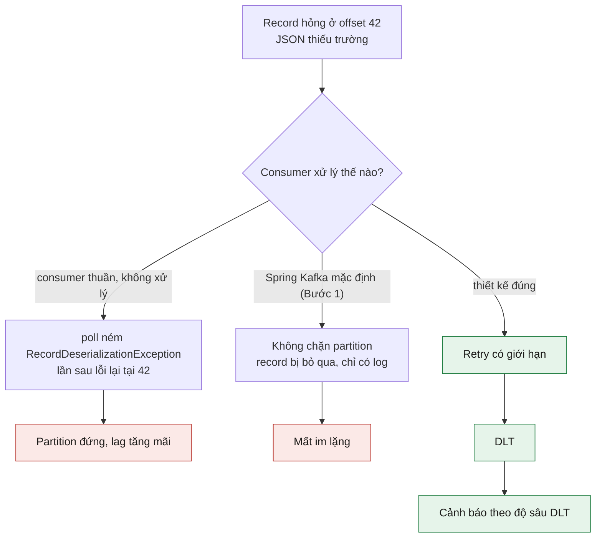
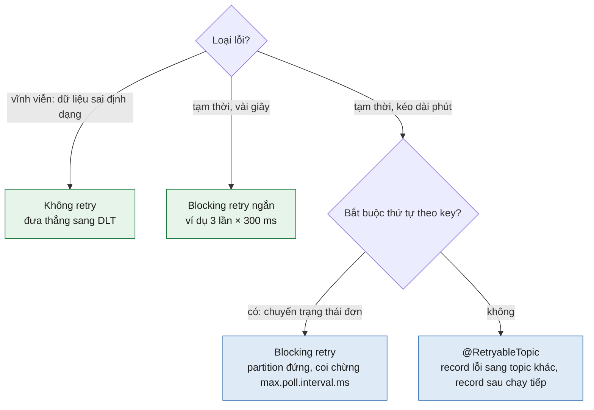
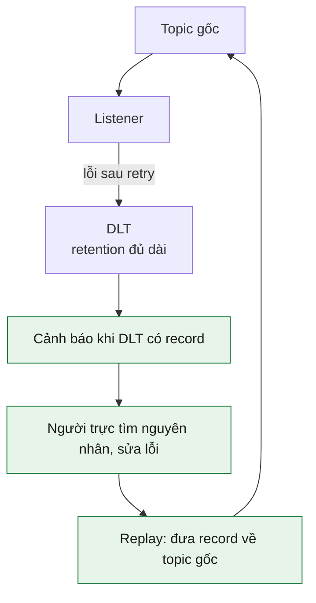
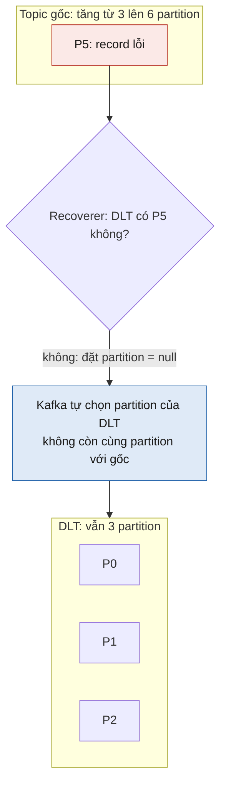
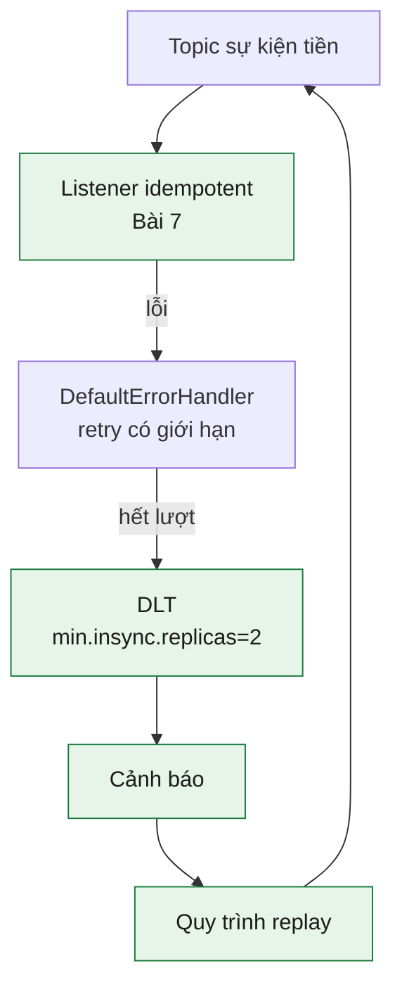

<!-- Tự sinh từ 0006-error-handling-dlt.html bằng scripts/html2md.py. Đừng sửa tay. -->

[Kafka](../README.md) / [Bài 5](0005-consumer-offset-commit.md) / Bài 6 · [Sổ tay tình huống](../reference/0003-tricky-scenarios.md)

# Bài 6: Một message hỏng thì Kafka làm gì? Spring Kafka bỏ nó đi

Với yêu cầu "không mất", hành vi mặc định của lúc xử lý lỗi là thứ nguy hiểm nhất bạn chưa nhìn thấy.

> **Liên quan tới mission** Bạn là người thiết kế: khi consumer gặp message không xử lý được, thiết kế phải trả lời "retry mấy lần, chờ bao lâu, cuối cùng để ở đâu, ai xem, ai chạy lại". Bài này cho bạn từ vựng và cấu hình để trả lời trong họp, và một cú sốc cần thấy tận mắt: mặc định là mất message im lặng.

**Thắng lợi của bài này:** bạn dự đoán đúng số phận của một message hỏng trong ba cấu hình (mặc định, có DLT, retry topic), tự cấu hình `DefaultErrorHandler` + `DeadLetterPublishingRecoverer`, và nói được khác biệt giữa blocking retry và non-blocking retry.

## 1. Kiến thức tối thiểu (có nguồn)

1. **Docs Apache không định nghĩa DLQ cho consumer thường.** DLQ chính thức chỉ có ở Kafka Connect (`errors.tolerance`, `errors.deadletterqueue.topic.name`) và Share Groups. Retry topic và DLT trong consumer là *pattern ứng dụng*; Spring Kafka hiện thực nó cho bạn. [[Connect guide]](https://kafka.apache.org/44/kafka-connect/user-guide/) [[research/0001, mục 1.1]](../research/0001-curriculum-coverage.md)
2. **Mặc định của `DefaultErrorHandler`:** `FixedBackOff(0L, 9)`, tức thử tối đa 10 lần giao, không chờ (tham số đầu là khoảng chờ giữa các lần, tham số sau là số lần *thử lại* sau lần giao đầu: 1 + 9 = 10). Hết lần thử: recoverer mặc định *chỉ log ở mức ERROR* và offset của record được commit, nghĩa là **record bị bỏ qua**. [[Handling exceptions]](https://docs.spring.io/spring-kafka/reference/kafka/annotation-error-handling.html)
3. **Một số lỗi "fatal" không retry** mà đi thẳng tới recoverer: `DeserializationException`, `MessageConversionException`, `ConversionException`, `MethodArgumentResolutionException`, `NoSuchMethodException`, `ClassCastException`. Tuỳ biến bằng `addNotRetryableExceptions`. [[Handling exceptions]](https://docs.spring.io/spring-kafka/reference/kafka/annotation-error-handling.html)
4. **Blocking retry:** thread consumer ngủ theo back-off giữa các lần thử, nghĩa là cả partition đứng. Back-off dài hơn `max.poll.interval.ms` thì phải dùng `ContainerPausingBackOffHandler`, nếu không bạn tự gây ra Bài 5(b). [[Handling exceptions]](https://docs.spring.io/spring-kafka/reference/kafka/annotation-error-handling.html)
5. **`DeadLetterPublishingRecoverer`:** mặc định gửi tới `<topic gốc>-dlt` (tutorial cũ ghi `.DLT`, đã lỗi thời), **cùng số partition** với record gốc, nên DLT phải có ít nhất bằng số partition của topic gốc. Nó giữ mọi header gốc và thêm header `DLT_EXCEPTION_*`, `DLT_ORIGINAL_TOPIC/PARTITION/OFFSET`. Nó *không tự tạo* topic DLT. [[Handling exceptions]](https://docs.spring.io/spring-kafka/reference/kafka/annotation-error-handling.html) [[mã nguồn v4.1.2]](https://github.com/spring-projects/spring-kafka/blob/v4.1.2/spring-kafka/src/main/java/org/springframework/kafka/listener/DeadLetterPublishingRecoverer.java)
6. **Poison pill ở tầng giải mã:** bọc deserializer bằng `ErrorHandlingDeserializer`; lỗi giải mã thành value `null` + header chứa exception và byte gốc, record không tới listener. [[Serialization]](https://docs.spring.io/spring-kafka/reference/kafka/serdes.html)
7. **Non-blocking retry: `@RetryableTopic`.** Record lỗi được đẩy sang topic `-retry` (rồi `-dlt`) và partition gốc chạy tiếp. Hậu tố mặc định `-retry` và `-dlt`; không dùng với batch listener và không kết hợp với container transaction; topic retry tự tạo có replication factor `-1` (mặc định broker), nên hãy khai báo `NewTopic` riêng. [[Retry topic]](https://docs.spring.io/spring-kafka/reference/retrytopic/retry-config.html) [[research/0002, mục 2.3]](../research/0002-spring-kafka.md)

## 2. Dự đoán trước khi chạy (retrieval)

Đọc `labs/05-scenarios/src/main/java/lab/S8Poison.java` rồi trả lời *trước* khi mở kết quả. Topic `s8-poison` nhận 10 message `m0..m9`, trong đó `m5` được thay bằng `POISON` làm listener ném exception.

<!-- quiz:predict -->

**1. Cấu hình mặc định (không khai báo error handler). Listener ném exception với m5. Điều gì xảy ra với m5?**

- **A.** Consumer dừng hẳn và chờ người xử lý
- **B.** Thử tối đa 10 lần, log lỗi, rồi bỏ qua
- **C.** Tự chuyển sang topic có hậu tố -dlt
- **D.** Thử mãi không dừng, chặn cả partition

<details><summary>Đáp án</summary>

**B. Thử tối đa 10 lần, log lỗi, rồi bỏ qua**

DefaultErrorHandler mặc định FixedBackOff(0L, 9): 10 lần giao rồi chỉ log ERROR và commit offset (đã quan sát ở s8: POISON biến mất).

</details>

**2. Cấu hình DefaultErrorHandler(DeadLetterPublishingRecoverer(template), FixedBackOff(300L, 2L)). m5 sẽ được giao cho listener bao nhiêu lần trước khi vào DLT?**

- **A.** Một lần duy nhất, rồi vào DLT
- **B.** Hai lần, cách nhau ba trăm mili giây
- **C.** Mười lần, như cấu hình mặc định
- **D.** Ba lần, cách nhau ba trăm mili giây

<details><summary>Đáp án</summary>

**D. Ba lần, cách nhau ba trăm mili giây**

FixedBackOff(interval, maxAttempts=2) nghĩa là 2 lần thử lại sau lần giao đầu: tổng 3 lần giao, cách nhau 300ms.

</details>

**3. Topic s8-poison có 3 partition, topic s8-poison-dlt chỉ có 1. Record lỗi ở partition 2. Docs nói gì về recoverer mặc định?**

- **A.** DLT tự tăng số partition cho đủ
- **B.** Record luôn vào partition 0 của DLT
- **C.** Record bị mất mà không có cảnh báo gì
- **D.** DLT phải có ít nhất bằng số partition gốc

<details><summary>Đáp án</summary>

**D. DLT phải có ít nhất bằng số partition gốc**

Mặc định gửi tới <topic>-dlt cùng số partition; DLT phải có ít nhất bằng số partition của topic gốc. Topic DLT cũng không tự được tạo bởi recoverer.

</details>

<!-- /quiz -->

## 3. Lab thật

**Trạng thái trung thực:** `s8` và `s8dlt` đã chạy trên broker nhúng 1 node và kết quả trong bài là kết quả quan sát được. Chưa chạy với cụm 3 broker của bạn. Cụm thật cũng cho thấy cùng kết quả logic (đường đi của record, không liên quan độ bền), nhưng hãy xác nhận và báo lại.

### Bước 1. Mặc định: `s8`

```
cd labs/05-scenarios
mvn -q spring-boot:run -Dspring-boot.run.profiles=s8        # ~25 giây
```

Đã quan sát: listener xử lý m0-m4 và m6-m9; `POISON` không còn ở đâu (log ERROR sau 10 lần giao rồi bỏ qua, consumer chạy tiếp). Ghi lại: số lần listener bị gọi với POISON.

Tôi đã chạy s8 và thấy POISON biến mất

### Bước 2. Có DLT: `s8dlt`

```
mvn -q spring-boot:run -Dspring-boot.run.profiles=s8dlt
```

Profile này khai báo `new DefaultErrorHandler(new DeadLetterPublishingRecoverer(template), new FixedBackOff(300L, 2L))` và topic `s8-poison-dlt` có 3 partition (bằng topic gốc).

Đã quan sát: `POISON` nằm trong `s8-poison-dlt`, các message còn lại vẫn xử lý bình thường. Tự thử: tạo `s8-poison-dlt` chỉ 1 partition (sửa `TopicsConfig`) rồi gửi record lỗi ở partition 2 của topic gốc: record có vào được DLT không? (Docs: DLT phải đủ partition; kết quả chưa được chạy thử.)

Tôi đã chạy s8dlt và đọc được header DLT_*

### Bước 3. Đọc DLT bằng CLI

```
docker exec kafka-1 /opt/kafka/bin/kafka-console-consumer.sh --bootstrap-server kafka-1:19092 --topic s8-poison-dlt --from-beginning --property print.headers=true
```

Mong đợi (chưa kiểm chứng cờ `print.headers` với bản 4.4): record cùng payload và header `kafka_dlt-exception-fqcn`, `kafka_dlt-original-topic`... Nếu cờ không nhận, bỏ nó và chỉ xem payload.

Tôi đã đọc DLT bằng CLI

### Bước 4. Biến thể tự làm

Sửa `FixedBackOff(300L, 2L)` thành `ExponentialBackOff` hoặc thêm `addNotRetryableExceptions(IllegalArgumentException.class)` và cho listener ném `IllegalArgumentException`. Đoán trước số lần giao, rồi đếm trong log.

Tôi đã đổi back-off hoặc loại lỗi không retry

## 4. Usecase oái oăm

### (a) Cổng thanh toán: một message JSON thiếu trường chặn cả partition

Nếu bạn tự viết consumer thuần mà không xử lý, `poll` ném `RecordDeserializationException` (có `offset()` của record hỏng) và, nếu không bỏ qua record đó, lần `poll` kế tiếp lặp lại lỗi tại cùng offset, lag tăng mãi (đây là suy luận, docs không mô tả cách bỏ qua). Với Spring Kafka thì ngược lại: hành vi mặc định *không chặn* nhưng *mất im lặng* (Bước 1). Hai thái cực. Thiết kế đúng nằm giữa: retry có giới hạn, rồi DLT, rồi cảnh báo trên độ sâu DLT.



*Flow: cùng một record hỏng, ba cách xử lý cho ba kết quả: chặn mãi, mất im lặng, hoặc vào DLT có cảnh báo.*

### (b) Lỗi tạm thời và lỗi vĩnh viễn cần cách xử lý khác nhau

Dịch vụ phụ trợ chết 2 giây (tạm thời) khác với dữ liệu sai định dạng (vĩnh viễn). Retry 3 lần × 300ms chữa được loại đầu; loại sau nên thành "không retry" để khỏi lãng phí. Nếu lỗi tạm thời kéo dài phút thì blocking retry làm partition đứng và có nguy cơ vượt `max.poll.interval.ms`: đó là lúc cân nhắc `@RetryableTopic`, đổi lại **thứ tự** message cùng key không còn được đảm bảo (record lỗi đi sang topic khác trong khi record sau chạy tiếp). Hệ quả thiết kế: nếu thứ tự theo key là bắt buộc (ví dụ chuyển trạng thái đơn), chọn blocking retry hoặc xử lý bất biến theo thứ tự ở tầng nghiệp vụ.



*Flow: chọn cách retry theo loại lỗi và theo yêu cầu thứ tự. Nếu thứ tự theo key là bắt buộc, cũng có thể làm tầng nghiệp vụ chịu được sai thứ tự.*

### (c) DLT không phải thùng rác

Có DLT mà không ai nhìn nó là mất message có tên đẹp. Cần: cảnh báo khi DLT có record, quy trình "replay" (đưa record về topic gốc sau khi sửa lỗi), và giữ `retention` của DLT đủ dài. Docs Spring Kafka không quy định quy trình này: đó là quyết định thiết kế của bạn.



*Flow: DLT chỉ có giá trị khi có cảnh báo, người xử lý và đường replay về topic gốc.*

### (d) DLT cùng số partition: bẫy khi tăng partition

Bài 2 đã nói thêm partition làm đổi mapping key. Hệ quả mới ở đây: topic gốc tăng partition mà quên tăng DLT thì recoverer không gửi được record có partition vượt (nó kiểm tra và đặt partition là null theo docs). Khi đó phải chọn lại: để Kafka chọn partition của DLT, hay bắt buộc cùng partition.



*Flow: topic gốc tăng partition mà DLT thì không; recoverer đặt partition là null và Kafka tự chọn.*

### (e) Nếu là ngân hàng

Mặc định "10 lần rồi bỏ" là không thể chấp nhận cho sự kiện tiền. Cấu hình tối thiểu: `DefaultErrorHandler` + DLT có `min.insync.replicas=2` + cảnh báo + quy trình replay, và listener idempotent (Bài 7) vì retry nghĩa là giao nhiều lần.



*Kiến trúc: cấu hình tối thiểu cho sự kiện tiền: retry giới hạn, DLT bền, cảnh báo, replay, listener idempotent.*

### Hỏi nhanh, đáp gọn

- **Chọn retry kiểu nào cho dòng tiền theo tài khoản?** Thường là blocking retry ngắn để giữ thứ tự theo tài khoản, rồi DLT; lỗi kéo dài thì cảnh báo thay vì retry vô hạn.
- **DLT xong rồi thì sao?** Có người nhận cảnh báo, sửa nguyên nhân, rồi replay record về topic gốc; consumer phải idempotent vì replay là giao thêm lần nữa.

## 5. Tự nói thành lời

Trong 45 giây: *"Message lỗi vào consumer Spring Kafka mặc định thì ... Mình cấu hình ... để ... Đánh đổi của retry blocking so với retry topic là ..."* Dùng: poison pill, DLT, back-off, thứ tự, `max.poll.interval.ms`.

**Ôn nhanh:** [tóm tắt Bài 6](../summaries/0006-error-handling-dlt.md) (đọc sau khi đã tự nói).

## 6. Kiểm tra

<!-- quiz:quiz -->

**1. Message JSON hỏng làm lỗi ở bước giải mã trước khi tới listener. Cách đúng trong Spring Kafka là gì?**

- **A.** Bọc deserializer bằng ErrorHandlingDeserializer
- **B.** Bắt exception trong hàm main của ứng dụng
- **C.** Tăng max.poll.records lên thật lớn
- **D.** Tắt enable.auto.commit ở phía consumer

<details><summary>Đáp án</summary>

**A. Bọc deserializer bằng ErrorHandlingDeserializer**

ErrorHandlingDeserializer biến lỗi giải mã thành value null + header; record không tới listener và đi theo đường error handler/DLT.

</details>

**2. Dịch vụ phụ trợ lỗi trong 5 phút. Bạn dùng blocking retry với back-off 1 phút, max.poll.interval.ms mặc định 5 phút. Rủi ro chính?**

- **A.** Message bị trùng trong topic DLT
- **B.** Partition đứng và có thể rebalance
- **C.** Topic retry không được tạo tự động
- **D.** Producer nhận NotEnoughReplicasException

<details><summary>Đáp án</summary>

**B. Partition đứng và có thể rebalance**

Blocking retry giữ thread consumer ngủ; tổng thời gian không poll có thể vượt max.poll.interval.ms. Dùng ContainerPausingBackOffHandler hoặc non-blocking retry.

</details>

**3. Nghiệp vụ bắt buộc giữ thứ tự theo key (các bước của một đơn hàng). Nhược điểm của @RetryableTopic là gì?**

- **A.** Không thể tạo topic có hậu tố -dlt
- **B.** Không thể gửi record tới nhiều partition
- **C.** Không thể dùng cùng Spring Boot 4.1.2
- **D.** Thứ tự message cùng key không còn đảm bảo

<details><summary>Đáp án</summary>

**D. Thứ tự message cùng key không còn đảm bảo**

Record lỗi đi sang topic retry trong khi record sau của cùng key chạy tiếp ở topic gốc, nên thứ tự bị phá. Đó là đánh đổi của non-blocking retry.

</details>

**4. Docs chính thức của Apache Kafka 4.4 có mô tả DLQ cho consumer thường không?**

- **A.** Có, qua cấu hình errors.tolerance
- **B.** Có, qua cấu hình dead.letter.topic
- **C.** Không, chỉ cho Connect và Share Groups
- **D.** Không, và Kafka cấm gửi lại topic

<details><summary>Đáp án</summary>

**C. Không, chỉ cho Connect và Share Groups**

DLQ chính thức chỉ có cho Kafka Connect và Share Groups; với consumer thường đó là pattern ứng dụng, Spring Kafka hiện thực giúp bạn.

</details>

<!-- /quiz -->

## Nguồn nên đọc

> **Chính:** [Spring Kafka: Handling Exceptions](https://docs.spring.io/spring-kafka/reference/kafka/annotation-error-handling.html) (khoảng 20 phút; chú ý phần DefaultErrorHandler và DeadLetterPublishingRecoverer).
>
> **Bổ trợ:** [Retry topic](https://docs.spring.io/spring-kafka/reference/retrytopic/retry-config.html).
>
> **Mã nguồn bài này:** `labs/05-scenarios` (`S8Poison.java`). **Tra nhanh:** [Sổ tay](../reference/0003-tricky-scenarios.md), nhóm C (E1).

**Bài tiếp theo:** [Bài 7: idempotent consumer, outbox, transaction](0007-idempotent-consumer-transactions.md): retry nghĩa là giao nhiều lần; làm sao để nhiều lần mà tác dụng vẫn một lần.

> **Còn chỗ nào mơ hồ?** Hỏi thẳng giáo viên, ví dụ "retry topic hay blocking retry cho dòng tiền?", "replay DLT thế nào?". Dán kết quả quiz và những gì bạn thấy khi chạy s8/s8dlt.
