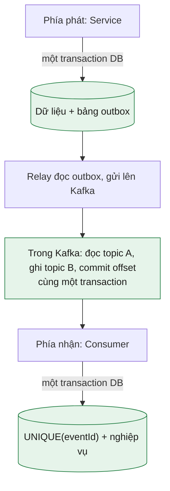
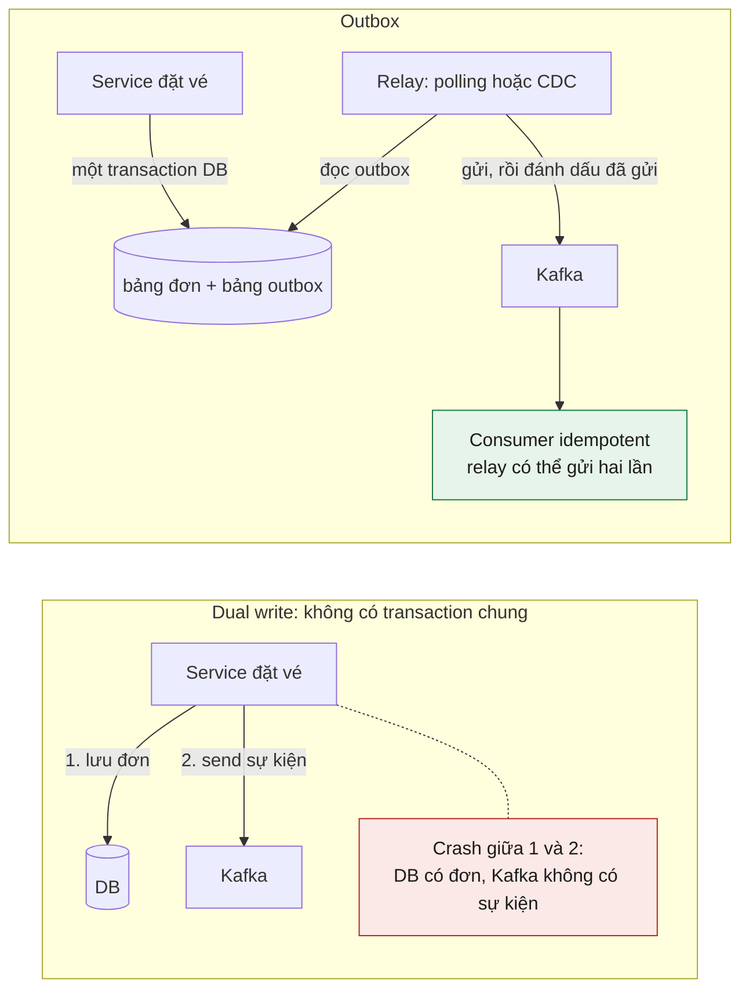
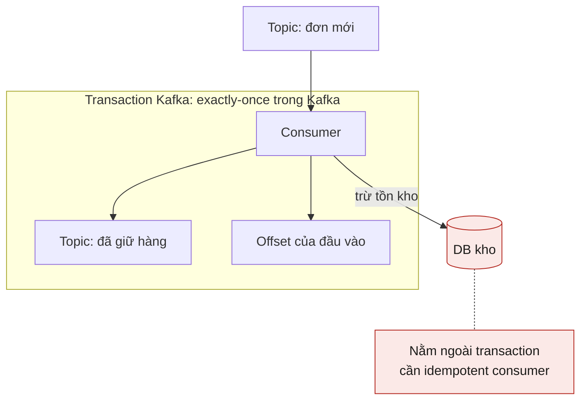
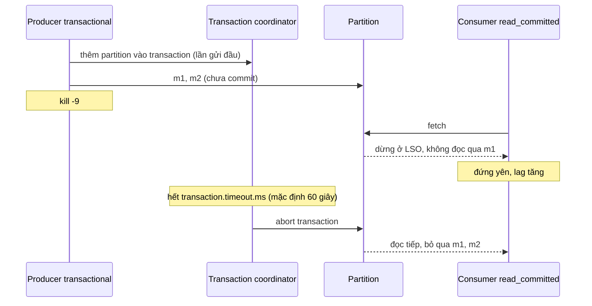
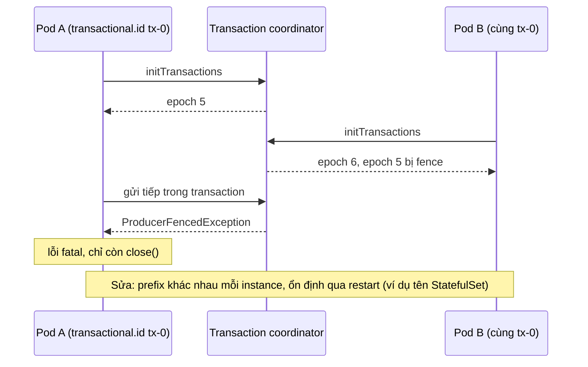
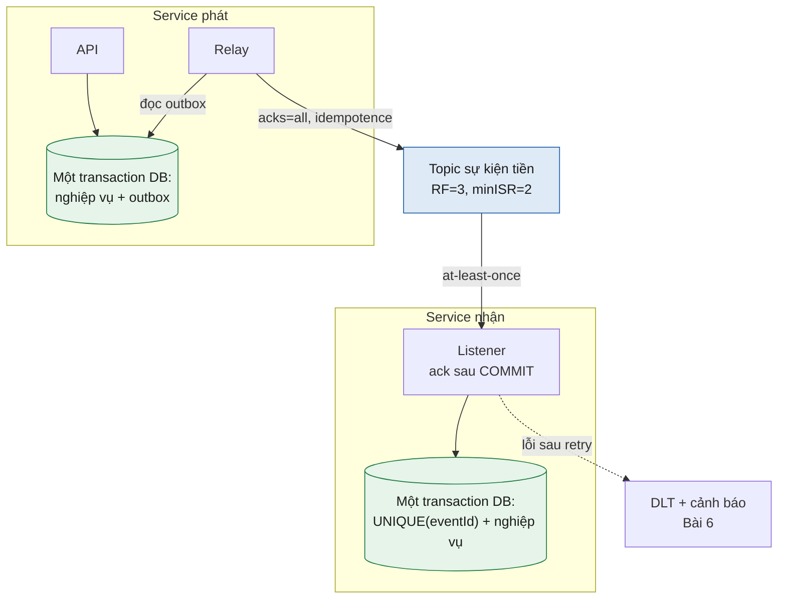

<!-- Tự sinh từ 0007-idempotent-consumer-transactions.html bằng scripts/html2md.py. Đừng sửa tay. -->

[Kafka](../README.md) / [Bài 6](0006-error-handling-dlt.md) / Bài 7 · [Sổ tay tình huống](../reference/0003-tricky-scenarios.md)

# Bài 7: Idempotent consumer, outbox, transaction

Không mất nghĩa là có thể trùng. Bài 4-6 đẩy bạn về phía "ít nhất một lần"; bài này lo nửa còn lại: tác dụng phụ chỉ xảy ra một lần dù message được giao nhiều lần.

> **Liên quan tới mission** "Không mất" + at-least-once = có trùng. Ai đó trong họp sẽ hỏi: "vậy có bị trừ tiền hai lần không?". Bạn cần ba câu trả lời có tên: idempotent consumer, outbox, transaction; và biết phạm vi của "exactly-once" để không hứa quá.

**Thắng lợi của bài này:** bạn thiết kế được consumer chống trùng đúng chỗ (cùng transaction DB với tác dụng phụ), giải thích vì sao "dedup trong RAM" vẫn sai, và nói được exactly-once của Kafka phủ tới đâu và dừng ở đâu.

## 1. Ba công cụ

At-least-once nghĩa là message có thể tới nhiều lần (ba ngữ nghĩa giao hàng ở [Bài 5c](0012-delivery-semantics.md)). Ba công cụ dưới đây đứng ở ba chỗ khác nhau của luồng: **outbox** ở phía phát, **transaction** trong Kafka, **idempotent consumer** ở phía nhận.



*Kiến trúc: outbox ở phía phát, transaction cho bước Kafka → Kafka, idempotent consumer ở phía nhận.*

### 1.1. Idempotent consumer: trùng cũng không sao

- **Chống trùng ở phía nhận, bằng mã nghiệp vụ của sự kiện** (`eventId`): trong cùng một transaction DB, ghi mã vào bảng có khoá duy nhất rồi mới thực hiện tác dụng phụ; gặp lại mã cũ thì bỏ qua. Commit DB xong mới commit offset.
- **Không dùng offset làm khoá:** ứng dụng gửi lại tạo record mới với offset mới. Idempotent producer cũng không giúp, vì nó chỉ phủ retry trong một session; resend ở tầng ứng dụng "cannot be de-duplicated". [[KafkaProducer javadoc]](https://kafka.apache.org/44/javadoc/org/apache/kafka/clients/producer/KafkaProducer.html)
- **Không dedup trong RAM:** restart là mất trí nhớ, và instance khác không thấy.
- Đây là pattern ứng dụng, không phải tính năng của Kafka. Cách docs Apache mô tả cho hệ thống ngoài là lưu offset cùng kết quả trong một giao dịch ở hệ thống đích. [[KafkaConsumer javadoc: storing offsets outside Kafka]](https://kafka.apache.org/44/javadoc/org/apache/kafka/clients/consumer/KafkaConsumer.html)

### 1.2. Outbox: ghi DB và gửi Kafka không lệch nhau

- **Vấn đề "ghi kép"**: lưu đơn vào DB rồi gửi Kafka là hai hệ thống không có transaction chung. Crash ở giữa là DB có đơn mà Kafka không có sự kiện.
- **Outbox:** ghi sự kiện vào bảng outbox *trong cùng transaction DB* với dữ liệu; một tiến trình relay đọc bảng đó, gửi lên Kafka rồi đánh dấu đã gửi.
- **Relay có thể gửi hai lần** (crash giữa gửi và đánh dấu), nên phía nhận vẫn phải là idempotent consumer. Outbox cũng là pattern ứng dụng.

### 1.3. Transaction: exactly-once trong Kafka

- **Transaction gộp ba việc** thành một: đọc topic đầu vào, ghi topic đầu ra, commit offset đầu vào. Hoặc cả ba xảy ra, hoặc không việc nào. Đó là exactly-once cho luồng Kafka → Kafka. [[Design: Message Delivery Semantics]](https://kafka.apache.org/44/design/design/)
- **Spring Boot:** đặt `spring.kafka.producer.transaction-id-prefix` là đủ để Boot dựng `KafkaTransactionManager` và gắn vào container; listener ném lỗi thì transaction rollback và record được giao lại. [[Transactions]](https://docs.spring.io/spring-kafka/reference/kafka/transactions.html)
- **Phía đọc phải đặt `isolation.level=read_committed`.** Mặc định `read_uncommitted` trả về mọi record, kể cả record của transaction đã abort. Transaction đang mở chặn consumer `read_committed` ở LSO (last stable offset) cho tới khi nó kết thúc, hoặc hết `transaction.timeout.ms` (60 giây). [[Consumer configs]](https://kafka.apache.org/44/configuration/consumer-configs/) [[Producer configs]](https://kafka.apache.org/44/configuration/producer-configs/)
- **Phạm vi:** transaction của Kafka không bao gồm DB hay API bên ngoài. Đầu ra là DB thì quay về idempotent consumer.

### Năm điều cần nhớ

| Thứ | Giá trị / quy tắc | Công cụ |
|---|---|---|
| Khoá chống trùng | `eventId` (mã nghiệp vụ), không phải offset | 1.1 |
| Nơi đặt dedup | Cùng transaction DB với tác dụng phụ, rồi mới commit offset | 1.1 |
| Phía phát ghi DB + gửi sự kiện | Bảng outbox trong cùng transaction DB | 1.2 |
| `spring.kafka.producer.transaction-id-prefix` | Bật transaction; prefix khác nhau mỗi instance | 1.3 |
| `isolation.level` | Mặc định `read_uncommitted`; dùng `read_committed` khi đọc topic có transaction | 1.3 |

**Chọn ngữ nghĩa nào cho luồng nào, và cấu hình Spring Boot cho từng loại:** xem [Bài 5c](0012-delivery-semantics.md). Bài này đi sâu vào hai công cụ của dòng cuối bảng đó: idempotent consumer với outbox, và transaction.

## 2. Mô phỏng: crash ở đâu thì mất, trùng hay đúng?

Chọn một công cụ và một điểm crash, *đoán trước* kết quả (đúng, mất hay trùng), rồi bấm "Chạy". Sau crash, mô phỏng khởi động lại từ trạng thái bền (DB, offset đã commit, log Kafka); thứ gì chỉ nằm trong RAM thì mất. Mô phỏng theo mô hình ở mục 1, không phải client thật.

1. **Ghi kép**, crash sau bước 1: DB và Kafka lệch nhau thế nào? Rồi **outbox** với cùng điểm crash, và crash sau bước 2.
2. **Phía nhận: không chống trùng**, crash sau bước 2 (đã cộng điểm, chưa commit offset). Đây là at-least-once.
3. **Chống trùng bằng Set trong RAM**: lúc không crash có vẻ ổn, kể cả khi tick "bản trùng". Rồi tick "bản trùng" và crash sau bước 3: vì sao lại trùng?
4. **UNIQUE(eventId) cùng transaction DB**: thử mọi điểm crash, có lúc nào trùng không?
5. **Kafka → Kafka**: không transaction và có transaction, crash sau bước 2, với reader `read_committed` rồi `read_uncommitted`.

## 3. Dự đoán, rồi chạy

Đọc `S9IdempotentConsumer.java`: 5 sự kiện, user `u1..u5` được cộng `10 × n` điểm, *mỗi sự kiện được gửi 2 lần* với cùng `eventId` (mô phỏng ứng dụng gửi lại sau restart), producer idempotent bật. Trả lời trước khi chạy:

<!-- quiz:predict -->

**1. Mỗi sự kiện được gửi hai lần bởi ứng dụng, producer đã bật idempotence. Consumer cộng điểm mỗi lần nhận. Điểm của u1 (sự kiện 10 điểm) sẽ là?**

- **A.** Mười điểm, vì producer idempotent
- **B.** Hai mươi điểm, vì hai record riêng
- **C.** Năm điểm, vì broker chia đôi
- **D.** Không xác định, vì tùy cấu hình acks

<details><summary>Đáp án</summary>

**B. Hai mươi điểm, vì hai record riêng**

Idempotence chỉ chống trùng do retry trong một session; hai lần gửi của ứng dụng là hai record khác nhau (đã quan sát ở s9: 20, 40, 60, 80, 100).

</details>

**2. Consumer dedup bằng khoá topic-partition-offset. Hai record trùng do ứng dụng gửi lại có hai offset khác nhau. Dedup này làm gì?**

- **A.** Chặn cả hai record nhờ cùng nội dung
- **B.** Chỉ chặn việc giao lại cùng một record
- **C.** Chặn record thứ hai vì offset lớn hơn
- **D.** Hỏng khi số partition bằng đúng ba

<details><summary>Đáp án</summary>

**B. Chỉ chặn việc giao lại cùng một record**

Khoá theo offset chỉ nhận ra "cùng record được giao lại". Hai record gửi lại có hai offset nên cả hai đều lọt. Cần khoá theo mã nghiệp vụ (eventId).

</details>

<!-- /quiz -->

**Trạng thái trung thực:** `s9` và `s9dedup` đã chạy trên broker nhúng 1 node (kết quả bên dưới là quan sát được). `s10` lần chạy đầu lộ ra lỗi trong code của mình (xem bước 3); đã sửa nhưng **chưa chạy lại**, nên "mong đợi" ở s10 là dự đoán. Chưa có kết quả trên cụm 3 broker của bạn.

### Bước 1. S9: điểm bị gấp đôi

```
cd labs/05-scenarios
mvn -q spring-boot:run -Dspring-boot.run.profiles=s9        # ~15 giây
```

Đã quan sát: điểm là {20, 40, 60, 80, 100} thay vì {10, 20, 30, 40, 50}. Producer idempotent không cứu được vì hai lần gửi là hai record riêng biệt.

Tôi đã chạy s9 và thấy điểm gấp đôi

### Bước 2. S9dedup: chống trùng bằng eventId

```
mvn -q spring-boot:run -Dspring-boot.run.profiles=s9dedup
```

Đã quan sát: điểm đúng. **Cảnh báo trong chính file code:** tập "đã xử lý" nằm trong RAM chỉ để minh hoạ. Hãy làm bài tập ở mục 4 để thấy vì sao.

Tôi đã chạy s9dedup

### Bước 3. S10: transaction consume-transform-produce

```
mvn -q spring-boot:run -Dspring-boot.run.profiles=s10       # ~15 giây
```

Đầu vào `a, b, BOOM, c`; với `BOOM` lần đầu listener ném lỗi, transaction abort, container giao lại. Hai consumer đọc topic `s10-out` bằng `read_uncommitted` và `read_committed`.

Mong đợi (dự đoán, chưa chạy lại): `read_uncommitted` thấy BOOM hai lần (một bản thuộc transaction aborted); `read_committed` thấy mỗi giá trị đúng một lần. Bài học từ lần chạy đầu: `template.send` là bất đồng bộ, nên nếu ném lỗi ngay thì producer hủy cả lô chưa gửi (`TransactionAbortedException`) và không có bản ghi aborted nào để thấy; code đã thêm `.get(10, SECONDS)` trước khi ném.

Tôi đã chạy s10 và so hai chế độ đọc

<!-- quiz:predict2 -->

**1. Trong s10, consumer đọc topic s10-out bằng read_uncommitted sẽ thấy gì về bản ghi của transaction đã abort?**

- **A.** Không thấy, vì đã bị xóa ngay
- **B.** Thấy, vì chế độ này đọc cả bản abort
- **C.** Thấy nhưng đánh dấu để bỏ qua sau
- **D.** Chỉ thấy khi bật enable.auto.commit

<details><summary>Đáp án</summary>

**B. Thấy, vì chế độ này đọc cả bản abort**

read_uncommitted trả mọi record, kể cả của transaction đã abort; read_committed chỉ trả record đã commit (tới LSO).

</details>

<!-- /quiz -->

## 4. Bài tập thiết kế: đưa dedup vào đúng chỗ

Hàm cộng điểm (khoảng 5 dòng) hiện chạy trong RAM. Bạn viết lại cho production, dùng DB quan hệ. Tự viết trước, rồi mở đáp án.

1. Bảng nào, ràng buộc nào, khoá là gì?
2. Thứ tự các thao tác trong *một* transaction DB là gì?
3. Khi nào ack offset?
4. Crash ở ba điểm (trước DB commit, sau DB commit trước ack, sau ack) thì chuyện gì xảy ra?

Mở đáp án gợi ý

**Bảng:** `processed_event(event_id PRIMARY KEY, processed_at)` (hoặc `UNIQUE` trên chính bảng điểm). **Trong một transaction:** `INSERT processed_event`; nếu vi phạm khoá thì đã xử lý rồi, bỏ qua việc cộng điểm; nếu thành công thì cộng điểm; `COMMIT`. **Ack offset sau COMMIT** (ack-mode manual, Bài 5).

**Crash:** trước COMMIT: DB không đổi, offset chưa commit → giao lại, xử lý lại đúng một lần. Sau COMMIT trước ack: giao lại, lần này `INSERT` vi phạm khoá → bỏ qua, không cộng lần hai (đây là chỗ dedup trong RAM sai vì RAM mất khi crash). Sau ack: xong.

**Chọn khoá:** dùng *mã nghiệp vụ* của sự kiện (`eventId` do producer sinh một lần cho một hành động). Khoá `topic-partition-offset` chỉ chống được việc *giao lại* cùng record, không chống được *record trùng do ứng dụng gửi lại* (S9: hai record có hai offset khác nhau). Đây là lý do chính bài này tồn tại. Điều kiện kèm theo: `eventId` phải ổn định qua các lần gửi lại (sinh ở nơi phát sinh sự kiện, không sinh lại lúc gửi).

**Dọn dẹp:** bảng `processed_event` lớn dần; giữ theo cửa sổ thời gian lớn hơn thời gian tối đa mà một bản trùng có thể xuất hiện (retention của topic).

## 5. Đi sâu: chi tiết cho ba công cụ

Đọc sau khi đã làm lab và bài tập thiết kế.

### Ngữ nghĩa giao hàng và cách docs mô tả cho hệ thống ngoài

- **Ba ngữ nghĩa giao hàng** theo docs: at-most-once (có thể mất, không bao giờ gửi lại), at-least-once (không mất, có thể trùng), exactly-once (mỗi message có tác dụng đúng một lần). Docs nói cách đạt at-most-once là tắt retry ở producer và commit offset *trước* khi xử lý; exactly-once của Kafka dùng transaction cho luồng đọc Kafka → ghi Kafka; khi ghi sang hệ thống ngoài, cần phối hợp giữa offset và đầu ra. [[Design: Message Delivery Semantics]](https://kafka.apache.org/44/design/design/)
- **Cách docs mô tả cho hệ thống ngoài:** lưu offset *cùng* kết quả trong một giao dịch ở hệ thống đích, và khi khởi động lại thì `seek()` tới offset đã lưu. [[KafkaConsumer javadoc: storing offsets outside Kafka]](https://kafka.apache.org/44/javadoc/org/apache/kafka/clients/consumer/KafkaConsumer.html)
- **Idempotent producer chỉ phủ "một session"**; resend ở tầng ứng dụng "cannot be de-duplicated" (Bài 4). [[KafkaProducer javadoc]](https://kafka.apache.org/44/javadoc/org/apache/kafka/clients/producer/KafkaProducer.html)

### Idempotent consumer và outbox là pattern ứng dụng

- **Idempotent consumer và outbox là pattern ứng dụng.** Cả Apache lẫn Spring Kafka đều không có tài liệu chính thức cho chúng ([research/0002, mục 2.4](../research/0002-spring-kafka.md)). Bài này dạy chúng như thiết kế, không như tính năng.

### Transaction trong Spring, phía đọc và phạm vi

- **Transaction trong Spring Boot:** chỉ cần đặt `spring.kafka.producer.transaction-id-prefix` thì Boot tự dựng `KafkaTransactionManager` và gắn vào container. `transactional.id` = prefix + n; prefix phải khác nhau ở mỗi instance. Container mở transaction, gửi offset vào cùng transaction (`sendOffsetsToTransaction`), và rollback + giao lại khi listener ném lỗi. [[Transactions]](https://docs.spring.io/spring-kafka/reference/kafka/transactions.html) [[Exactly Once]](https://docs.spring.io/spring-kafka/reference/kafka/exactly-once.html)
- **Phía đọc:** consumer cần `isolation.level=read_committed` (mặc định `read_uncommitted`) và `enable.auto.commit=false`. `read_committed` chỉ đọc tới LSO (last stable offset); transaction treo làm LSO không tiến và consumer kẹt: đó là động cơ của KIP-890. `transaction.timeout.ms` mặc định 60000, trần broker 900000. Transaction cần cụm ≥ 3 broker. [[Producer configs]](https://kafka.apache.org/44/configuration/producer-configs/) [[KIP-890]](https://cwiki.apache.org/confluence/display/KAFKA/KIP-890%3A+Transactions+Server-Side+Defense)
- **Phạm vi:** transaction của Kafka không bao gồm DB của bạn. `ChainedKafkaTransactionManager` đã deprecated từ 2.7; khuyến nghị dùng `KafkaTransactionManager` ở container và `@Transactional` cho DB, *không* phải hai-pha-commit. Ghi DB + gửi Kafka vẫn là "hai hệ thống". [[Transactions]](https://docs.spring.io/spring-kafka/reference/kafka/transactions.html)

## 6. Usecase

[Xem mọi usecase của khoá học](../reference/0005-usecase-index.md)

### (a) Đặt vé: ghi DB rồi gửi Kafka (dual write)

Dịch vụ lưu đơn vào DB rồi `send` sự kiện. Crash giữa hai việc: DB có đơn, Kafka không có sự kiện (mất), hoặc ngược lại nếu bạn gửi trước. Hai hệ thống không có transaction chung. **Outbox**: ghi sự kiện vào bảng `outbox` *cùng transaction DB* với đơn; một tiến trình riêng đọc bảng này và gửi lên Kafka (polling, hoặc CDC đọc log DB), đánh dấu đã gửi. Kết quả: at-least-once (relay có thể gửi hai lần khi crash giữa gửi và đánh dấu), nên consumer vẫn phải idempotent. Đánh đổi: thêm bảng, thêm tiến trình, thêm độ trễ. Pattern ứng dụng, không có trong docs Kafka.

**Xử lý:** outbox: ghi sự kiện vào bảng outbox trong cùng transaction DB với dữ liệu, relay gửi lên Kafka; consumer vẫn phải idempotent.



*Kiến trúc: dual write có khe hở giữa DB và Kafka; outbox gộp hai việc ghi vào một transaction DB.*

### (b) Kho + đơn hàng: transaction chỉ phủ trong Kafka

Consume "đơn mới" → produce "đã giữ hàng" trong một transaction Kafka là exactly-once *trong Kafka*. Nhưng bước "trừ tồn kho trong DB" ở giữa nằm ngoài. Nếu bạn nói trong họp "bên mình có exactly-once", câu hỏi kế tiếp sẽ là "với DB thì sao?". Câu trả lời trung thực: at-least-once + idempotent consumer cho DB; transaction Kafka dùng khi cả đầu vào và đầu ra đều là topic.

**Xử lý:** at-least-once cộng idempotent consumer cho bước ghi DB; transaction Kafka chỉ dùng cho luồng topic → topic.



*Flow: transaction Kafka phủ topic đầu ra và offset đầu vào, không phủ bước ghi DB ở giữa.*

### (c) Producer chết giữa transaction: consumer đứng yên

Producer transactional bị kill -9 khi transaction đang mở. Consumer `read_committed` không đọc qua LSO cho tới khi coordinator đóng transaction (sau `transaction.timeout.ms`, mặc định 60 giây). Tức là một sự cố nhỏ ở producer biến thành độ trễ cho mọi consumer `read_committed` của partition đó. Hạ `transaction.timeout.ms` nếu nghiệp vụ không cho phép chờ lâu; transaction chưa tới 60 giây thì đừng hạ quá thấp. (Chưa có lab cho tình huống này.)

**Xử lý:** hạ `transaction.timeout.ms` nếu nghiệp vụ không chờ được lâu, nhưng không thấp hơn thời gian một transaction thật.



*Sequence: transaction mở dở chặn consumer read_committed ở LSO cho tới khi coordinator abort.*

### (d) `transactional.id` trùng giữa hai instance

Hai pod cùng prefix: producer nào khởi tạo sau sẽ "fence" producer trước (`ProducerFencedException`, lỗi fatal chỉ còn `close()`). Hệ quả vận hành: prefix cần khác nhau mỗi instance, nhưng ổn định qua restart nếu muốn giữ tính chống trùng qua restart. Điều này xung đột với autoscaling kiểu "pod tên ngẫu nhiên": cần một cách đặt tên ổn định (ví dụ StatefulSet). Ghi vào danh sách câu hỏi cho platform team.

**Xử lý:** prefix `transactional.id` khác nhau mỗi instance và ổn định qua restart (ví dụ tên pod của StatefulSet).



*Sequence: hai instance cùng transactional.id; producer khởi tạo sau fence producer trước.*

### (e) Nếu là ngân hàng

"At-least-once + idempotent consumer với `UNIQUE(eventId)` trong cùng transaction DB, kèm outbox ở phía phát" là thiết kế mặc định cho sự kiện tiền. Transaction Kafka chỉ thêm khi có luồng topic → topic thật sự.



*Kiến trúc mặc định cho sự kiện tiền: outbox ở phía phát, at-least-once qua Kafka, dedup trong transaction DB ở phía nhận.*

### Hỏi nhanh, đáp gọn

- **Bên kia nói "mình có exactly-once", hỏi lại gì?** "Đầu ra cuối cùng là Kafka hay DB?" Nếu là DB thì đó là at-least-once cộng dedup.
- **Bảng dedup giữ bao lâu?** Lâu hơn khoảng thời gian một bản trùng còn có thể xuất hiện, thường gắn với retention của topic.

## 7. Tự nói thành lời

Trong 60 giây: *"Để một lệnh không bị xử lý hai lần dù Kafka giao hai lần, mình ... Nếu hỏi exactly-once thì mình trả lời ... vì phạm vi của nó là ..."* Dùng: at-least-once, idempotent, outbox, `read_committed`, LSO.

**Ôn nhanh:** [tóm tắt Bài 7](../summaries/0007-idempotent-consumer-transactions.md) (đọc sau khi đã tự nói).

## 8. Kiểm tra

<!-- quiz:quiz -->

**1. Dedup bằng một Set<String> trong RAM của consumer sai ở điểm nào khi service restart?**

- **A.** Set đầy bộ nhớ nên service tự dừng
- **B.** Set mất sau restart nên bản trùng lọt
- **C.** Set làm chậm poll nên bị rebalance
- **D.** Set không dùng được với nhiều partition

<details><summary>Đáp án</summary>

**B. Set mất sau restart nên bản trùng lọt**

Crash giữa xử lý và ack làm record được giao lại; RAM đã mất nên không nhớ đã xử lý. Dedup phải nằm cùng transaction DB với tác dụng phụ.

</details>

**2. Mục đích chính của bảng outbox là gì?**

- **A.** Ghi sự kiện cùng transaction với dữ liệu
- **B.** Thay thế hoàn toàn topic trong Kafka
- **C.** Giúp consumer đọc nhanh hơn từ DB
- **D.** Giảm số partition cần dùng cho topic

<details><summary>Đáp án</summary>

**A. Ghi sự kiện cùng transaction với dữ liệu**

Outbox giải bài toán ghi kép DB và Kafka: sự kiện nằm cùng transaction DB với dữ liệu, rồi một relay gửi lên Kafka (at-least-once).

</details>

**3. Nghiệp vụ đọc topic A rồi ghi topic B và commit offset. Công cụ nào của Kafka cho kết quả ghi đúng một lần trong Kafka?**

- **A.** acks=all cùng min.insync.replicas=2
- **B.** Transaction cùng isolation read_committed
- **C.** enable.auto.commit đặt bằng giá trị true
- **D.** Static membership qua group.instance.id

<details><summary>Đáp án</summary>

**B. Transaction cùng isolation read_committed**

Transaction (offset commit cùng transaction với ghi) + consumer read_committed cho exactly-once trong phạm vi Kafka. Các lựa chọn khác phục vụ độ bền hoặc rebalance.

</details>

**4. Service nói "mình exactly-once". Câu hỏi trung thực đầu tiên bạn nên đặt lại là gì?**

- **A.** Bao nhiêu partition dùng cho topic
- **B.** Có dùng Spring Boot phiên bản mới
- **C.** Đầu ra cuối cùng là Kafka hay DB
- **D.** Broker chạy trên bao nhiêu máy chủ

<details><summary>Đáp án</summary>

**C. Đầu ra cuối cùng là Kafka hay DB**

Exactly-once của Kafka chỉ phủ luồng Kafka → Kafka. Nếu đầu ra là DB hay HTTP, cần at-least-once cộng idempotent consumer.

</details>

**5. Producer transactional bị kill giữa transaction. Consumer read_committed trên cùng partition sẽ thế nào?**

- **A.** Đọc tiếp bình thường qua phần dở dang
- **B.** Báo lỗi ngay và dừng consumer group
- **C.** Đứng chờ tới khi transaction bị đóng
- **D.** Tự chuyển sang chế độ read_uncommitted

<details><summary>Đáp án</summary>

**C. Đứng chờ tới khi transaction bị đóng**

read_committed không đọc qua LSO; transaction treo giữ LSO cho tới khi coordinator đóng nó sau transaction.timeout.ms (mặc định 60000).

</details>

<!-- /quiz -->

## Nguồn nên đọc

> **Chính:** mục "Message Delivery Semantics" trong [Design](https://kafka.apache.org/44/design/design/), rồi [Spring Kafka: Exactly Once](https://docs.spring.io/spring-kafka/reference/kafka/exactly-once.html) và [Transactions](https://docs.spring.io/spring-kafka/reference/kafka/transactions.html) (tổng khoảng 30 phút).
>
> **Bổ trợ:** [KIP-890](https://cwiki.apache.org/confluence/display/KAFKA/KIP-890%3A+Transactions+Server-Side+Defense) (đọc phần động cơ).
>
> **Mã nguồn bài này:** `labs/05-scenarios` (`S9IdempotentConsumer`, `S10Transactions`). **Tra nhanh:** [Sổ tay](../reference/0003-tricky-scenarios.md), nhóm C (E2, E3).

**Bài tiếp theo:** [Bài 8: thiết kế topic](0008-topic-design.md): gom mọi thứ đã học thành quyết định cho một topic mới.

> **Còn chỗ nào mơ hồ?** Hỏi thẳng giáo viên, ví dụ "outbox polling hay CDC?", "dedup nên giữ bao lâu?". Dán kết quả quiz và những gì bạn thấy khi chạy s9/s10.
