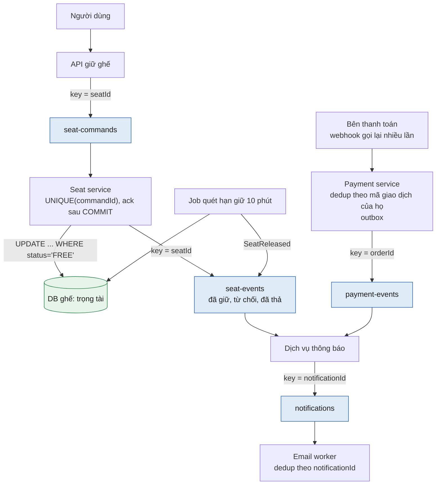

<!-- Tự sinh từ 0009-final-design-test.html bằng scripts/html2md.py. Đừng sửa tay. -->

[Kafka](../README.md) / [Bài 8](0008-topic-design.md) / Bài 9 · [Sổ tay tình huống](../reference/0003-tricky-scenarios.md) · [Managed trên AWS](../reference/0004-managed-kafka-msk-vs-confluent.md)

# Bài 9: 30 phút, một bài toán lạ, nói như đang họp

Đây là bài kiểm tra cuối trong mission của bạn. Không có phần kiến thức mới: bạn dùng những gì đã học và chúng ta xem chỗ nào còn hổng.

> **Liên quan tới mission** Mission đặt điều kiện thành công: cho một bài toán mới trong lĩnh vực bất kỳ, trong 30 phút tự đề xuất topic, key, số partition, cấu hình độ bền, cấu hình producer/consumer, cách xử lý trùng/lỗi, và giải thích đánh đổi bằng lời như đang họp. Bài này đúng là bài thi đó.

**Thắng lợi của bài này:** một thẻ thiết kế hoàn chỉnh cho bài toán lạ, tự chấm bằng thang bên dưới, và một danh sách ngắn những chỗ cần học lại (nếu có).

## 1. Phần A: gọi lại tổng hợp (10 phút, không nhìn bài cũ)

Tám câu trộn lẫn các bài 1-8 (xen kẽ chủ đề, cố ý). Câu nào sai thì quay lại bài tương ứng sau khi làm xong phần B.

<!-- quiz:quiz -->

**1. Một message được ghi vào partition 2 với offset 7. Điều nào đúng về thứ tự?**

- **A.** Nó đứng sau mọi message cũ hơn trong topic
- **B.** Nó đứng sau offset 6 của partition 2
- **C.** Nó đứng sau offset 6 ở mọi partition
- **D.** Nó có thể được đọc trước offset 6 cùng partition

Đáp án

**B. Nó đứng sau offset 6 của partition 2**

Thứ tự chỉ được đảm bảo trong một partition (Bài 2).

**2. Cụm 3 node combined mode. Hai node chết cùng lúc. Vì sao cụm không dùng được?**

- **A.** Dữ liệu trong topic bị xoá hết
- **B.** Producer tự tắt vì acks quá cao
- **C.** Consumer group bị giải tán vĩnh viễn
- **D.** Mất đa số controller của quorum

Đáp án

**D. Mất đa số controller của quorum**

Quorum cần đa số controller; 3 controller chịu được 1 lỗi (Bài 3).

**3. acks=all, min.insync.replicas=1, ISR chỉ còn leader, leader chết. Với unclean.leader.election.enable=false, partition ra sao?**

- **A.** Offline cho tới khi một replica ISR sống lại
- **B.** Tự bầu follower ngoài ISR làm leader ngay
- **C.** Vẫn ghi bình thường nhờ min.insync.replicas
- **D.** Tự chuyển sang topic dự phòng cùng tên

Đáp án

**A. Offline cho tới khi một replica ISR sống lại**

Chọn nhất quán: chờ replica trong ISR; unclean=true mới cho bầu replica ngoài ISR và chấp nhận mất dữ liệu (Bài 4).

**4. Listener giao việc cho thread pool rồi return; auto-commit bật. Crash. Điều gì có thể xảy ra?**

- **A.** Chỉ trùng, không bao giờ mất
- **B.** Chỉ chậm, không mất không trùng
- **C.** Có thể mất việc đã commit chưa xong
- **D.** Broker tự giữ việc cho lần sau

Đáp án

**C. Có thể mất việc đã commit chưa xong**

Offset đi trước việc xử lý nên có thể mất (Bài 5).

**5. Spring Kafka mặc định, message hỏng làm listener ném lỗi. Sau 10 lần giao thì sao?**

- **A.** Log ERROR rồi bị bỏ qua
- **B.** Vào topic -dlt tự động
- **C.** Consumer dừng cho tới khi sửa
- **D.** Quay lại đầu hàng đợi mãi mãi

Đáp án

**A. Log ERROR rồi bị bỏ qua**

DefaultErrorHandler mặc định chỉ log và commit offset: mất im lặng (Bài 6).

**6. Hai record trùng do ứng dụng gửi lại có offset khác nhau. Khoá dedup nào bắt được cả hai?**

- **A.** Offset của record trong partition
- **B.** Số partition cộng với tên topic
- **C.** Thời điểm nhận của consumer
- **D.** Mã nghiệp vụ của sự kiện

Đáp án

**D. Mã nghiệp vụ của sự kiện**

Chỉ mã nghiệp vụ (eventId) ổn định qua các lần gửi lại (Bài 7).

**7. Topic 6 partition cần tăng lên 12 mà vẫn giữ thứ tự theo key. Nhận định đúng nhất?**

- **A.** Không đảm bảo: key có thể đổi partition
- **B.** Làm được nếu bật idempotence cho producer
- **C.** Làm được nếu đặt lại min.insync.replicas
- **D.** Làm được, Kafka tự chia lại dữ liệu cũ

Đáp án

**A. Không đảm bảo: key có thể đổi partition**

Tăng partition làm đổi mapping key và không phân phối lại dữ liệu cũ (Bài 8, s12).

**8. Một dịch vụ nói "exactly-once". Dữ liệu cuối cùng được ghi vào DB quan hệ. Bạn nên hiểu thế nào?**

- **A.** Đúng, vì transaction Kafka bao cả DB
- **B.** Đúng, vì producer đã bật idempotence
- **C.** Chỉ đúng nếu có dedup ở phía DB
- **D.** Sai, vì acks=all luôn gây trùng

Đáp án

**C. Chỉ đúng nếu có dedup ở phía DB**

Transaction Kafka chỉ phủ Kafka→Kafka; với DB cần at-least-once + idempotent consumer (Bài 7).

<!-- /quiz -->

## 2. Phần B: bài toán lạ (30 phút)

**Cách làm:** đặt đồng hồ, điền thẻ bên dưới *không nhìn tài liệu*, rồi nói to 2 phút "như trong họp". Sau đó mới mở thang chấm và đáp án mẫu. Nếu bạn muốn một đề chưa từng thấy, bảo giáo viên "ra đề cho tôi" và dùng cùng thẻ.

> **Đề mẫu: bán vé sự kiện** Một sàn bán vé mở bán 5.000 ghế cho 50.000 người cùng giành, đỉnh khoảng 20.000 yêu cầu/giây trong 2 phút. Người dùng giữ ghế trong 10 phút để thanh toán; hết hạn thì ghế được thả. Yêu cầu: không bán một ghế hai lần; không mất thanh toán đã thành công; email xác nhận gửi ít nhất một lần, trùng thì chấp nhận được nhưng nên hiếm. Dịch vụ thanh toán bên thứ ba có thể gọi lại (webhook) nhiều lần.

30:00

Bắt đầuDừng

1. Các topic và quan hệ giữa chúng (tên, ai ghi, ai đọc) 2. Key của từng topic, vì sao 3. Số partition và cách bạn chọn (kèm dư địa) 4. Độ bền: RF, min.insync.replicas, producer acks/idempotence, cách đọc kết quả gửi 5. Consumer: commit, xử lý trùng, xử lý lỗi (retry, DLT), thứ tự 6. Retention hay compaction, kích thước message, schema/eventId 7. Ba rủi ro lớn nhất và đánh đổi bạn đã chọn 8. Câu hỏi bạn sẽ hỏi platform team (managed Kafka)

Xoá thẻ Thẻ được lưu trong trình duyệt của bạn (nếu trình duyệt cho phép), không gửi đi đâu.

## 3. Thang chấm (tự chấm, mỗi mục 0-2 điểm)

| # | Mục | 2 điểm khi bạn... | Bài |
|---|---|---|---|
| 1 | Key và thứ tự | chọn key theo đối tượng cần giữ thứ tự, và nêu rủi ro key nóng hoặc key quá thô | 2, 8 |
| 2 | Partition | gắn số partition với song song hoá cần có, nói được không giảm được và tăng làm đổi mapping | 2, 8 |
| 3 | Độ bền | nêu đủ RF=3, minISR=2 ở topic, acks=all, và đánh đổi sẵn sàng/bền; nói rõ lỗi gửi được đọc ở đâu | 4 |
| 4 | Consumer | tắt auto-commit hoặc ack sau xử lý, nêu crash ở đâu gây trùng, chọn ack-mode | 5 |
| 5 | Trùng | dedup bằng mã nghiệp vụ trong cùng transaction DB với tác dụng phụ; nhắc webhook gọi lại; nói đúng phạm vi exactly-once | 7 |
| 6 | Lỗi | có retry giới hạn + DLT cùng số partition + cảnh báo/replay; nêu đánh đổi thứ tự của retry topic | 6 |
| 7 | Dữ liệu | chọn retention/compaction hợp lý, nêu kích thước message và `eventId`/phiên bản schema | 8 |
| 8 | Nói như họp | mở bằng yêu cầu, đi qua quyết định kèm đánh đổi, kết bằng rủi ro còn lại và câu hỏi cho platform team | Tất cả |

**Cách đọc điểm:** 13-16 điểm: sẵn sàng "chém". 9-12: quay lại bài ứng với các mục bạn được 0-1. Dưới 9: làm lại một đề khác sau khi ôn các bài yếu. Điểm này tự chấm nên mang tính hướng dẫn; dán thẻ cho giáo viên để chấm giúp.

## 4. Đáp án mẫu (mở sau khi đã làm)

Mở đáp án mẫu cho đề bán vé

**Topic (gợi ý):** `seat-commands` (yêu cầu giữ ghế), `seat-events` (kết quả: đã giữ, từ chối, đã thả), `payment-events` (kết quả thanh toán, gồm webhook), `notifications` (gửi email). Mỗi topic có DLT riêng.

*Kiến trúc minh hoạ cho đáp án mẫu. Mỗi topic có DLT riêng (không vẽ). Ai ghi notifications là lựa chọn của bạn.*

**Key:** `seatId` cho `seat-commands` và `seat-events`: mọi yêu cầu cho cùng một ghế đi vào cùng một partition, được xử lý tuần tự bởi một consumer, nên "ai thắng ghế" là quyết định có thứ tự. Đánh đổi: key theo `eventId` (sự kiện) sẽ dồn mọi yêu cầu vào một partition: tải nóng và không song song. `orderId` cho `payment-events`. `userId` hoặc `notificationId` cho `notifications`.

**Partition:** tính từ đỉnh 20.000 yêu cầu/giây và số consumer cần chạy song song, cộng dư địa vì không giảm được và tăng làm đổi mapping; kiểm quota partition của dịch vụ managed. Con số cụ thể cần đo, không đoán.

**Độ bền:** `seat-commands` và `payment-events`: RF=3, minISR=2, `acks=all`, idempotence, đọc kết quả gửi bằng `whenComplete`/`get`; nếu gửi lỗi thì API trả lỗi cho người dùng chứ không âm thầm nuốt. Hỏi platform team về `unclean.leader.election.enable`.

**Không bán hai lần:** bảo đảm cuối cùng nằm ở *DB*, không ở Kafka: cập nhật ghế bằng điều kiện (`UPDATE seat SET status='HELD' WHERE id=? AND status='FREE'`) hoặc ràng buộc duy nhất. Kafka cho thứ tự và giảm tranh chấp; DB là trọng tài. Consumer idempotent: `UNIQUE(commandId)` trong cùng transaction DB, ack sau COMMIT.

**Thanh toán:** webhook của bên thứ ba có thể gọi lại: khoá dedup là mã giao dịch của họ (mã nghiệp vụ, không phải offset). Phía phát dùng outbox để ghi DB và sự kiện cùng transaction.

**Lỗi:** `DefaultErrorHandler` + `DeadLetterPublishingRecoverer` (DLT cùng số partition, minISR=2), back-off ngắn cho lỗi tạm thời, không retry lỗi dữ liệu; cảnh báo khi DLT có record; có quy trình replay. Với `seat-commands` thứ tự theo ghế quan trọng nên ưu tiên blocking retry ngắn thay vì retry topic.

**Hết hạn giữ ghế (10 phút):** đây là bộ đếm giờ nghiệp vụ. Trong những gì chúng ta đã học Kafka không có hẹn giờ giao message (retry topic chỉ phục vụ retry), nên đặt hạn trong DB và một job quét định kỳ, rồi phát sự kiện `SeatReleased`. Ghi chú: đây là quyết định thiết kế, không phải tính năng Kafka.

**Thông báo:** at-least-once, dedup theo `notificationId` (hiếm trùng, không nghiêm trọng); sự kiện này chịu được minISR thấp hơn nếu doanh nghiệp đồng ý, nhưng với mail xác nhận thanh toán thì dùng cấu hình như thanh toán cho đơn giản.

**Dữ liệu:** `retention.ms` vài ngày cho command (đủ để sửa lỗi và replay), dài hơn cho `payment-events` nếu cần đối soát; không compaction vì cần lịch sử. Message nhỏ; `eventId` (hoặc `commandId`) và phiên bản schema ngay từ đầu.

**Rủi ro còn lại cần nói:** (1) đỉnh tải vượt dự tính làm lag tăng và hết hạn giữ ghế trước khi xử lý xong: cần giám sát lag; (2) key nóng nếu một ghế bị tranh quá nhiều; (3) DLT không ai xem.

**Câu hỏi cho platform team:** xem 8 câu ở [bảng managed](../reference/0004-managed-kafka-msk-vs-confluent.md), đặc biệt: ai sở hữu cấu hình cụm, `unclean.leader.election.enable`, quyền tạo topic và trần partition, trần kích thước message, và lịch bảo trì (broker khởi động lại lần lượt, producer cần `delivery.timeout.ms` đủ dài).

**Ôn nhanh:** [tóm tắt Bài 9](../summaries/0009-final-design-test.md) (đọc sau khi đã tự nói).

### Hỏi nhanh, đáp gọn

- **Khung nói dùng lại cho đề bất kỳ** Yêu cầu (mất được không, trùng được không, thứ tự theo gì, tải bao nhiêu) → topic và key → partition → độ bền → consumer và chống trùng → lỗi → dữ liệu (retention, kích thước, schema) → rủi ro → câu hỏi cho platform team.
- **Người nghe ngắt lời hỏi "sao không exactly-once?"** Vì đầu ra cuối là DB; transaction Kafka chỉ phủ Kafka sang Kafka. Ở đây at-least-once cộng dedup trong DB cho cùng kết quả.

## 5. Sau bài này

- **Dán thẻ của bạn cho giáo viên** để chấm và chỉ ra chỗ cần ôn; mình sẽ ghi một learning record dựa trên kết quả thật, không phải trên dự đoán.
- **Chạy những lab chưa kiểm chứng:** lab 04 (ba thí nghiệm độ bền), s6, s10, s13. Kết quả của bạn quyết định các câu "Mong đợi" trong bài 4, 5, 7, 8 còn đúng không.
- **Hỏi platform team** 8 câu ở [bảng managed](../reference/0004-managed-kafka-msk-vs-confluent.md) ngay tuần đầu onboarding; và nếu muốn học thêm Schema Registry, nói để mình chạy research có nguồn trước khi dạy.
- **Cộng đồng:** xem mục Communities trong `RESOURCES.md` để kiểm tra "chém" của bạn với người làm thật.

> **Còn chỗ nào mơ hồ?** Hỏi thẳng giáo viên. Một yêu cầu rất hữu ích: "ra cho tôi một đề khác" (domain bất kỳ), hoặc "đóng vai người phản biện thiết kế của tôi".
