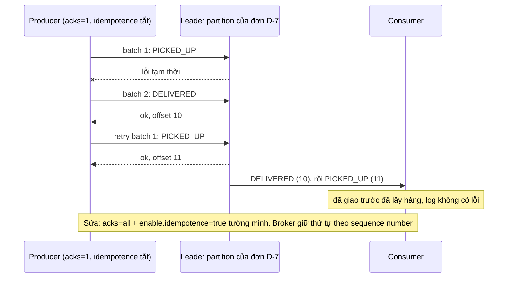
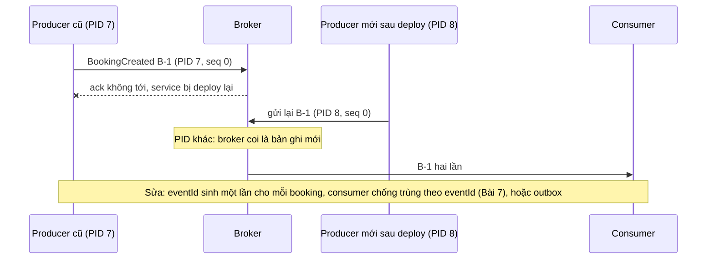
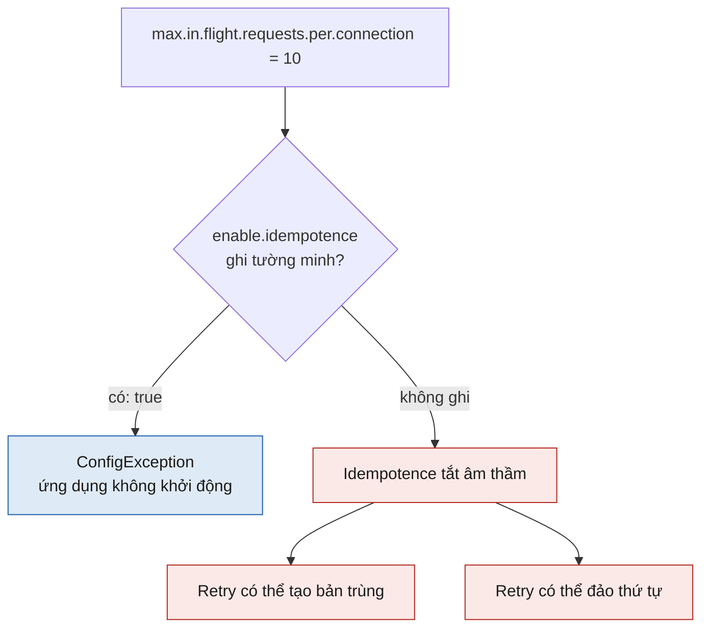

<!-- Tự sinh từ 0010-idempotent-producer.html bằng scripts/html2md.py. Đừng sửa tay. -->

[Kafka](../README.md) / [Bài 4](0004-producer-durability.md) / Bài 4b · [Bài 5](0005-consumer-offset-commit.md) · [Sổ tay tình huống](../reference/0003-tricky-scenarios.md)

# Bài 4b: Idempotent producer, gửi lại mà không trùng

Bài 4 lo "không mất". Cái giá của không mất là gửi lại; bài này lo để gửi lại không sinh bản trùng, và chỉ ra chỗ nó không lo được.

> **Liên quan tới mission** Khi bạn nói "producer bật idempotence rồi", người nghe hay hiểu thành "không bao giờ trùng". Sai. Sau bài này bạn nói được chính xác nó chặn trùng ở đâu, không chặn ở đâu, và cấu hình thế nào để không ai vô tình tắt nó.

**Thắng lợi của bài này:** bạn giải thích được cơ chế producer ID + sequence number, dự đoán đúng kết quả của 4 tình huống gửi lại (mô phỏng ở mục 3), và viết được cấu hình Spring Kafka tường minh khiến cấu hình sai lộ ra ngay lúc khởi động.

## 1. Kiến thức tối thiểu (có nguồn)

1. **Vấn đề gốc: không nhận được ack thì phải gửi lại.** Producer không biết lần gửi trước đã ghi hay chưa, nên gửi lại; nếu lần trước thật ra đã ghi thì log có hai bản. Docs gọi đó là at-least-once: "the message may be written to the log again during resending if the original request had in fact succeeded." [[Design: Message Delivery Semantics]](https://kafka.apache.org/44/design/design/)
2. **Cơ chế:** "the broker assigns each producer an ID and deduplicates messages using a sequence number that is sent by the producer along with every message." Diễn ra như sau:   [[Design]](https://kafka.apache.org/44/design/design/)
   - Mỗi producer có một **producer ID (PID)** do broker cấp. Mỗi batch gửi vào một partition mang một **sequence number** tăng dần.
   - Broker nhớ sequence cuối của từng PID. Retry mang lại đúng sequence cũ, nên broker nhận ra "đã có" và không ghi thêm.
3. **Hai thứ bạn được:** "producer retries will no longer introduce duplicates" [[KafkaProducer javadoc]](https://kafka.apache.org/44/javadoc/org/apache/kafka/clients/producer/KafkaProducer.html), và **thứ tự được giữ** kể cả khi có nhiều request đang bay: docs của `max.in.flight.requests.per.connection` nói giá trị > 1 cộng retry có thể đảo thứ tự khi idempotence tắt, còn khi idempotence bật thì thứ tự được giữ. [[Producer configs]](https://kafka.apache.org/44/configuration/producer-configs/)
4. **Thứ bạn không được: trùng do ứng dụng gửi lại.** Javadoc: "it is imperative to avoid application level re-sends since these cannot be de-duplicated", và "the producer can only guarantee idempotence for messages sent within a single session." Restart producer là session mới, PID mới; gửi lại cùng nội dung là bản ghi mới với broker. [[KafkaProducer javadoc]](https://kafka.apache.org/44/javadoc/org/apache/kafka/clients/producer/KafkaProducer.html) Chống trùng loại này phải làm ở consumer (Bài 7).
5. **Ba điều kiện bắt buộc:** `acks=all`, `retries` > 0, `max.in.flight.requests.per.connection` ≤ 5 (mô tả config nói broker chỉ giữ thông tin 5 batch gần nhất của mỗi producer). Mặc định của client đã thoả cả ba. [[Producer configs]](https://kafka.apache.org/44/configuration/producer-configs/)
6. **Mặc định bật, nhưng có thể bị tắt âm thầm.** `enable.idempotence` mặc định `true` từ Kafka 3.0. "Idempotence is enabled by default if no conflicting configurations are set." Nếu cấu hình xung đột (ví dụ `acks=1`):   [[Producer configs]](https://kafka.apache.org/44/configuration/producer-configs/) [[Javadoc]](https://kafka.apache.org/44/javadoc/org/apache/kafka/clients/producer/KafkaProducer.html)
   - bạn **không ghi** `enable.idempotence`: client tắt nó và chạy tiếp, không báo gì;
   - bạn **ghi tường minh** `enable.idempotence=true`: client ném `ConfigException`.
7. **Khi lỗi vẫn lọt qua:** nếu `send` vẫn báo lỗi dù retry vô hạn (ví dụ message hết hạn trong buffer trước khi gửi), javadoc khuyên đóng producer và kiểm tra message cuối để chắc nó không bị trùng. Gặp `OutOfOrderSequenceException` thì vẫn gửi tiếp được nhưng có thể sai thứ tự; muốn giữ thứ tự, đóng producer và tạo mới. [[Javadoc]](https://kafka.apache.org/44/javadoc/org/apache/kafka/clients/producer/KafkaProducer.html)
8. **Nối sang Bài 7:** đặt `transactional.id` thì idempotence được bật kèm ("enable.idempotence is implied"), và ID này có ý nghĩa qua nhiều session của producer. [[Producer configs]](https://kafka.apache.org/44/configuration/producer-configs/)

## 2. Cấu hình trong Spring Boot

Spring Boot không đổi mặc định của producer ([research/0002](../research/0002-spring-kafka.md)), nên với kafka-clients 4.x **không cấu hình gì cũng đã bật idempotence**. Vấn đề là nó bị tắt âm thầm khi ai đó đặt `acks: "1"` để "chạy nhanh hơn". Cách phòng: ghi tường minh, để cấu hình sai thành lỗi khởi động chứ không thành mất an toàn thầm lặng.

```
spring:
  kafka:
    producer:
      acks: all                          # điều kiện 1
      properties:
        "[enable.idempotence]": true     # tường minh: xung đột sẽ ném ConfigException
        # retries và max.in.flight.requests.per.connection: để mặc định (MAX_VALUE, 5)
        "[delivery.timeout.ms]": 120000  # giới hạn thời gian retry (Bài 4)
```

Boot không có property riêng cho `enable.idempotence`, nên phải đi qua `properties[...]`. Kiểm tra giá trị thật: client in bảng "ProducerConfig values" ở mức INFO khi tạo producer; tìm dòng `enable.idempotence`.

### Thí nghiệm: làm cấu hình sai lộ ra (lab 04, không cần sửa code)

Profile `risky` của lab 04 đặt `acks: "1"` và tắt idempotence tường minh. Bạn ghi đè để đòi idempotence cùng `acks=1`:

```
cd labs/04-producer-durability
mvn -q -DskipTests package
java -jar target/producer-durability-0.0.1-SNAPSHOT.jar --spring.profiles.active=risky \
  "--spring.kafka.producer.properties[enable.idempotence]=true" \
  --logging.level.org.apache.kafka.clients.producer.ProducerConfig=INFO
```

Mong đợi: tạo producer thất bại với `ConfigException` nói idempotence cần `acks=all`. Hành vi này đã kiểm chứng bằng kafka-clients thật trong workspace, nhưng **lệnh trên chưa chạy thử**; chạy khi cụm Bài 3 đang lên (lab đặt `admin.fail-fast=true` nên không có cụm thì app dừng sớm vì lý do khác). Rồi bỏ dòng ghi đè, chạy lại với profile `safe` và tìm `enable.idempotence = true` trong log.

Tôi đã thấy ConfigException và đọc được giá trị thật trong log

## 3. Mô phỏng: bốn kiểu gửi lại

Một partition, xem log broker ghi gì. Mô phỏng theo mô hình ở mục 1, không phải client thật. Với mỗi nút, **đoán trước** rồi bấm, lần lượt khi bật và khi tắt idempotence (đổi ô tick sẽ làm lại từ đầu).

1. **"Gửi, ack bị mất trên đường về"**: broker đã ghi, producer tự retry. Bật: không trùng. Tắt: trùng.
2. **"Gửi 2 batch, batch đầu lỗi tạm thời"**: batch sau tới trước. Bật: broker từ chối batch nhảy cóc, thứ tự giữ nguyên. Tắt: đảo thứ tự.
3. **"Producer restart, ứng dụng gửi lại đơn cuối"**: PID mới, sequence về 0. Bật hay tắt đều **trùng**: đây là giới hạn "single session".

## 4. Usecase oái oăm

### (a) Logistics: DELIVERED đến trước PICKED_UP

Team giao hàng đặt `acks: "1"` cho nhanh. Idempotence tắt âm thầm (điều kiện 1 bị vi phạm). Một ngày broker chập chờn, batch PICKED_UP lỗi tạm thời, batch DELIVERED đi trước, PICKED_UP được retry sau. Consumer thấy đơn "đã giao" rồi mới "đã lấy hàng". Không ai đổi cấu hình idempotence, không có lỗi nào trong log. Xử lý: `acks=all` và ghi tường minh `enable.idempotence=true`.



*Sequence: idempotence tắt âm thầm; một batch retry đi sau batch kế tiếp nên thứ tự trong log bị đảo.*

### (b) Đặt vé: restart rồi gửi lại

Service đặt vé gửi `BookingCreated`, bị deploy lại trước khi nhận kết quả. Lúc khởi động nó gửi lại các booking "chưa chắc đã gửi". Producer mới, PID mới: hai bản ghi, idempotence không giúp được. Xử lý: `eventId` sinh một lần cho mỗi booking, consumer chống trùng theo nó (Bài 7), hoặc outbox để chỉ một tiến trình chịu trách nhiệm gửi.



*Sequence: producer mới có PID mới, nên broker không nhận ra bản gửi lại là trùng.*

### (c) "Ta tăng max.in.flight lên 10 cho throughput"

Nếu đặt tường minh idempotence: lỗi khởi động. Nếu không: idempotence tắt âm thầm, và với retry thì thứ tự không còn được đảm bảo. Một dòng cấu hình "tối ưu hiệu năng" lấy đi hai bảo đảm. Đây là ví dụ tốt cho lý do review cấu hình producer cũng quan trọng như review code.



*Flow: một dòng "tối ưu hiệu năng" cho hai kết cục, tuỳ có ghi tường minh enable.idempotence hay không.*

## 5. Tự nói thành lời

Trong 45 giây: *"Idempotent producer chặn trùng bằng ... Nó giữ được thứ tự vì ... Nó không chặn được ... vì ... Để không ai tắt nó vô tình, mình cấu hình ..."*

**Ôn nhanh:** [tóm tắt Bài 4b](../summaries/0010-idempotent-producer.md) (đọc sau khi đã tự nói).

## 6. Kiểm tra

<!-- quiz:quiz -->

**1. Broker dùng gì để nhận ra một batch gửi lại là bản trùng?**

- **A.** Nội dung message so với bản ghi trước
- **B.** Producer ID cùng sequence number của batch
- **C.** Offset mà producer tự gán cho message
- **D.** Key của message và thời điểm gửi đi

<details><summary>Đáp án</summary>

**B. Producer ID cùng sequence number của batch**

Docs: broker cấp cho mỗi producer một ID và lọc trùng bằng sequence number gửi kèm mỗi message. Nội dung giống nhau không phải là căn cứ.

</details>

**2. Service restart rồi gửi lại một đơn hàng nó không chắc đã gửi. Idempotence đang bật. Kết quả?**

- **A.** Broker bỏ qua vì cùng nội dung đơn
- **B.** Producer tự nhận ra và không gửi lại
- **C.** Log có hai bản ghi của cùng một đơn
- **D.** Broker ném lỗi OutOfOrderSequenceException

<details><summary>Đáp án</summary>

**C. Log có hai bản ghi của cùng một đơn**

Producer mới là session mới, PID mới; idempotence chỉ đảm bảo trong một session và không lọc được gửi lại ở tầng ứng dụng.

</details>

**3. Không ai đặt enable.idempotence; một bạn đổi acks thành 1. Client 4.x làm gì?**

- **A.** Âm thầm tắt idempotence và chạy tiếp
- **B.** Ném ConfigException khi tạo producer
- **C.** Tự đổi acks về all rồi chạy tiếp
- **D.** Giữ idempotence và chạy với acks=1

<details><summary>Đáp án</summary>

**A. Âm thầm tắt idempotence và chạy tiếp**

Không đặt tường minh thì cấu hình xung đột làm idempotence bị tắt mà không báo. Ghi tường minh enable.idempotence=true biến việc này thành ConfigException.

</details>

**4. Idempotence bật, max.in.flight=5. Batch 1 lỗi tạm thời, batch 2 tới broker trước. Điều gì xảy ra?**

- **A.** Batch 2 được ghi trước, thứ tự bị đảo
- **B.** Cả hai batch bị mất do lỗi tạm thời
- **C.** Batch 1 bị bỏ qua vì đã quá hạn gửi
- **D.** Batch 2 bị từ chối, thứ tự được giữ

<details><summary>Đáp án</summary>

**D. Batch 2 bị từ chối, thứ tự được giữ**

Sequence của batch 2 nhảy cóc nên broker từ chối; producer gửi lại theo đúng thứ tự. Docs: idempotence bật thì thứ tự được giữ với in-flight tới 5.

</details>

**5. Vì sao nên ghi tường minh enable.idempotence=true dù mặc định đã là true?**

- **A.** Để producer gửi nhanh hơn mặc định
- **B.** Để cấu hình xung đột thành lỗi khởi động
- **C.** Để idempotence phủ qua nhiều session
- **D.** Để consumer không cần chống trùng nữa

<details><summary>Đáp án</summary>

**B. Để cấu hình xung đột thành lỗi khởi động**

Tường minh thì acks=1 hay in-flight > 5 sẽ ném ConfigException ngay khi tạo producer, thay vì âm thầm tắt idempotence. Nó không mở rộng phạm vi qua session.

</details>

<!-- /quiz -->

## Nguồn nên đọc

> **Chính:** phần mở đầu của [KafkaProducer javadoc](https://kafka.apache.org/44/javadoc/org/apache/kafka/clients/producer/KafkaProducer.html) (đoạn "idempotent producer", khoảng 10 phút), và mục `enable.idempotence`, `max.in.flight.requests.per.connection` trong [Producer configs](https://kafka.apache.org/44/configuration/producer-configs/).
>
> **Bổ trợ:** mục "Message Delivery Semantics" trong [Design](https://kafka.apache.org/44/design/design/).

**Bài tiếp theo:** [Bài 5: consumer, offset, commit](0005-consumer-offset-commit.md).

> **Còn chỗ nào mơ hồ?** Hỏi thẳng giáo viên, ví dụ "vì sao giới hạn là 5?", "idempotence có tốn hiệu năng không?". Dán dòng kết quả quiz.
