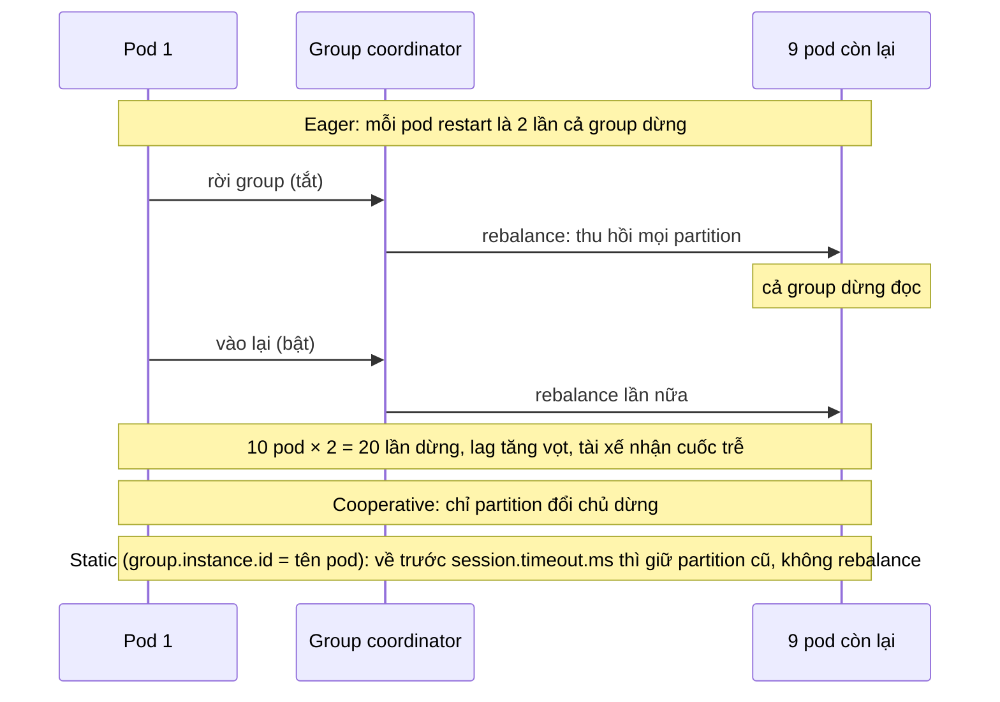
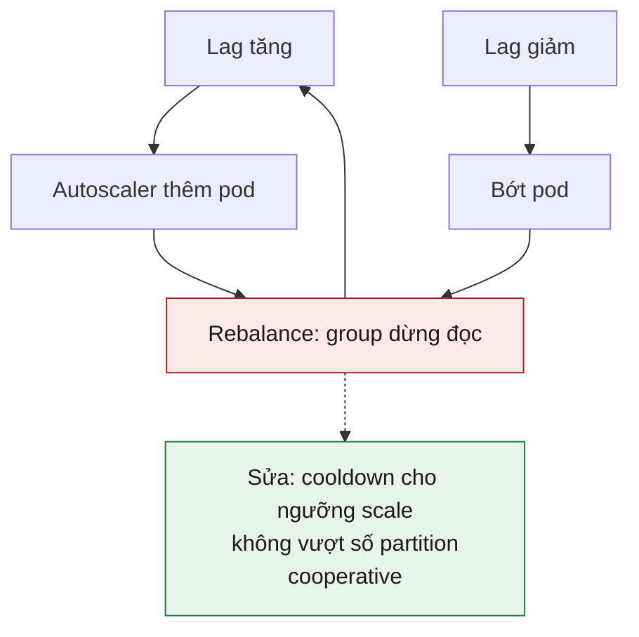
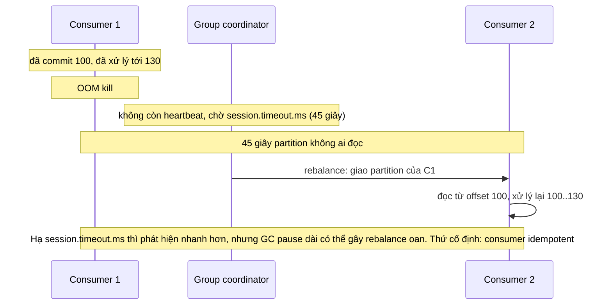

<!-- Tự sinh từ 0011-rebalance.html bằng scripts/html2md.py. Đừng sửa tay. -->

[Kafka](../README.md) / [Bài 5](0005-consumer-offset-commit.md) / Bài 5b · [Bài 5c](0012-delivery-semantics.md) · [Sổ tay tình huống](../reference/0003-tricky-scenarios.md)

# Bài 5b: Rebalance, khi group chia lại partition

Mỗi lần deploy, scale hay một consumer chết, group phải chia lại partition. Đó là lúc message đứng yên và message bị xử lý lại.

> **Liên quan tới mission** "Sao mỗi lần deploy lag tăng vọt?", "sao có message bị xử lý hai lần dù code không lỗi?". Hai câu này thường có chung một câu trả lời: rebalance. Sau bài này bạn nói được nó xảy ra khi nào, cả group dừng hay chỉ một phần dừng, và cấu hình nào giảm nó.

**Thắng lợi của bài này:** bạn kể được 5 nguyên nhân gây rebalance, dự đoán partition nào dừng ở eager và ở cooperative, và chọn được cấu hình (cooperative, static membership, giao thức consumer, commit khi bị thu hồi) cho một service deploy thường xuyên.

## 1. Kiến thức tối thiểu (có nguồn)

1. **Rebalance là gì.** Group coordinator (một broker) chia lại partition giữa các consumer trong group. Trong lúc chia, partition đang chuyển chủ không có ai đọc. [[KafkaConsumer javadoc]](https://kafka.apache.org/44/javadoc/org/apache/kafka/clients/consumer/KafkaConsumer.html)
2. **Khi nào xảy ra.** Javadoc liệt kê: số partition của topic đang đọc thay đổi; topic được tạo hoặc xoá (khi subscribe theo pattern); một member tắt hoặc chết; một member mới vào. Thêm trường hợp thứ năm: consumer không gọi `poll()` trong `max.poll.interval.ms` thì tự rời group (Bài 5). [[KafkaConsumer javadoc]](https://kafka.apache.org/44/javadoc/org/apache/kafka/clients/consumer/KafkaConsumer.html)
3. **Coordinator biết consumer chết bằng heartbeat.** Consumer gửi heartbeat định kỳ (`heartbeat.interval.ms`, mặc định 3000). Không nhận được heartbeat trong `session.timeout.ms` (mặc định 45000) thì coordinator loại consumer và rebalance. Hệ quả: consumer bị `kill -9` thì **khoảng 45 giây** partition của nó không ai đọc. Tắt êm (`close()`) thì consumer báo rời group ngay. [[Consumer configs]](https://kafka.apache.org/44/configuration/consumer-configs/)
4. **Rebalance chỉ diễn ra trong `poll()`**, và các callback chạy trên chính thread gọi `poll()`. Consumer đang mắc kẹt xử lý một lô dài thì không tham gia rebalance được, cả group chờ nó. [[ConsumerRebalanceListener]](https://kafka.apache.org/44/javadoc/org/apache/kafka/clients/consumer/ConsumerRebalanceListener.html)
5. **Eager và cooperative.**   [[ConsumerRebalanceListener]](https://kafka.apache.org/44/javadoc/org/apache/kafka/clients/consumer/ConsumerRebalanceListener.html) [[CooperativeStickyAssignor]](https://kafka.apache.org/44/javadoc/org/apache/kafka/clients/consumer/CooperativeStickyAssignor.html) [[Consumer configs]](https://kafka.apache.org/44/configuration/consumer-configs/)
   - **Eager:** `onPartitionsRevoked` được gọi với *toàn bộ* partition đang giữ: mọi consumer trả hết rồi mới chia lại, cả group dừng.
   - **Cooperative:** chỉ thu hồi các partition thật sự chuyển chủ; partition giữ nguyên chủ thì đọc tiếp. Phải đặt `CooperativeStickyAssignor` cho *mọi* consumer trong group.
   - **Mặc định:** `partition.assignment.strategy` = `[RangeAssignor, CooperativeStickyAssignor]`, nghĩa là vẫn dùng `RangeAssignor` (eager). Docs hướng dẫn chuyển sang cooperative bằng một lần rolling restart sau khi bỏ `RangeAssignor` khỏi danh sách.
6. **Rebalance và trùng message.** Partition chuyển sang consumer khác thì consumer mới đọc từ *offset đã commit*; record đã xử lý mà chưa commit sẽ bị xử lý lại. Docs khuyên commit trong `onPartitionsRevoked` "to prevent duplicate data". Nếu consumer đã bị loại vì hết session timeout thì `onPartitionsLost` được gọi và lúc đó thường không commit được nữa, vì partition có thể đã thuộc consumer khác. Consumer bị đá vì quá `max.poll.interval.ms` mà vẫn commit thì nhận `CommitFailedException`: chỉ member còn trong group mới được commit. [[ConsumerRebalanceListener]](https://kafka.apache.org/44/javadoc/org/apache/kafka/clients/consumer/ConsumerRebalanceListener.html) [[KafkaConsumer javadoc]](https://kafka.apache.org/44/javadoc/org/apache/kafka/clients/consumer/KafkaConsumer.html)
7. **Static membership.** Đặt `group.instance.id` (duy nhất mỗi instance) thì consumer là static member. Restart nhanh, quay lại trước khi hết `session.timeout.ms`, thì không rebalance; static member quá `max.poll.interval.ms` thì partition cũng không bị chia lại ngay mà chờ hết session timeout. Đổi lại: static member chết thật thì partition của nó đứng tới hết session timeout. Mỗi `group.instance.id` chỉ một instance được dùng tại một thời điểm. [[Consumer configs]](https://kafka.apache.org/44/configuration/consumer-configs/)
8. **Giao thức mới `group.protocol=consumer` (KIP-848).** Giao thức classic dựa trên "a group-wide synchronization barrier", nên "a single misbehaving consumer can take down or disturb the whole group". Giao thức mới chia lại từng phần, việc tính toán chuyển về coordinator, và "a consumer should not be impacted at all by a rebalance if its assignment is not changed". Khi dùng nó, `session.timeout.ms` và `heartbeat.interval.ms` phía client không còn tác dụng; broker quyết định. Mặc định của client vẫn là `classic`; dùng được hay không phụ thuộc broker (xem [bảng managed](../reference/0004-managed-kafka-msk-vs-confluent.md)). [[KIP-848]](https://cwiki.apache.org/confluence/display/KAFKA/KIP-848%3A+The+Next+Generation+of+the+Consumer+Rebalance+Protocol) [[Consumer configs]](https://kafka.apache.org/44/configuration/consumer-configs/)
9. **Spring Kafka.** Boot không có property riêng cho `group.instance.id` hay `partition.assignment.strategy`; đặt qua `spring.kafka.consumer.properties[...]`. Với `concurrency` > 1, container tự thêm hậu tố `-n` vào `group.instance.id` cho từng consumer. Muốn chạy code khi bị thu hồi partition: khai báo bean `ConsumerAwareRebalanceListener`, Boot tự gắn vào container. [[Message listener container]](https://docs.spring.io/spring-kafka/reference/kafka/receiving-messages/message-listener-container.html) [[Rebalance listeners]](https://docs.spring.io/spring-kafka/reference/kafka/receiving-messages/rebalance-listeners.html)

```
spring:
  kafka:
    consumer:
      properties:
        "[partition.assignment.strategy]": org.apache.kafka.clients.consumer.CooperativeStickyAssignor
        "[group.instance.id]": ${HOSTNAME}     # phải khác nhau mỗi pod và ổn định qua restart
```

Hai dòng này là ví dụ ghép từ docs, chưa chạy thử. `${HOSTNAME}` chỉ ổn định qua restart nếu tên pod ổn định (ví dụ StatefulSet); tên pod ngẫu nhiên làm mất lợi ích của static membership.

## 2. Mô phỏng: ai dừng khi group chia lại

Topic 6 partition, ban đầu C1 và C2. Mỗi partition luôn có 2 record đã xử lý nhưng chưa commit, để bạn thấy trùng khi partition đổi chủ không êm. Mô phỏng đơn giản hoá: cooperative thật cần hai vòng rebalance, ở đây gộp làm một.

1. **Eager, "Thêm consumer"**: cả 6 partition dừng dù chỉ 2 partition đổi chủ. Đổi sang **Cooperative** rồi làm lại: chỉ 2 partition dừng.
2. **"Crash (kill -9)"**: rebalance sau session timeout và 2 record mỗi partition bị xử lý lại. So với **"Rời êm"**: không trùng.
3. **"Deploy lại"** khi tắt static membership: hai lần rebalance. Bật static membership rồi làm lại: không rebalance, chỉ partition của consumer đó dừng trong lúc restart.
4. **"Xử lý quá max.poll.interval.ms"**: hai lần rebalance (bị đá rồi vào lại) cộng trùng. Đây là kịch bản của lab `s7` ở Bài 5.

## 3. Thực hành trên cụm

### Bước 1. Ba consumer Spring Boot cùng group, xem group chia lại

Dùng consumer của `labs/03-spring-clients` (Bài 3 bước 3). Nó in mỗi lần bị thu hồi hoặc được giao partition:

```
// labs/03-spring-clients/.../ConsumerListener.java (rút gọn): Boot tự gắn bean này vào container
@Bean
ConsumerAwareRebalanceListener rebalanceLogger() {
    return new ConsumerAwareRebalanceListener() {
        public void onPartitionsRevokedBeforeCommit(Consumer<?, ?> c, Collection<TopicPartition> parts) {
            System.out.printf("[%s] REBALANCE: bị thu hồi %s%n", instance, parts);   // container commit sau callback này
        }
        public void onPartitionsAssigned(Consumer<?, ?> c, Collection<TopicPartition> parts) {
            System.out.printf("[%s] REBALANCE: được giao %s%n", instance, parts);
        }
        public void onPartitionsLost(Consumer<?, ?> c, Collection<TopicPartition> parts) {
            System.out.printf("[%s] REBALANCE: MẤT %s%n", instance, parts);
        }
    };
}
```

Mở 3 terminal, mỗi terminal một instance cùng group `g-rb` (topic `lab-orders` có 3 partition):

```
cd labs/03-spring-clients
mvn -q -DskipTests package          # Maven chạy bằng JDK 17+ (đặt JAVA_HOME như README của lab)
J="java -jar target/spring-clients-0.0.1-SNAPSHOT.jar"
$J --spring.profiles.active=consumer --lab.group=g-rb --lab.instance=c1    # terminal 1
$J --spring.profiles.active=consumer --lab.group=g-rb --lab.instance=c2    # terminal 2
$J --spring.profiles.active=consumer --lab.group=g-rb --lab.instance=c3    # terminal 3
# terminal 4: ai giữ partition nào
docker exec kafka-1 /opt/kafka/bin/kafka-consumer-groups.sh --bootstrap-server kafka-1:19092 --describe --group g-rb --members --verbose
```

Rồi lần lượt: (1) Ctrl-C c3 (rời êm); (2) chạy lại c3; (3) giết cứng c2 bằng PowerShell `Stop-Process -Id <pid> -Force` (tìm pid bằng `Get-Process java`) và xem log c1, c3 ngay rồi sau khoảng 45 giây.

Mong đợi (theo docs, chưa chạy thử trên cụm này): mỗi lần c3 vào hoặc rời, cả ba in "bị thu hồi" toàn bộ partition rồi "được giao" (eager, vì mặc định là `RangeAssignor`). Ctrl-C thì chia lại gần như ngay; giết cứng c2 thì phần của c2 đứng tới khi hết session timeout (khoảng 45 giây) rồi mới được giao cho người khác.

Tôi đã thấy partition chuyển chủ khi consumer rời êm và khi chết

### Bước 1b. Bật cooperative và static membership

Dừng cả ba, chạy lại với thêm profile `static` (mỗi instance giữ nguyên `--lab.instance`):

```
# labs/03-spring-clients/src/main/resources/application-static.yml
spring:
  kafka:
    consumer:
      properties:
        "[group.instance.id]": ${lab.instance}
        "[partition.assignment.strategy]": org.apache.kafka.clients.consumer.CooperativeStickyAssignor
```

```
$J --spring.profiles.active=consumer,static --lab.group=g-rb2 --lab.instance=c1   # tương tự c2, c3
```

Ctrl-C c2 rồi chạy lại ngay (dưới 45 giây). Sau đó thêm c4.

Mong đợi (theo docs, chưa chạy thử): c2 restart nhanh thì không có dòng REBALANCE ở c1, c3 (static membership); thêm c4 thì chỉ partition chuyển sang c4 bị thu hồi, các partition khác không (cooperative). Dùng group mới `g-rb2` vì cooperative phải bật cho mọi consumer trong group. Ghi lại bạn thấy gì: chỗ này là đặc tính có thể khác theo phiên bản client và broker.

Tôi đã so eager/cooperative và dynamic/static

### Bước 2. Rebalance do xử lý chậm (lab s7)

Nếu chưa chạy ở Bài 5: `mvn -q spring-boot:run -Dspring-boot.run.profiles=s7` trong `labs/05-scenarios`. Lần này đọc log để đếm số lần "partitions revoked/assigned" (container ghi log rebalance ở mức INFO).

Tôi đã đếm số lần rebalance trong log s7

## 4. Usecase oái oăm

### (a) Gọi xe: rolling deploy 10 pod làm điều phối đứng hình

Deploy thay lần lượt 10 pod. Mỗi pod tắt rồi bật là hai lần rebalance; với eager, mỗi lần cả group dừng. Hai mươi lần dừng trong vài phút, lag tăng vọt, tài xế nhận cuốc trễ. Xử lý theo mức: cooperative (chỉ partition đổi chủ dừng), static membership với tên pod ổn định (restart nhanh không rebalance), hoặc giao thức consumer nếu broker hỗ trợ. Trên MSK, AWS khuyên luôn đặt `group.instance.id`.



*Sequence: với eager, mỗi pod restart là hai lần cả group dừng; static membership giữ chỗ cũ nếu pod về kịp.*

### (b) Autoscale theo lag thành "bão rebalance"

Lag tăng, autoscaler thêm pod; thêm pod gây rebalance, lag tăng tiếp; lag giảm thì bớt pod, lại rebalance. Group dành nhiều thời gian chia lại hơn là đọc. Xử lý: ngưỡng scale có độ trễ (cooldown), không scale vượt số partition (consumer thừa chỉ ngồi chờ, Bài 1), dùng cooperative.



*Flow: scale theo lag tạo vòng lặp, vì chính việc thêm hoặc bớt pod gây rebalance.*

### (c) Consumer chết đột ngột: 45 giây im lặng rồi xử lý trùng

Pod bị OOM kill. Coordinator không nhận heartbeat nhưng chỉ loại nó sau `session.timeout.ms`. Trong lúc đó partition của nó không ai đọc; sau đó consumer mới đọc từ offset đã commit và xử lý lại phần chưa commit. Hạ `session.timeout.ms` giúp phát hiện nhanh hơn, nhưng một lần GC pause dài cũng có thể bị coi là chết và gây rebalance oan. Không có giá trị đúng cho mọi nơi; thứ cố định là consumer phải idempotent (Bài 7).



*Sequence: consumer chết đột ngột; partition im lặng tới hết session.timeout.ms, rồi phần chưa commit bị xử lý lại.*

### (d) Nếu là ngân hàng

"Service đọc giao dịch dùng cooperative + static membership, commit khi bị thu hồi partition, và consumer idempotent vì rebalance vẫn có thể gây xử lý lại." Câu cuối quan trọng nhất: giảm rebalance là tối ưu, chống trùng mới là bảo đảm.

## 5. Tự nói thành lời

Trong 60 giây: *"Rebalance xảy ra khi ... Với eager thì ..., với cooperative thì ... Consumer chết đột ngột thì ... vì ... Để deploy không làm group đứng, mình cấu hình ..."*

**Ôn nhanh:** [tóm tắt Bài 5b](../summaries/0011-rebalance.md) (đọc sau khi đã tự nói).

## 6. Kiểm tra

<!-- quiz:quiz -->

**1. Trường hợp nào KHÔNG gây rebalance trong một consumer group?**

- **A.** Một consumer mới tham gia group
- **B.** Topic được tăng thêm partition
- **C.** Producer đổi acks từ 1 sang all
- **D.** Consumer không poll kịp trong hạn

<details><summary>Đáp án</summary>

**C. Producer đổi acks từ 1 sang all**

Rebalance do thành viên group hoặc số partition thay đổi (và consumer quá max.poll.interval.ms). Cấu hình producer không liên quan tới group.

</details>

**2. Group 3 consumer dùng RangeAssignor (eager). Thêm consumer thứ 4. Partition nào ngừng đọc trong lúc rebalance?**

- **A.** Tất cả partition của cả group
- **B.** Chỉ partition chuyển sang consumer mới
- **C.** Không partition nào, chia lại ngay
- **D.** Chỉ partition của consumer đầu tiên

<details><summary>Đáp án</summary>

**A. Tất cả partition của cả group**

Eager: onPartitionsRevoked được gọi với toàn bộ partition đang giữ, mọi consumer trả hết rồi mới chia lại. Cooperative mới chỉ dừng partition đổi chủ.

</details>

**3. Pod consumer bị kill -9 (dynamic member, mặc định). Partition của nó được chia lại khi nào?**

- **A.** Ngay lập tức, broker thấy kết nối đứt
- **B.** Sau max.poll.interval.ms, tức 5 phút
- **C.** Chỉ khi có consumer mới vào group
- **D.** Sau session.timeout.ms, khoảng 45 giây

<details><summary>Đáp án</summary>

**D. Sau session.timeout.ms, khoảng 45 giây**

Coordinator chỉ loại consumer khi không nhận heartbeat trong session.timeout.ms (mặc định 45000). Trong lúc đó partition không ai đọc.

</details>

**4. Vì sao docs khuyên commit offset trong onPartitionsRevoked?**

- **A.** Để consumer sau không xử lý lại
- **B.** Để broker giữ partition lâu hơn
- **C.** Để rebalance xảy ra nhanh gấp đôi
- **D.** Để producer không gửi trùng nữa

<details><summary>Đáp án</summary>

**A. Để consumer sau không xử lý lại**

Consumer nhận partition sẽ đọc từ offset đã commit; commit trước khi bị thu hồi để tránh xử lý lại ("to prevent duplicate data").

</details>

**5. Service deploy nhiều lần mỗi ngày, mỗi pod restart dưới 20 giây, tên pod ổn định. Cấu hình nào tránh rebalance khi restart?**

- **A.** Tăng max.poll.records lên thật lớn
- **B.** Đặt group.instance.id cho mỗi pod
- **C.** Đặt enable.auto.commit bằng true
- **D.** Giảm heartbeat.interval.ms xuống 1s

<details><summary>Đáp án</summary>

**B. Đặt group.instance.id cho mỗi pod**

Static membership: quay lại trong session timeout với cùng group.instance.id thì không rebalance. Đổi lại pod chết thật thì partition đứng tới hết session timeout.

</details>

<!-- /quiz -->

## Nguồn nên đọc

> **Chính:** [ConsumerRebalanceListener javadoc](https://kafka.apache.org/44/javadoc/org/apache/kafka/clients/consumer/ConsumerRebalanceListener.html) (ngắn, khoảng 10 phút), rồi phần "Motivation" của [KIP-848](https://cwiki.apache.org/confluence/display/KAFKA/KIP-848%3A+The+Next+Generation+of+the+Consumer+Rebalance+Protocol).
>
> **Spring:** [Rebalance listeners](https://docs.spring.io/spring-kafka/reference/kafka/receiving-messages/rebalance-listeners.html).

**Bài tiếp theo:** [Bài 5c: at-most-once, at-least-once, exactly-once](0012-delivery-semantics.md): ghép nửa ghi (Bài 4) và nửa đọc (Bài 5, 5b) thành ngữ nghĩa của cả luồng. Sau đó là [Bài 6](0006-error-handling-dlt.md).

> **Còn chỗ nào mơ hồ?** Hỏi thẳng giáo viên, ví dụ "cooperative có làm chậm rebalance không?", "session.timeout.ms nên đặt bao nhiêu?". Dán dòng kết quả quiz.
