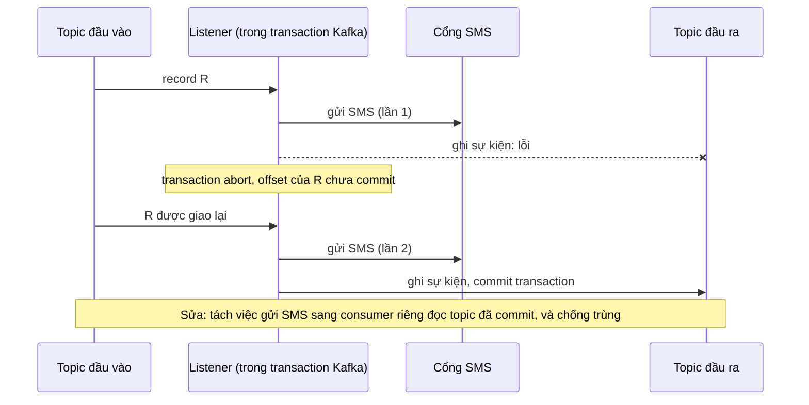
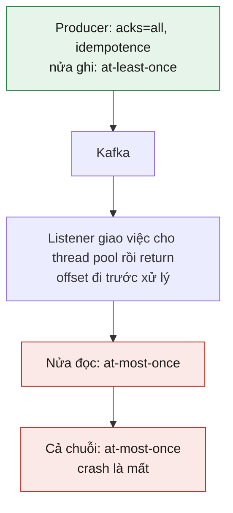
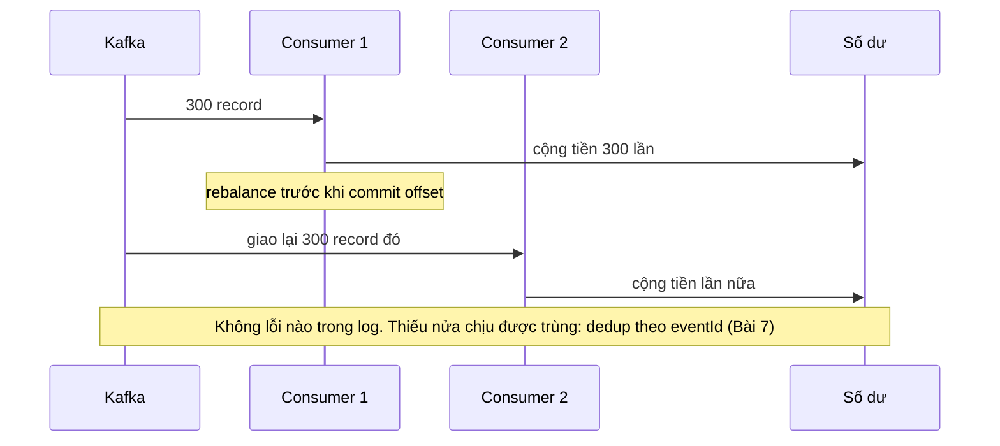

<!-- Tự sinh từ 0012-delivery-semantics.html bằng scripts/html2md.py. Đừng sửa tay. -->

[Kafka](../README.md) / [Bài 5b](0011-rebalance.md) / Bài 5c · [Bài 6](0006-error-handling-dlt.md) · [Sổ tay tình huống](../reference/0003-tricky-scenarios.md)

# Bài 5c: At-most-once, at-least-once, exactly-once: chọn cái nào, cấu hình ra sao

Bài 4 lo phía ghi, Bài 5 lo phía đọc. Ngữ nghĩa giao hàng là kết quả của cả hai cộng lại, và là câu đầu tiên cần chốt khi thiết kế một luồng sự kiện.

> **Liên quan tới mission** Trong họp thiết kế, "luồng này at-least-once hay exactly-once?" là câu hỏi mở đầu. Trả lời sai thì cả thiết kế sai: hứa exactly-once cho một luồng ghi DB là hứa điều Kafka không làm được. Sau bài này bạn chọn đúng ngữ nghĩa cho từng loại dữ liệu và viết được cấu hình Spring Boot tương ứng.

**Thắng lợi của bài này:** với một luồng dữ liệu bất kỳ, bạn chọn ngữ nghĩa giao hàng, chỉ ra producer và consumer phải cấu hình gì để đạt nó, và chỉ ra chỗ ngữ nghĩa đó có thể bị phá.

## 1. Kiến thức tối thiểu (có nguồn)

1. **Ba ngữ nghĩa** theo docs: [[Design: Message Delivery Semantics]](https://kafka.apache.org/44/design/design/)
   - **At most once**: "Messages may be lost but are never redelivered."
   - **At least once**: "Messages are never lost but may be redelivered."
   - **Exactly once**: "Each message is processed once and only once."
2. **Ngữ nghĩa là của cả chuỗi, có hai nửa.** Nửa ghi (producer → broker) và nửa đọc (broker → consumer → tác dụng phụ). Chuỗi yếu ở nửa nào thì yếu cả chuỗi: producer hoàn hảo mà consumer commit trước khi xử lý thì vẫn mất. [[Design]](https://kafka.apache.org/44/design/design/)
3. **Nửa ghi.** Producer không retry thì có thể mất (at-most-once). Có retry thì không mất nhưng có thể ghi trùng (at-least-once). Retry cộng idempotence thì không trùng do retry trong một session ([Bài 4b](0010-idempotent-producer.md)). Độ bền phía broker (`acks=all`, `min.insync.replicas`) quyết định message đã ack có còn hay không ([Bài 4](0004-producer-durability.md)).
4. **Nửa đọc: thứ tự giữa "xử lý" và "lưu vị trí".** Docs: đọc, *lưu vị trí*, rồi mới xử lý thì "corresponds to at-most-once" vì consumer chết giữa chừng thì message chưa được xử lý; đọc, xử lý, rồi *lưu vị trí* thì "corresponds to the at-least-once semantics". [[Design]](https://kafka.apache.org/44/design/design/) Trong Spring, "lưu vị trí" là thời điểm commit offset ([Bài 5](0005-consumer-offset-commit.md), mục "Commit offset xảy ra lúc nào").
5. **Mặc định Kafka là at-least-once:** "Kafka guarantees at-least-once delivery by default". At-most-once phải tự chọn: tắt retry ở producer và commit offset trước khi xử lý. [[Design]](https://kafka.apache.org/44/design/design/)
6. **Exactly-once có hai phạm vi khác nhau.**   [[Design]](https://kafka.apache.org/44/design/design/)
   - **Kafka → Kafka:** đọc topic, ghi topic khác, và "write the offset to Kafka in the same transaction as the output topics". Kafka làm được bằng transaction + consumer `read_committed` ([Bài 7](0007-idempotent-consumer-transactions.md)).
   - **Kafka → hệ thống ngoài (DB, API):** "generally requires cooperation with such systems". Hai cách docs nêu: two-phase commit (nhiều hệ thống không hỗ trợ), hoặc "letting the consumer store its offset in the same place as its output". Cách thực tế phổ biến: at-least-once + consumer idempotent, để tác dụng phụ chỉ xảy ra một lần dù message tới nhiều lần.

## 2. Chọn ngữ nghĩa theo loại dữ liệu

| Ngữ nghĩa | Đánh đổi | Hợp với (phân tích, không phải quy định) |
|---|---|---|
| **At-most-once** | Nhanh, đơn giản; chấp nhận mất | Dữ liệu "mới nhất là đủ": giá chứng khoán hiển thị theo thời gian thực, vị trí xe, telemetry, metric. Tick mất thì tick sau thay ngay; xử lý lại tick cũ còn có hại |
| **At-least-once** | Không mất; phải chịu hoặc chống trùng | Phần lớn sự kiện nghiệp vụ: đơn hàng, thông báo, đồng bộ dữ liệu, audit log. Kèm consumer idempotent nếu tác dụng phụ không được lặp |
| **Exactly-once trong Kafka** | Chậm hơn, phức tạp hơn; chỉ phủ Kafka → Kafka | Bước xử lý luồng có đầu vào và đầu ra đều là topic: tính vị thế, tổng hợp giao dịch theo phút, làm giàu và chuyển đổi định dạng |
| **Hiệu quả đúng một lần với DB** (at-least-once + idempotent consumer + outbox) | Thêm bảng dedup, outbox; consumer phức tạp hơn | Tiền và lệnh: chuyển khoản, ghi sổ cái, trừ tiền, đặt lệnh, phát hành thẻ. Tác dụng phụ nằm ở DB hoặc hệ thống ngoài |

**Tài chính, ngân hàng, chứng khoán:** dòng tiền và lệnh gần như luôn ở dòng cuối; exactly-once của Kafka chỉ dùng cho các bước xử lý luồng giữa các topic; at-most-once chỉ cho dữ liệu hiển thị kiểu giá thời gian thực. Đây là lập luận từ phạm vi bảo đảm trong docs, không phải quy định của ngành; hệ thống cụ thể có thể chọn khác.

## 3. Cấu hình Spring Boot cho từng ngữ nghĩa

Các đoạn dưới ghép từ docs Kafka và Spring Kafka ([research/0002](../research/0002-spring-kafka.md)). Đoạn có trong lab ghi rõ lab; đoạn không có trong lab là mẫu, chưa chạy thử.

### At-most-once

```
# application.yml
spring:
  kafka:
    producer:
      acks: "1"
      retries: 0
      properties:
        "[enable.idempotence]": false    # idempotence cần retries > 0 và acks=all (Bài 4b)
    consumer:
      enable-auto-commit: false
    listener:
      ack-mode: manual_immediate
```

```
// Lưu vị trí TRƯỚC, xử lý SAU: chết giữa chừng thì message này mất, không bao giờ xử lý lại
@KafkaListener(topics = "price-ticks", groupId = "price-board")
void on(ConsumerRecord<String, String> rec, Acknowledgment ack) {
    ack.acknowledge();      // commit ngay
    board.update(rec.key(), rec.value());
}
```

### At-least-once

```
spring:
  kafka:
    producer:
      acks: all
      properties:
        "[enable.idempotence]": true
    consumer:
      enable-auto-commit: false
    listener:
      ack-mode: manual_immediate         # hoặc để mặc định batch nếu chịu được xử lý lại cả lô
```

```
// Xử lý TRƯỚC, lưu vị trí SAU: chết giữa chừng thì record được giao lại (trùng, không mất)
@KafkaListener(topics = "orders", groupId = "order-service")
void on(ConsumerRecord<String, String> rec, Acknowledgment ack) {
    process(rec);
    ack.acknowledge();
}
```

Đây chính là profile `s6fix` của `labs/05-scenarios` (Bài 5); producer là profile `safe` của lab 04 (Bài 4).

### Hiệu quả đúng một lần với DB (at-least-once + idempotent consumer)

```
// Mẫu, chưa chạy thử: dedup và tác dụng phụ trong CÙNG một transaction DB, ack SAU khi commit DB
@KafkaListener(topics = "payments", groupId = "ledger")
void on(ConsumerRecord<String, String> rec, Acknowledgment ack) {
    ledger.applyOnce(eventIdOf(rec), rec.value());   // @Transactional bên trong
    ack.acknowledge();
}

@Transactional
public void applyOnce(String eventId, String payload) {
    try {
        jdbc.update("INSERT INTO processed_event(event_id) VALUES (?)", eventId);  // PRIMARY KEY(event_id)
    } catch (DuplicateKeyException alreadyDone) {
        return;                                  // đã xử lý rồi: bỏ qua, vẫn ack
    }
    jdbc.update("INSERT INTO ledger_entry ...", ...);
}
```

Profile `s9dedup` của lab 05 minh hoạ ý này với tập "đã xử lý" trong RAM (chỉ để thấy, không đúng khi restart); [Bài 7](0007-idempotent-consumer-transactions.md) giải thích vì sao phải nằm trong DB.

### Exactly-once trong Kafka (Kafka → Kafka)

```
spring:
  kafka:
    producer:
      transaction-id-prefix: tx-pos-     # Boot tự dựng KafkaTransactionManager; prefix khác nhau mỗi instance
    consumer:
      isolation-level: read-committed    # consumer phía sau chỉ thấy dữ liệu đã commit
      enable-auto-commit: false
```

```
// Container mở transaction: gửi output và commit offset đầu vào cùng một transaction
@KafkaListener(topics = "trades", groupId = "position-calc")
void on(ConsumerRecord<String, String> rec) {
    template.send("positions", rec.key(), recalc(rec.value()));
}   // ném exception thì transaction abort và record được giao lại
```

Đây là profile `s10` của lab 05 (đã sửa lỗi, chưa chạy lại). Cấu hình đầy đủ và giới hạn: [Bài 7](0007-idempotent-consumer-transactions.md).

## 4. Thực hành: chọn ngữ nghĩa cho 4 luồng

Với mỗi luồng, viết ra: ngữ nghĩa, cấu hình producer, cấu hình consumer, chỗ có thể bị phá. Rồi mở đáp án.

1. Bảng giá cổ phiếu trên app môi giới, cập nhật nhiều lần mỗi giây.
2. Gửi email xác nhận đơn hàng.
3. Trừ tiền tài khoản khi nhận sự kiện "thanh toán đã duyệt".
4. Gộp các giao dịch khớp lệnh trong topic `trades` thành vị thế theo tài khoản, ghi ra topic `positions`.

Mở đáp án gợi ý

1. **At-most-once.** Producer `acks=1`, không retry; consumer ack trước rồi cập nhật bảng. Bị phá: không có gì cần giữ, nhưng nếu ai đó dùng chính luồng này để tính tiền thì sai.
2. **At-least-once**, dedup theo `orderId` nếu muốn tránh gửi hai email. Chỗ phá: gọi dịch vụ email rồi crash trước khi ack thì email đi hai lần; chấp nhận được hoặc dedup.
3. **At-least-once + idempotent consumer** (khoá duy nhất theo mã sự kiện trong cùng transaction DB với bút toán), phía phát dùng outbox. Chỗ phá: dedup trong RAM, ack trước khi commit DB, hoặc khoá dedup là offset thay vì mã sự kiện.
4. **Exactly-once trong Kafka**: transaction + `read_committed` ở consumer của `positions`. Chỗ phá: listener vừa ghi topic vừa gọi API ngoài (API không nằm trong transaction); consumer phía sau quên `read_committed` nên thấy cả dữ liệu đã abort.

## 5. Usecase oái oăm

### (a) "Exactly-once" mà khách nhận hai SMS

Listener chạy trong transaction Kafka, gửi SMS rồi ghi sự kiện ra topic. Lần đầu ghi topic lỗi, transaction abort, record được giao lại, SMS đi lần hai. Transaction Kafka không rút lại được một cuộc gọi ra ngoài. Xử lý: tách việc gửi SMS sang consumer riêng đọc topic đã commit, và cho nó chống trùng.



*Sequence: transaction Kafka abort và giao lại record, nhưng không rút lại được SMS đã gửi.*

### (b) At-most-once ngoài ý muốn

Team nghĩ mình đang at-least-once vì cấu hình producer chuẩn, nhưng listener giao việc cho thread pool rồi return (chế độ B ở Bài 5). Offset đi trước việc xử lý; crash là mất. Ngữ nghĩa của chuỗi do nửa yếu nhất quyết định.



*Flow: ngữ nghĩa của cả chuỗi do nửa yếu nhất quyết định.*

### (c) At-least-once với consumer không idempotent

Rebalance (Bài 5b) giao lại 300 record đã xử lý chưa commit; consumer cộng tiền lần nữa. Không có lỗi nào trong log. At-least-once không sai; thiếu là nửa "chịu được trùng".



*Sequence: at-least-once giao lại đúng như hứa; consumer không chống trùng nên cộng tiền hai lần.*

### Hỏi nhanh, đáp gọn

- **Bên kia nói "mình exactly-once"?** Hỏi "đầu ra cuối là Kafka hay DB?". DB thì thực chất là at-least-once cộng dedup.
- **Cấu hình at-most-once trong Spring?** Producer `retries: 0`, `acks: "1"`, tắt idempotence; listener `ack.acknowledge()` trước rồi mới xử lý.
- **Vì sao transaction Kafka không cứu được SMS gửi hai lần?** Cuộc gọi ra ngoài không nằm trong transaction; abort và giao lại thì SMS đi lần nữa.

## 6. Tự nói thành lời

Trong 60 giây: *"Ba ngữ nghĩa là ... Ngữ nghĩa của cả chuỗi phụ thuộc vào ... Với tiền thì mình chọn ... vì exactly-once của Kafka chỉ phủ ... Giá hiển thị thì ... vì ..."*

**Ôn nhanh:** [tóm tắt Bài 5c](../summaries/0012-delivery-semantics.md) (đọc sau khi đã tự nói).

## 7. Kiểm tra

<!-- quiz:quiz -->

**1. Consumer đọc message, commit offset ngay, rồi mới xử lý. Nó chết giữa lúc xử lý. Ngữ nghĩa của nửa đọc là gì?**

- **A.** At-least-once, vì sẽ được giao lại
- **B.** At-most-once, message này bị mất
- **C.** Exactly-once, nhờ offset đã lưu
- **D.** Không xác định, tuỳ cấu hình acks

<details><summary>Đáp án</summary>

**B. At-most-once, message này bị mất**

Docs: lưu vị trí trước khi xử lý tương ứng at-most-once; consumer chết thì message chưa được xử lý và không được giao lại.

</details>

**2. Không cấu hình gì đặc biệt, Kafka bảo đảm ngữ nghĩa nào?**

- **A.** At-most-once theo mặc định
- **B.** Exactly-once theo mặc định
- **C.** Không bảo đảm ngữ nghĩa nào
- **D.** At-least-once theo mặc định

<details><summary>Đáp án</summary>

**D. At-least-once theo mặc định**

Docs: "Kafka guarantees at-least-once delivery by default". At-most-once và exactly-once phải tự cấu hình.

</details>

**3. Luồng đọc topic payments rồi ghi bút toán vào PostgreSQL. Cách thực tế để mỗi thanh toán có tác dụng đúng một lần?**

- **A.** Bật transaction-id-prefix cho producer
- **B.** Đặt isolation-level là read-committed
- **C.** At-least-once cộng khoá dedup trong DB
- **D.** Tắt retry để không bao giờ gửi lại

<details><summary>Đáp án</summary>

**C. At-least-once cộng khoá dedup trong DB**

Transaction Kafka không bao DB. Docs: hệ thống ngoài cần phối hợp, ví dụ lưu offset cùng chỗ với output; thực tế phổ biến là at-least-once + consumer idempotent trong cùng transaction DB.

</details>

**4. Bảng giá cổ phiếu thời gian thực trên app. Ngữ nghĩa nào hợp lý nhất?**

- **A.** At-most-once, tick mới thay tick cũ
- **B.** Exactly-once, giá là dữ liệu tiền tệ
- **C.** At-least-once cộng dedup theo mã giá
- **D.** Exactly-once cộng outbox ở phía phát

<details><summary>Đáp án</summary>

**A. At-most-once, tick mới thay tick cũ**

Giá hiển thị chỉ cần giá mới nhất; mất một tick thì tick sau thay ngay, xử lý lại tick cũ còn làm bảng giá lùi. Đây là phân tích, không phải quy định.

</details>

**5. Producer cấu hình chuẩn (acks=all, idempotence). Listener giao việc cho thread pool rồi return, auto-commit bật. Ngữ nghĩa thực tế của cả chuỗi?**

- **A.** Exactly-once nhờ producer idempotent
- **B.** At-least-once nhờ producer ghi bền
- **C.** Có thể mất do nửa đọc commit sớm
- **D.** Không mất vì broker giữ message lại

<details><summary>Đáp án</summary>

**C. Có thể mất do nửa đọc commit sớm**

Ngữ nghĩa của chuỗi do nửa yếu nhất quyết định. Offset được commit trước khi việc xong, crash là mất dù message vẫn nằm trong topic.

</details>

<!-- /quiz -->

## Nguồn nên đọc

> **Chính:** mục "Message Delivery Semantics" trong [Design](https://kafka.apache.org/44/design/design/) (khoảng 15 phút): cả ba định nghĩa, hai nửa của chuỗi và phạm vi exactly-once đều ở đây.
>
> **Spring:** [Exactly Once Semantics](https://docs.spring.io/spring-kafka/reference/kafka/exactly-once.html).

**Bài tiếp theo:** [Bài 6: poison pill, retry, DLT](0006-error-handling-dlt.md).

> **Còn chỗ nào mơ hồ?** Hỏi thẳng giáo viên, ví dụ "two-phase commit với Kafka có làm được không?", "audit log nên chọn ngữ nghĩa nào?". Dán dòng kết quả quiz và đáp án bài tập mục 4.
