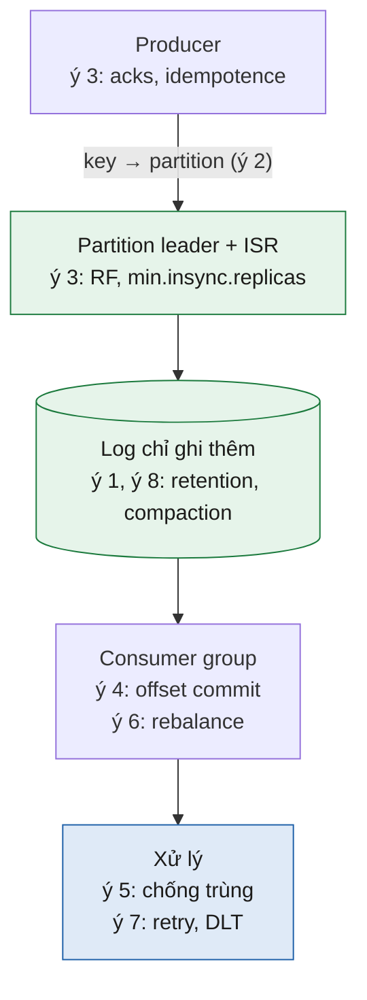

<!-- Tự sinh từ 0013-core-80-20.html bằng scripts/html2md.py. Đừng sửa tay. -->

[Kafka](../README.md) / [Bài 9](0009-final-design-test.md) / Bài 10 · [Tổng hợp usecase](../reference/0005-usecase-index.md) · [Bảng tra](../reference/0001-core-concepts.md)

# Bài 10: Tổng kết 80/20

Phần 20% của Kafka giải thích 80% những gì bạn sẽ gặp trong họp thiết kế và khi gỡ sự cố, cùng những ngộ nhận phổ biến nhất về chính phần 20% đó.

> **Liên quan tới mission** Mục tiêu cuối của khoá học là: cho một bài toán mới, bạn đề xuất được thiết kế và nói được đánh đổi. Bài này gom cả khoá học thành tám ý và sáu câu hỏi thiết kế, để bạn mang vào họp mà không cần mở lại từng bài.

**Thắng lợi của bài này:** bạn nói được tám ý cốt lõi trong 2 phút, chỉ ra được ngộ nhận khi đồng nghiệp nói sai, và với một loại dữ liệu bất kỳ (tiền, lệnh, giá, thông báo) chọn được cấu hình bằng sáu câu hỏi.

## 1. 20% cốt lõi: tám ý

Đọc theo đường đi của một message: producer ghi, broker giữ, consumer đọc và xử lý. Mỗi ý có link về bài chi tiết.

*Kiến trúc: tám ý cốt lõi đặt trên đường đi của một message.*

1. **Kafka là một log chỉ ghi thêm, không phải hàng đợi.** Đọc không xoá dữ liệu; dữ liệu được giữ theo retention. Mỗi consumer group tự nhớ mình đọc tới đâu, nên nhiều group đọc cùng topic độc lập, và có thể đọc lại. [[Introduction]](https://kafka.apache.org/intro) · [Bài 1](0001-kafka-big-picture.md)
2. **Partition là đơn vị của mọi thứ.** Thứ tự chỉ có trong một partition. Song song tối đa bằng số partition (mỗi partition một consumer trong group). Key quyết định partition, nên key quyết định thứ tự và phân tải. Số partition chỉ tăng, và tăng thì key đổi partition. [[Design]](https://kafka.apache.org/44/design/design/) · [Bài 2](0002-key-partition-offset.md), [Bài 8](0008-topic-design.md)
3. **Độ bền là bốn núm vặn, và ack là lời hứa trên ISR hiện tại.** `acks=all` chờ mọi replica trong ISR; `min.insync.replicas` là cái sàn chặn ghi khi ISR quá nhỏ; retry trong `delivery.timeout.ms`; idempotence chống trùng do retry. Thiếu replica thì phải chọn giữa sẵn sàng và bền. [[Design: replication]](https://kafka.apache.org/44/design/design/) · [Bài 3](0003-build-cluster.md), [Bài 4](0004-producer-durability.md), [Bài 4b](0010-idempotent-producer.md)
4. **Offset commit là lời hứa của consumer.** Commit trước khi xử lý xong thì crash là mất; xử lý xong mới commit thì crash là xử lý lại. [[Design: consumer position]](https://kafka.apache.org/44/design/design/) · [Bài 5](0005-consumer-offset-commit.md)
5. **Mặc định là at-least-once, nên trùng là bình thường.** Exactly-once của Kafka chỉ phủ luồng topic → topic (transaction). Ra DB hay API thì dùng idempotent consumer (khoá `eventId` trong cùng transaction DB) và outbox ở phía phát. [[Design: Message Delivery Semantics]](https://kafka.apache.org/44/design/design/) · [Bài 5c](0012-delivery-semantics.md), [Bài 7](0007-idempotent-consumer-transactions.md)
6. **Rebalance là cái giá của group động.** Mỗi lần consumer vào, rời, chết hay xử lý quá chậm, partition đổi chủ phải dừng, và phần chưa commit bị xử lý lại. Cooperative và static membership giảm số lần dừng, không loại bỏ trùng. [[ConsumerRebalanceListener]](https://kafka.apache.org/44/javadoc/org/apache/kafka/clients/consumer/ConsumerRebalanceListener.html) · [Bài 5b](0011-rebalance.md)
7. **Lỗi không tự biến mất, và mặc định của Spring là bỏ qua.** Hết lượt retry thì Spring Kafka mặc định chỉ log rồi commit. Thiết kế đúng: retry có giới hạn, phân biệt lỗi tạm thời và lỗi dữ liệu, DLT có cảnh báo và quy trình replay. [[Spring: handling exceptions]](https://docs.spring.io/spring-kafka/reference/kafka/annotation-error-handling.html) · [Bài 6](0006-error-handling-dlt.md)
8. **Thiết kế topic là quyết định khó đổi.** Key, số partition và định dạng message (schema) khó đổi nhất. Retention hay compaction quyết định ai còn đọc lại được và đọc lại được gì. Mặc định của broker rất mỏng (1 bản sao, tự tạo topic): người tạo topic phải tự đặt. [[Topic configs]](https://kafka.apache.org/44/configuration/topic-configs/) · [Bài 8](0008-topic-design.md)

## 2. Ngộ nhận phổ biến về phần 20% đó

Mỗi dòng là một câu bạn sẽ nghe trong họp, kèm điều tài liệu thật sự nói.

| Ngộ nhận | Thực tế | Ý / bài |
|---|---|---|
| "Kafka giữ thứ tự cho cả topic." | Chỉ trong một partition. Muốn thứ tự theo tài khoản thì lấy mã tài khoản làm key. | 2 · Bài 2 |
| "Đọc xong thì message biến mất, như hàng đợi." | Message nằm lại tới hết retention; group khác, hoặc chính group đó sau khi reset offset, đọc lại được. | 1 · Bài 1 |
| "Chậm thì thêm consumer." | Chỉ có tác dụng tới số partition; consumer thừa ngồi chờ, và mỗi lần thêm bớt là một lần rebalance. | 2, 6 · Bài 1, 5b |
| "Thiếu partition thì sau này tăng thêm." | Tăng được nhưng không giảm được, và key đổi partition nên thứ tự theo key vỡ qua điểm tăng. | 2 · Bài 8 |
| "`acks=all` nghĩa là cả 3 replica đã có." | Là mọi replica trong ISR hiện tại. ISR co còn leader thì ack khi mới có 1 bản sao; cần `min.insync.replicas=2`. | 3 · Bài 4 |
| "Đã nhận ack là không thể mất." | Vẫn mất được với `acks=1`, với `min.insync.replicas=1`, hoặc khi `unclean.leader.election.enable=true` (mặc định trên MSK Standard). | 3 · Bài 4 |
| "Bật idempotence ở producer là hết trùng." | Chỉ hết trùng do retry trong một session. Service restart rồi gửi lại, hoặc consumer xử lý lại, vẫn trùng. | 3, 5 · Bài 4b, 7 |
| "Auto-commit là mất message." | Auto-commit chỉ commit trong `poll()`. Xử lý trong cùng thread thì là at-least-once; chỉ mất khi giao việc cho thread khác rồi `poll()` tiếp. | 4 · Bài 5 |
| "Bật exactly-once của Kafka là hết trùng ở DB." | Transaction Kafka không bao DB hay API ngoài. Ra DB thì at-least-once cộng chống trùng theo `eventId`. | 5 · Bài 5c, 7 |
| "Rebalance chỉ xảy ra khi consumer chết." | Còn khi consumer vào, tắt êm, không `poll()` trong `max.poll.interval.ms`, hoặc topic thêm partition. | 6 · Bài 5b |
| "Spring Kafka không bao giờ bỏ message lỗi." | Mặc định giao tối đa 10 lần rồi chỉ log ERROR và commit offset: mất im lặng. | 7 · Bài 6 |
| "Có DLT là xong." | DLT không ai xem là mất message có tên đẹp. Cần cảnh báo, người xử lý và quy trình replay. | 7 · Bài 6 |
| "Compaction giữ đúng một bản ghi mỗi key, ngay lập tức." | Compaction chạy ngầm, thời điểm không cứng; consumer có thể thấy nhiều bản ghi cùng key. | 8 · Bài 8 |
| "Hạ `acks=1` để consumer thấy dữ liệu nhanh hơn." | Consumer chỉ thấy message khi mọi replica trong ISR đã có, bất kể `acks`. Muốn nhanh thì gom lô và nén. | Bài 8b |
| "Muốn độ trễ thấp thì đặt `linger.ms=0`." | Mặc định đã là 5 từ Kafka 4.0, vì lô lớn hơn thường cho độ trễ tương đương hoặc thấp hơn; khi quá tải, độ trễ chủ yếu là xếp hàng. | Bài 8b |
| "`--to-datetime` hiểu theo giờ máy mình." | Không ghi múi giờ thì là UTC. Ở Việt Nam phải ghi `+07:00`, nếu không sẽ lệch 7 tiếng. | Bài 8c |
| "Kafka log là bất biến, làm audit là yên tâm." | Chỉ ghi thêm và offset không đổi, nhưng vẫn xoá được: retention, compaction, `deleteRecords`, xoá topic. | Bài 8c |
| "Registry nhận schema mới là mọi consumer an toàn." | BACKWARD (mặc định) chỉ bảo đảm consumer mới đọc dữ liệu cũ. Phải nâng consumer trước, producer sau. | Bài 8d |

## 3. Sáu câu hỏi thiết kế

Gặp bài toán mới, hỏi đủ sáu câu theo thứ tự. Mỗi câu trả lời dẫn tới một nhóm cấu hình.

| Câu hỏi | Quyết định | Ý / bài |
|---|---|---|
| 1. Thứ tự theo đối tượng nào? | Key = mã đối tượng đó (tài khoản, lệnh, mã chứng khoán); tránh key nóng | 2 · Bài 2, 8 |
| 2. Mất có chấp nhận được không? | Không: RF=3, `min.insync.replicas=2`, `acks=all`, unclean=false, đọc kết quả gửi. Có: nới để đổi lấy sẵn sàng và độ trễ | 3 · Bài 4 |
| 3. Trùng có chấp nhận được không? | Không với tác dụng phụ: idempotent consumer + outbox; Kafka → Kafka: transaction | 5 · Bài 5c, 7 |
| 4. Commit lúc nào? | Sau khi xử lý xong; với tiền thì ack thủ công sau khi DB commit | 4 · Bài 5 |
| 5. Tải bao nhiêu, cần song song bao nhiêu? | Số partition theo số consumer cần chạy song song lúc đỉnh tải, cộng dư địa | 2 · Bài 8 |
| 6. Lỗi và dữ liệu cũ xử lý ra sao? | Retry có giới hạn, DLT, cảnh báo, replay; retention hay compaction theo nhu cầu đọc lại | 7, 8 · Bài 6, 8 |

## 4. Loại dữ liệu → cấu hình (ngân hàng và chứng khoán)

Ba dòng đầu dựa trên các bài đã học. Hai dòng chứng khoán là **lập luận của giáo viên từ cùng các nguyên lý**, chưa có nguồn chuẩn ngành: kiểm lại với team ở nơi mới.

| Loại dữ liệu | Thứ tự theo | Ngữ nghĩa | Độ bền | Chống trùng |
|---|---|---|---|---|
| Chuyển tiền, bút toán sổ cái | Mã tài khoản | At-least-once | RF=3, minISR=2, `acks=all`, unclean=false | `UNIQUE(eventId)` trong transaction DB; outbox ở phía phát |
| Thông báo email/SMS | Thường không cần | At-least-once, ít trùng | Như tiền nếu là xác nhận giao dịch | Dedup theo mã thông báo; gửi ở consumer riêng, ngoài transaction |
| Log, telemetry | Không cần | Mất vài điểm được | Có thể nới `min.insync.replicas`, `acks` | Không cần |
| Lệnh đặt/huỷ chứng khoán *(lập luận)* | Tài khoản hoặc mã lệnh | At-least-once | Như tiền | Theo mã lệnh; huỷ lệnh phải đến sau đặt lệnh, nên cùng key |
| Giá thị trường hiển thị *(lập luận)* | Mã chứng khoán | At-most-once chấp nhận được: tick mới thay tick cũ | Có thể nới | Không cần; topic "giá mới nhất" hợp với compaction |

## 5. Ba mảng mở rộng: mỗi mảng một ý cốt lõi

Tám ý trên phủ trục "không mất". Ba mảng mở rộng của mission, mỗi mảng gói trong một ý:

- **Quá tải là dữ liệu chờ, không phải hệ thống sập.** Chờ ở bộ đệm producer (`send()` bị chặn) hoặc chờ trên đĩa (lag). Tăng thông lượng bằng gom lô và nén; lag là tín hiệu số một; số partition là trần song song. Mảng quan trọng nhất cho market data. · [Bài 8b](0014-throughput-latency.md)
- **Giữ được thì đọc lại được, nhưng giữ có hạn.** Retention là SLA cho consumer; compaction giữ trạng thái mới nhất, không phải lịch sử; đọc lại theo thời điểm luôn ghi `+07:00`; audit dựa vào thứ tự trong partition và quyền xoá chặt. · [Bài 8c](0015-replay-retention.md)
- **Kafka chỉ lưu byte, hợp đồng nằm ở registry.** Thêm field tuỳ chọn có default là an toàn; BACKWARD nghĩa là nâng consumer trước; đổi kiểu thì làm topic mới. · [Bài 8d](0016-schema-evolution.md)

## 6. Kiểm tra (xen kẽ mọi chủ đề)

Các câu cố tình trộn chủ đề, để bạn phải tự nhận ra câu đang hỏi ý nào. Làm không nhìn bài, rồi đọc giải thích.

<!-- quiz:quiz -->

**1. Đồng nghiệp đề xuất: "lag cao thì nhân đôi số pod consumer". Topic có 6 partition, đang chạy 6 pod. Điều gì xảy ra?**

- **A.** Đọc nhanh gấp đôi ngay lập tức
- **B.** Lag giảm dần theo số pod mới
- **C.** 6 pod mới ngồi chờ, thêm một lần rebalance
- **D.** Kafka tự tách partition thành 12

Đáp án

**C. 6 pod mới ngồi chờ, thêm một lần rebalance**

Ý 2 và 6: mỗi partition chỉ một consumer trong group; consumer thừa không có partition, và việc thêm pod gây rebalance.

**2. Topic RF=3, min.insync.replicas=1, acks=all. Hai follower đã bị loại khỏi ISR. Producer nhận ack cho message mới nghĩa là gì?**

- **A.** Message mới có ở một bản sao
- **B.** Message đã có ở cả ba replica
- **C.** Message chưa được ghi vào log
- **D.** Broker đã từ chối message này

Đáp án

**A. Message mới có ở một bản sao**

Ý 3: acks=all chờ ISR hiện tại; ISR chỉ còn leader nên ack khi mới có 1 bản sao. min.insync.replicas=2 sẽ chặn trường hợp này.

**3. Listener Spring Boot ghi bút toán vào DB rồi return, ack-mode mặc định. Pod bị kill giữa lô 500 record. Khi chạy lại?**

- **A.** Mất các record đang xử lý dở
- **B.** Không mất, nhưng một phần lô bị xử lý lại
- **C.** Không mất và không trùng nhờ Spring
- **D.** Phải reset offset bằng tay mới đọc tiếp

Đáp án

**B. Không mất, nhưng một phần lô bị xử lý lại**

Ý 4 và 5: AckMode BATCH commit sau khi xử lý xong lô; crash giữa lô thì chạy lại từ offset đã commit, nên phần đã làm bị xử lý lại. Vì vậy bút toán phải chống trùng theo eventId.

**4. Team nói: "bên mình bật transaction Kafka nên ghi DB đúng một lần". Câu trả lời trung thực?**

- **A.** Đúng, transaction phủ cả DB đó
- **B.** Đúng nếu đặt read_committed ở consumer
- **C.** Đúng nếu producer bật idempotence
- **D.** Sai, cần chống trùng trong transaction DB

Đáp án

**D. Sai, cần chống trùng trong transaction DB**

Ý 5: exactly-once của Kafka chỉ phủ topic → topic. Đầu ra là DB thì vẫn là at-least-once, cần idempotent consumer.

**5. Job đối soát chạy hàng tuần, group nghỉ 10 ngày, auto.offset.reset mặc định. Lần chạy tiếp theo đọc gì?**

- **A.** Mọi dữ liệu từ lần chạy trước
- **B.** Chỉ dữ liệu mới đến sau lúc khởi động
- **C.** Báo lỗi và dừng, chờ người xử lý
- **D.** Đọc lại toàn bộ topic từ offset 0

Đáp án

**B. Chỉ dữ liệu mới đến sau lúc khởi động**

Ý 1 và 4: offset đã commit hết hạn sau 7 ngày group rỗng; mặc định latest nhảy tới cuối log, bỏ qua dữ liệu tồn.

**6. Message JSON thiếu trường làm listener ném lỗi. Không cấu hình error handler. Số phận message?**

- **A.** Bị bỏ qua sau 10 lần, chỉ còn log
- **B.** Chặn partition mãi tới khi sửa code
- **C.** Tự chuyển sang topic tên -dlt
- **D.** Được giữ lại chờ người xử lý tay

Đáp án

**A. Bị bỏ qua sau 10 lần, chỉ còn log**

Ý 7: DefaultErrorHandler mặc định giao tối đa 10 lần rồi log ERROR và commit offset: mất im lặng. DLT phải tự cấu hình.

**7. Topic sự kiện tài khoản 3 partition, key là mã tài khoản. Team muốn tăng lên 12 partition khi hệ thống đang chạy. Rủi ro chính?**

- **A.** Dữ liệu cũ bị Kafka chia lại
- **B.** Producer phải đổi tên topic mới
- **C.** Không có rủi ro, Kafka tự cân bằng
- **D.** Sự kiện cũ và mới của một tài khoản lệch partition

Đáp án

**D. Sự kiện cũ và mới của một tài khoản lệch partition**

Ý 2 và 8: tăng partition làm key đổi partition, dữ liệu cũ không được chia lại; thứ tự theo tài khoản vỡ qua điểm tăng.

**8. Service gửi sự kiện, crash trước khi nhận ack, khởi động lại và gửi lại. Producer bật idempotence. Kết quả?**

- **A.** Broker nhận ra và bỏ bản gửi lại
- **B.** Có thể có hai bản ghi trong topic
- **C.** Producer báo lỗi trùng lúc khởi động
- **D.** Broker giữ bản sau, xoá bản trước

Đáp án

**B. Có thể có hai bản ghi trong topic**

Ý 3 và 5: idempotence chỉ phủ retry trong một session; restart là producer mới, broker không nhận ra bản gửi lại. Chống trùng ở consumer bằng eventId.

<!-- /quiz -->

## 7. Tự nói thành lời

Trong 2 phút, không nhìn: *"Kafka là ... Partition quyết định ... Không mất cần ... Commit phải ... Trùng là bình thường nên ... Rebalance gây ... Lỗi thì ... Khi tạo topic, ba thứ khó đổi nhất là ..."*

**Ôn nhanh:** [tóm tắt Bài 10](../summaries/0013-core-80-20.md) (đọc sau khi đã tự nói).

## Nguồn nên đọc

> **Chính:** [Kafka Design](https://kafka.apache.org/44/design/design/): gần như cả tám ý đều có gốc trong tài liệu này (persistence, consumer position, replication, delivery semantics).
>
> **Tra cứu:** [Tổng hợp usecase](../reference/0005-usecase-index.md) để xem mỗi ý xuất hiện trong tình huống thật nào.

> **Còn chỗ nào mơ hồ?** Hỏi thẳng giáo viên, ví dụ "ngộ nhận nào hay gây sự cố nhất ở production?", "bài toán X của team mình trả lời sáu câu hỏi thế nào?". Dán kết quả quiz để biết ý nào cần ôn lại.
