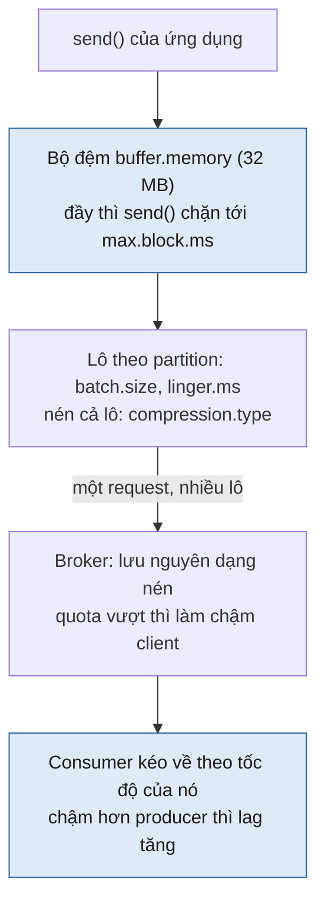
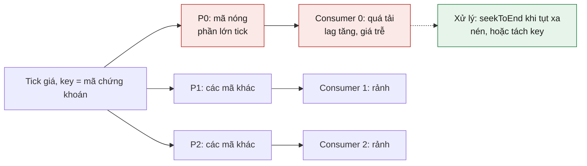
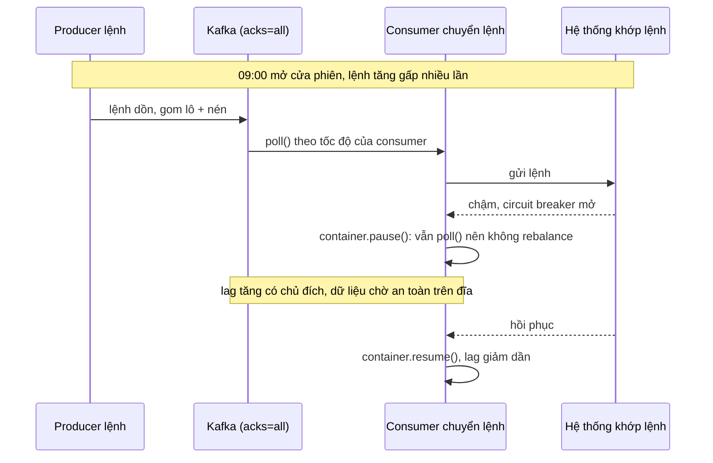

<!-- Tự sinh từ 0014-throughput-latency.html bằng scripts/html2md.py. Đừng sửa tay. -->

[Kafka](../README.md) / [Bài 8](0008-topic-design.md) / Bài 8b · [Bài 8c](0015-replay-retention.md) · [Tổng hợp usecase](../reference/0005-usecase-index.md)

# Bài 8b: Quá tải, thông lượng, độ trễ

Kafka không sập khi quá tải: nó để dữ liệu chờ. Chờ ở bộ đệm của producer thì thread gửi bị chặn; chờ trên đĩa broker thì consumer tụt lại (lag). Bài này dạy bạn đọc và điều khiển hai chỗ chờ đó.

> **Liên quan tới mission** Mission đã mở rộng sang mảng quá tải và độ trễ. Câu bạn sẽ gặp: "giờ mở cửa phiên lệnh dồn gấp 10, hệ thống chịu được không?", "bảng giá cần độ trễ thấp, cấu hình sao?". Sau bài này bạn trả lời bằng ba thứ: gom lô và nén ở producer, số partition là trần song song, và lag là tín hiệu quá tải.

**Thắng lợi của bài này:** bạn tự đo được thông lượng của producer với ba cấu hình trên cụm 3 broker, đọc được lag của một group, và giải thích được vì sao hạ `acks` không làm consumer thấy dữ liệu sớm hơn.

## 1. Bốn khái niệm

Đường đi của một record khi tải cao: `send()` đưa record vào bộ đệm, producer gom thành lô theo partition, nén cả lô, gửi một request; broker lưu nguyên dạng nén; consumer kéo về và giải nén. Mỗi chặng có một chỗ có thể nghẽn.



*Flow: đường đi của record khi tải cao, và hai chỗ dữ liệu chờ (bộ đệm producer, lag ở consumer).*

### 1.1. Thông lượng: gom lô và nén

- **Gom lô là đòn bẩy chính.** Docs gọi batching là "one of the big drivers of efficiency": producer gom record trong bộ nhớ để gửi lô lớn, "to trade off a small amount of additional latency for better throughput". [[Design: Efficiency]](https://kafka.apache.org/44/design/design/)
- **`batch.size`** (16384 byte) là trần của một lô *cho mỗi partition*; **`linger.ms`** là thời gian chờ để gom thêm. **Từ Kafka 4.0, `linger.ms` mặc định là 5** (trước đó 0), vì lô lớn hơn "typically result in similar or lower producer latency despite the increased linger". Tài liệu cũ ghi 0 là đã lỗi thời. [[Producer configs]](https://kafka.apache.org/44/configuration/producer-configs/) [[Upgrade notes]](https://kafka.apache.org/44/getting-started/upgrade/)
- **Nén do producer làm, theo cả lô** (mặc định `compression.type=none`). Broker lưu nguyên dạng nén, consumer tự giải nén; lô càng to thì nén càng tốt. Topic mặc định `compression.type=producer`, tức giữ codec producer chọn. [[Design: End-to-end Batch Compression]](https://kafka.apache.org/44/design/design/)

### 1.2. Độ trễ: thứ `acks` không mua được

- **Hạ `acks` không làm consumer thấy dữ liệu sớm hơn.** "Regardless of the acks setting, the messages will not be visible to the consumers" cho tới khi mọi replica trong ISR đã có. `acks=1` chỉ rút ngắn thời gian producer chờ, đổi lại rủi ro mất (Bài 4). [[Design: Replicated Logs]](https://kafka.apache.org/44/design/design/)
- **Khi quá tải, độ trễ chủ yếu là thời gian xếp hàng** trong bộ đệm producer, không phải thời gian mạng. Lab ở mục 2 cho thấy rõ: cùng một cụm, độ trễ p50 từ vài giây xuống vài chục ms chỉ nhờ gom lô và nén.

### 1.3. Song song: partition là trần

- **Mỗi partition chỉ một consumer trong group đọc**, nên "the partition count impacts the maximum parallelism of your consumers". Thêm consumer quá số partition thì consumer thừa ngồi không. [[Basic operations]](https://kafka.apache.org/44/operations/basic-kafka-operations/)
- **Partition nóng không giải được bằng cách thêm consumer:** một key chiếm phần lớn tải thì một partition (và một consumer) gánh phần lớn tải (Bài 2).
- Docs Apache không đưa công thức chọn số partition theo thông lượng; con số cụ thể chỉ có ở nhà cung cấp, ví dụ MSK Standard ghi "Throughput per-partition: Max 15 MB/s". [[MSK quotas]](https://docs.aws.amazon.com/msk/latest/developerguide/limits.html)

### 1.4. Quá tải: lag và backpressure

- **Lag là tín hiệu quá tải số một.** Consumer chậm thì "simply falls behind and catches up when it can": dữ liệu chờ trên đĩa trong giới hạn retention. Lag tăng đều nghĩa là tốc độ đọc nhỏ hơn tốc độ ghi. [[Design: Push vs. pull]](https://kafka.apache.org/44/design/design/)
- **Hai cách đo khác nhau:** cột LAG của `kafka-consumer-groups.sh --describe` tính từ offset đã commit; metric client `records-lag-max` "is based on current offset and not committed offset". [[Monitoring]](https://kafka.apache.org/44/operations/monitoring/)
- **Backpressure phía producer**: bộ đệm `buffer.memory` đầy thì `send()` chặn thread gọi tới `max.block.ms` (60 giây) rồi ném lỗi. **Phía consumer Spring**: `pause()`/`resume()` container (vẫn `poll()` nên không rebalance), `pausePartition()`, `idleBetweenPolls`. [[Spring: pause/resume]](https://docs.spring.io/spring-kafka/reference/kafka/pause-resume.html)
- **Quota:** Apache mặc định không giới hạn ("By default, clients receive an unlimited quota"); vượt quota thì broker *làm chậm* client (mute channel, fetch trả về rỗng), không báo lỗi. [[Design: Quotas]](https://kafka.apache.org/44/design/design/)

### Tám giá trị cần nhớ

| Cấu hình | Mặc định 4.4 | Ý nghĩa | Khái niệm |
|---|---|---|---|
| `batch.size` (producer) | 16384 | Trần một lô, cho mỗi partition | 1.1 |
| `linger.ms` (producer) | 5 (từ 4.0; trước là 0) | Chờ gom thêm record | 1.1 |
| `compression.type` (producer) | `none` | Nén cả lô: `gzip`, `snappy`, `lz4`, `zstd` | 1.1 |
| `buffer.memory` (producer) | 33554432 (32 MB) | Bộ đệm chờ gửi; đầy thì `send()` chặn | 1.4 |
| `max.block.ms` (producer) | 60000 | Thời gian `send()` được phép chặn | 1.4 |
| `fetch.min.bytes` (consumer) | 1 | Broker chờ đủ bấy nhiêu byte mới trả | 1.2 |
| `max.poll.records` (consumer) | 500 | Số record mỗi `poll()`, không đổi cách fetch | 1.4 |
| Client quota | không giới hạn | Vượt thì bị làm chậm, không lỗi | 1.4 |

[[Producer configs]](https://kafka.apache.org/44/configuration/producer-configs/) [[Consumer configs]](https://kafka.apache.org/44/configuration/consumer-configs/)

## 2. Thực hành trên cụm

Dùng lab Spring Boot `labs/03-spring-clients` (profile mới `perf`) và cụm 3 broker của Bài 3. Profile `perf` gửi 200.000 message, mỗi message 200 byte, nhanh nhất có thể, rồi in thông lượng và độ trễ gửi (từ lúc gọi `send()` tới lúc broker ack).

```
// labs/03-spring-clients/src/main/java/lab/PerfRunner.java (rút gọn)
long t0 = System.nanoTime();
// send() có thể CHẶN thread này khi buffer.memory đầy, tối đa max.block.ms (backpressure phía producer)
template.send(topic, "k-" + (i % keyCount), payload).whenComplete((r, ex) -> {
    latencyNs[idx] = System.nanoTime() - t0;   // độ trễ gửi = xếp hàng trong bộ đệm + mạng + chờ ISR
    done.countDown();
});
```

### Bước 1. Đo ba cấu hình producer

```
cd labs/03-spring-clients
mvn -q -DskipTests package          # JAVA_HOME phải là JDK 17+
J="java -jar target/spring-clients-0.0.1-SNAPSHOT.jar --spring.profiles.active=perf --lab.topic=lab-perf"

$J                                                       # mặc định 4.x: linger.ms=5
$J --spring.kafka.producer.properties[linger.ms]=0       # mặc định cũ
$J --spring.kafka.producer.compression-type=lz4          # thêm nén
$J --spring.kafka.producer.properties[linger.ms]=25 --spring.kafka.producer.batch-size=131072 --spring.kafka.producer.compression-type=lz4
```

Dự đoán trước khi chạy: cấu hình nào nhanh nhất, và độ trễ p50 của cấu hình mặc định là vài ms hay vài giây?

Đã chạy thật trên máy của bạn (2026-11-17, Spring Boot trên Windows gửi vào cụm trong WSL; số tuyệt đối sẽ khác ở máy khác, tỷ lệ mới đáng nhìn):

| Cấu hình | Message/giây | Độ trễ gửi p50 | p99 |
|---|---|---|---|
| `linger.ms=0` (mặc định cũ) | 15.289 | 4.484 ms | 9.763 ms |
| Mặc định 4.x (`linger.ms=5`) | 20.640 | 3.280 ms | 5.730 ms |
| Thêm `lz4` | 58.738 | 76 ms | 250 ms |
| `linger.ms=25`, batch 128 KB, `lz4` | 72.199 | 60 ms | 139 ms |

Đọc kết quả: độ trễ vài giây không phải do mạng, mà do 200.000 record xếp hàng trong bộ đệm. Khi thông lượng tăng gấp ba, hàng đợi gần như biến mất và p50 giảm từ giây xuống chục ms. Với tải nhẹ (2.000 message) thì mặc định và `linger.ms=0` gần như ngang nhau (p50 26 ms và 48 ms), đúng lý do docs đổi mặc định. **Lưu ý trung thực:** payload của lab là một ký tự lặp lại nên nén cực tốt; dữ liệu JSON thật sẽ không được gấp ba như vậy.

Tôi đã chạy và so sánh bốn cấu hình

### Bước 2. Thấy lag của một consumer chậm

```
# consumer xử lý mỗi record 1 ms, chạy khoảng 30 giây rồi tắt (Ctrl+C)
java -jar target/spring-clients-0.0.1-SNAPSHOT.jar --spring.profiles.active=consumer \
  --lab.topic=lab-perf --lab.group=g-lag --lab.instance=c1 --lab.process-ms=1

# trong terminal Ubuntu (WSL)
docker exec kafka-1 /opt/kafka/bin/kafka-consumer-groups.sh --bootstrap-server kafka-1:19092 --describe --group g-lag
```

Đã chạy thật (rút gọn):

```
GROUP  TOPIC     PARTITION  CURRENT-OFFSET  LOG-END-OFFSET  LAG     CONSUMER-ID
g-lag  lab-perf  0          4805            220428          215623  consumer-g-lag-1-...
g-lag  lab-perf  1          -               263952          -       consumer-g-lag-1-...
g-lag  lab-perf  5          4195            241488          237293  consumer-g-lag-1-...
```

Ba điều cần thấy: (1) LAG tính từ offset *đã commit*; (2) partition chưa commit lần nào hiện `-`, không phải 0; (3) consumer đã tắt bằng Ctrl+C vẫn còn trong danh sách tới khi hết session timeout (Bài 5b). Một consumer không thể đọc kịp 6 partition: chạy thêm consumer cùng `g-lag` (tối đa 6) để chia việc.

Tôi đã đọc được lag và thử thêm consumer

### Bước 3 (đọc code). Backpressure phía consumer trong Spring

Khi hệ thống phía sau (core banking, máy khớp lệnh) báo quá tải, dừng nhận thay vì để listener lỗi liên tục. Đoạn dưới ghép từ docs Spring, **chưa chạy thử**:

```
@KafkaListener(id = "orders", topics = "orders")
void onOrder(String order) { matchingEngine.submit(order); }

// khi circuit breaker của matchingEngine mở:
registry.getListenerContainer("orders").pause();   // dừng trước poll() kế tiếp, vẫn poll() nên không rebalance
// khi hồi phục:
registry.getListenerContainer("orders").resume();
```

Trong lúc pause, lag tăng là chủ đích chứ không phải sự cố. Mẫu "pause khi circuit breaker mở" là thiết kế tự dựng; docs Spring chỉ mô tả `pause()`/`resume()`. [[Spring: pause/resume]](https://docs.spring.io/spring-kafka/reference/kafka/pause-resume.html)

## 3. Đi sâu: chi tiết cho bốn khái niệm

Đọc sau khi đã chạy lab.

### Producer và khuyến nghị của AWS cho MSK

- Khuyến nghị nhà cung cấp, không phải mặc định Apache: `linger.ms` tối thiểu 5, "higher value of 25ms, for most use cases", và "against ever using a value of zero in low latency use cases"; `batch.size` 64 KB hoặc 128 KB; `buffer.memory` 64 MB; nén `lz4` hoặc `zstd`. [[MSK client best practices]](https://docs.aws.amazon.com/msk/latest/developerguide/bestpractices-kafka-client.html)
- Metric phát hiện bộ đệm đầy: `bufferpool-wait-ratio`, `waiting-threads`, `record-queue-time-avg`, `batch-size-avg`, `compression-rate-avg`. [[Monitoring]](https://kafka.apache.org/44/operations/monitoring/)
- `max.request.size` (1 MB) cũng là trần của lô chưa nén; trần ở broker/topic tính trên lô *sau* nén. [[Producer configs]](https://kafka.apache.org/44/configuration/producer-configs/)

### Consumer: fetch và poll là hai núm khác nhau

- `fetch.min.bytes` (1), `fetch.max.wait.ms` (500), `max.partition.fetch.bytes` (1 MB), `fetch.max.bytes` (50 MB) điều khiển mạng và broker; `max.poll.records` "does not impact the underlying fetching behavior", nó điều khiển vòng xử lý của ứng dụng. [[Consumer configs]](https://kafka.apache.org/44/configuration/consumer-configs/)
- Xử lý lâu và không đều: javadoc khuyên chuyển xử lý sang thread khác, tắt auto commit, commit sau khi xong, và "pause the partition so that no new records are received from poll until after thread has finished". [[KafkaConsumer javadoc]](https://kafka.apache.org/44/javadoc/org/apache/kafka/clients/consumer/KafkaConsumer.html)

### Lag trên dịch vụ managed

- MSK: `EstimatedMaxTimeLag` ("Time estimate (in seconds) to drain MaxOffsetLag"), `MaxOffsetLag`, `SumOffsetLag`. Bẫy: metric chỉ phát khi group ở trạng thái STABLE hoặc EMPTY, và không phát nếu tên group có dấu `:`, ký tự không phải ASCII, hoặc chưa commit offset nào. [[MSK consumer lag]](https://docs.aws.amazon.com/msk/latest/developerguide/consumer-lag.html)
- Cảnh báo theo thời gian để đọc hết (`EstimatedMaxTimeLag`) có ý nghĩa nghiệp vụ hơn cảnh báo theo số offset tuyệt đối.

### Quota và một bất ngờ cho ngân hàng

- Quota theo nhóm (user, client-id), tính **trên từng broker**: `producer_byte_rate`, `consumer_byte_rate`, `request_percentage`, đặt bằng `kafka-configs.sh --alter --entity-type users ...`. Metric: `produce-throttle-time-avg`, `fetch-throttle-time-avg`. [[Basic operations: quotas]](https://kafka.apache.org/44/operations/basic-kafka-operations/)
- MSK Express và Serverless có trần thông lượng cứng, vượt thì bị throttle. [[MSK quotas]](https://docs.aws.amazon.com/msk/latest/developerguide/limits.html)
- **Bật SSL thì Kafka không dùng zero-copy:** "sendfile is not used when SSL is enabled". Cụm TLS/mTLS của ngân hàng tốn CPU hơn cho đường đọc; đừng so với số benchmark plaintext. [[Design: Efficiency]](https://kafka.apache.org/44/design/design/)

## 4. Usecase

[Xem mọi usecase của khoá học](../reference/0005-usecase-index.md)

### (a) Chứng khoán: một mã vốn hoá lớn làm nghẽn bảng giá

Topic giá dùng mã chứng khoán làm key để giữ thứ tự tick theo mã. Phiên có tin tức, một mã chiếm phần lớn tick, nên một partition và một consumer gánh gần hết tải; thêm consumer không giúp vì mỗi partition chỉ một consumer trong group đọc. Bảng giá của mã đó trễ dần trong khi các mã khác vẫn mượt. Với dữ liệu hiển thị, javadoc mô tả đúng cách xử lý: consumer tụt quá xa thì "skip to the most recent records" thay vì đọc hết.

**Xử lý:** consumer hiển thị giá tụt quá ngưỡng thì `seekToEnd` để nhảy tới giá mới nhất (tick cũ không còn giá trị); bật nén để tăng thông lượng; muốn chia tải của mã nóng thì phải tách key (ví dụ mã + loại dữ liệu), đổi lại mất thứ tự giữa các key con.



*Flow: một key nóng dồn tải vào một partition; consumer của nó trễ trong khi consumer khác rảnh.*

### (b) Chứng khoán: mở cửa phiên, luồng lệnh tăng gấp nhiều lần

Lúc mở cửa, lệnh đặt dồn trong vài phút; consumer chuyển lệnh sang hệ thống khớp lệnh không theo kịp, lag tăng. Có người đề xuất hạ `acks=1` "cho nhanh". Nhưng lệnh là dữ liệu không được mất, và consumer vẫn chỉ thấy lệnh khi đã đủ ISR, nên hạ `acks` không giúp phía khớp lệnh. Lag tăng trong cao điểm là bình thường nếu nó giảm lại sau đó.

**Xử lý:** giữ `acks=all` và idempotence; tăng thông lượng bằng gom lô và nén; cảnh báo theo thời gian để đọc hết (`EstimatedMaxTimeLag` trên MSK) thay vì số offset; khi hệ thống khớp lệnh chậm thì `pause()` container thay vì để listener lỗi liên tục.



*Sequence: cao điểm mở cửa phiên; pause khi hệ thống phía sau chậm, lag tăng có chủ đích rồi giảm.*

### (c) Ngân hàng: API chuyển tiền treo khi broker bị throttle

API chuyển tiền gọi `KafkaTemplate.send()` trên thread HTTP. Một ngày cụm managed chạm trần quota, broker làm chậm producer chứ không báo lỗi; bộ đệm 32 MB đầy dần, rồi mỗi `send()` chặn thread tới 60 giây. Thread pool web cạn, cả service ngừng trả lời. Log không có exception nào cho tới khi hết 60 giây.

**Xử lý:** hạ `max.block.ms` xuống mức API chịu được; quyết định trước khi Kafka không nhận thì trả 503 hay ghi outbox (Bài 7); theo dõi `bufferpool-wait-ratio` và `produce-throttle-time-avg` để thấy throttle trước khi API treo.

### (d) Nhiều team chung cụm: một team đọc lại cả tuần làm chậm mọi người

Team báo cáo reset offset để đọc lại dữ liệu cả tuần. Dữ liệu cũ không còn trong page cache nên broker phải đọc đĩa, và group đó kéo hết băng thông; consumer của team khác bắt đầu có lag dù tải của họ không đổi.

**Xử lý:** đặt `consumer_byte_rate` cho principal của team đọc lại (quota tính theo từng broker), theo dõi `throttle-time` để thấy quota có tác dụng; trên MSK, việc đặt quota thường do platform team giữ quyền.

### Hỏi nhanh, đáp gọn

- **Muốn độ trễ thấp thì đặt `linger.ms=0`?** Thường không cần: mặc định 5 cho độ trễ tương đương hoặc thấp hơn nhờ lô lớn hơn; AWS còn khuyên không dùng 0.
- **Nén có làm broker tốn CPU?** Broker giải nén để kiểm tra lô rồi lưu nguyên dạng nén; nén là việc của producer. Đặt codec ở topic khác codec producer có thể khiến broker nén lại (chưa kiểm chứng trong docs).
- **Lag bao nhiêu là quá nhiều?** Không có con số chung; lag vượt retention là mất dữ liệu chưa đọc, nên ngưỡng phải nhỏ hơn retention nhiều.

## 5. Tự nói thành lời

Trong 60 giây: *"Thông lượng tăng nhờ ... và ...; mặc định linger.ms đã là ... từ 4.0. Hạ acks không giúp consumer vì ... Khi quá tải, dữ liệu chờ ở hai chỗ: ... và ... Tín hiệu số một là ..., đo bằng ..."*

**Ôn nhanh:** [tóm tắt Bài 8b](../summaries/0014-throughput-latency.md) (đọc sau khi đã tự nói).

## 6. Kiểm tra

<!-- quiz:quiz -->

**1. Đồng nghiệp đề xuất hạ acks từ all xuống 1 để bảng giá phía consumer cập nhật nhanh hơn. Điều nào đúng?**

- **A.** Consumer thấy dữ liệu sớm hơn hẳn
- **B.** Consumer vẫn chỉ thấy khi đủ ISR
- **C.** Consumer đọc trực tiếp từ follower
- **D.** Broker bỏ qua bước chép sang ISR

<details><summary>Đáp án</summary>

**B. Consumer vẫn chỉ thấy khi đủ ISR**

Docs: "Regardless of the acks setting, the messages will not be visible to the consumers" cho tới khi mọi replica trong ISR đã có. acks=1 chỉ rút ngắn thời gian producer chờ.

</details>

**2. Client Kafka 4.x, không cấu hình gì về linger.ms. Producer chờ tối đa bao lâu để gom lô?**

- **A.** 5 ms, mặc định từ Kafka 4.0
- **B.** 0 ms, gửi ngay từng record
- **C.** 100 ms, theo mặc định cũ
- **D.** Chờ tới khi đủ batch.size

<details><summary>Đáp án</summary>

**A. 5 ms, mặc định từ Kafka 4.0**

Kafka 4.0 đổi linger.ms mặc định từ 0 sang 5; đủ batch.size thì gửi sớm hơn.

</details>

**3. Topic 6 partition, group đang có 6 consumer, lag vẫn tăng. Thêm 6 consumer nữa vào cùng group thì sao?**

- **A.** Lag giảm một nửa ngay
- **B.** Kafka tự tách thành 12 partition
- **C.** 6 consumer mới ngồi không
- **D.** Mỗi partition có hai người đọc

<details><summary>Đáp án</summary>

**C. 6 consumer mới ngồi không**

Số partition là trần song song của một group: mỗi partition chỉ một consumer trong group đọc. Phải tăng thông lượng mỗi consumer hoặc tăng partition (với cái giá ở Bài 8).

</details>

**4. Cụm managed bị throttle vì vượt quota. Producer trong API chuyển tiền thấy gì đầu tiên?**

- **A.** Exception QuotaExceeded ngay
- **B.** Message bị broker bỏ âm thầm
- **C.** Broker trả lỗi cho từng record
- **D.** Gửi chậm dần, send() có thể bị chặn

<details><summary>Đáp án</summary>

**D. Gửi chậm dần, send() có thể bị chặn**

Vượt quota thì broker làm chậm client (mute channel), không báo lỗi. Bộ đệm đầy dần và send() chặn tới max.block.ms.

</details>

**5. Cột LAG của kafka-consumer-groups.sh --describe tính từ đâu?**

- **A.** Từ offset đã commit của group
- **B.** Từ vị trí hiện tại trong bộ nhớ
- **C.** Từ offset đầu tiên của partition
- **D.** Từ timestamp của record cuối

<details><summary>Đáp án</summary>

**A. Từ offset đã commit của group**

LAG = LOG-END-OFFSET trừ CURRENT-OFFSET, là offset đã commit. Metric client records-lag-max thì tính theo vị trí hiện tại.

</details>

<!-- /quiz -->

## Nguồn nên đọc

> **Chính:** mục "Efficiency", "End-to-end Batch Compression" và "Quotas" trong [Kafka Design](https://kafka.apache.org/44/design/design/) (khoảng 20 phút).
>
> **Cho MSK:** [Best practices for Apache Kafka clients](https://docs.aws.amazon.com/msk/latest/developerguide/bestpractices-kafka-client.html). Nguồn đầy đủ: `research/0006-throughput-latency.md`.

**Bài tiếp theo:** [Bài 8c: đọc lại, audit, giữ dữ liệu](0015-replay-retention.md).

> **Còn chỗ nào mơ hồ?** Hỏi thẳng giáo viên, ví dụ "bảng giá cần độ trễ dưới 100 ms thì cấu hình thế nào?", "đặt quota cho team khác trên MSK ai làm?". Dán kết quả lab của bạn để so sánh.
