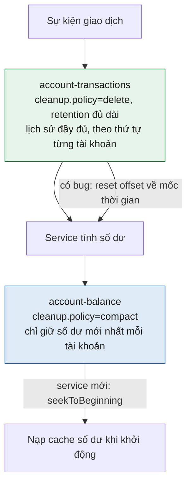
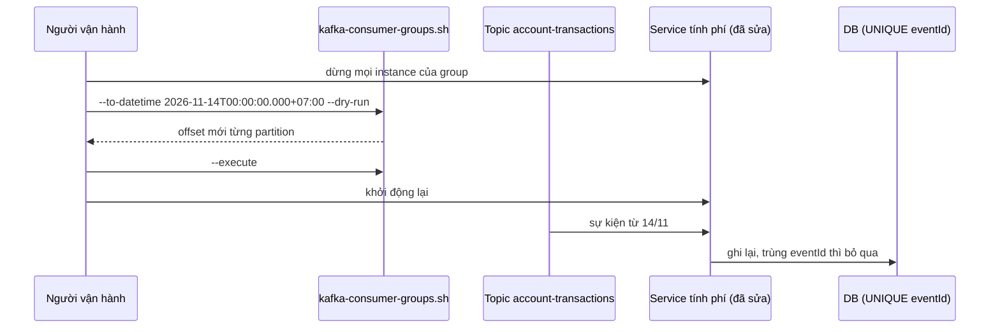

<!-- Tự sinh từ 0015-replay-retention.html bằng scripts/html2md.py. Đừng sửa tay. -->

[Kafka](../README.md) / [Bài 8b](0014-throughput-latency.md) / Bài 8c · [Bài 8d](0016-schema-evolution.md) · [Tổng hợp usecase](../reference/0005-usecase-index.md)

# Bài 8c: Đọc lại, audit, giữ dữ liệu

Kafka không xoá message khi đã đọc. Đó là lý do bạn đọc lại được: dựng lại số dư sau một bug, chạy lại một phiên giao dịch, phục vụ audit. Nhưng "giữ được" có giới hạn, và có vài bẫy làm bạn đọc lại sai chỗ.

> **Liên quan tới mission** Mảng mở rộng thứ hai của mission: đọc lại, audit, giữ dữ liệu. Câu bạn sẽ gặp: "bug tính phí chạy từ 3 ngày trước, chạy lại được không?", "Kafka có dùng làm audit trail được không?". Sau bài này bạn trả lời được dữ liệu còn bao lâu, đọc lại bằng cách nào, và Kafka bảo đảm gì cho audit.

**Thắng lợi của bài này:** bạn đọc lại được dữ liệu từ một mốc thời gian bằng Spring Kafka và bằng CLI, tự thấy bẫy múi giờ của lệnh reset offset, và nói được Kafka bảo đảm gì, không bảo đảm gì khi làm audit.

## 1. Bốn khái niệm



*Kiến trúc: một topic "delete" giữ lịch sử để đọc lại, một topic "compact" giữ trạng thái mới nhất.*

### 1.1. Retention: dữ liệu được giữ bao lâu

- **Đọc không xoá dữ liệu:** "events are not deleted after consumption"; mỗi topic tự định thời gian giữ. [[Introduction]](https://kafka.apache.org/44/getting-started/introduction/)
- **`retention.ms` mặc định 7 ngày**, và docs gọi nó là "an SLA on how soon consumers must read their data". Lag vượt retention là mất dữ liệu chưa đọc. [[Topic configs]](https://kafka.apache.org/44/configuration/topic-configs/)
- **Xoá theo cả segment, không theo từng record**, và căn theo timestamp lớn nhất trong segment. Nên dữ liệu có thể sống *lâu hơn* retention (chờ segment đóng) hoặc *ngắn hơn* (record mang timestamp cũ). [[Implementation: Log]](https://kafka.apache.org/44/implementation/log/)

### 1.2. Compaction: trạng thái mới nhất, không phải lịch sử

- **`cleanup.policy=compact`** giữ "at least the last known value for each message key"; thứ tự và offset không đổi. Dùng để nạp lại trạng thái hay cache. [[Design: Log Compaction]](https://kafka.apache.org/44/design/design/)
- **Xoá một key bằng tombstone** (value `null`). Tombstone chỉ sống `delete.retention.ms` (1 ngày): consumer đọc chậm hơn mức đó "may miss delete markers".
- **Compaction không tức thì** (segment đang ghi không bao giờ bị compact), và topic compact *không* là lịch sử: đừng dùng một mình làm audit.

### 1.3. Đọc lại: ba con đường

- **CLI** `kafka-consumer-groups.sh --reset-offsets`: một group mỗi lần, group phải đang dừng, mặc định chỉ xem trước (`--dry-run`), thêm `--execute` mới thật sự đổi. [[Basic operations]](https://kafka.apache.org/44/operations/basic-kafka-operations/)
- **API** `seek()` và `offsetsForTimes()`: trả "the earliest offset whose timestamp is greater than or equal to the given timestamp". [[KafkaConsumer javadoc]](https://kafka.apache.org/44/javadoc/org/apache/kafka/clients/consumer/KafkaConsumer.html)
- **Spring**: `ConsumerSeekAware` / `AbstractConsumerSeekAware` với `seekToTimestamp`, `seekToBeginning`, `seekToEnd`. [[Spring: seek]](https://docs.spring.io/spring-kafka/reference/kafka/seek.html)
- **Bẫy múi giờ:** `--to-datetime` không ghi múi giờ thì bị hiểu là **UTC** (đọc trong source 4.4.0, docs không nói). Ở Việt Nam phải ghi `+07:00`. Mục 3 cho bạn thấy tận mắt. [[Utils.getDateTime]](https://github.com/apache/kafka/blob/4.4.0/clients/src/main/java/org/apache/kafka/common/utils/Utils.java)

### 1.4. Timestamp và audit

- **`CreateTime`** (mặc định) là giờ producer gán; **`LogAppendTime`** là giờ broker ghi đè khi lưu. Từ Kafka 4.0, record có timestamp tương lai quá 1 giờ bị từ chối. [[ProducerRecord]](https://kafka.apache.org/44/javadoc/org/apache/kafka/clients/producer/ProducerRecord.html) [[Upgrade notes]](https://kafka.apache.org/44/getting-started/upgrade/)
- **Kafka bảo đảm cho audit:** thứ tự trong một partition; "The offset for a message never changes"; message đã commit không mất khi còn một replica ISR. [[Design]](https://kafka.apache.org/44/design/design/)
- **Kafka không hứa "bất biến":** docs không dùng chữ "immutable". Dữ liệu vẫn bị xoá theo retention, compaction, `deleteRecords` (cần quyền Delete trên Topic) hoặc xoá topic. [[ACLs]](https://kafka.apache.org/44/security/authorization-and-acls/)

### Bảy giá trị cần nhớ

| Cấu hình | Mặc định 4.4 | Ý nghĩa | Khái niệm |
|---|---|---|---|
| `retention.ms` | 604800000 (7 ngày) | "SLA" cho consumer; `-1` là không giới hạn thời gian | 1.1 |
| `retention.bytes` | -1 | Giới hạn theo dung lượng, *mỗi partition* | 1.1 |
| `segment.bytes` / `segment.ms` | 1 GB / 7 ngày | Xoá và compact theo từng segment | 1.1 |
| `cleanup.policy` | `delete` | `compact` giữ bản cuối mỗi key | 1.2 |
| `delete.retention.ms` | 86400000 (1 ngày) | Tombstone sống bao lâu | 1.2 |
| `message.timestamp.type` | `CreateTime` | `LogAppendTime` nếu cần giờ broker | 1.4 |
| `offsets.retention.minutes` (broker) | 10080 (7 ngày) | Offset của group rỗng bị xoá sau thời gian này | 1.3 |

[[Topic configs]](https://kafka.apache.org/44/configuration/topic-configs/) [[Broker configs]](https://kafka.apache.org/44/configuration/broker-configs/)

## 2. Mô phỏng: giữ được bao lâu, đọc lại từ đâu?

Ba tình huống của mục 1, chọn bằng ô đầu tiên. Mô hình rút gọn (một partition, đếm theo ngày), không phải broker thật. *Đoán trước* rồi mới bấm.

1. **Retention** 7 ngày, segment 7 ngày: cleaner chạy xong, record cũ nhất còn đọc được là ngày nào? Đổi segment 1 ngày rồi so.
2. Tick **nạp lại giao dịch 2 năm trước**: segment vừa ghi hôm nay còn sống không?
3. **Đọc lại theo thời điểm**, không ghi múi giờ, `--dry-run`: offset mới là bao nhiêu? Rồi ghi `+07:00`, tick `--execute`, khởi động lại consumer.
4. Tick "group vẫn đang chạy" rồi chạy lệnh: chuyện gì xảy ra?
5. **Compaction**: chạy compaction, tick "đã trôi qua 1 ngày", chạy lần nữa, rồi cho B đọc tiếp. So với consumer mới đọc từ đầu.

## 3. Thực hành trên cụm

Dùng profile mới `replay` của `labs/03-spring-clients` và cụm của Bài 3.

```
// labs/03-spring-clients/src/main/java/lab/ReplayListener.java (rút gọn)
public class ReplayListener extends AbstractConsumerSeekAware {
    private final AtomicBoolean seekedOnce = new AtomicBoolean();

    @Override
    public void onPartitionsAssigned(Map<TopicPartition, Long> assignments, ConsumerSeekCallback callback) {
        super.onPartitionsAssigned(assignments, callback);
        if (!seekedOnce.getAndSet(true)) {            // chỉ seek LẦN ĐẦU: hàm này chạy lại sau mỗi rebalance
            long from = System.currentTimeMillis() - replayMinutes * 60_000;
            callback.seekToTimestamp(assignments.keySet(), from);   // bên dưới là offsetsForTimes
        }
    }

    @KafkaListener(topics = "${lab.topic}", groupId = "${lab.group:g-replay}")
    void onMessage(ConsumerRecord<String, String> rec) { /* in timestamp theo giờ VN, partition, offset */ }
}
```

### Bước 1. Đọc lại 2 phút gần nhất bằng Spring

```
cd labs/03-spring-clients
J="java -jar target/spring-clients-0.0.1-SNAPSHOT.jar"
$J --spring.profiles.active=producer --lab.count=6                          # gửi vài message mới vào lab-orders
$J --spring.profiles.active=replay --lab.group=g-replay-1 --lab.replay-minutes=2
```

Đã chạy thật (2026-11-17, rút gọn):

```
[replay] seekToTimestamp(16:34:06 17/11) cho [lab-orders-2, lab-orders-1, lab-orders-0]
[replay] 16:35:54 17/11 CreateTime partition=2 offset=0 key=DRV-001
[replay] 16:35:54 17/11 CreateTime partition=2 offset=1 key=DRV-002
[replay] 16:35:54 17/11 CreateTime partition=0 offset=0 key=DRV-003
```

Consumer nhảy tới record đầu tiên có timestamp từ mốc trở đi ở từng partition. Timestamp loại `CreateTime`: giờ của máy producer.

Tôi đã đọc lại theo thời gian bằng Spring

### Bước 2. Bẫy múi giờ của `--reset-offsets`

Message vừa gửi lúc khoảng 16:35 giờ Việt Nam. Hai lệnh dưới cùng muốn "đọc lại từ 16:30", đều ở chế độ chỉ xem trước. Dự đoán kết quả của lệnh đầu.

```
# trong terminal Ubuntu (WSL)
G="docker exec kafka-1 /opt/kafka/bin/kafka-consumer-groups.sh --bootstrap-server kafka-1:19092 --group g-reset-demo --topic lab-orders --reset-offsets"
$G --to-datetime 2026-11-17T16:30:00.000 --dry-run           # KHÔNG ghi múi giờ
$G --to-datetime 2026-11-17T16:30:00.000+07:00 --dry-run     # CÓ ghi +07:00
```

Đã chạy thật:

```
# không ghi múi giờ: 16:30 UTC = 23:30 giờ VN, tức tương lai
Warn: Partition 2 from topic lab-orders is empty. Falling back to latest known offset.
g-reset-demo  lab-orders  2  4
g-reset-demo  lab-orders  0  3
# có +07:00
g-reset-demo  lab-orders  2  0
g-reset-demo  lab-orders  0  0
```

Lệnh đầu nhảy tới **cuối log**, tức bỏ qua toàn bộ dữ liệu cần đọc lại, kèm cảnh báo "is empty" gây hiểu lầm (partition có dữ liệu, chỉ không có record nào sau mốc). Lệnh sau mới đúng ý. Quy tắc: luôn ghi `+07:00`, luôn chạy `--dry-run` trước `--execute`.

Tôi đã thấy bẫy múi giờ

### Bước 3. Một topic compact có sẵn trong cụm của bạn

```
docker exec kafka-1 /opt/kafka/bin/kafka-topics.sh --bootstrap-server kafka-1:19092 --describe --topic _schemas
```

Có sau khi bật Schema Registry ở Bài 8d: `PartitionCount: 1 ... Configs: min.insync.replicas=1,cleanup.policy=compact`. Registry dùng chính compaction để giữ "bản mới nhất mỗi key": đúng mô hình ở mục 1.2.

## 4. Đi sâu: chi tiết cho bốn khái niệm

### Retention

- "Data is deleted one log segment at a time"; với retention theo thời gian, "the largest timestamp in a segment file ... defining the retention time for the entire segment"; retention theo dung lượng tắt mặc định. Broker kiểm tra mỗi 5 phút (`log.retention.check.interval.ms`), rồi chờ `file.delete.delay.ms` (1 phút) trước khi xoá file. [[Implementation: Log]](https://kafka.apache.org/44/implementation/log/)
- Consumer đứng ở offset đã bị xoá thì nhận `OutOfRangeException` và "can either reset itself or fail", theo `auto.offset.reset` (`earliest`, `latest`, `by_duration:<ISO8601>`, `none`). Với ngân hàng, `latest` ở đây là bỏ qua âm thầm phần chưa đọc. [[Consumer configs]](https://kafka.apache.org/44/configuration/consumer-configs/)
- `message.timestamp.before.max.ms` mặc định `Long.MAX`, nên broker không chặn timestamp cũ: nạp lại dữ liệu lịch sử với `CreateTime` gốc có thể bị xoá ngay khi segment đóng.

### Compaction

- Bốn bảo đảm của docs: consumer theo kịp thấy mọi message; "Compaction will never re-order messages, just remove some"; "The offset for a message never changes"; đọc từ đầu thấy "at least the final state of all records". Đọc từ offset đã bị compact thì nhận message kế tiếp còn lại. [[Design: Log Compaction]](https://kafka.apache.org/44/design/design/)
- Thời hạn compaction "is not a hard guarantee"; mặc định `min.compaction.lag.ms`=0, `max.compaction.lag.ms`=Long.MAX, `min.cleanable.dirty.ratio`=0.5.

### Đọc lại

- Kịch bản của `--reset-offsets`: `--to-datetime`, `--to-earliest`, `--to-latest`, `--shift-by`, `--by-duration`, `--to-offset`, `--from-file`; offset ngoài khoảng được kẹp về đầu hoặc cuối hợp lệ. [[Basic operations]](https://kafka.apache.org/44/operations/basic-kafka-operations/)
- Spring: gọi `seekToTimestamp` cho nhiều partition bằng bản nhận `Collection`, vì "it is more efficient to find the offsets for the timestamps in a single call". Cố định offset ban đầu: `@PartitionOffset(initialOffset = ...)` với manual assignment. [[Spring: seek]](https://docs.spring.io/spring-kafka/reference/kafka/seek.html)
- Docs nêu đúng usecase dựng lại trạng thái: "the state may be recreated on a new machine by re-consuming all the data ... (assuming that Kafka is retaining sufficient history)". [[KafkaConsumer javadoc]](https://kafka.apache.org/44/javadoc/org/apache/kafka/clients/consumer/KafkaConsumer.html)

### Lưu lâu: tiered storage

- Tiered storage (KIP-405) "marked production-ready since Kafka 3.9": segment đã đóng chuyển sang kho rẻ (ví dụ S3); không hỗ trợ topic compact; Apache không kèm sẵn plugin lưu trữ. [[KIP-405]](https://cwiki.apache.org/confluence/display/KAFKA/KIP-405%3A+Kafka+Tiered+Storage) [[Tiered storage]](https://kafka.apache.org/44/operations/tiered-storage/)
- MSK: chỉ cho Standard brokers; "The minimum retention period in low-cost storage is 3 days"; đọc từ tầng rẻ "an increase in read latency for the first few bytes". [[MSK tiered storage]](https://docs.aws.amazon.com/msk/latest/developerguide/msk-tiered-storage.html)

## 5. Usecase

[Xem mọi usecase của khoá học](../reference/0005-usecase-index.md)

### (a) Ngân hàng: bug tính phí chạy 3 ngày, dựng lại số dư

Phát hiện service tính phí sai từ 00:00 ngày 14/11. Topic `account-transactions` (key = số tài khoản, retention 30 ngày) vẫn còn đủ dữ liệu. Cần cho service đọc lại từ mốc đó sau khi sửa code. Đọc lại nghĩa là xử lý lại: mọi tác dụng phụ ra ngoài (ghi DB, gửi thông báo) sẽ xảy ra lần nữa.

**Xử lý:** dừng group, `--reset-offsets --to-datetime 2026-11-14T00:00:00.000+07:00 --dry-run`, kiểm tra offset mới, rồi `--execute`; consumer phải idempotent theo `eventId` (Bài 7) để đọc lại không trừ phí hai lần.



*Sequence: đọc lại từ một mốc thời gian an toàn: dừng group, xem trước, thực hiện, và consumer chịu được trùng.*

### (b) Ngân hàng: nạp lại lịch sử 2 năm, dữ liệu biến mất sau vài phút

Team migrate nạp giao dịch 2 năm trước vào một topic retention 7 ngày, giữ nguyên `CreateTime` gốc của từng giao dịch. Mọi segment có timestamp lớn nhất đã quá 7 ngày, nên ngay khi segment đóng và broker kiểm tra (mỗi 5 phút), cả segment bị xoá. Không có lỗi nào, broker không chặn timestamp cũ.

**Xử lý:** đặt `message.timestamp.type=LogAppendTime` cho topic nạp lại (timestamp là giờ ghi, giờ nghiệp vụ để trong payload), hoặc đặt `retention.ms` phù hợp với dữ liệu lịch sử.

### (c) Ngân hàng: tài khoản đã đóng vẫn hiện trong cache

Topic `account-balance` (compact) ghi tombstone khi tài khoản đóng. Một service dựng cache từ topic này chạy chậm hơn 1 ngày (ví dụ chỉ chạy mỗi tuần): tombstone đã bị dọn sau `delete.retention.ms`, nên service có thể không bao giờ thấy lệnh xoá, và cache còn giữ tài khoản đã đóng tuỳ thời điểm cleaner chạy.

**Xử lý:** tăng `delete.retention.ms` của topic lớn hơn khoảng thời gian chậm nhất của consumer, hoặc cho service dựng cache đọc lại từ đầu mỗi lần khởi động (`seekToBeginning`).

### (d) Chứng khoán: chạy lại phiên 14/11 nhưng bắt đầu nhầm 7 tiếng

Team quant muốn chạy lại thuật toán trên dữ liệu phiên 14/11 (09:00 tới 15:00 giờ Việt Nam). Lệnh reset ghi `--to-datetime 2026-11-14T09:00:00.000`, không có múi giờ: công cụ hiểu là 09:00 UTC, tức 16:00 giờ Việt Nam, nên bỏ qua cả phiên. Không có lỗi, chỉ có kết quả rỗng.

**Xử lý:** luôn ghi `+07:00` và chạy `--dry-run` trước; dừng ở 15:00 bằng `offsetsForTimes` (tìm offset của mốc 15:00 ở từng partition) hoặc logic ứng dụng dừng khi gặp timestamp sau 15:00, vì CLI không có tuỳ chọn "dừng ở thời điểm".

### (e) Audit: "Kafka là bất biến, không ai sửa được"

Trong họp, có người đề xuất dùng Kafka làm audit trail vì "log bất biến". Đúng là Kafka chỉ ghi thêm, không có API sửa record, offset không đổi. Nhưng dữ liệu vẫn có thể biến mất: hết retention, compaction, `deleteRecords`, xoá topic, hoặc ai đó đổi `retention.ms` bằng `kafka-configs.sh`. `CreateTime` cũng là giờ ứng dụng tự đặt.

**Xử lý:** chỉ cấp quyền `Delete` trên Topic cho vai trò quản trị; giám sát thay đổi `cleanup.policy` và `retention.ms`; dùng `LogAppendTime` nếu cần giờ ghi do broker đặt; retention dài theo chính sách lưu trữ của ngân hàng (hỏi platform team, cân nhắc tiered storage).

### Hỏi nhanh, đáp gọn

- **Đặt `retention.ms` 7 ngày thì đúng ngày thứ 8 dữ liệu mất?** Không chính xác: xoá theo segment, nên có thể muộn hơn tới khi segment đóng.
- **Seek trong `onPartitionsAssigned` có sao không?** Hàm này chạy lại sau mỗi rebalance: seek vô điều kiện thì mỗi lần rebalance lại đọc lại từ mốc. Seek một lần, hoặc dùng CLI khi group dừng.
- **Topic compact có thay được topic lịch sử?** Không: nó chỉ giữ bản cuối mỗi key.

## 6. Tự nói thành lời

Trong 60 giây: *"Kafka giữ dữ liệu theo ..., không theo việc đã đọc; mặc định ... và đó là SLA cho ... Xoá theo ..., nên ... Compaction giữ ..., không phải ... Đọc lại có ba đường: ... Bẫy lớn nhất là ... Cho audit, Kafka bảo đảm ... nhưng không ..."*

**Ôn nhanh:** [tóm tắt Bài 8c](../summaries/0015-replay-retention.md) (đọc sau khi đã tự nói).

## 7. Kiểm tra

<!-- quiz:quiz -->

**1. Topic giao dịch để retention mặc định. Consumer group báo cáo nghỉ 10 ngày rồi chạy lại. Dữ liệu 10 ngày trước còn không?**

- **A.** Còn, vì group chưa đọc tới
- **B.** Có thể đã bị xoá theo retention
- **C.** Còn, vì offset không bao giờ đổi
- **D.** Còn, broker giữ lại cho group

<details><summary>Đáp án</summary>

**B. Có thể đã bị xoá theo retention**

retention.ms mặc định 7 ngày, là "SLA on how soon consumers must read their data". Kafka xoá theo thời gian, không theo việc đã đọc.

</details>

**2. Ở Việt Nam, bạn chạy --reset-offsets --to-datetime 2026-11-14T09:00:00.000 (không ghi múi giờ). Công cụ hiểu là?**

- **A.** 09:00 theo giờ của máy bạn
- **B.** 09:00 theo giờ của broker
- **C.** 09:00 UTC, tức 16:00 giờ VN
- **D.** Báo lỗi vì thiếu múi giờ

<details><summary>Đáp án</summary>

**C. 09:00 UTC, tức 16:00 giờ VN**

Source 4.4.0: Utils.getDateTime nối thêm "Z" khi thiếu múi giờ, tức UTC. Luôn ghi +07:00.

</details>

**3. Topic account-balance dùng cleanup.policy=compact. Dùng nó làm audit trail mọi thay đổi số dư được không?**

- **A.** Được, compaction giữ thứ tự
- **B.** Được, offset không bao giờ đổi
- **C.** Được nếu retention.ms=-1
- **D.** Không, nó chỉ giữ bản cuối mỗi key

<details><summary>Đáp án</summary>

**D. Không, nó chỉ giữ bản cuối mỗi key**

Compaction giữ "at least the last known value for each message key": trạng thái mới nhất, không phải lịch sử. Audit cần một topic delete giữ đủ sự kiện.

</details>

**4. Listener Spring gọi seekToTimestamp trong onPartitionsAssigned mỗi lần được gọi. Rủi ro là gì?**

- **A.** Mỗi rebalance lại đọc lại từ mốc
- **B.** Spring báo lỗi khi khởi động
- **C.** Chỉ partition đầu được seek
- **D.** Offset đã commit bị xoá đi

<details><summary>Đáp án</summary>

**A. Mỗi rebalance lại đọc lại từ mốc**

onPartitionsAssigned chạy mỗi lần được giao partition, kể cả sau rebalance. Muốn đọc lại một lần thì seek một lần, hoặc dùng CLI khi group dừng.

</details>

**5. Trong họp: "Kafka log là bất biến, dùng làm audit là yên tâm". Câu trả lời đúng nhất?**

- **A.** Đúng, không ai xoá được dữ liệu
- **B.** Chỉ ghi thêm, nhưng vẫn xoá được
- **C.** Sai, record sửa được bằng Admin API
- **D.** Đúng nếu bật idempotence producer

<details><summary>Đáp án</summary>

**B. Chỉ ghi thêm, nhưng vẫn xoá được**

Không có API sửa record và offset không đổi, nhưng dữ liệu vẫn mất theo retention, compaction, deleteRecords hoặc xoá topic. Docs không dùng chữ "immutable".

</details>

<!-- /quiz -->

## Nguồn nên đọc

> **Chính:** mục "Log Compaction" trong [Kafka Design](https://kafka.apache.org/44/design/design/) và trang [Implementation: Log](https://kafka.apache.org/44/implementation/log/) (khoảng 20 phút).
>
> **Spring:** [Seeking to a Specific Offset](https://docs.spring.io/spring-kafka/reference/kafka/seek.html). Nguồn đầy đủ: `research/0007-replay-retention-audit.md`.

**Bài tiếp theo:** [Bài 8d: hợp đồng sự kiện (schema)](0016-schema-evolution.md).

> **Còn chỗ nào mơ hồ?** Hỏi thẳng giáo viên, ví dụ "audit giao dịch 10 năm thì nên để ở Kafka hay chỗ khác?", "đọc lại mà không làm trùng thông báo thì sao?".
