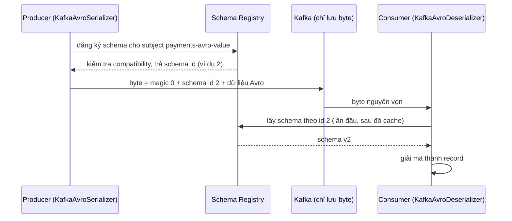
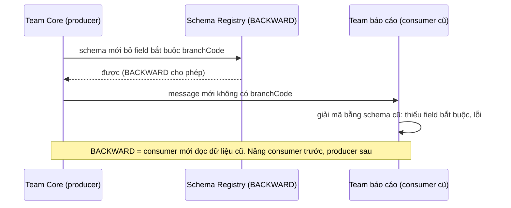

<!-- Tự sinh từ 0016-schema-evolution.html bằng scripts/html2md.py. Đừng sửa tay. -->

[Kafka](../README.md) / [Bài 8c](0015-replay-retention.md) / Bài 8d · [Bài 9](0009-final-design-test.md) · [Tổng hợp usecase](../reference/0005-usecase-index.md)

# Bài 8d: Hợp đồng sự kiện (schema)

Kafka chỉ lưu byte. Khi năm team cùng đọc sự kiện thanh toán của một team khác, cái giữ cho họ không vỡ khi định dạng thay đổi là một hợp đồng: schema, cùng một registry kiểm tra mọi thay đổi trước khi nó lên production.

> **Liên quan tới mission** Mảng mở rộng thứ ba của mission: hợp đồng sự kiện giữa nhiều team. Câu bạn sẽ gặp: "thêm field vào sự kiện thanh toán có làm hỏng team khác không?", "registry nào, ai được đăng ký schema?". Sau bài này bạn phân biệt được thay đổi an toàn và thay đổi phá vỡ, và biết thứ tự nâng cấp producer, consumer.

**Thắng lợi của bài này:** bạn chạy Schema Registry trên cụm của mình, gửi sự kiện Avro bằng Spring Boot với ba phiên bản schema, tận mắt thấy registry nhận thay đổi an toàn và từ chối thay đổi phá vỡ, và đọc được schema id nằm trong từng message.

## 1. Bốn khái niệm



*Sequence: schema không đi qua Kafka; mỗi message chỉ mang schema id, registry giữ hợp đồng.*

### 1.1. Kafka chỉ lưu byte

- **Một event là key, value, timestamp, header**; serializer là "An interface for converting objects to bytes". Broker Apache không đọc nội dung value, không kiểm tra schema. [[Introduction]](https://kafka.apache.org/44/getting-started/introduction/) [[Serializer]](https://kafka.apache.org/44/javadoc/org/apache/kafka/common/serialization/Serializer.html)
- **Không có registry thì hợp đồng chỉ là thoả thuận miệng**: team phát đổi định dạng tuỳ ý thì "it becomes very difficult to ensure that all downstream consumers will (continue to) be able to interpret the data". [[Schema Registry concepts]](https://docs.confluent.io/platform/current/schema-registry/fundamentals/index.html)
- **Wire format của Confluent:** byte 0 là magic `0`, byte 1 tới 4 là schema id, sau đó mới là dữ liệu. Mọi consumer của topic phải dùng deserializer cùng hệ registry. [[Serdes: wire format]](https://docs.confluent.io/platform/current/schema-registry/fundamentals/serdes-develop/index.html)

### 1.2. Subject, version, schema id

- **Subject** là "a named scope for schema evolution": một chuỗi version có cấu hình compatibility riêng. Mặc định (`TopicNameStrategy`) subject là `<topic>-value` và `<topic>-key`. [[Concepts]](https://docs.confluent.io/platform/current/schema-registry/fundamentals/index.html)
- **Schema id** là định danh toàn cục của một định nghĩa schema; producer nhúng id vào từng message, consumer dùng id để lấy schema.
- **Mặc định một topic chỉ một loại record**: `TopicNameStrategy` "Not generally" chứa nhiều loại; muốn nhiều loại event trong một topic thì đổi sang `TopicRecordNameStrategy`. [[Serdes]](https://docs.confluent.io/platform/current/schema-registry/fundamentals/serdes-develop/index.html)

### 1.3. Compatibility: thay đổi nào được phép

- **Mặc định là `BACKWARD`, không transitive**: consumer dùng schema mới đọc được dữ liệu của version *liền trước*. Nghĩa là **nâng consumer trước, producer sau**: "upgrade all consumers before you start producing new events". [[Schema evolution]](https://docs.confluent.io/platform/current/schema-registry/fundamentals/schema-evolution.html)
- **Luật vàng:** thêm hoặc bỏ field *tuỳ chọn có default* (Avro: `["null", T]`, `"default": null`) an toàn ở mọi mode. Thêm field bắt buộc không default thì phá vỡ `BACKWARD`. Đổi kiểu (ví dụ số sang chuỗi) thì phá vỡ; docs khuyên "create a brand-new topic".
- **Muốn đọc lại toàn bộ lịch sử bằng code mới** (Bài 8c) thì dùng `BACKWARD_TRANSITIVE`: kiểm với *mọi* version trước, không chỉ version liền trước.

### 1.4. Registry nào, cấu hình trong Spring ra sao

- **Confluent Schema Registry**: chạy ngoài broker, lưu schema trong topic compact `_schemas`; serializer mặc định **tự đăng ký** schema (`auto.register.schemas=true`). [[Configuration options]](https://docs.confluent.io/platform/current/schema-registry/connect.html)
- **AWS Glue Schema Registry** (thường đi với MSK): miễn phí, xác thực bằng IAM, 8 mode (thêm `DISABLED`, `_ALL` tương ứng transitive), và serializer mặc định **không** tự đăng ký. [[Glue Schema Registry]](https://docs.aws.amazon.com/glue/latest/dg/schema-registry.html)
- **Spring Boot** không có trang riêng cho Schema Registry: cấu hình qua `spring.kafka.*.properties[...]`, bọc deserializer bằng `ErrorHandlingDeserializer`; lỗi giải mã là lỗi fatal, không retry (Bài 6). [[Spring Boot: Kafka]](https://docs.spring.io/spring-boot/reference/messaging/kafka.html)

### Bảng thay đổi schema (Avro, theo docs Confluent)

| Thay đổi | BACKWARD (mặc định) | FORWARD | FULL |
|---|---|---|---|
| Thêm field tuỳ chọn có default | ✔ | ✔ | ✔ |
| Bỏ field tuỳ chọn | ✔ | ✔ | ✔ |
| Thêm field bắt buộc (không default) | ✘ | ✔ | ✘ |
| Bỏ field bắt buộc | ✔ (nhưng consumer cũ vỡ) | ✘ | ✘ |
| Đổi kiểu field | ✘ | ✘ | ✘ |

[[Schema evolution]](https://docs.confluent.io/platform/current/schema-registry/fundamentals/schema-evolution.html) Đổi tên field không có trong các trang đã đọc; về kiểm tra nó tương đương bỏ field cũ cộng thêm field mới (chưa kiểm chứng).

## 2. Mô phỏng: registry nhận hay từ chối, consumer nào vỡ?

Subject `payments-avro-value` bắt đầu với v1 (`eventId, accountId, amount, currency="VND"`), cùng tên field với lab ở mục 3. Mô hình theo luật đọc của Avro, rút gọn, không phải registry thật. *Đoán trước* rồi mới bấm.

1. Mode mặc định **BACKWARD**: thêm `branchCode` không default. Registry nói gì? (Đối chiếu với lab.)
2. Thêm `channel` có default, đăng ký, cho producer v2 gửi, hai consumer đọc (A vẫn dùng v1).
3. Bỏ `amount` (bắt buộc): BACKWARD nhận. Producer gửi bằng version mới, consumer A còn v1 đọc: chuyện gì xảy ra? Rút ra thứ tự nâng cấp.
4. Làm lại, đổi sang **FORWARD** rồi **FULL**, thử lại hai thay đổi trên.
5. Thêm `channel` có default, rồi "channel: bỏ default": BACKWARD nhận, **BACKWARD_TRANSITIVE** thì không. Vì sao?

## 3. Thực hành trên cụm

Cụm của Bài 3 giờ có thêm service `schema-registry` (image `confluentinc/cp-schema-registry:8.3.2`) trong compose profile `schema`, REST ở `http://localhost:18081` (cổng 8081 trên máy bạn đang bị load balancer của k3d dùng). Lab Spring Boot: `labs/08d-schema`.

```
# labs/08d-schema/src/main/resources/application.yml (rút gọn)
spring:
  kafka:
    properties:
      "[schema.registry.url]": http://localhost:18081
    producer:
      value-serializer: io.confluent.kafka.serializers.KafkaAvroSerializer
      properties:
        "[auto.register.schemas]": true      # mặc định của Confluent, ghi ra cho rõ
    consumer:
      value-deserializer: org.springframework.kafka.support.serializer.ErrorHandlingDeserializer
      properties:
        "[spring.deserializer.value.delegate.class]": io.confluent.kafka.serializers.KafkaAvroDeserializer
```

```
// schemas/payment-v2.avsc: v1 + một field TUỲ CHỌN
{"name": "channel", "type": ["null", "string"], "default": null}
// schemas/payment-v3.avsc: v2 + một field BẮT BUỘC, không default
{"name": "branchCode", "type": "string"}
```

### Bước 1. Bật Schema Registry

```
# trong terminal Ubuntu (WSL)
cd /mnt/d/Workspace/study/kafka/labs/03-cluster
docker compose --profile schema up -d schema-registry
curl -s http://localhost:18081/config
```

Đã chạy thật: `{"compatibilityLevel":"BACKWARD"}`: mặc định BACKWARD đúng như docs. Registry tự tạo topic `_schemas` (1 partition, `cleanup.policy=compact`).

Registry đã chạy

### Bước 2. Gửi ba phiên bản schema

```
cd labs/08d-schema
mvn -q -DskipTests package
J="java -jar target/schema-0.0.1-SNAPSHOT.jar"
$J --spring.profiles.active=produce --lab.schema=v1
$J --spring.profiles.active=produce --lab.schema=v2
$J --spring.profiles.active=produce --lab.schema=v3
```

Dự đoán trước: phiên bản nào bị từ chối, và lý do?

Đã chạy thật (rút gọn):

```
[produce] schema v1, field: [eventId, accountId, amount, currency]
[produce] ACC-000 -> partition=0 offset=0
[produce] schema v2, field: [eventId, accountId, amount, currency, channel]
[produce] ACC-000 -> partition=0 offset=2
[produce] schema v3, field: [eventId, accountId, amount, currency, channel, branchCode]
[produce] GỬI LỖI (RestClientException): Schema being registered is incompatible with an earlier schema
  for subject "payments-avro-value", details: [{errorType:'READER_FIELD_MISSING_DEFAULT_VALUE',
  description:'The field 'branchCode' at path '/fields/5' in the new schema has no default value ...
```

v2 được đăng ký thành version 2; v3 bị từ chối *trước khi* có byte nào vào Kafka: hợp đồng chặn thay đổi phá vỡ ngay ở producer.

Tôi đã thấy registry nhận v2 và từ chối v3

### Bước 3. Đọc lẫn message v1 và v2

```
$J --spring.profiles.active=consume
```

Đã chạy thật (rút gọn):

```
[consume] partition=0 offset=0 schema field=[eventId, accountId, amount, currency] value={...}
[consume] partition=0 offset=2 schema field=[eventId, accountId, amount, currency, channel] value={...}
```

Hai phiên bản nằm chung một topic; consumer đọc được cả hai vì mỗi message mang schema id của chính nó.

### Bước 4. Nhìn byte và hỏi registry trước khi đổi schema

```
# 16 byte đầu của một message
docker exec kafka-1 /opt/kafka/bin/kafka-console-consumer.sh --bootstrap-server kafka-1:19092 \
  --topic payments-avro --partition 1 --offset 0 --max-messages 1 | head -c 16 | xxd

# kiểm tra v3 với version mới nhất, KHÔNG đăng ký
python3 -c "import json;print(json.dumps({'schema':open('src/main/resources/schemas/payment-v3.avsc').read()}))" > /tmp/v3.json
curl -s -X POST -H 'Content-Type: application/vnd.schemaregistry.v1+json' --data @/tmp/v3.json \
  'http://localhost:18081/compatibility/subjects/payments-avro-value/versions/latest?verbose=true'
```

Đã chạy thật:

```
00000000: 0000 0000 0148 3336 6631 6635 6161 2d33  .....H36f1f5aa-3
{"is_compatible":false,"messages":["{errorType:'READER_FIELD_MISSING_DEFAULT_VALUE', ...}", ... "{validateFields: 'false', compatibility: 'BACKWARD'}"]}
```

Byte `00` là magic, bốn byte `00 00 00 01` là schema id 1, phần sau là dữ liệu Avro. Endpoint `/compatibility` cho phép kiểm tra trong CI trước khi deploy, không cần gửi message.

Tôi đã đọc được schema id trong byte

## 4. Đi sâu: chi tiết cho bốn khái niệm

### Subject và đăng ký schema

- Ba strategy: `TopicNameStrategy` (mặc định, `<topic>-value`), `RecordNameStrategy` (theo tên record, kiểm tra *trên mọi topic*), `TopicRecordNameStrategy` (`<topic>-<record>`). [[Serdes]](https://docs.confluent.io/platform/current/schema-registry/fundamentals/serdes-develop/index.html)
- `use.latest.version` (mặc định false) chỉ có tác dụng khi `auto.register.schemas=false`: producer dùng version mới nhất của subject. Nhiều nơi tắt tự đăng ký ở production và đăng ký qua CI; docs không có câu khuyến nghị chung (chưa kiểm chứng).
- Avro cần schema cả khi đọc, nên payload gọn ("field names don't have to be explicitly encoded"). Docs khuyên "Use specific records for production applications"; lab dùng `GenericRecord` cho dễ thấy schema. [[Avro serdes]](https://docs.confluent.io/platform/current/schema-registry/fundamentals/serdes-develop/serdes-avro.html)

### Compatibility

- Lý do mặc định là BACKWARD: "so that you can rewind consumers to the beginning of the topic. With FORWARD compatibility mode, you aren't guaranteed the ability to read old messages." [[Schema evolution]](https://docs.confluent.io/platform/current/schema-registry/fundamentals/schema-evolution.html)
- FORWARD: nâng producer trước. FULL: producer và consumer nâng độc lập. Protobuf: docs khuyên `BACKWARD_TRANSITIVE` "as adding new message types is not forward compatible".
- Đặt compatibility theo subject: `PUT /config/{subject}` với `{"compatibility":"BACKWARD_TRANSITIVE"}` (đã chạy thử trên cụm lab).

### AWS Glue Schema Registry

- Hỗ trợ Avro, JSON Schema, Protobuf; registry là "a logical container of schemas"; compatibility gắn theo schema, không có khái niệm subject; giới hạn 10000 schema version mỗi region. [[Glue Schema Registry]](https://docs.aws.amazon.com/glue/latest/dg/schema-registry.html)
- Client Java: `GlueSchemaRegistryKafkaSerializer`; mặc định `SCHEMA_AUTO_REGISTRATION_SETTING` "If not passed, uses "false""; `COMPATIBILITY_SETTING` mặc định BACKWARD; schema name mặc định là tên topic. [[Glue Java serde]](https://docs.aws.amazon.com/glue/latest/dg/schema-registry-gs-serde-java.html)
- Chuyển registry: consumer dùng deserializer Glue với `SECONDARY_DESERIALIZER` cho định dạng cũ; nâng consumer trước, producer sau. [[Glue migration]](https://docs.aws.amazon.com/glue/latest/dg/schema-registry-integrations-migration.html)

## 5. Usecase

[Xem mọi usecase của khoá học](../reference/0005-usecase-index.md)

### (a) Ngân hàng: thêm kênh giao dịch vào sự kiện thanh toán

Team Core Banking phát `PaymentCompleted` cho năm team khác. Nghiệp vụ cần thêm `channel` (mobile, web, quầy). Nếu thêm như field bắt buộc, registry từ chối (Bước 2 với v3); nếu không có registry, consumer của năm team sẽ vỡ ở những chỗ không ai lường trước.

**Xử lý:** thêm `channel` là field tuỳ chọn `["null","string"]` với `"default": null`: an toàn ở mọi mode, consumer cũ bỏ qua field mới, consumer mới đọc message cũ với giá trị null.

### (b) Ngân hàng: bỏ một field "không ai dùng" làm vỡ team khác

Team Core muốn bỏ `branchCode` (đang bắt buộc) vì nghĩ không ai dùng. BACKWARD cho phép thay đổi này, nên registry nhận. Nhưng một team báo cáo chưa nâng cấp vẫn chạy consumer với schema cũ, cần `branchCode`, và vỡ khi đọc message mới: BACKWARD chỉ bảo đảm consumer *mới* đọc được dữ liệu *cũ*.

**Xử lý:** với BACKWARD, nâng mọi consumer trước rồi mới nâng producer; trước khi bỏ field, hỏi các team đang đọc subject đó, hoặc dùng FULL để registry chặn cả chiều này.



*Sequence: thay đổi được registry nhận vẫn làm vỡ consumer chưa nâng cấp, vì BACKWARD chỉ bảo đảm một chiều.*

### (c) Ngân hàng: nhiều loại sự kiện tài khoản trong một topic

`AccountOpened`, `Deposited`, `Withdrawn`, `AccountClosed` phải cùng một topic, cùng key là số tài khoản để giữ thứ tự (Bài 2). Với `TopicNameStrategy` mặc định, subject `accounts-value` chỉ chứa một chuỗi version; đăng ký loại record thứ hai sẽ bị coi là "thay đổi" của loại thứ nhất và vỡ kiểm tra compatibility.

**Xử lý:** dùng `TopicRecordNameStrategy` (mỗi loại record một subject trong phạm vi topic), hoặc schema references; tránh `RecordNameStrategy` nếu tên record có thể trùng giữa các topic, vì nó kiểm tra trên mọi topic.

### (d) Chứng khoán: đổi kiểu giá từ số nguyên sang số thập phân

Topic lệnh chứng khoán đang có `price` kiểu `long` (đơn vị đồng). Sàn chuyển sang giá có phần lẻ, team muốn đổi sang kiểu khác. Đổi kiểu là thay đổi phá vỡ ở mọi mode: không consumer nào đọc được cả dữ liệu cũ lẫn mới qua cùng một field.

**Xử lý:** thêm field mới tuỳ chọn có default cho giá kiểu mới và giữ field cũ trong giai đoạn chuyển; nếu bắt buộc đổi hẳn thì làm theo docs: "create a brand-new topic" và chuyển consumer sang topic mới.

### (e) Consumer đọc topic Avro bằng deserializer chuỗi

Một team viết consumer nhanh bằng `StringDeserializer` để "xem thử" topic thanh toán. Mỗi message có 5 byte đầu là magic và schema id, rồi tới dữ liệu Avro nhị phân: chuỗi đọc ra là rác. Nếu dùng `JsonDeserializer` thì giải mã lỗi ngay trong `poll()`.

**Xử lý:** mọi consumer của topic dùng deserializer cùng hệ registry, bọc bằng `ErrorHandlingDeserializer` để lỗi giải mã đi thẳng vào DLT (Bài 6) thay vì chặn vòng `poll()`.

### Hỏi nhanh, đáp gọn

- **Có registry rồi thì cần idempotent consumer nữa không?** Có: registry giữ định dạng, không chống trùng.
- **Ai được đăng ký schema?** Câu hỏi cho platform team: registry nào (Glue hay Confluent), quyền đăng ký (IAM hay RBAC), compatibility mặc định của tổ chức, có cho tự đăng ký trên production không.
- **Đọc lại một năm dữ liệu bằng code mới có chắc đọc được không?** Chỉ chắc khi subject dùng `BACKWARD_TRANSITIVE` hoặc `FULL_TRANSITIVE`.

## 6. Tự nói thành lời

Trong 60 giây: *"Kafka chỉ lưu ..., hợp đồng nằm ở ... Mỗi message mang ..., consumer lấy schema từ ... Mặc định compatibility là ..., nghĩa là nâng ... trước. Thay đổi an toàn nhất là ...; đổi kiểu thì ... Trên MSK thường dùng ..., khác Confluent ở chỗ ..."*

**Ôn nhanh:** [tóm tắt Bài 8d](../summaries/0016-schema-evolution.md) (đọc sau khi đã tự nói).

## 7. Kiểm tra

<!-- quiz:quiz -->

**1. Subject đang ở compatibility mặc định. Team thêm một field bắt buộc, không có default, vào schema Avro. Registry làm gì?**

- **A.** Nhận và tạo version mới
- **B.** Từ chối vì phá vỡ BACKWARD
- **C.** Nhận nhưng cảnh báo trong log
- **D.** Tự thêm default rồi nhận

<details><summary>Đáp án</summary>

**B. Từ chối vì phá vỡ BACKWARD**

BACKWARD: consumer dùng schema mới phải đọc được message cũ; message cũ thiếu field bắt buộc nên không đọc được. Lab cho lỗi READER_FIELD_MISSING_DEFAULT_VALUE.

</details>

**2. Với compatibility BACKWARD, thứ tự nâng cấp đúng là?**

- **A.** Nâng producer trước, consumer sau
- **B.** Nâng cả hai cùng một lúc
- **C.** Nâng consumer trước, producer sau
- **D.** Thứ tự nào cũng như nhau

<details><summary>Đáp án</summary>

**C. Nâng consumer trước, producer sau**

Docs: "upgrade all consumers before you start producing new events". BACKWARD bảo đảm consumer mới đọc được dữ liệu cũ, không bảo đảm chiều ngược lại.

</details>

**3. Thay đổi nào an toàn ở cả BACKWARD, FORWARD và FULL?**

- **A.** Thêm field tuỳ chọn có default
- **B.** Thêm field bắt buộc không default
- **C.** Đổi kiểu field từ số sang chuỗi
- **D.** Bỏ một field đang bắt buộc

<details><summary>Đáp án</summary>

**A. Thêm field tuỳ chọn có default**

Docs: "adding or removing a field with a default value is a fully compatible change".

</details>

**4. Mỗi message do KafkaAvroSerializer của Confluent ghi ra chứa gì ở 5 byte đầu?**

- **A.** Toàn bộ schema dạng JSON
- **B.** Tên topic và số version
- **C.** Checksum của payload Avro
- **D.** Magic byte 0 và schema id

<details><summary>Đáp án</summary>

**D. Magic byte 0 và schema id**

Wire format: byte 0 là magic 0, byte 1 tới 4 là schema id (big-endian), rồi tới dữ liệu. Lab đọc được 00 00 00 00 01.

</details>

**5. Ngân hàng dùng MSK với AWS Glue Schema Registry. Điều nào khác Confluent theo mặc định?**

- **A.** Glue không hỗ trợ Avro
- **B.** Serializer Glue không tự đăng ký schema
- **C.** Glue không có kiểm tra compatibility
- **D.** Glue bắt buộc dùng FULL

<details><summary>Đáp án</summary>

**B. Serializer Glue không tự đăng ký schema**

Glue: SCHEMA_AUTO_REGISTRATION_SETTING "If not passed, uses false"; Confluent: auto.register.schemas mặc định true. Cả hai mặc định BACKWARD.

</details>

<!-- /quiz -->

## Nguồn nên đọc

> **Chính:** [Schema Evolution and Compatibility](https://docs.confluent.io/platform/current/schema-registry/fundamentals/schema-evolution.html) (khoảng 20 phút): bảng thay đổi, thứ tự nâng cấp, lý do mặc định BACKWARD.
>
> **Cho MSK:** [AWS Glue Schema Registry](https://docs.aws.amazon.com/glue/latest/dg/schema-registry.html). Nguồn đầy đủ: `research/0008-schema-evolution.md`.

**Bài tiếp theo:** [Bài 9: bài kiểm tra cuối](0009-final-design-test.md), rồi [Bài 10: tổng kết](0013-core-80-20.md).

> **Còn chỗ nào mơ hồ?** Hỏi thẳng giáo viên, ví dụ "đổi tên một field thì làm sao?", "JSON Schema có khác Avro nhiều không?". Dán thông báo lỗi của registry nếu bạn thử schema khác.
