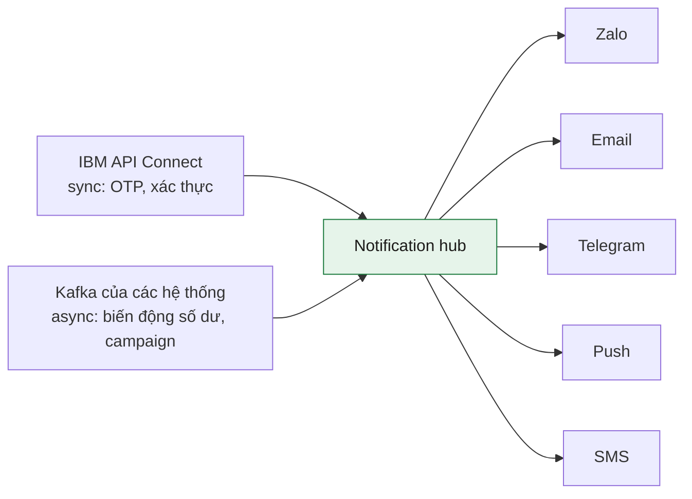
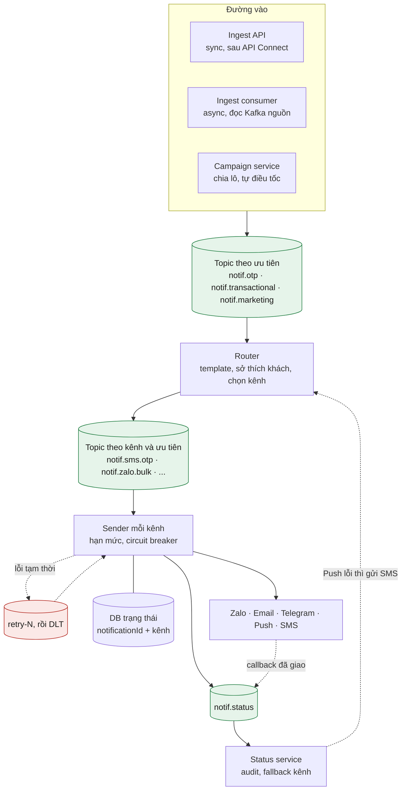
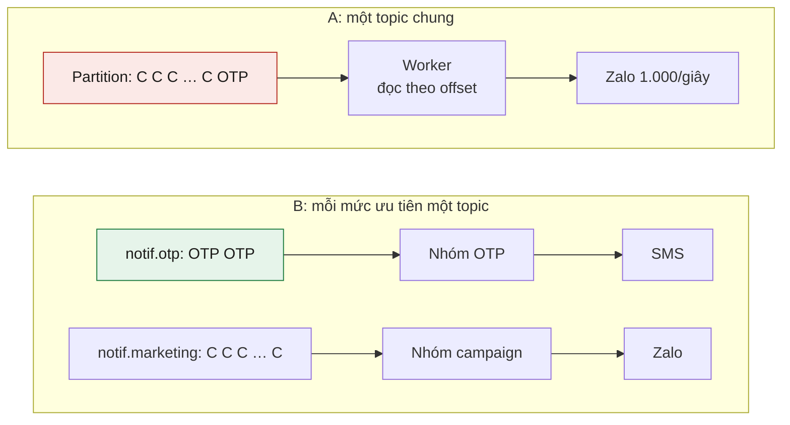
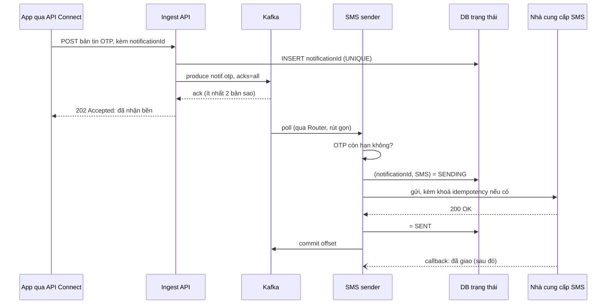
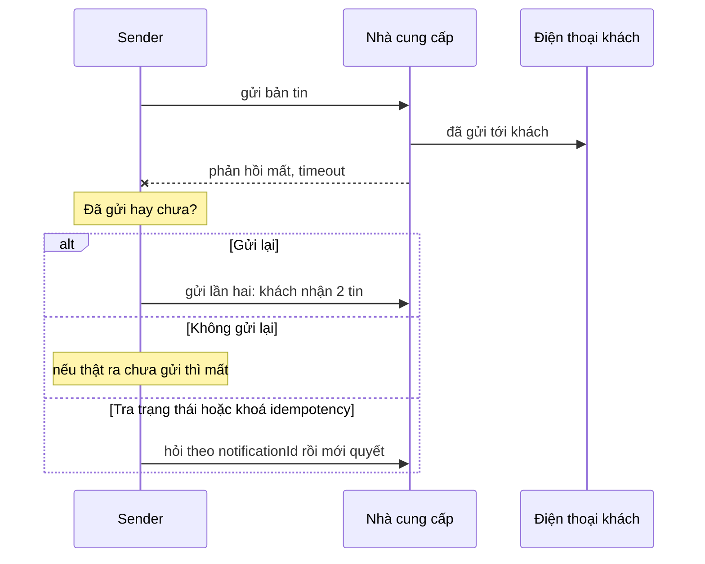

<!-- Tự sinh từ 0017-notification-hub.html bằng scripts/html2md.py. Đừng sửa tay. -->

[Kafka](../README.md) / [Bài 10](0013-core-80-20.md) / Bài 11 · [Tổng hợp usecase](../reference/0005-usecase-index.md) · [Bảng tra](../reference/0001-core-concepts.md)

# Bài 11: Bài toán notification hub cho ngân hàng

Một đề thiết kế hệ thống từ phỏng vấn, giải ở mức high level. Trọng tâm: Kafka đóng vai trò gì, và mỗi vai trò giải quyết ràng buộc nào của đề.

> **Liên quan tới mission** Mission yêu cầu: cho một bài toán mới, đề xuất topic, key, số partition, độ bền, cách xử lý trùng và lỗi, rồi nói được đánh đổi. Bài này áp dụng cả khoá vào một đề thật, có thêm hai thứ khoá học chưa gặp: làn ưu tiên và nhà cung cấp bên ngoài không kiểm soát được.

**Thắng lợi của bài này:** bạn trình bày được thiết kế trong 5 phút: kiến trúc, năm vai trò của Kafka, cách giữ không mất và không trùng ở từng chặng, và giới hạn trung thực khi gọi nhà cung cấp bên ngoài.

## 1. Đề bài và ba ràng buộc

> **Đề** Một hub gửi thông báo tập trung cho ngân hàng, nhận từ IBM API Connect (sync) và Kafka (async), gửi ra 5 kênh (Zalo, Email, Telegram, Push, SMS), chịu tải hàng triệu người dùng, không được mất hay gửi trùng bản tin.

*Hai đường vào, năm đường ra. Mọi đường ra là hệ thống bên ngoài.*

Ba ràng buộc chi phối mọi quyết định phía sau:

1. **Tải rất cao và rất lệch.** Một campaign có thể đẩy cả triệu bản tin trong vài phút, trong khi OTP ít nhưng phải tới trong vài giây. OTP không được chờ campaign.
2. **Nhà cung cấp bên ngoài không kiểm soát được.** Mỗi kênh có hạn mức gửi riêng và có thể chậm hoặc sập bất kỳ lúc nào.
3. **Đây là ngân hàng.** Mất bản tin (OTP, báo trừ tiền) hay gửi trùng (hai tin báo trừ tiền) đều là sự cố nghiêm trọng.

**Hỏi lại trước khi vẽ** (trong phỏng vấn, nêu giả định nếu không được trả lời): tải đỉnh của từng loại bản tin; OTP phải tới trong bao lâu và hết hạn sau bao lâu; nhà cung cấp nào có khoá idempotency hoặc API tra trạng thái; loại bản tin nào cần đúng thứ tự theo khách hàng; phải lưu vết bao lâu để audit.

## 2. Kiến trúc tổng thể

*Màu xanh là topic Kafka. Mỗi mũi tên vào hoặc ra một topic là một chỗ hai bên tách rời nhau về thời gian và tốc độ.*

- **Ingest** nhận từ hai đường, kiểm tra, gán (hoặc nhận) `notificationId` làm khoá idempotency, rồi ghi vào topic theo mức ưu tiên. Đường sync trả `202 Accepted` khi Kafka đã ack: "đã nhận bền", không phải "đã giao tới khách".
- **Router** đọc từng topic ưu tiên bằng một consumer group riêng, dựng nội dung, chọn kênh theo loại bản tin và sở thích khách, rồi ghi sang topic của kênh.
- **Sender**: mỗi kênh một service, mỗi topic kênh một consumer group. Sender giữ hạn mức gọi nhà cung cấp, ngắt mạch khi nhà cung cấp sập, ghi trạng thái gửi vào DB và phát sự kiện trạng thái.
- **Status service** gom trạng thái từ sender và callback của nhà cung cấp: phục vụ tra cứu, audit, và gửi lại qua kênh dự phòng.

## 3. Kafka đóng vai trò gì

Năm vai trò, mỗi vai trò trả lời một ràng buộc. Đây là phần nên nói kỹ nhất khi trình bày.

| Vai trò | Ràng buộc | Cơ chế | Bài |
|---|---|---|---|
| **Lớp đệm bền** giữa người gửi và nhà cung cấp | (1), (2) | Bản tin nằm trong log tới hết retention, mỗi consumer group tự giữ vị trí đọc. Đỉnh tải hay nhà cung cấp sập chỉ làm lag tăng, không làm mất. Retention phải dài hơn sự cố dài nhất cần chịu được. | [1](0001-kafka-big-picture.md), [8b](0014-throughput-latency.md), [8c](0015-replay-retention.md) |
| **Làn ưu tiên** | (1) | Consumer đọc mỗi partition tuần tự theo offset [[KafkaConsumer]](https://kafka.apache.org/44/javadoc/org/apache/kafka/clients/consumer/KafkaConsumer.html), nên trong một partition không có chuyện bản tin sau vượt bản tin trước. Muốn OTP không chờ campaign thì tách topic và consumer group, không phải đặt "độ ưu tiên" cho message. | [2](0002-key-partition-offset.md), [8](0008-topic-design.md) |
| **Cách ly nhà cung cấp** | (2) | Mỗi kênh một topic và một consumer group: Zalo sập không chặn SMS. Khi ngắt mạch, sender `pause()` container: consumer vẫn `poll()` nên không bị đá khỏi group. Lỗi tạm thời đi sang retry topic có mốc thời gian, hết lượt thì DLT [[Spring: retry topic]](https://docs.spring.io/spring-kafka/reference/retrytopic/how-the-pattern-works.html). | [6](0006-error-handling-dlt.md), [8b](0014-throughput-latency.md) |
| **Không mất** | (3) | RF=3, `min.insync.replicas=2`, `acks=all`; Ingest chỉ trả 202 sau ack; consumer commit sau khi xử lý xong; DLT có cảnh báo và quy trình replay. | [4](0004-producer-durability.md), [5](0005-consumer-offset-commit.md), [6](0006-error-handling-dlt.md) |
| **Không trùng**, trong giới hạn có thể | (3) | Kafka cho at-least-once, nên trùng là bình thường. Chống trùng bằng `notificationId`: ở Ingest (client gọi lại) và trước khi gọi nhà cung cấp (trạng thái theo bản tin và kênh). Transaction Kafka không bao được lời gọi ra hệ thống ngoài. | [4b](0010-idempotent-producer.md), [5c](0012-delivery-semantics.md), [7](0007-idempotent-consumer-transactions.md) |

Thêm một vai trò phụ: `notif.status` là luồng sự kiện trạng thái cho audit và báo cáo; bản tin nằm ở DLT hay cần gửi lại sau sự cố thì đọc lại được từ log ([Bài 8c](0015-replay-retention.md)).

## 4. Vì sao phải tách topic: hình dung vấn đề

*A: OTP đứng sau 100.000 bản tin campaign, và Zalo chỉ nhận 1.000 bản tin mỗi giây. B: hai hàng độc lập.*

Thêm consumer không cứu được thiết kế A: số consumer chạy song song tối đa bằng số partition, và campaign lấp mọi partition. Muốn OTP có hàng riêng thì phải tách topic. Thứ tự đọc giữa hai topic do consumer quyết định; Kafka cho phép `pause()` một số partition để tập trung đọc partition khác [[KafkaConsumer: Consumption Flow Control]](https://kafka.apache.org/44/javadoc/org/apache/kafka/clients/consumer/KafkaConsumer.html), nhưng hai consumer group riêng đơn giản và dễ vận hành hơn.

### Thiết kế topic

| Topic | Key | Lý do |
|---|---|---|
| `notif.otp` | `notificationId` | OTP không cần thứ tự giữa các bản tin; key ngẫu nhiên chia đều partition. |
| `notif.transactional` | mã khách hàng | Hai tin biến động số dư của một khách phải đến đúng thứ tự. |
| `notif.marketing` | `notificationId` | Khối lượng lớn, không cần thứ tự; nhiều partition, retention dài hơn để gửi dần. |
| `notif.<kênh>.<ưu tiên>` | giữ key của topic nguồn | Cách ly theo kênh và theo ưu tiên. Retry topic và DLT do team vận hành tạo theo tài liệu thiết kế, không để ứng dụng tự tạo ([Bài 8](0008-topic-design.md)). |
| `notif.status` | `notificationId` | Mọi trạng thái của một bản tin vào cùng partition, đúng thứ tự. |

**Số partition và nút cổ chai.** Một triệu bản tin trong một giờ là khoảng 280 bản tin mỗi giây: rất nhỏ với Kafka. Nút cổ chai là phía gửi: hạn mức của nhà cung cấp, và thời gian mỗi lời gọi API. Ví dụ với số giả định: mỗi lời gọi mất 100 ms và gửi tuần tự thì một luồng gửi khoảng 10 bản tin mỗi giây; muốn 1.000 bản tin mỗi giây thì cần khoảng 100 lời gọi song song, bằng nhiều partition hoặc gửi song song bên trong consumer. Số partition tính theo số luồng gửi cần lúc đỉnh tải, không theo dung lượng của Kafka ([Bài 8b](0014-throughput-latency.md)).

## 5. Luồng OTP, từ API Connect tới điện thoại

*Hai chỗ ghi bền trước khi trả lời: DB (chống client gọi lại) và Kafka (chống mất). Commit offset là việc cuối cùng.*

- Client timeout rồi gọi lại cùng `notificationId`: `INSERT` vi phạm UNIQUE. Bản tin đã lên Kafka thì trả lại 202; chưa lên (Ingest chết giữa hai bước) thì gửi lên lần nữa.
- Sender kiểm hạn trước khi gửi: OTP đã hết hạn thì không gửi nữa, đánh dấu EXPIRED. Gửi một OTP hết hạn chỉ làm khách bối rối.
- Sender crash sau khi gửi, trước khi commit: bản tin được giao lại, thấy trạng thái SENT nên bỏ qua ([Bài 7](0007-idempotent-consumer-transactions.md)).

## 6. Không mất, không trùng: từng chặng, và giới hạn trung thực

| Chặng | Nguy cơ | Chặn bằng |
|---|---|---|
| Client → Ingest | Timeout, client gọi lại | `notificationId` UNIQUE ở Ingest |
| Ingest → Kafka | Broker chết sau khi ack | RF=3, `min.insync.replicas=2`, `acks=all`; trả 202 sau ack |
| Kafka → Router → topic kênh | Crash giữa đọc và ghi | Commit sau khi ghi xong; hoặc transaction Kafka cho đoạn đọc-xử lý-ghi ([Bài 5c](0012-delivery-semantics.md)) |
| Topic kênh → Sender | Crash, rebalance khi deploy | Commit sau khi gửi; trạng thái theo (`notificationId`, kênh) |
| Sender → nhà cung cấp | Sập, chậm, lỗi tạm thời | Hạn mức, ngắt mạch và `pause()`, retry topic, DLT có cảnh báo, kênh dự phòng |
| Sender → nhà cung cấp | **Timeout mơ hồ**: không biết đã gửi chưa | Xem dưới đây: không có cấu hình Kafka nào giải được |

*Kafka chỉ giữ được vị trí đọc của mình. Muốn đúng một lần ra hệ thống ngoài thì hệ thống ngoài phải hợp tác.*

Tài liệu Kafka nói rõ: khi ghi ra hệ thống ngoài, giới hạn nằm ở việc phối hợp vị trí đọc của consumer với thứ thực sự đã được lưu ở đầu ra [[Design: Message Delivery Semantics]](https://kafka.apache.org/44/design/design/). Vì vậy câu trả lời trung thực cho "không mất, không trùng" là:

- Trong hub (Ingest, Kafka, Router, Sender, DB): không mất và không trùng là làm được bằng các bài đã học.
- Ở chặng cuối: chỉ làm được khi nhà cung cấp có khoá idempotency hoặc API tra trạng thái. Đó là tiêu chí khi chọn nhà cung cấp.
- Nhà cung cấp không có thì chọn theo loại bản tin. *Lập luận của giáo viên, kiểm lại với nghiệp vụ:* OTP thì gửi lại (hai mã giống nhau ít hại hơn không đăng nhập được); biến động số dư thì ưu tiên kênh có tra trạng thái, và nội dung có mã giao dịch để khách đối chiếu nếu nhận hai lần; campaign thì không gửi lại.

## 7. Mô phỏng: một topic chung hay tách theo ưu tiên

Ba loại bản tin: OTP 20 bản tin mỗi giây qua SMS, giao dịch 300 qua Push, campaign 100.000 qua Zalo. Mọi con số là giả định để thấy hình dạng vấn đề; hạn OTP rút còn 30 giây cho vừa 60 giây mô phỏng.

1. Thiết kế A, retry tại chỗ, bấm "+5 giây" bốn lần. OTP chờ bao lâu? Đổi sang B và làm lại.
2. Thiết kế A, đổi sang retry topic. OTP đỡ hơn không, và vì sao vẫn chậm?
3. Thiết kế B, retry topic, chạy tới giây 60. Bao nhiêu bản tin vào DLT? Bấm "Replay DLT".
4. Bỏ hai sự cố đầu, tick ba sự cố còn lại. Đếm số bản tin trùng, rồi tick "Chống trùng".
5. Còn trùng hoặc mất ở dòng "timeout mơ hồ": thử ba cách xử lý và nói cái giá của từng cách.

Mô phỏng tổng hợp khác: [từ producer tới DB](../portal/index.md#sim-e2e) và [một ngày bảy sự cố](../portal/index.md#sim-e2e-day), cho phần "không mất, không trùng" bên trong hub.

## 8. Usecase: ba sự cố hub phải chịu được

[Xem mọi usecase của khoá học](../reference/0005-usecase-index.md)

### (a) Ngân hàng: campaign 9 giờ sáng, OTP tới chậm hai phút

Marketing gửi khuyến mãi cho một triệu khách lúc 9 giờ, cùng lúc khách đăng nhập để chuyển tiền. Bản tin campaign và OTP nằm chung một topic: OTP đứng sau hàng trăm nghìn bản tin campaign trong cùng partition, nhiều mã hết hạn trước khi tới. **Xử lý:** tách topic và consumer group theo mức ưu tiên, giữ riêng một phần hạn mức SMS cho OTP, và cho campaign service tự điều tốc theo hạn mức của kênh.

### (b) Ngân hàng: nhà cung cấp Zalo sập 20 phút

Sender gọi Zalo liên tục lỗi. Nếu retry tại chỗ thì partition đứng yên; nếu SMS và Zalo chung consumer group thì SMS cũng đứng. **Xử lý:** mỗi kênh một topic và consumer group; ngắt mạch thì `pause()` container Zalo, lag tăng nhưng bản tin vẫn nằm trong log; lỗi tạm thời đi retry topic, hết lượt vào DLT có cảnh báo; bản tin quan trọng chuyển sang kênh dự phòng.

### (c) Ngân hàng: khách nhận hai tin báo trừ tiền

Pod sender bị deploy lại ngay sau khi gửi tin, trước khi commit offset; pod mới đọc lại và gửi lần hai. Khách tưởng bị trừ tiền hai lần và gọi tổng đài. **Xử lý:** ghi trạng thái (`notificationId`, kênh) trước và sau khi gọi nhà cung cấp, bỏ qua bản tin đã SENT; gửi kèm khoá idempotency khi nhà cung cấp hỗ trợ.

## 9. Trình bày trong 5 phút

1. **30 giây: làm rõ đề.** Nhắc ba ràng buộc, hỏi tải đỉnh, hạn OTP, nhà cung cấp có idempotency không.
2. **1 phút: kiến trúc.** Vẽ Ingest, topic ưu tiên, Router, topic kênh, Sender, status. Một câu: "Kafka nằm giữa mọi chặng để mỗi bên chạy theo tốc độ của mình."
3. **1 phút: tải lệch và nhà cung cấp.** Tách theo ưu tiên vì partition đọc tuần tự; tách theo kênh để một nhà cung cấp sập không kéo theo kênh khác; retry topic, DLT, `pause()`.
4. **1 phút 30: không mất, không trùng.** Đi từng chặng theo bảng ở mục 6; kết bằng giới hạn trung thực của timeout mơ hồ.
5. **1 phút: đánh đổi.** Nhiều topic thì vận hành nhiều hơn; retry topic mất thứ tự; trạng thái trong DB thêm một lần ghi cho mỗi bản tin; OTP nằm trong log tới hết retention, nên hỏi team bảo mật về mã hoá nội dung.

## 10. Kiểm tra

<!-- quiz:quiz -->

**1. Campaign một triệu bản tin chung topic với OTP, 12 partition, 12 consumer. Vì sao OTP vẫn chậm?**

- **A.** Consumer đọc partition theo thứ tự offset
- **B.** Kafka ưu tiên message có kích thước lớn
- **C.** Producer gom OTP vào lô của campaign
- **D.** Broker giới hạn tốc độ ghi của topic OTP

Đáp án

**A. Consumer đọc partition theo thứ tự offset**

Mỗi partition được đọc tuần tự; campaign lấp mọi partition nên OTP đứng sau. Thêm consumer không giúp vì đã bằng số partition. Cách sửa là tách topic theo ưu tiên.

**2. Nhà cung cấp Zalo sập 20 phút. Cách nào giữ bản tin mà không chặn kênh khác?**

- **A.** Tăng số partition của topic Zalo lên
- **B.** Consumer group riêng, pause khi sập
- **C.** Đặt acks=1 để producer ghi nhanh hơn
- **D.** Giảm retention để log không bị đầy lên

Đáp án

**B. Consumer group riêng, pause khi sập**

Topic và consumer group riêng cho từng kênh cách ly sự cố; pause() giữ consumer trong group mà không đọc thêm; bản tin nằm trong log chờ Zalo lên lại.

**3. Ingest trả 202 cho API Connect sớm nhất lúc nào mà vẫn không mất bản tin?**

- **A.** Ngay khi nhận request, chưa ghi gì
- **B.** Sau khi consumer đã commit offset
- **C.** Sau khi Kafka trả ack với acks=all
- **D.** Sau khi nhà cung cấp SMS trả 200

Đáp án

**C. Sau khi Kafka trả ack với acks=all**

Ack với acks=all và min.insync.replicas=2 nghĩa là bản tin đã có ít nhất hai bản sao. Chờ tới lúc gửi xong thì đúng nhưng ghép chặt đường sync vào nhà cung cấp.

**4. Sender gọi nhà cung cấp SMS bị timeout, không biết đã gửi chưa. Nhà cung cấp có API tra trạng thái. Làm gì?**

- **A.** Gửi lại ngay vì OTP cần đến nhanh
- **B.** Bỏ qua vì gửi trùng là sự cố nặng
- **C.** Bật transaction Kafka cho lời gọi
- **D.** Tra trạng thái theo mã rồi quyết

Đáp án

**D. Tra trạng thái theo mã rồi quyết**

Gửi lại có thể trùng, bỏ qua có thể mất. Transaction Kafka không bao được hệ thống ngoài. Tra trạng thái là cách duy nhất biết chắc.

**5. Sender gửi xong, chưa commit offset thì pod bị deploy lại. Điều gì chặn gửi trùng?**

- **A.** enable.idempotence=true ở producer
- **B.** Trạng thái SENT theo notificationId, kênh
- **C.** isolation.level=read_committed ở consumer
- **D.** Tăng session.timeout.ms của consumer

Đáp án

**B. Trạng thái SENT theo notificationId, kênh**

Bản tin được giao lại sau rebalance là chuyện bình thường của at-least-once. Chỉ trạng thái lưu bền theo notificationId và kênh mới cho sender biết đã gửi rồi.

**6. Campaign một triệu bản tin trong một giờ. Nút cổ chai thường ở đâu?**

- **A.** Hạn mức gửi của nhà cung cấp kênh
- **B.** Thông lượng ghi của Kafka broker
- **C.** Số partition tối đa của một topic
- **D.** Dung lượng đĩa còn trống của broker

Đáp án

**A. Hạn mức gửi của nhà cung cấp kênh**

Khoảng 280 bản tin mỗi giây là rất nhỏ với Kafka. Giới hạn nằm ở phía gửi: hạn mức và độ trễ API của nhà cung cấp.

<!-- /quiz -->

## 11. Tự nói thành lời

Không nhìn bài: *"Kafka trong hub có năm vai trò: ... OTP không chờ campaign vì ... Zalo sập không ảnh hưởng SMS vì ... Không mất nhờ ... Không trùng nhờ ..., trừ chặng cuối, nơi ..."*

**Ôn nhanh:** [tóm tắt Bài 11](../summaries/0017-notification-hub.md).

## Nguồn nên đọc

> **Chính:** [Spring Kafka: How the pattern works (non-blocking retries)](https://docs.spring.io/spring-kafka/reference/retrytopic/how-the-pattern-works.html): retry topic, DLT, và cái giá là mất thứ tự.
>
> **Thêm:** [KafkaConsumer javadoc](https://kafka.apache.org/44/javadoc/org/apache/kafka/clients/consumer/KafkaConsumer.html), mục Consumption Flow Control; [Kafka Design](https://kafka.apache.org/44/design/design/), mục Message Delivery Semantics.

> **Còn chỗ nào mơ hồ?** Hỏi thẳng giáo viên, ví dụ "nếu interviewer hỏi sao không dùng RabbitMQ có priority queue thì trả lời thế nào?", "tính số partition cho topic SMS ra sao?". Dán kết quả quiz để biết chỗ cần ôn.
