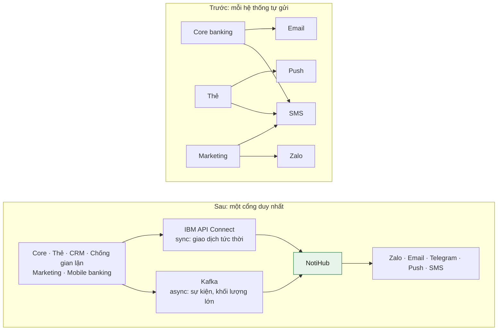
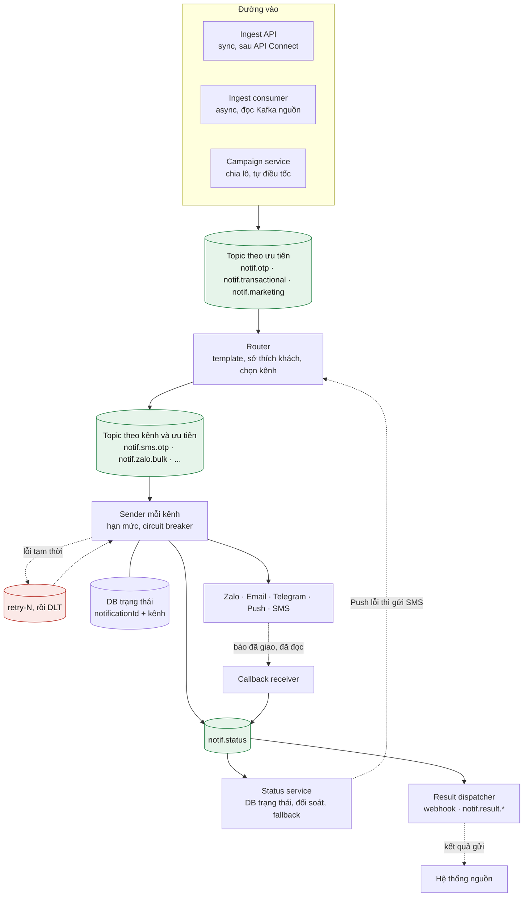
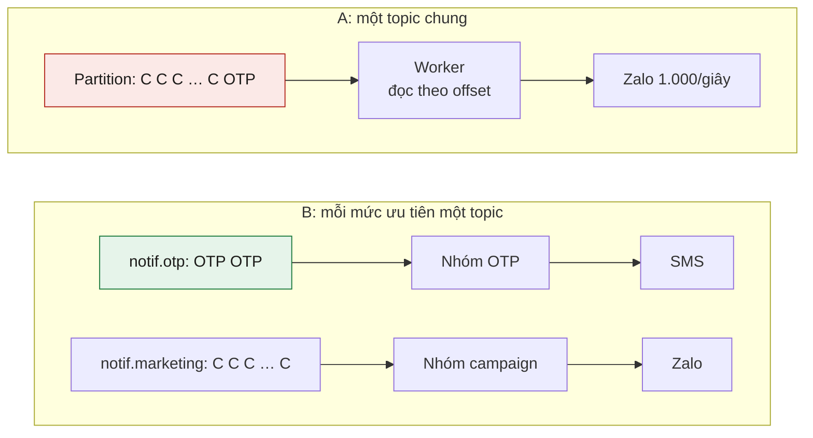
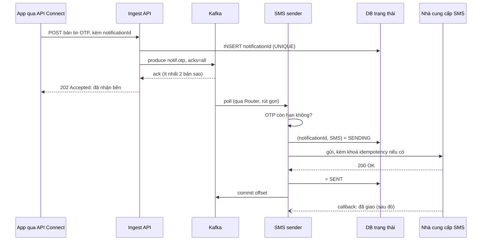
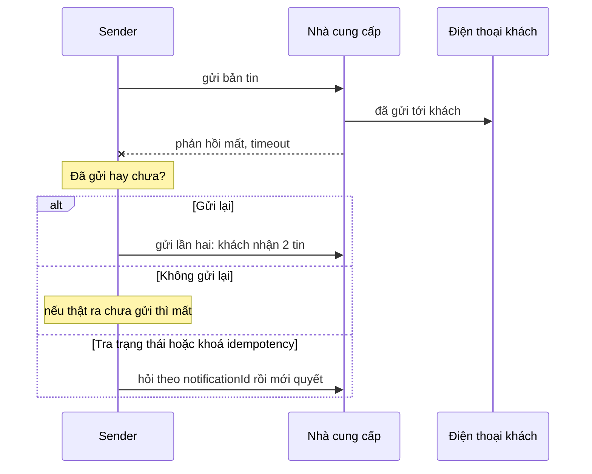
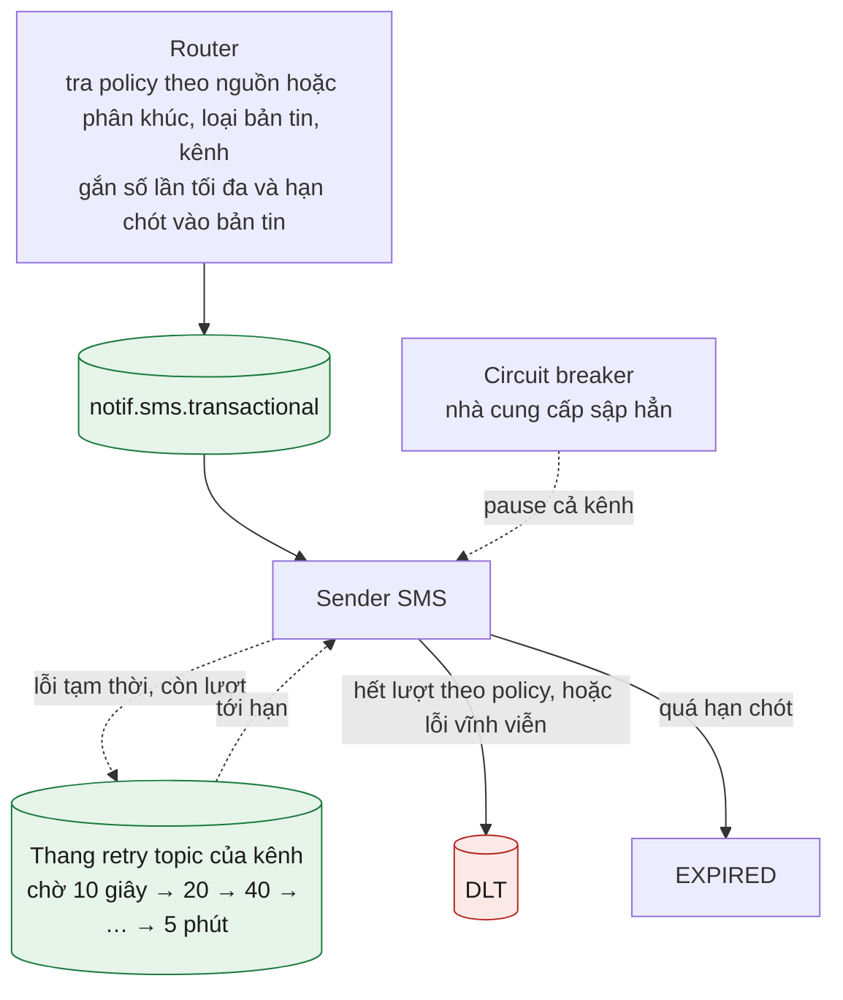
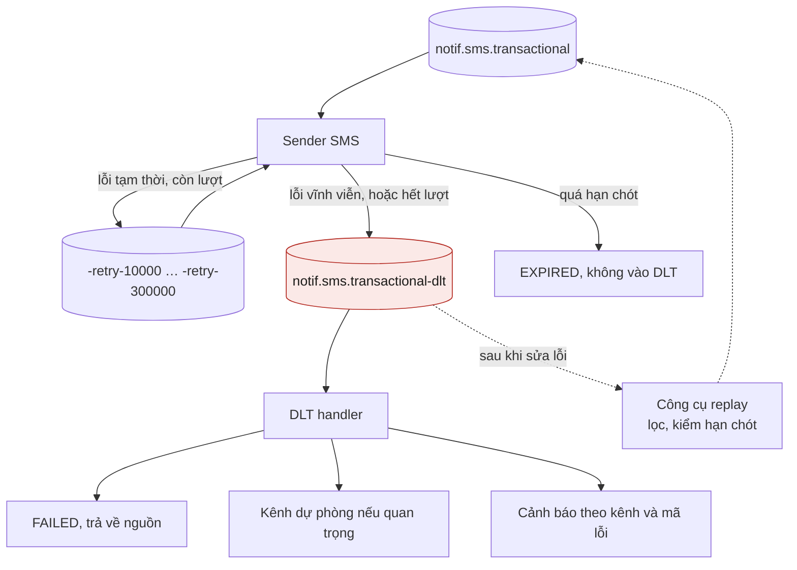
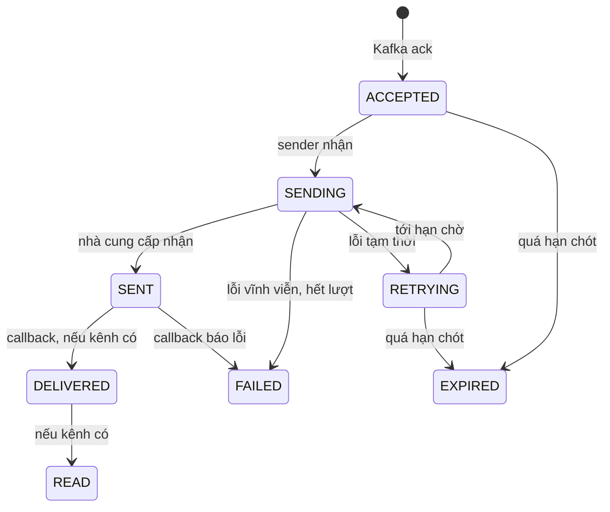
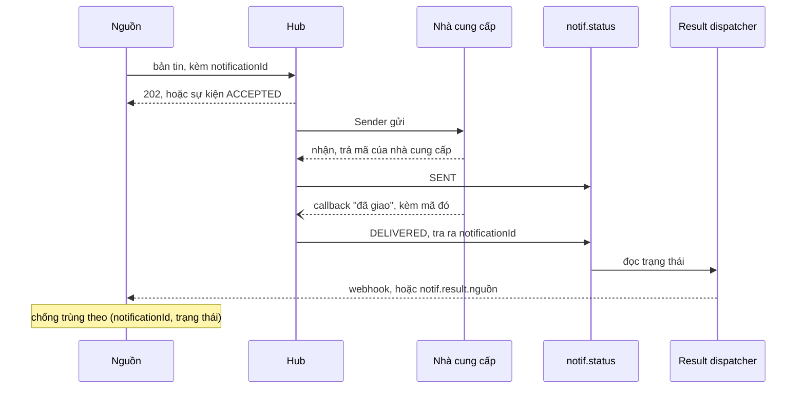

<!-- Tự sinh từ 0017-notification-hub.html bằng scripts/html2md.py. Đừng sửa tay. -->

[Kafka](../README.md) / [Bài 10](0013-core-80-20.md) / Bài 11 · [Tổng hợp usecase](../reference/0005-usecase-index.md) · [Bảng tra](../reference/0001-core-concepts.md)

# Bài 11: Bài toán notification hub cho ngân hàng

Một đề thiết kế hệ thống từ phỏng vấn, giải ở mức high level. Trọng tâm: Kafka đóng vai trò gì, mỗi vai trò giải quyết ràng buộc nào của đề, và năm chỗ hay bị đào sâu: chọn message queue, retry, DLQ, crash, trả kết quả về nguồn.

> **Liên quan tới mission** Mission yêu cầu: cho một bài toán mới, đề xuất topic, key, số partition, độ bền, cách xử lý trùng và lỗi, rồi nói được đánh đổi. Bài này áp dụng cả khoá vào một đề thật, có thêm hai thứ khoá học chưa gặp: làn ưu tiên và nhà cung cấp bên ngoài không kiểm soát được.

**Thắng lợi của bài này:** bạn trình bày được thiết kế trong 5 phút: kiến trúc, năm vai trò của Kafka, cách giữ không mất và không trùng ở từng chặng, và giới hạn trung thực khi gọi nhà cung cấp bên ngoài. Bị hỏi sâu về queue, retry, DLQ, crash hay kết quả gửi, bạn trả lời được bằng cơ chế cụ thể.

## 1. Bối cảnh, mục tiêu và ba ràng buộc

**Bối cảnh.** Ngân hàng có nhiều hệ thống nghiệp vụ: core banking, thẻ, CRM, chống gian lận, marketing, mobile banking. Mỗi hệ thống tự gửi thông báo qua từng kênh. Hệ quả:

- Mỗi hệ thống tự tích hợp với từng nhà cung cấp (Zalo, nhà mạng SMS, SMTP...): cùng một việc được làm nhiều lần.
- Không có chỗ nào thấy tập trung trạng thái gửi, tỉ lệ thành công, chi phí theo kênh.
- Throttle và ưu tiên không nhất quán: không có chỗ chung để bảo đảm OTP đi nhanh hơn khuyến mãi.
- Khó mở rộng khi thêm kênh mới, hoặc khi tải tăng đột biến: cuối tháng, sao kê, khuyến mãi, cảnh báo gian lận hàng loạt.

*Trước: mỗi hệ thống nối thẳng tới từng nhà cung cấp. Sau: hai đường vào, năm đường ra, và mọi đường ra là hệ thống bên ngoài.*

**Mục tiêu.** Mỗi vấn đề ở trên có một mục tiêu và một thành phần trả lời:

| Vấn đề hiện tại | Mục tiêu của hub | Thành phần trả lời |
|---|---|---|
| Mỗi hệ thống tự tích hợp từng nhà cung cấp | Một cổng duy nhất, hai đường vào: API Connect (sync) và Kafka (async) | Ingest API, Ingest consumer (mục 2) |
| Không thấy trạng thái, tỉ lệ thành công, chi phí | Trạng thái gửi tập trung (delivered, failed, read khi kênh có) cho đối soát và báo cáo | `notif.status`, Status service, trả kết quả về nguồn (mục 11) |
| Ưu tiên và throttle không nhất quán | Đúng kênh, đúng người, đúng ưu tiên; template và cá nhân hoá nội dung | Topic theo ưu tiên (mục 4), Router, hạn mức ở Sender |
| Khó mở rộng khi thêm kênh hay tải tăng | Hàng chục triệu bản tin mỗi ngày, hàng nghìn TPS ở đỉnh, không mất, chịu được kênh sập | Kafka làm lớp đệm (mục 3); kênh mới là topic và sender mới; retry, DLT (mục 8, 9) |

> **Đề** Thiết kế high level hub gửi thông báo tập trung (NotiHub): nhận từ IBM API Connect (sync) và Kafka (async), gửi ra 5 kênh (Zalo, Email, Telegram, Push, SMS), chịu hàng chục triệu bản tin mỗi ngày và hàng nghìn TPS ở đỉnh, không được mất hay gửi trùng bản tin, có trạng thái gửi tập trung. Bài này tạm chưa xét phần tuân thủ bảo vệ dữ liệu cá nhân.

Ba ràng buộc chi phối mọi quyết định phía sau:

1. **Tải rất cao và rất lệch.** Một campaign hay đợt sao kê cuối tháng có thể đẩy cả triệu bản tin trong vài phút, trong khi OTP ít nhưng phải tới trong vài giây. OTP không được chờ campaign.
2. **Nhà cung cấp bên ngoài không kiểm soát được.** Mỗi kênh có hạn mức gửi riêng và có thể chậm hoặc sập bất kỳ lúc nào.
3. **Đây là ngân hàng.** Mất bản tin (OTP, báo trừ tiền) hay gửi trùng (hai tin báo trừ tiền) đều là sự cố nghiêm trọng.

**Hỏi lại trước khi vẽ** (trong phỏng vấn, nêu giả định nếu không được trả lời): tải đỉnh của từng loại bản tin; OTP phải tới trong bao lâu và hết hạn sau bao lâu; nhà cung cấp nào có khoá idempotency, API tra trạng thái, callback báo đã giao; loại bản tin nào cần đúng thứ tự theo khách hàng; policy retry do ai quyết và khác nhau theo những gì; nguồn muốn nhận kết quả gửi theo cách nào; phải lưu vết bao lâu để audit.

Sau phần trình bày chính, đề này thường bị đào sâu vào năm chỗ, mỗi chỗ một mục: chọn message queue (mục 7), retry (mục 8), DLQ (mục 9), crash (mục 10), trả kết quả về nguồn (mục 11). Mỗi mục trả lời ở mức system design: vấn đề, thiết kế, Kafka làm gì trong thiết kế đó, và đánh đổi. Chi tiết hiện thực chỉ cần nhắc tên pattern hoặc annotation.

## 2. Kiến trúc tổng thể

*Màu xanh là topic Kafka. Mỗi mũi tên vào hoặc ra một topic là một chỗ hai bên tách rời nhau về thời gian và tốc độ.*

- **Ingest** nhận từ hai đường, kiểm tra, gán (hoặc nhận) `notificationId` làm khoá idempotency, rồi ghi vào topic theo mức ưu tiên. Đường sync trả `202 Accepted` khi Kafka đã ack: "đã nhận bền", không phải "đã giao tới khách".
- **Router** đọc từng topic ưu tiên bằng một consumer group riêng, dựng nội dung, chọn kênh theo loại bản tin và sở thích khách, rồi ghi sang topic của kênh.
- **Sender**: mỗi kênh một service, mỗi topic kênh một consumer group. Sender giữ hạn mức gọi nhà cung cấp, ngắt mạch khi nhà cung cấp sập, ghi trạng thái gửi vào DB và phát sự kiện trạng thái.
- **Router** cũng là chỗ dựng nội dung từ template và cá nhân hoá, nên các hệ thống nguồn chỉ gửi loại bản tin và dữ liệu, không gửi văn bản đã dựng.
- **Callback receiver** nhận báo cáo giao từ nhà cung cấp, tra ra `notificationId` từ mã bản tin của nhà cung cấp, và ghi vào `notif.status`.
- **Status service** gom trạng thái từ sender và callback: phục vụ tra cứu, đối soát, báo cáo tỉ lệ thành công và chi phí theo kênh, và gửi lại qua kênh dự phòng.
- **Result dispatcher** trả kết quả gửi về hệ thống nguồn bằng webhook hoặc topic kết quả (mục 11).

## 3. Kafka đóng vai trò gì

Năm vai trò, mỗi vai trò trả lời một ràng buộc. Đây là phần nên nói kỹ nhất khi trình bày.

| Vai trò | Ràng buộc | Cơ chế | Bài |
|---|---|---|---|
| **Lớp đệm bền** giữa người gửi và nhà cung cấp | (1), (2) | Bản tin nằm trong log tới hết retention, mỗi consumer group tự giữ vị trí đọc. Đỉnh tải hay nhà cung cấp sập chỉ làm lag tăng, không làm mất. Retention phải dài hơn sự cố dài nhất cần chịu được. | [1](0001-kafka-big-picture.md), [8b](0014-throughput-latency.md), [8c](0015-replay-retention.md) |
| **Làn ưu tiên** | (1) | Consumer đọc mỗi partition tuần tự theo offset [[KafkaConsumer]](https://kafka.apache.org/44/javadoc/org/apache/kafka/clients/consumer/KafkaConsumer.html), nên trong một partition không có chuyện bản tin sau vượt bản tin trước. Muốn OTP không chờ campaign thì tách topic và consumer group, không phải đặt "độ ưu tiên" cho message. | [2](0002-key-partition-offset.md), [8](0008-topic-design.md) |
| **Cách ly nhà cung cấp** | (2) | Mỗi kênh một topic và một consumer group: Zalo sập không chặn SMS. Khi ngắt mạch, sender `pause()` container: consumer vẫn `poll()` nên không bị đá khỏi group. Lỗi tạm thời đi sang retry topic có mốc thời gian, hết lượt thì DLT [[Spring: retry topic]](https://docs.spring.io/spring-kafka/reference/retrytopic/how-the-pattern-works.html). | [6](0006-error-handling-dlt.md), [8b](0014-throughput-latency.md) |
| **Không mất** | (3) | RF=3, `min.insync.replicas=2`, `acks=all`; Ingest chỉ trả 202 sau ack; consumer commit sau khi xử lý xong; DLT có cảnh báo và quy trình replay. | [4](0004-producer-durability.md), [5](0005-consumer-offset-commit.md), [6](0006-error-handling-dlt.md) |
| **Không trùng**, trong giới hạn có thể | (3) | Kafka cho at-least-once, nên trùng là bình thường. Chống trùng bằng `notificationId`: ở Ingest (client gọi lại) và trước khi gọi nhà cung cấp (trạng thái theo bản tin và kênh). Transaction Kafka không bao được lời gọi ra hệ thống ngoài. | [4b](0010-idempotent-producer.md), [5c](0012-delivery-semantics.md), [7](0007-idempotent-consumer-transactions.md) |

Thêm một vai trò phụ: `notif.status` là luồng sự kiện trạng thái mà nhiều bên cùng đọc (DB trạng thái, báo cáo, đối soát chi phí, trả kết quả về nguồn); bản tin nằm ở DLT hay cần gửi lại sau sự cố thì đọc lại được từ log ([Bài 8c](0015-replay-retention.md)).

## 4. Vì sao phải tách topic: hình dung vấn đề

*A: OTP đứng sau 100.000 bản tin campaign, và Zalo chỉ nhận 1.000 bản tin mỗi giây. B: hai hàng độc lập.*

Thêm consumer không cứu được thiết kế A: số consumer chạy song song tối đa bằng số partition, và campaign lấp mọi partition. Muốn OTP có hàng riêng thì phải tách topic. Thứ tự đọc giữa hai topic do consumer quyết định; Kafka cho phép `pause()` một số partition để tập trung đọc partition khác [[KafkaConsumer: Consumption Flow Control]](https://kafka.apache.org/44/javadoc/org/apache/kafka/clients/consumer/KafkaConsumer.html), nhưng hai consumer group riêng đơn giản và dễ vận hành hơn.

### Thiết kế topic

| Topic | Key | Lý do |
|---|---|---|
| `notif.otp` | `notificationId` | OTP không cần thứ tự giữa các bản tin; key ngẫu nhiên chia đều partition. |
| `notif.transactional` | mã khách hàng | Hai tin biến động số dư của một khách phải đến đúng thứ tự. |
| `notif.marketing` | `notificationId` | Khối lượng lớn, không cần thứ tự; nhiều partition, retention dài hơn để gửi dần. |
| `notif.<kênh>.<ưu tiên>` | giữ key của topic nguồn | Cách ly theo kênh và theo ưu tiên. Retry topic và DLT do team vận hành tạo theo tài liệu thiết kế, không để ứng dụng tự tạo ([Bài 8](0008-topic-design.md)). |
| `notif.status` | `notificationId` | Mọi trạng thái của một bản tin vào cùng partition, đúng thứ tự. |
| `notif.result.<nguồn>` | `notificationId` | Kết quả gửi cho nguồn dùng Kafka. Mỗi nguồn một topic: phân quyền theo nguồn, và nguồn đọc chậm không làm chậm nguồn khác (mục 11). |

**Chia làn theo độ khẩn, không theo phòng ban.** Sao kê cuối tháng là khối lượng lớn nhưng không khẩn: đi làn `notif.marketing` (có thể đặt tên là `notif.bulk` cho rõ). Cảnh báo gian lận hàng loạt thì khẩn: đi làn `notif.transactional`, nhưng do hệ thống nguồn gửi dồn, nên Ingest giới hạn tốc độ theo từng nguồn để một nguồn không lấp cả làn.

**Số partition và nút cổ chai.** 30 triệu bản tin mỗi ngày là khoảng 350 bản tin mỗi giây trung bình; đỉnh vài nghìn TPS vẫn nhỏ với một cụm Kafka. Nút cổ chai là phía gửi: hạn mức của nhà cung cấp, và thời gian mỗi lời gọi API. Ví dụ với số giả định: mỗi lời gọi mất 100 ms và gửi tuần tự thì một luồng gửi khoảng 10 bản tin mỗi giây; muốn 1.000 bản tin mỗi giây cho một kênh thì cần khoảng 100 lời gọi song song, bằng nhiều partition hoặc gửi song song bên trong consumer. Số partition tính theo số luồng gửi cần lúc đỉnh tải, không theo dung lượng của Kafka ([Bài 8b](0014-throughput-latency.md)).

## 5. Luồng OTP, từ API Connect tới điện thoại

*Hai chỗ ghi bền trước khi trả lời: DB (chống client gọi lại) và Kafka (chống mất). Commit offset là việc cuối cùng.*

- Client timeout rồi gọi lại cùng `notificationId`: `INSERT` vi phạm UNIQUE. Bản tin đã lên Kafka thì trả lại 202; chưa lên (Ingest chết giữa hai bước) thì gửi lên lần nữa.
- Sender kiểm hạn trước khi gửi: OTP đã hết hạn thì không gửi nữa, đánh dấu EXPIRED. Gửi một OTP hết hạn chỉ làm khách bối rối.
- Sender crash sau khi gửi, trước khi commit: bản tin được giao lại, thấy trạng thái SENT nên bỏ qua ([Bài 7](0007-idempotent-consumer-transactions.md)).

## 6. Không mất, không trùng: từng chặng, và giới hạn trung thực

| Chặng | Nguy cơ | Chặn bằng |
|---|---|---|
| Client → Ingest | Timeout, client gọi lại | `notificationId` UNIQUE ở Ingest |
| Ingest → Kafka | Broker chết sau khi ack | RF=3, `min.insync.replicas=2`, `acks=all`; trả 202 sau ack |
| Kafka → Router → topic kênh | Crash giữa đọc và ghi | Commit sau khi ghi xong; hoặc transaction Kafka cho đoạn đọc-xử lý-ghi ([Bài 5c](0012-delivery-semantics.md)) |
| Topic kênh → Sender | Crash, rebalance khi deploy | Commit sau khi gửi; trạng thái theo (`notificationId`, kênh) |
| Sender → nhà cung cấp | Sập, chậm, lỗi tạm thời | Hạn mức, ngắt mạch và `pause()`, retry topic, DLT có cảnh báo, kênh dự phòng |
| Sender → nhà cung cấp | **Timeout mơ hồ**: không biết đã gửi chưa | Xem dưới đây: không có cấu hình Kafka nào giải được |

*Kafka chỉ giữ được vị trí đọc của mình. Muốn đúng một lần ra hệ thống ngoài thì hệ thống ngoài phải hợp tác.*

Tài liệu Kafka nói rõ: khi ghi ra hệ thống ngoài, giới hạn nằm ở việc phối hợp vị trí đọc của consumer với thứ thực sự đã được lưu ở đầu ra [[Design: Message Delivery Semantics]](https://kafka.apache.org/44/design/design/). Vì vậy câu trả lời trung thực cho "không mất, không trùng" là:

- Trong hub (Ingest, Kafka, Router, Sender, DB): không mất và không trùng là làm được bằng các bài đã học.
- Ở chặng cuối: chỉ làm được khi nhà cung cấp có khoá idempotency hoặc API tra trạng thái. Đó là tiêu chí khi chọn nhà cung cấp.
- Nhà cung cấp không có thì chọn theo loại bản tin. *Lập luận của giáo viên, kiểm lại với nghiệp vụ:* OTP thì gửi lại (hai mã giống nhau ít hại hơn không đăng nhập được); biến động số dư thì ưu tiên kênh có tra trạng thái, và nội dung có mã giao dịch để khách đối chiếu nếu nhận hai lần; campaign thì không gửi lại.

## 7. Message queue: dùng ở bước nào, dùng loại nào

Có dùng, và dùng Kafka làm backbone: mọi chặng giữa hai thành phần đều đi qua một topic. Queue nằm ở mọi chỗ hai bên cần chạy theo tốc độ riêng, hoặc phải chịu được bên kia sập. Chỗ cần trả lời ngay thì không dùng queue. Bốn mục sau đều dựa trên backbone này: retry và DLQ là topic, crash an toàn nhờ offset, kết quả gửi đi qua topic trạng thái.

| Bước | Topic | Queue giải quyết gì |
|---|---|---|
| Hệ thống nguồn → hub (async) | Topic sự kiện của nguồn, ví dụ giao dịch của core banking | Nguồn không chờ hub. Hub sập thì sự kiện vẫn nằm trong log; hub lên lại đọc tiếp từ offset đã commit. |
| Ingest → Router | `notif.otp`, `notif.transactional`, `notif.marketing` | Tách "đã nhận" khỏi "đã gửi": đường sync trả 202 sau khi Kafka ack. Mỗi làn ưu tiên một hàng riêng. |
| Router → Sender | `notif.<kênh>.<ưu tiên>` | Cách ly nhà cung cấp: mỗi kênh tự điều tốc theo hạn mức của mình. |
| Sender gửi lỗi | `…-retry-<delay>`, `…-dlt` | Retry không chặn partition chính (mục 8); bản tin hết lượt không bị bỏ (mục 9). |
| Sau khi gửi, và callback của nhà cung cấp | `notif.status` | Một luồng trạng thái, nhiều bên đọc: DB trạng thái, báo cáo, đối soát chi phí, fallback, trả kết quả. |
| Hub → nguồn | `notif.result.<nguồn>` | Trả kết quả cho nguồn dùng Kafka (mục 11). |

**Chỗ không dùng queue:** API Connect gọi Ingest bằng HTTP vì nguồn cần câu trả lời ngay (202 hoặc lỗi); tra trạng thái là đọc DB; lịch campaign nằm trong DB của campaign service.

**Vì sao là Kafka.** *Lập luận của giáo viên, đối chiếu với nền tảng thật của ngân hàng:*

- Ngân hàng đã dùng Kafka trong kiến trúc microservices: không thêm một nền tảng phải vận hành, và nguồn async gửi bằng thứ họ đã có.
- Log giữ bản tin tới hết retention, nên đọc lại được: replay DLT, gửi lại sau sự cố, dựng lại báo cáo ([Bài 8c](0015-replay-retention.md)).
- Nhiều consumer group đọc cùng một topic mà không phải sao chép: `notif.status` phục vụ DB, báo cáo và trả kết quả cùng lúc.
- Thứ tự theo key: hai tin biến động số dư của một khách đi đúng thứ tự ([Bài 2](0002-key-partition-offset.md)).

**Kafka thiếu gì, và bù thế nào.** Kafka không có độ ưu tiên hay độ trễ cho từng message: bù bằng topic theo ưu tiên (mục 4) và retry topic theo mốc trễ (mục 8). Trong một consumer group, số consumer chạy song song tối đa bằng số partition: bù bằng đủ partition, hoặc Share Groups ("queues for Kafka", production-ready từ Kafka 4.2). Share Groups cho nhiều consumer hơn số partition, ack từng bản ghi và giới hạn số lần giao, nhưng không giữ thứ tự [[KIP-932]](https://cwiki.apache.org/confluence/display/KAFKA/KIP-932%3A+Queues+for+Kafka) [[research/0001]](../research/0001-curriculum-coverage.md). Vì vậy Share Groups hợp làn OTP hay campaign, không hợp biến động số dư.

Nếu bị hỏi về một broker kiểu hàng đợi có sẵn độ ưu tiên và độ trễ theo message: nó giải được hai chỗ thiếu trên, nhưng thêm một nền tảng phải vận hành, và hàng đợi kiểu xoá sau khi ack thì không đọc lại được bản tin cũ. *Lập luận của giáo viên.*

## 8. Retry: chờ tăng dần, giới hạn theo khách hàng và kênh

[Bài 6](0006-error-handling-dlt.md) đã có hai loại lỗi và hai kiểu retry. Ở hub, retry có thêm ba yêu cầu: thời gian chờ tăng dần, số lần tối đa khác nhau theo khách hàng và kênh, và hạn chót theo loại bản tin.

### Ba quy tắc

1. **Chỉ retry lỗi tạm thời.** Timeout, nhà cung cấp trả lỗi 5xx hoặc báo vượt hạn mức: retry. Số điện thoại sai, template lỗi, dữ liệu hỏng: thử bao nhiêu lần cũng không qua, nên đi thẳng sang DLT.
2. **Thời gian chờ tăng dần.** Lần thử lại thứ n chờ `min(delay × multipliern-1, maxDelay)`, ví dụ 10 giây, 20, 40, 80, 160, rồi dừng ở 5 phút. Nhà cung cấp đang quá tải mà bị dội retry đều đặn thì càng lâu hồi phục.
3. **Dừng ở giới hạn nào tới trước:** số lần tối đa, hoặc hạn chót. OTP còn lượt nhưng đã hết hạn thì dừng, vì gửi OTP hết hạn là vô ích.

**Retry không thay được ngắt mạch.** Khi nhà cung cấp sập hẳn, mọi bản tin đều lỗi: retry từng bản tin chỉ đốt hết lượt của chúng rồi dồn vào DLT. Ngắt mạch thì `pause()` container của kênh đó (mục 3): bản tin nằm yên trong log và không mất lượt. Retry dành cho lỗi lẻ tẻ.

### Bảng policy

"Khách hàng" có thể là hệ thống nguồn (core, thẻ, marketing) hoặc phân khúc người nhận (ví dụ khách ưu tiên). Cách làm giống nhau: policy được tra theo khoá (nguồn hoặc phân khúc, loại bản tin, kênh). Con số dưới đây là giả định.

| Loại bản tin | Kênh | Phân khúc | Số lần tối đa | Chờ | Hạn chót | Hết lượt thì |
|---|---|---|---|---|---|---|
| OTP | SMS | mọi khách | 3 | 1 giây, 2 giây | hạn của OTP | FAILED, báo nguồn để khách bấm gửi lại |
| Biến động số dư | Push | mọi khách | 3 | 5 giây ×2, tối đa 1 phút | 5 phút | Chuyển sang SMS |
| Biến động số dư | SMS | thường | 5 | 10 giây ×2, tối đa 5 phút | 2 giờ | DLT, cảnh báo |
| Biến động số dư | SMS | ưu tiên | 8 | 10 giây ×2, tối đa 5 phút | 2 giờ | DLT, cảnh báo |
| Campaign | Zalo | mọi khách | 2 | 5 phút | hết khung giờ campaign | FAILED, không gửi bù |

### Thiết kế: thang retry topic và policy đi theo bản tin

*Thang chờ là của kênh; dừng ở bậc nào là do policy của từng bản tin. Retry không chặn partition chính.*

- **Kafka làm gì:** mỗi bậc chờ là một retry topic. Bản tin lỗi được ghi sang bậc kế tiếp, partition chính đi tiếp; consumer của bậc chờ chỉ đọc khi tới hạn. Bản tin nằm bền trong log suốt thời gian chờ, nên pod chết giữa chừng cũng không mất. Pattern này gọi là **non-blocking retry** [[Spring: How the pattern works]](https://docs.spring.io/spring-kafka/reference/retrytopic/how-the-pattern-works.html).
- **Giới hạn theo khách hàng và kênh:** thang chờ đặt theo kênh, vì đó là đặc tính của nhà cung cấp. Số lần tối đa và hạn chót đặt theo policy, Router gắn vào bản tin lúc chọn kênh. Sender so số lần đã thử với policy của bản tin: tới giới hạn thì đưa thẳng sang DLT, dù thang của kênh còn bậc.
- **Nhắc tên khi được hỏi hiện thực:** Spring Kafka có sẵn pattern này: `@RetryableTopic` với `@BackOff` (delay, multiplier, maxDelay) tạo thang retry topic và DLT, `@DltHandler` xử lý DLT [[Spring: Features]](https://docs.spring.io/spring-kafka/reference/retrytopic/features.html).

**Hai đánh đổi cần nói.**

- **Mất thứ tự.** Bản tin đi retry topic có thể tới sau bản tin mới hơn. Với biến động số dư, nội dung có thời điểm và số dư sau giao dịch thì chấp nhận được; nếu không, làn đó dùng blocking retry ngắn vài giây, chấp nhận partition đứng trong lúc chờ.
- **Thang chờ chung cho cả kênh.** Các phân khúc chỉ khác nhau ở số lần và hạn chót. Muốn thang chờ khác nhau thì phải tách topic, đổi lại vận hành nhiều topic hơn.

## 9. DLQ: chứa gì, ai xử lý, đưa về thế nào

Với consumer thường, DLQ không phải tính năng có sẵn của Kafka mà là pattern ứng dụng; Spring gọi nó là DLT (dead-letter topic). Docs Apache chỉ định nghĩa DLQ cho Kafka Connect và Share Groups ([Bài 6](0006-error-handling-dlt.md)). Ở hub, thiết kế DLT phải trả lời bốn câu: cái gì vào DLT, bản ghi mang theo gì, ai được báo, và đưa bản tin về thế nào.

*DLT là điểm dừng có người trông, không phải thùng rác. Replay ghi lại vào topic chính với cùng notificationId.*

### Cái gì vào DLT

| Trường hợp | Vào DLT? | Lý do |
|---|---|---|
| Lỗi vĩnh viễn: số sai, template lỗi, dữ liệu hỏng | Có, ngay | Cần người sửa dữ liệu hoặc template rồi mới gửi được. |
| Lỗi tạm thời, đã hết lượt theo policy | Có | Nhà cung cấp lỗi kéo dài; replay khi đã ổn. |
| OTP hoặc bản tin đã quá hạn chót | Không: EXPIRED | Gửi lại cũng vô ích; vẫn trả trạng thái về nguồn. |
| Campaign hết lượt | Không: FAILED | Khuyến mãi gửi bù muộn không còn giá trị; chỉ đếm vào báo cáo. |

*Hai dòng cuối của bảng là lập luận của giáo viên, kiểm lại với nghiệp vụ.*

### Mang theo gì, ai xử lý, đưa về thế nào

- **Mang theo:** bản tin gốc với `notificationId`, lý do lỗi, vị trí gốc (topic, partition, offset), số lần đã thử, mã lỗi của nhà cung cấp. Đủ để người trực quyết định sửa gì và có replay không. Spring tự thêm phần lý do và vị trí gốc vào header [[Spring: Handling exceptions]](https://docs.spring.io/spring-kafka/reference/kafka/annotation-error-handling.html).
- **Ai xử lý:** một consumer của DLT ghi FAILED vào trạng thái, để nguồn nhận kết quả (mục 11) và Status service quyết định có gửi qua kênh dự phòng không. Cảnh báo theo số bản ghi vào DLT mỗi phút, tách theo kênh và mã lỗi: một tin OTP hay số dư vào DLT là đủ để báo, campaign thì báo theo tỉ lệ. *Lập luận của giáo viên.*
- **Đưa về thế nào:** sửa nguyên nhân trước, rồi replay: lọc DLT theo thời gian và mã lỗi, bỏ bản tin đã quá hạn chót, ghi lại vào topic chính với cùng `notificationId` và bắt đầu thang retry mới. Sender thấy SENT thì bỏ qua, nên replay hai lần cũng không gửi trùng.
- **DLT cũng là dữ liệu không được mất:** cùng độ bền với topic chính (RF=3, `min.insync.replicas=2`), retention dài hơn thời gian xử lý sự cố.

## 10. App crash: chết ở đâu thì chuyện gì xảy ra

Một quy tắc phủ mọi chỗ: **ghi bền trước, commit sau, và mọi bước chạy lại được mà không gây trùng**. Kafka lo phần "chạy lại": offset chưa commit thì bản ghi được giao lại ([Bài 5](0005-consumer-offset-commit.md)). Hub lo phần "không gây trùng" bằng `notificationId`.

| Thành phần | Chết lúc | Sau khi chạy lại |
|---|---|---|
| Ingest API | Trước khi Kafka ack | Nguồn nhận lỗi hoặc timeout, gọi lại cùng `notificationId`; bản tin chưa lên Kafka nên được ghi lên lúc này. |
| Ingest API | Sau ack, trước khi trả 202 | Nguồn gọi lại; dòng chống trùng cho biết đã lên Kafka, nên trả 202 mà không ghi lần hai. |
| Ingest consumer | Trước khi commit | Đọc lại từ offset đã commit; trùng bị chặn bằng mã sự kiện của nguồn. |
| Router | Ghi topic kênh xong, chưa commit | Ghi lần hai sang topic kênh; sender chặn bằng trạng thái. Muốn khỏi trùng ngay ở đây: transaction đọc-xử lý-ghi ([Bài 5c](0012-delivery-semantics.md)). |
| Sender | Trước khi gọi nhà cung cấp | Bản ghi được giao lại, gửi bình thường. |
| Sender | Đã gọi, chưa ghi SENT | Giao lại, thấy trạng thái kẹt ở SENDING: không biết đã gửi chưa. Đây chính là timeout mơ hồ ở mục 6: tra trạng thái hoặc dùng khoá idempotency, nếu không có thì xử lý theo loại bản tin. |
| Sender | Đã ghi SENT, chưa commit | Giao lại, thấy SENT, bỏ qua. |
| Consumer của retry topic | Đang chờ tới hạn | Bản ghi vẫn nằm trong retry topic, chưa commit, nên được giao lại. |
| Result dispatcher | Đã gọi webhook, chưa commit | Gọi webhook lần hai; nguồn chống trùng theo (`notificationId`, trạng thái). |
| Broker | Bất kỳ lúc nào | RF=3, `min.insync.replicas=2`: partition có leader mới, bản tin đã ack không mất ([Bài 4](0004-producer-durability.md)). |
| Cả hub | Sập hẳn | Async: sự kiện nằm trong topic nguồn, lag tăng, hub lên lại đọc tiếp. Sync: API Connect trả lỗi, nguồn retry cùng `notificationId`. Hub chạy nhiều instance trên nhiều zone để hiếm khi tới mức này. |

**Ba chỗ dễ sót.**

- **Deploy là crash có báo trước.** Pod dừng nhận bản tin mới, làm xong việc dở, commit rồi mới tắt. Thời gian ân hạn của pod phải dài hơn thời gian xử lý một lô bản tin; bị giết giữa chừng thì không mất (chưa commit), nhưng rơi vào dòng "đã gọi, chưa ghi SENT".
- **Một bản tin làm chết process mỗi lần đọc**, ví dụ hết bộ nhớ khi dựng nội dung. Offset không commit, pod lên lại đọc đúng bản tin đó và chết tiếp. Không cấu hình Kafka nào tự gỡ được: chặn bằng giới hạn kích thước ở Ingest, cảnh báo khi pod restart liên tục, và gỡ bằng tay bằng cách chuyển bản ghi đó sang DLT rồi dời offset qua nó ([Bài 8c](0015-replay-retention.md)). *Lập luận của giáo viên.*
- **SENT mãi không có báo đã giao.** Nhà cung cấp có thể không gửi callback. Job đối soát định kỳ tìm bản tin SENT quá lâu chưa có kết quả, tra API của nhà cung cấp nếu có, nếu không thì đánh dấu "đã gửi, không có xác nhận".

## 11. Trả kết quả gửi về nguồn

Nguồn cần biết bản tin của mình ra sao: CSKH tra cứu, đối soát, hoặc quyết định gửi lại. Thiết kế có ba phần: mô hình trạng thái, chỗ trạng thái đến từ đâu, và cách trả về nguồn.

*Trạng thái lưu theo (notificationId, kênh). Có fallback thì một bản tin có nhiều dòng, mỗi kênh một dòng.*

**Trạng thái đến từ hai nơi.** Sender phát SENT hoặc FAILED khi gọi nhà cung cấp, và lưu mã bản tin mà nhà cung cấp trả về. Callback receiver nhận báo đã giao hay đã đọc từ nhà cung cấp, dùng mã đó tra ra `notificationId`. Không phải kênh nào cũng báo đã giao hay đã đọc, nên mỗi kênh ghi rõ trạng thái cuối cùng nó báo được.

*"Hub" gộp Ingest, Sender và Callback receiver. Kết quả đi một chiều qua notif.status; nguồn không phải gọi ngược vào sender hay nhà cung cấp.*

| Cách trả về | Hợp với | Cách làm |
|---|---|---|
| **API tra cứu** (nguồn hỏi) | Nguồn sync, màn hình CSKH, đối soát | `GET /notifications/{id}` qua API Connect, đọc DB trạng thái. Luôn có, vì là chỗ dựa khi hai cách kia lỗi. |
| **Webhook** (hub gọi) | Nguồn sync cần biết ngay | Nguồn đăng ký URL. Result dispatcher đọc `notif.status` rồi gọi URL đó; lỗi thì retry có chờ tăng dần và có DLT riêng, như mục 8 và 9. |
| **Topic kết quả** (hub ghi) | Nguồn đã dùng Kafka | Dispatcher ghi sang `notif.result.<nguồn>`, key `notificationId`. Phân quyền theo tiền tố topic, mỗi nguồn chỉ đọc topic của mình. |

Khi đăng ký, nguồn chọn cách nhận và mức chi tiết: chỉ kết quả cuối (DELIVERED, FAILED, EXPIRED) hay mọi bước. OTP thường chỉ cần biết khi thất bại. *Lập luận của giáo viên.*

**Bốn bẫy.**

- **Trùng.** Trả kết quả cũng là at-least-once (dispatcher có thể chết sau khi gọi webhook). Nguồn phải chống trùng theo (`notificationId`, trạng thái).
- **Sai thứ tự.** Callback "đã giao" của nhà cung cấp có thể tới trước sự kiện SENT của sender, vì hai bên ghi độc lập. Key theo `notificationId` chỉ giữ thứ tự theo lúc ghi vào topic. Vì vậy trạng thái chỉ được tiến, không lùi: Status service bỏ qua sự kiện "cũ hơn" trạng thái hiện tại.
- **Nguồn chậm kéo theo nguồn khác.** Webhook của một nguồn timeout mà mọi nguồn chung một hàng thì cả hàng đứng: cùng bài toán cách ly nhà cung cấp, chỉ đảo chiều. Tách topic kết quả và consumer group theo nguồn, ngắt mạch theo nguồn.
- **Không có callback.** Xem job đối soát ở mục 10.

**Đối soát và báo cáo.** `notif.status` là nguồn duy nhất cho tỉ lệ thành công và chi phí theo kênh: đếm SENT theo kênh và nhà cung cấp, nhân đơn giá, so với hoá đơn của nhà cung cấp.

## 12. Mô phỏng: một topic chung hay tách theo ưu tiên

Ba loại bản tin: OTP 20 bản tin mỗi giây qua SMS, giao dịch 300 qua Push, campaign 100.000 qua Zalo. Mọi con số là giả định để thấy hình dạng vấn đề; hạn OTP rút còn 30 giây cho vừa 60 giây mô phỏng.

1. Thiết kế A, retry tại chỗ, bấm "+5 giây" bốn lần. OTP chờ bao lâu? Đổi sang B và làm lại.
2. Thiết kế A, đổi sang retry topic. OTP đỡ hơn không, và vì sao vẫn chậm?
3. Thiết kế B, retry topic, chạy tới giây 60. Bao nhiêu bản tin vào DLT? Bấm "Replay DLT".
4. Bỏ hai sự cố đầu, tick ba sự cố còn lại. Đếm số bản tin trùng, rồi tick "Chống trùng".
5. Còn trùng hoặc mất ở dòng "timeout mơ hồ": thử ba cách xử lý và nói cái giá của từng cách.

Mô phỏng tổng hợp khác: [từ producer tới DB](../portal/index.md#sim-e2e) và [một ngày bảy sự cố](../portal/index.md#sim-e2e-day), cho phần "không mất, không trùng" bên trong hub.

## 13. Usecase: ba sự cố hub phải chịu được

[Xem mọi usecase của khoá học](../reference/0005-usecase-index.md)

### (a) Ngân hàng: campaign 9 giờ sáng, OTP tới chậm hai phút

Marketing gửi khuyến mãi cho một triệu khách lúc 9 giờ, cùng lúc khách đăng nhập để chuyển tiền. Bản tin campaign và OTP nằm chung một topic: OTP đứng sau hàng trăm nghìn bản tin campaign trong cùng partition, nhiều mã hết hạn trước khi tới. **Xử lý:** tách topic và consumer group theo mức ưu tiên, giữ riêng một phần hạn mức SMS cho OTP, và cho campaign service tự điều tốc theo hạn mức của kênh.

### (b) Ngân hàng: nhà cung cấp Zalo sập 20 phút

Sender gọi Zalo liên tục lỗi. Nếu retry tại chỗ thì partition đứng yên; nếu SMS và Zalo chung consumer group thì SMS cũng đứng. **Xử lý:** mỗi kênh một topic và consumer group; ngắt mạch thì `pause()` container Zalo, lag tăng nhưng bản tin vẫn nằm trong log; lỗi tạm thời đi retry topic, hết lượt vào DLT có cảnh báo; bản tin quan trọng chuyển sang kênh dự phòng.

### (c) Ngân hàng: khách nhận hai tin báo trừ tiền

Pod sender bị deploy lại ngay sau khi gửi tin, trước khi commit offset; pod mới đọc lại và gửi lần hai. Khách tưởng bị trừ tiền hai lần và gọi tổng đài. **Xử lý:** ghi trạng thái (`notificationId`, kênh) trước và sau khi gọi nhà cung cấp, bỏ qua bản tin đã SENT; gửi kèm khoá idempotency khi nhà cung cấp hỗ trợ.

## 14. Trình bày trong 5 phút

1. **30 giây: làm rõ đề.** Nhắc ba ràng buộc, hỏi tải đỉnh, hạn OTP, nhà cung cấp có idempotency không.
2. **1 phút: kiến trúc.** Vẽ Ingest, topic ưu tiên, Router, topic kênh, Sender, status. Một câu: "Kafka nằm giữa mọi chặng để mỗi bên chạy theo tốc độ của mình."
3. **1 phút: tải lệch và nhà cung cấp.** Tách theo ưu tiên vì partition đọc tuần tự; tách theo kênh để một nhà cung cấp sập không kéo theo kênh khác; retry topic, DLT, `pause()`.
4. **1 phút 30: không mất, không trùng.** Đi từng chặng theo bảng ở mục 6; kết bằng giới hạn trung thực của timeout mơ hồ.
5. **1 phút: đánh đổi.** Nhiều topic thì vận hành nhiều hơn; retry topic mất thứ tự; trạng thái trong DB thêm một lần ghi cho mỗi bản tin; OTP nằm trong log tới hết retention, nên hỏi team bảo mật về mã hoá nội dung.

**Khi bị đào sâu**, mỗi chỗ một câu chốt, rồi mới đi vào chi tiết:

| Chỗ | Câu chốt |
|---|---|
| Message queue | Có, Kafka, ở mọi chỗ hai bên chạy khác tốc độ; HTTP ở chỗ cần trả lời ngay (mục 7). |
| Retry | Non-blocking retry: thang retry topic chờ tăng dần theo kênh; số lần và hạn chót theo policy gắn vào bản tin; nhà cung cấp sập hẳn thì ngắt mạch, không retry (mục 8). |
| DLQ | DLT là pattern ứng dụng; vào khi lỗi vĩnh viễn hoặc hết lượt; có cảnh báo, trả FAILED về nguồn, replay cùng notificationId (mục 9). |
| Crash | Ghi bền trước, commit sau, mọi bước chạy lại được; chỗ khó là kẹt ở SENDING, chính là timeout mơ hồ (mục 10). |
| Trả kết quả | Một luồng notif.status; nguồn chọn API tra cứu, webhook hoặc topic kết quả; nhận ít nhất một lần, trạng thái chỉ tiến (mục 11). |

## 15. Kiểm tra

<!-- quiz:quiz -->

**1. Campaign một triệu bản tin chung topic với OTP, 12 partition, 12 consumer. Vì sao OTP vẫn chậm?**

- **A.** Consumer đọc partition theo thứ tự offset
- **B.** Kafka ưu tiên message có kích thước lớn
- **C.** Producer gom OTP vào lô của campaign
- **D.** Broker giới hạn tốc độ ghi của topic OTP

Đáp án

**A. Consumer đọc partition theo thứ tự offset**

Mỗi partition được đọc tuần tự; campaign lấp mọi partition nên OTP đứng sau. Thêm consumer không giúp vì đã bằng số partition. Cách sửa là tách topic theo ưu tiên.

**2. Nhà cung cấp Zalo sập 20 phút. Cách nào giữ bản tin mà không chặn kênh khác?**

- **A.** Tăng số partition của topic Zalo lên
- **B.** Consumer group riêng, pause khi sập
- **C.** Đặt acks=1 để producer ghi nhanh hơn
- **D.** Giảm retention để log không bị đầy lên

Đáp án

**B. Consumer group riêng, pause khi sập**

Topic và consumer group riêng cho từng kênh cách ly sự cố; pause() giữ consumer trong group mà không đọc thêm; bản tin nằm trong log chờ Zalo lên lại.

**3. Ingest trả 202 cho API Connect sớm nhất lúc nào mà vẫn không mất bản tin?**

- **A.** Ngay khi nhận request, chưa ghi gì
- **B.** Sau khi consumer đã commit offset
- **C.** Sau khi Kafka trả ack với acks=all
- **D.** Sau khi nhà cung cấp SMS trả 200

Đáp án

**C. Sau khi Kafka trả ack với acks=all**

Ack với acks=all và min.insync.replicas=2 nghĩa là bản tin đã có ít nhất hai bản sao. Chờ tới lúc gửi xong thì đúng nhưng ghép chặt đường sync vào nhà cung cấp.

**4. Sender gọi nhà cung cấp SMS bị timeout, không biết đã gửi chưa. Nhà cung cấp có API tra trạng thái. Làm gì?**

- **A.** Gửi lại ngay vì OTP cần đến nhanh
- **B.** Bỏ qua vì gửi trùng là sự cố nặng
- **C.** Bật transaction Kafka cho lời gọi
- **D.** Tra trạng thái theo mã rồi quyết

Đáp án

**D. Tra trạng thái theo mã rồi quyết**

Gửi lại có thể trùng, bỏ qua có thể mất. Transaction Kafka không bao được hệ thống ngoài. Tra trạng thái là cách duy nhất biết chắc.

**5. Sender gửi xong, chưa commit offset thì pod bị deploy lại. Điều gì chặn gửi trùng?**

- **A.** enable.idempotence=true ở producer
- **B.** Trạng thái SENT theo notificationId, kênh
- **C.** isolation.level=read_committed ở consumer
- **D.** Tăng session.timeout.ms của consumer

Đáp án

**B. Trạng thái SENT theo notificationId, kênh**

Bản tin được giao lại sau rebalance là chuyện bình thường của at-least-once. Chỉ trạng thái lưu bền theo notificationId và kênh mới cho sender biết đã gửi rồi.

**6. Campaign một triệu bản tin trong một giờ. Nút cổ chai thường ở đâu?**

- **A.** Hạn mức gửi của nhà cung cấp kênh
- **B.** Thông lượng ghi của Kafka broker
- **C.** Số partition tối đa của một topic
- **D.** Dung lượng đĩa còn trống của broker

Đáp án

**A. Hạn mức gửi của nhà cung cấp kênh**

Khoảng 280 bản tin mỗi giây là rất nhỏ với Kafka. Giới hạn nằm ở phía gửi: hạn mức và độ trễ API của nhà cung cấp.

**7. Policy cho khách ưu tiên 8 lần gửi SMS, khách thường 5 lần, chung một topic kênh. Làm thế nào?**

- **A.** Tạo consumer group riêng cho từng khách hàng
- **B.** Tăng retries của producer lên bằng số lần tối đa
- **C.** Thang chờ theo kênh, dừng theo policy của bản tin
- **D.** Đặt max.poll.records bằng số lần thử tối đa

Đáp án

**C. Thang chờ theo kênh, dừng theo policy của bản tin**

Thang chờ là đặc tính của nhà cung cấp nên đặt theo kênh. Router gắn số lần tối đa vào từng bản tin; sender tới số lần đó thì đưa thẳng sang DLT, dù thang của kênh còn bậc.

**8. Nhà cung cấp SMS sập hẳn 30 phút. Vì sao không để retry topic tự lo?**

- **A.** Retry topic không cho thời gian chờ dài tới vậy
- **B.** Kafka xoá retry topic khi consumer lỗi liên tục
- **C.** Retry topic làm producer ở Ingest bị chặn lại
- **D.** Mọi bản tin đốt hết lượt rồi dồn hết vào DLT

Đáp án

**D. Mọi bản tin đốt hết lượt rồi dồn hết vào DLT**

Khi cả nhà cung cấp sập thì bản tin nào cũng lỗi. Ngắt mạch và pause() container giữ bản tin trong log mà không tốn lượt; retry dành cho lỗi lẻ tẻ.

**9. Tin số dư vào DLT lúc nhà cung cấp lỗi. Sửa xong, người trực lỡ replay về topic chính hai lần. Khách nhận mấy tin?**

- **A.** Một tin, nhờ trạng thái theo notificationId
- **B.** Hai tin, vì mỗi lần replay là một bản ghi
- **C.** Không tin nào, vì DLT đã commit offset rồi
- **D.** Ba tin, tính cả lần gửi lỗi lúc ban đầu

Đáp án

**A. Một tin, nhờ trạng thái theo notificationId**

Lần replay đầu gửi và ghi SENT. Lần sau sender thấy SENT nên bỏ qua. Replay giữ nguyên notificationId chính là để làm được việc này.

**10. Callback "đã giao" của nhà cung cấp tới trước sự kiện SENT của sender. Status service làm gì?**

- **A.** Ghi đè theo sự kiện nào tới sau cùng
- **B.** Giữ DELIVERED, bỏ qua SENT vì cũ hơn
- **C.** Từ chối callback, chờ nhà cung cấp gửi lại
- **D.** Gửi lại bản tin để có thứ tự cho đúng

Đáp án

**B. Giữ DELIVERED, bỏ qua SENT vì cũ hơn**

Hai nguồn trạng thái ghi độc lập nên có thể đảo thứ tự. Trạng thái chỉ được tiến: sự kiện cũ hơn trạng thái hiện tại bị bỏ qua.

<!-- /quiz -->

## 16. Tự nói thành lời

Không nhìn bài: *"Kafka trong hub có năm vai trò: ... OTP không chờ campaign vì ... Zalo sập không ảnh hưởng SMS vì ... Không mất nhờ ... Không trùng nhờ ..., trừ chặng cuối, nơi ..."*

Rồi trả lời từng câu đào sâu trong 30 giây: *"Retry của khách ưu tiên khác khách thường ở chỗ ... và hiện thực bằng ... Một bản tin vào DLT khi ..., mang theo ..., rồi ... Sender chết sau khi gọi nhà cung cấp thì ... Nguồn biết kết quả bằng ..., và phải chống trùng vì ..."*

**Ôn nhanh:** [tóm tắt Bài 11](../summaries/0017-notification-hub.md).

## Nguồn nên đọc

> **Chính:** [Spring Kafka: How the pattern works (non-blocking retries)](https://docs.spring.io/spring-kafka/reference/retrytopic/how-the-pattern-works.html): retry topic, DLT, và cái giá là mất thứ tự.
>
> **Thêm:** [KafkaConsumer javadoc](https://kafka.apache.org/44/javadoc/org/apache/kafka/clients/consumer/KafkaConsumer.html), mục Consumption Flow Control; [Kafka Design](https://kafka.apache.org/44/design/design/), mục Message Delivery Semantics.

> **Còn chỗ nào mơ hồ?** Hỏi thẳng giáo viên, ví dụ "nếu interviewer hỏi sao không dùng RabbitMQ có priority queue thì trả lời thế nào?", "tính số partition cho topic SMS ra sao?". Dán kết quả quiz để biết chỗ cần ôn.
