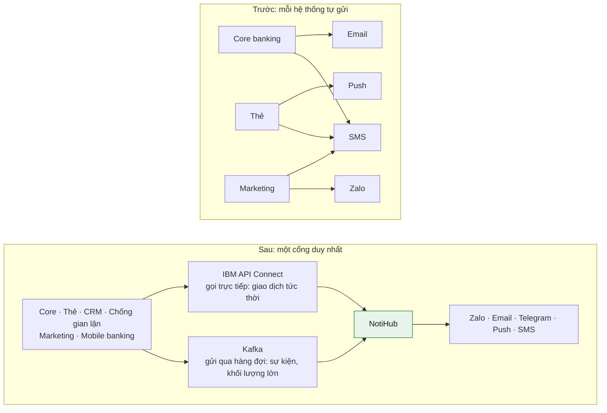
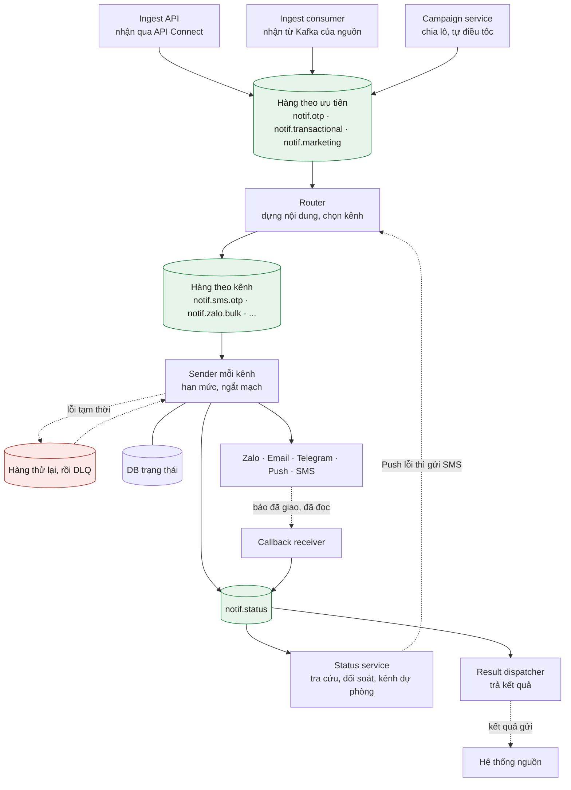
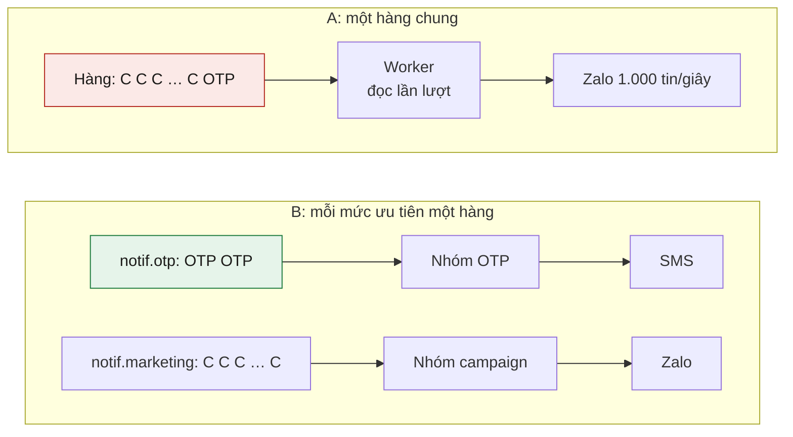
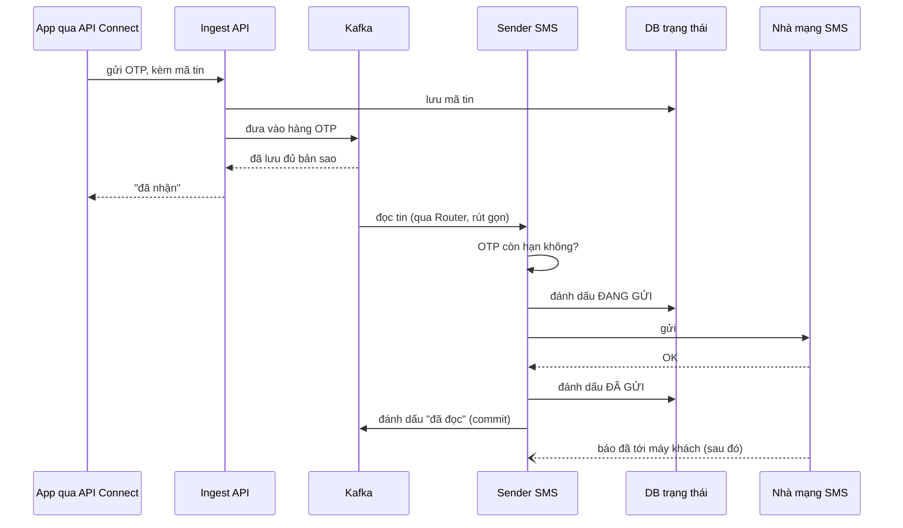
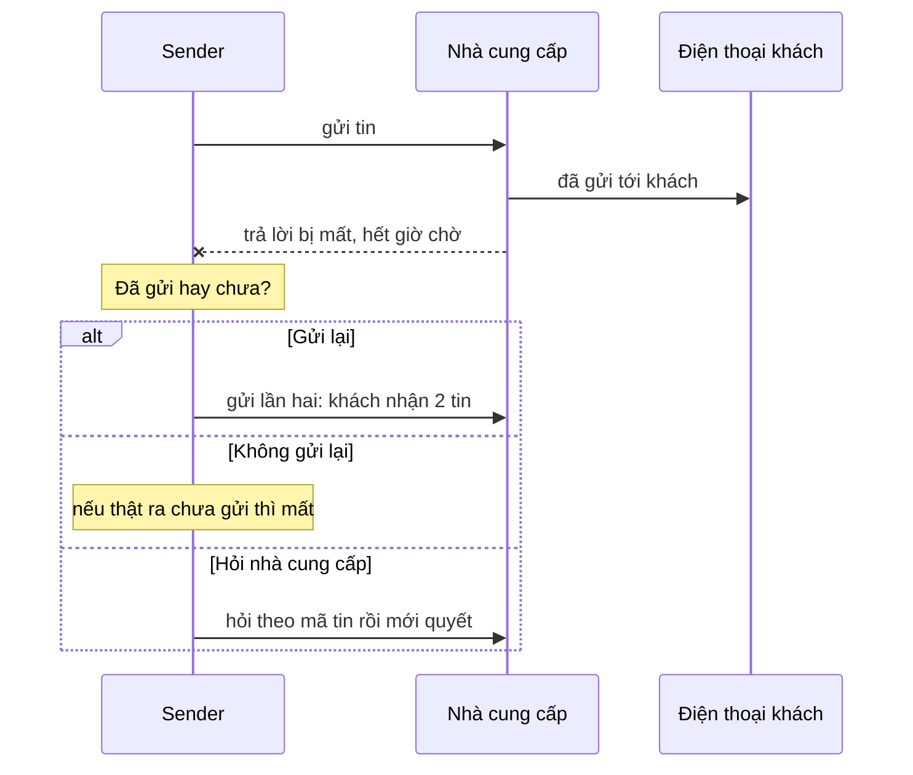
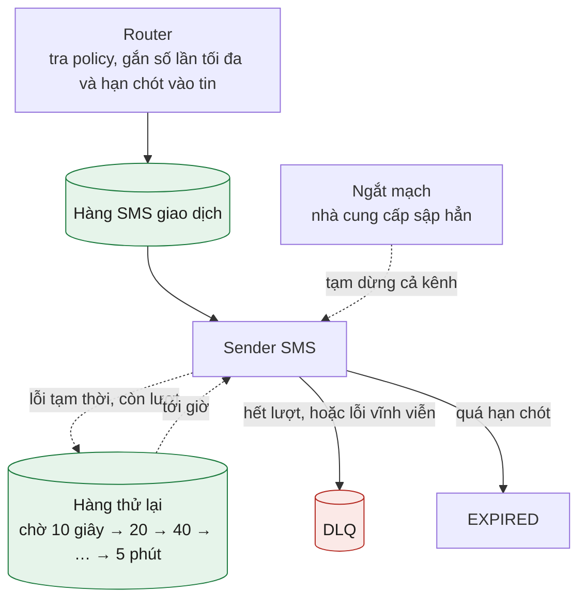
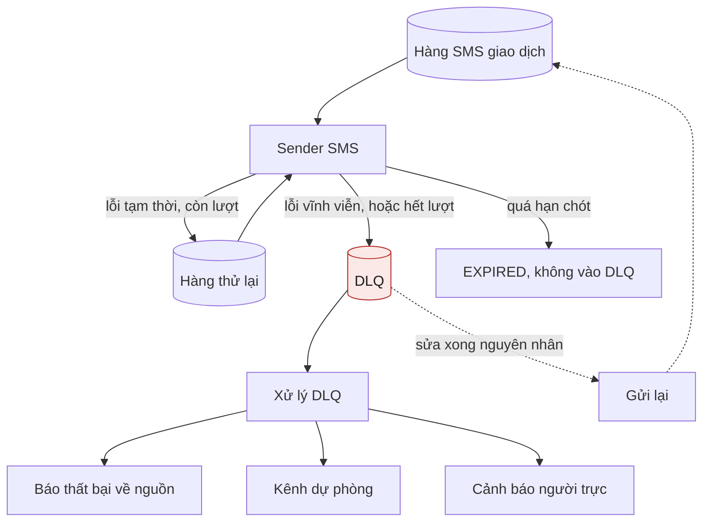
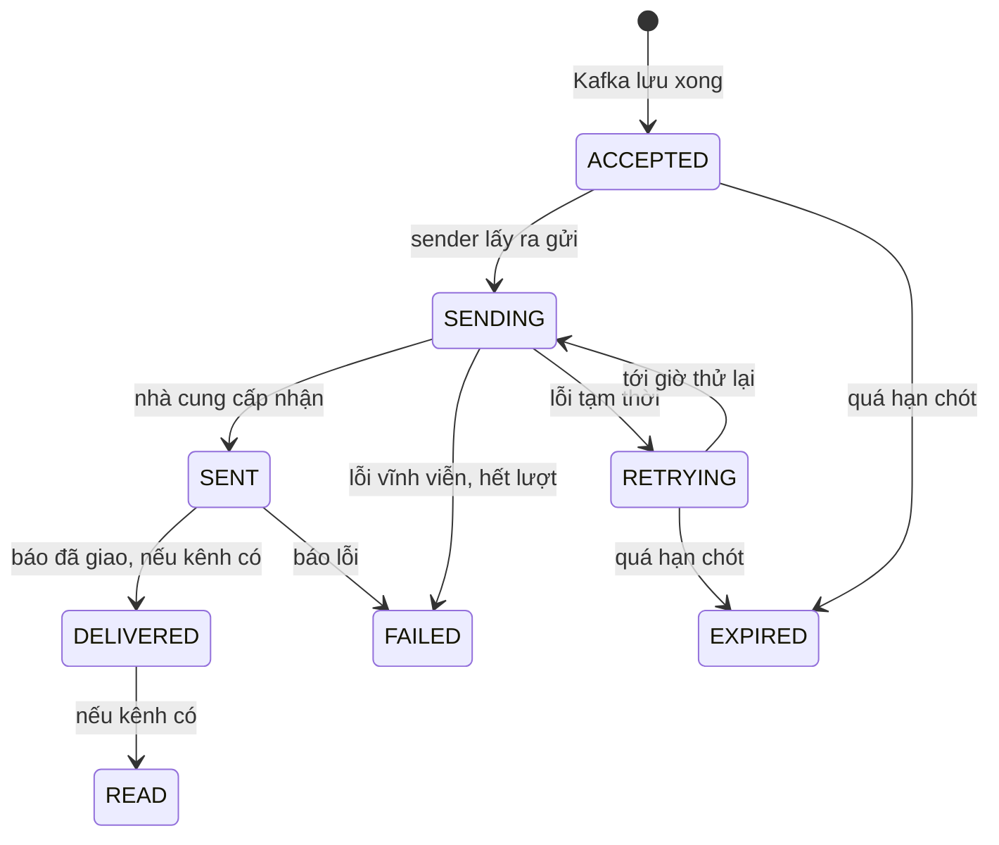
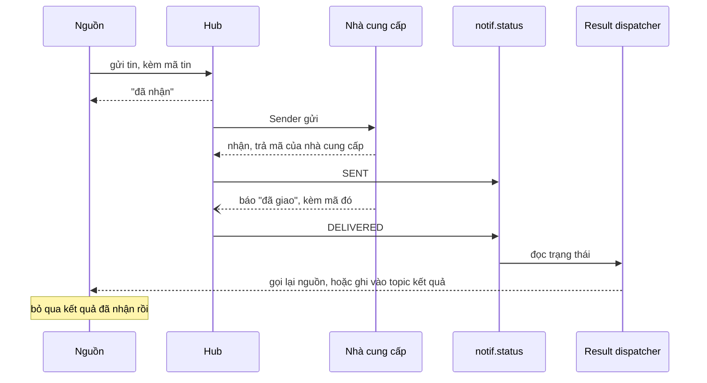

<!-- Tự sinh từ 0017-notification-hub.html bằng scripts/html2md.py. Đừng sửa tay. -->

[Kafka](../README.md) / [Bài 10](0013-core-80-20.md) / Bài 11 · [Tổng hợp usecase](../reference/0005-usecase-index.md) · [Bảng tra](../reference/0001-core-concepts.md)

# Bài 11: Bài toán notification hub cho ngân hàng

Một đề thiết kế hệ thống từ phỏng vấn, giải ở mức high level. Trọng tâm: Kafka đóng vai trò gì, mỗi vai trò giải quyết vấn đề nào của đề, và năm chỗ hay bị hỏi sâu: message queue dùng ở đâu, retry, DLQ, crash, trả kết quả về nguồn.

> **Liên quan tới mission** Mission yêu cầu: cho một bài toán mới, đề xuất topic, key, số partition, độ bền, cách xử lý trùng và lỗi, rồi nói được đánh đổi. Bài này áp dụng cả khoá vào một đề thật, có thêm hai thứ khoá học chưa gặp: làn ưu tiên và nhà cung cấp bên ngoài không kiểm soát được.

**Thắng lợi của bài này:** bạn trình bày được thiết kế trong 5 phút: kiến trúc, năm vai trò của Kafka, cách giữ không mất và không trùng ở từng chặng, và giới hạn khi gọi nhà cung cấp bên ngoài. Bị hỏi sâu về queue, retry, DLQ, crash hay kết quả gửi, bạn trả lời được bằng vài câu rõ ràng.

## 1. Bối cảnh, mục tiêu và ba ràng buộc

**Bối cảnh.** Ngân hàng có nhiều hệ thống nghiệp vụ: core banking, thẻ, CRM, chống gian lận, marketing, mobile banking. Mỗi hệ thống tự gửi thông báo qua từng kênh. Hệ quả:

- Mỗi hệ thống tự nối với từng nhà cung cấp (Zalo, nhà mạng SMS, máy chủ email...): cùng một việc làm nhiều lần.
- Không có chỗ nào thấy tập trung tin nào đã gửi, tỉ lệ thành công, chi phí theo kênh.
- Không có chỗ chung để giới hạn tốc độ gửi và bảo đảm OTP đi trước khuyến mãi.
- Khó mở rộng khi thêm kênh mới, hoặc khi tải tăng đột biến: cuối tháng, sao kê, khuyến mãi, cảnh báo gian lận hàng loạt.

*Trước: mỗi hệ thống nối thẳng tới từng nhà cung cấp. Sau: hai đường vào, năm đường ra, và mọi đường ra là hệ thống bên ngoài.*

**Mục tiêu.** Mỗi vấn đề ở trên có một mục tiêu và một phần của thiết kế trả lời:

| Vấn đề hiện tại | Mục tiêu của hub | Phần trả lời |
|---|---|---|
| Mỗi hệ thống tự nối từng nhà cung cấp | Một cổng duy nhất, hai đường vào: API Connect và Kafka | Ingest (mục 2) |
| Không thấy trạng thái, tỉ lệ thành công, chi phí | Trạng thái gửi tập trung (đã giao, thất bại, đã đọc khi kênh có) cho đối soát và báo cáo | Luồng trạng thái, trả kết quả về nguồn (mục 11) |
| Ưu tiên và tốc độ gửi không nhất quán | Đúng kênh, đúng người, đúng ưu tiên; nội dung theo mẫu và cá nhân hoá | Hàng theo ưu tiên (mục 4), Router, hạn mức ở Sender |
| Khó mở rộng khi thêm kênh hay tải tăng | Hàng chục triệu bản tin mỗi ngày, hàng nghìn tin mỗi giây lúc đỉnh, không mất, chịu được kênh sập | Kafka làm lớp đệm (mục 3); kênh mới là thêm một hàng và một sender; retry, DLQ (mục 8, 9) |

> Thiết kế high level hub gửi thông báo tập trung (NotiHub): nhận từ IBM API Connect (gọi trực tiếp) và Kafka (qua hàng đợi), gửi ra 5 kênh (Zalo, Email, Telegram, Push, SMS), chịu hàng chục triệu bản tin mỗi ngày và hàng nghìn tin mỗi giây lúc đỉnh, không được mất hay gửi trùng, có trạng thái gửi tập trung. Bài này tạm chưa xét phần tuân thủ bảo vệ dữ liệu cá nhân.

Ba ràng buộc chi phối mọi quyết định phía sau:

1. **Tải rất cao và rất lệch.** Một campaign hay đợt sao kê có thể đẩy cả triệu tin trong vài phút, trong khi OTP ít nhưng phải tới trong vài giây. OTP không được chờ campaign.
2. **Nhà cung cấp bên ngoài không kiểm soát được.** Mỗi kênh có hạn mức gửi riêng và có thể chậm hoặc sập bất kỳ lúc nào.
3. **Đây là ngân hàng.** Mất tin (OTP, báo trừ tiền) hay gửi trùng (hai tin báo trừ tiền) đều là sự cố nghiêm trọng.

**Làm rõ yêu cầu** (không được trả lời thì nêu giả định):

- Tải đỉnh của từng loại tin.
- OTP phải tới trong bao lâu, hết hạn sau bao lâu.
- Nhà cung cấp có chống gửi trùng, có cho tra trạng thái, có báo đã giao không.
- Loại tin nào cần đúng thứ tự.
- Số lần gửi lại khác nhau theo gì.
- Nguồn muốn nhận kết quả gửi theo cách nào.
- Lưu vết bao lâu để audit.

Sau phần trình bày chính, đề này thường bị hỏi sâu vào năm chỗ, mỗi chỗ một mục: message queue dùng ở đâu (mục 7), retry (mục 8), DLQ (mục 9), crash (mục 10), trả kết quả về nguồn (mục 11). Mỗi mục trả lời ở mức thiết kế: vấn đề, cách làm, Kafka giúp gì, và đánh đổi.

## 2. Kiến trúc tổng thể

*Màu xanh là topic Kafka (hàng đợi). Mỗi mũi tên vào hoặc ra một hàng là một chỗ hai bên không phải chờ nhau.*

- **Ingest** nhận tin từ hai đường, gắn cho mỗi tin một mã riêng (`notificationId`), rồi đưa vào hàng theo mức ưu tiên. Đường gọi trực tiếp được trả lời "đã nhận" ngay khi Kafka lưu xong, không chờ gửi tới khách.
- **Router** lấy tin từ từng hàng ưu tiên, dựng nội dung từ mẫu, chọn kênh theo loại tin và sở thích khách, rồi đưa sang hàng của kênh. Nhờ vậy hệ thống nguồn chỉ gửi loại tin và dữ liệu, không gửi văn bản đã dựng.
- **Sender**: mỗi kênh một service. Sender giữ tốc độ gửi trong hạn mức của nhà cung cấp, tạm dừng khi nhà cung cấp sập, và ghi lại tin nào đã gửi.
- **Callback receiver** nhận báo "đã giao, đã đọc" từ nhà cung cấp và ghi vào luồng trạng thái.
- **Status service** gom trạng thái để tra cứu, đối soát, báo cáo tỉ lệ thành công và chi phí, và gửi lại qua kênh dự phòng.
- **Result dispatcher** trả kết quả gửi về hệ thống nguồn (mục 11).

## 3. Kafka đóng vai trò gì

Năm vai trò, mỗi vai trò trả lời một ràng buộc. Đây là phần nên nói kỹ nhất khi trình bày.

| Vai trò | Ràng buộc | Cơ chế | Bài |
|---|---|---|---|
| **Lớp đệm bền** giữa người gửi và nhà cung cấp | (1), (2) | Tin được lưu lại; bên nhận đọc theo tốc độ của mình. Tải dồn hay nhà cung cấp sập chỉ làm hàng chờ dài ra, không mất. | [1](0001-kafka-big-picture.md), [8b](0014-throughput-latency.md), [8c](0015-replay-retention.md) |
| **Làn ưu tiên** | (1) | Mỗi hàng đọc theo thứ tự, không ai chen ngang. OTP không chờ campaign khi có hàng riêng. | [2](0002-key-partition-offset.md), [8](0008-topic-design.md) |
| **Cách ly nhà cung cấp** | (2) | Mỗi kênh một hàng riêng. Zalo sập thì tạm dừng hàng Zalo, SMS vẫn chạy. Lỗi tạm thời thì xếp sang hàng thử lại, hết lượt thì vào DLQ. | [6](0006-error-handling-dlt.md), [8b](0014-throughput-latency.md) |
| **Không mất** | (3) | Lưu nhiều bản sao rồi mới báo "đã nhận"; xử lý xong mới đánh dấu "đã đọc" (commit). | [4](0004-producer-durability.md), [5](0005-consumer-offset-commit.md) |
| **Không trùng**, trong giới hạn có thể | (3) | Kafka có thể giao lại một tin, nên mỗi tin mang một mã riêng; gặp mã đã gửi thì bỏ qua. | [4b](0010-idempotent-producer.md), [7](0007-idempotent-consumer-transactions.md) |

Thêm hai vai trò phụ: một luồng trạng thái (`notif.status`) cho nhiều bên cùng đọc (tra cứu, báo cáo, trả kết quả về nguồn); và đọc lại tin cũ khi cần gửi lại sau sự cố ([Bài 8c](0015-replay-retention.md)).

## 4. Vì sao phải tách topic

*A: OTP đứng sau 100.000 tin campaign, và Zalo chỉ nhận 1.000 tin mỗi giây. B: hai hàng độc lập.*

Mỗi hàng được đọc lần lượt, nên trong hàng chung OTP phải chờ hết campaign phía trước; thêm người đọc cũng không giúp. Cách sửa: mỗi mức ưu tiên một hàng (topic) và một nhóm người đọc (consumer group) riêng.

### Thiết kế topic

| Topic | Chia theo | Lý do |
|---|---|---|
| `notif.otp` | mã tin | Không cần thứ tự, chia đều. |
| `notif.transactional` | mã khách hàng | Tin của một khách đến đúng thứ tự. |
| `notif.marketing` | mã tin | Khối lượng lớn, gửi dần. |
| `notif.<kênh>.<ưu tiên>` | như hàng trước | Cách ly theo kênh và ưu tiên. |
| `notif.status` | mã tin | Trạng thái của một tin đúng thứ tự. |
| `notif.result.<nguồn>` | mã tin | Kết quả gửi cho từng nguồn (mục 11). |

- **Chia làn theo độ khẩn, không theo phòng ban:** sao kê đi làn khối lượng lớn; cảnh báo gian lận đi làn giao dịch, có giới hạn tốc độ theo nguồn.
- **Nút cổ chai không phải Kafka:** 30 triệu tin mỗi ngày chỉ khoảng 350 tin mỗi giây. Giới hạn là hạn mức và tốc độ của nhà cung cấp, nên số partition tính theo số tin cần gửi song song lúc đỉnh ([Bài 8b](0014-throughput-latency.md)).

## 5. Luồng OTP, từ API Connect tới điện thoại

*Lưu ở hai chỗ trước khi trả lời: DB (để nhận ra tin gửi lại) và Kafka (để không mất). Đánh dấu "đã đọc" là việc cuối cùng.*

- App không nhận được trả lời nên gửi lại cùng mã tin: hub nhận ra mã đã có, không tạo tin thứ hai.
- Sender kiểm hạn trước khi gửi: OTP đã hết hạn thì không gửi nữa, đánh dấu EXPIRED. Gửi một OTP hết hạn chỉ làm khách bối rối.
- Sender chết sau khi gửi, trước khi đánh dấu "đã đọc": tin được giao lại, sender thấy ĐÃ GỬI nên bỏ qua ([Bài 7](0007-idempotent-consumer-transactions.md)).

## 6. Không mất, không trùng: từng chặng, và giới hạn

| Chặng | Nguy cơ | Cách chặn |
|---|---|---|
| Nguồn → Ingest | Nguồn không nhận được trả lời, gửi lại | Mã tin: gặp mã đã có thì không tạo tin mới |
| Ingest → Kafka | Máy chủ Kafka chết ngay sau khi nhận | Lưu nhiều bản sao rồi mới trả lời "đã nhận" |
| Kafka → Router → hàng kênh | Router chết giữa chừng | Xử lý xong mới đánh dấu "đã đọc"; tin bị đưa sang hai lần thì Sender lọc |
| Hàng kênh → Sender | Sender chết, hay deploy lại | Đánh dấu "đã đọc" sau khi gửi; ghi lại tin nào đã gửi |
| Sender → nhà cung cấp | Sập, chậm, lỗi tạm thời | Giữ trong hạn mức, ngắt mạch, hàng thử lại, DLQ, kênh dự phòng |
| Sender → nhà cung cấp | **Hết giờ chờ mà không rõ kết quả**: không biết đã gửi chưa | Xem dưới đây: Kafka không giải được chỗ này |

*Kafka chỉ nhớ được mình đã đọc tới đâu. Muốn gửi đúng một lần ra bên ngoài thì bên ngoài phải hợp tác.*

Tài liệu Kafka cũng nói: khi ghi ra hệ thống bên ngoài, khó khăn nằm ở việc khớp "đã đọc tới đâu" với "bên ngoài đã thật sự nhận gì" [[Design: Message Delivery Semantics]](https://kafka.apache.org/44/design/design/). Vì vậy câu trả lời thật cho "không mất, không trùng" là:

- Bên trong hub: làm được bằng các bài đã học.
- Ở chặng cuối: chỉ làm được khi nhà cung cấp chống gửi trùng hoặc cho tra trạng thái. Đó là tiêu chí khi chọn nhà cung cấp.
- Nhà cung cấp không có thì chọn theo loại tin. *Lập luận của giáo viên, kiểm lại với nghiệp vụ:* OTP thì gửi lại (hai mã giống nhau ít hại hơn không đăng nhập được); biến động số dư thì ưu tiên kênh cho tra trạng thái, và nội dung có mã giao dịch để khách đối chiếu; campaign thì không gửi lại.

## 7. Message queue dùng ở đâu: chặng nào qua Kafka

Kafka là message queue của hub: chặng nào đi qua topic là chặng đó có queue. Kafka nằm ở mọi chỗ hai bên cần chạy theo tốc độ riêng hoặc phải chịu được bên kia sập; chỗ cần trả lời ngay thì gọi trực tiếp.

| Chặng | Topic | Kafka giúp gì |
|---|---|---|
| Hệ thống nguồn → hub | Topic sự kiện của nguồn | Nguồn không phải chờ hub. Hub sập thì tin vẫn nằm chờ, hub lên lại đọc tiếp. |
| Ingest → Router | Hàng theo ưu tiên | Trả lời "đã nhận" mà không chờ gửi xong. Mỗi mức ưu tiên một hàng. |
| Router → Sender | Hàng theo kênh | Mỗi kênh tự đi theo tốc độ của nhà cung cấp. |
| Sender gửi lỗi | Hàng thử lại, DLQ | Thử lại mà không chặn hàng chính (mục 8); tin hết lượt không bị bỏ (mục 9). |
| Sau khi gửi | `notif.status` | Một luồng trạng thái cho nhiều bên cùng đọc. |
| Hub → nguồn | `notif.result.<nguồn>` | Trả kết quả cho nguồn dùng Kafka (mục 11). |

**Chỗ không qua Kafka:** API Connect gọi Ingest trực tiếp vì nguồn cần câu trả lời ngay; tra trạng thái là đọc DB.

**Kafka thiếu gì, và bù thế nào.**

- Không có "ưu tiên" cho từng tin: tách hàng theo độ khẩn (mục 4).
- Không hẹn giờ gửi lại cho từng tin: dùng hàng thử lại có thời gian chờ (mục 8).
- Số người đọc song song không vượt số partition: tạo đủ partition. Bản Kafka mới có thêm Share Groups cho phép nhiều người đọc hơn, đổi lại không giữ thứ tự [[KIP-932]](https://cwiki.apache.org/confluence/display/KAFKA/KIP-932%3A+Queues+for+Kafka).

## 8. Retry: chờ tăng dần, giới hạn theo khách hàng và kênh

**Từ khoá:** lỗi tạm thời và lỗi vĩnh viễn (poison pill); thử lại tại chỗ (blocking retry: cả hàng đứng chờ) và thử lại qua hàng riêng (non-blocking retry: hàng chính đi tiếp); backoff (thời gian chờ giữa hai lần thử); DLQ ([Bài 6](0006-error-handling-dlt.md)). Ở hub, retry có thêm ba yêu cầu: chờ tăng dần, số lần tối đa theo khách hàng và kênh, và hạn chót theo loại tin.

### Ba quy tắc

1. **Chỉ thử lại lỗi tạm thời.** Hết giờ chờ, nhà cung cấp báo lỗi hay báo quá tải: thử lại. Số điện thoại sai, mẫu nội dung lỗi, dữ liệu hỏng: thử bao nhiêu lần cũng không qua, nên đưa thẳng vào DLQ.
2. **Chờ tăng dần, có trần.** Ví dụ 10 giây, 20, 40, 80, rồi giữ ở 5 phút. Nhà cung cấp đang quá tải mà bị dội tin liên tục thì càng lâu hồi phục.
3. **Dừng ở giới hạn nào tới trước:** số lần tối đa, hoặc hạn chót. OTP còn lượt nhưng đã hết hạn thì dừng.

**Retry không thay được ngắt mạch.** Khi nhà cung cấp sập hẳn, tin nào cũng lỗi: thử lại từng tin chỉ đốt hết lượt rồi dồn vào DLQ. Ngắt mạch (circuit breaker) thì tạm dừng cả kênh: tin nằm yên trong Kafka và không mất lượt. Retry dành cho lỗi lẻ tẻ.

**Policy** là cấu hình tra theo nguồn hoặc phân khúc khách, loại tin và kênh; nó cho ra số lần tối đa, hạn chót, và hết lượt thì làm gì. Ví dụ: OTP thử vài lần trong hạn của mã; khách ưu tiên được nhiều lần hơn khách thường. Con số cụ thể thuộc tài liệu thiết kế chi tiết.

### Thiết kế: thang hàng thử lại, policy đi theo tin

*Thang chờ là của kênh; dừng ở bậc nào là do policy của từng tin. Hàng chính không phải đứng chờ.*

- **Kafka giúp gì:** mỗi bậc chờ là một hàng (retry topic). Tin lỗi được chuyển sang bậc kế tiếp, hàng chính đi tiếp; tới giờ thì tin được lấy ra gửi lại. Trong lúc chờ, tin vẫn nằm an toàn trong Kafka, sender chết cũng không mất.
- **Giới hạn theo khách hàng và kênh:** thang chờ đặt theo kênh, vì đó là đặc tính của nhà cung cấp. Số lần tối đa và hạn chót đi theo từng tin. Tới giới hạn thì tin vào DLQ, dù thang của kênh còn bậc.
- **Nếu được hỏi cách làm:** Spring Kafka có sẵn mẫu này: `@RetryableTopic` (kèm `@BackOff` cho thời gian chờ) và `@DltHandler` cho DLQ [[Spring: retry topic]](https://docs.spring.io/spring-kafka/reference/retrytopic/how-the-pattern-works.html).

**Đánh đổi.**

- **Mất thứ tự.** Tin đi hàng thử lại có thể tới sau tin mới hơn. Với biến động số dư, nội dung có thời điểm và số dư sau giao dịch thì chấp nhận được; nếu không, làn đó thử lại tại chỗ vài giây và chấp nhận hàng đứng một lúc.
- **Thang chờ chung cho cả kênh.** Muốn mỗi phân khúc một thang chờ riêng thì phải tách hàng, đổi lại vận hành nhiều hàng hơn.

## 9. DLQ: dùng làm gì, khi nào đưa vào

DLQ (Spring gọi là DLT, dead-letter topic) giữ lại tin không gửi được, thay vì bỏ đi hoặc thử lại mãi, để người xử lý rồi gửi lại. Kafka không có sẵn DLQ cho trường hợp này; đây là cách làm của ứng dụng ([Bài 6](0006-error-handling-dlt.md)).

*DLQ là chỗ dừng có người trông, không phải thùng rác.*

- **Khi nào vào:** lỗi vĩnh viễn (số sai, mẫu lỗi, dữ liệu hỏng) thì vào ngay; lỗi tạm thời thì vào khi hết lượt thử. Quá hạn chót (OTP) thì không vào: đánh dấu EXPIRED.
- **Mang theo:** tin gốc, mã tin, lý do lỗi, đã thử mấy lần.
- **Sau khi vào:** báo thất bại về nguồn, cảnh báo người trực, gửi qua kênh dự phòng nếu là tin quan trọng.
- **Gửi lại:** sửa nguyên nhân trước, rồi đưa tin về hàng chính với cùng mã tin; tin đã gửi thì sender bỏ qua, nên không trùng. Thử ở [mô phỏng 12b](#rsim).
- **Độ bền:** DLQ cũng là dữ liệu không được mất, lưu bền như hàng chính.

## 10. App crash: chết ở đâu thì chuyện gì xảy ra

Một quy tắc phủ mọi chỗ: **lưu xong rồi mới đánh dấu "đã đọc", và mọi bước làm lại được mà không gây trùng**. Kafka lo phần "làm lại": tin chưa đánh dấu "đã đọc" sẽ được giao lại ([Bài 5](0005-consumer-offset-commit.md)). Hub lo phần "không trùng" bằng mã tin.

| Thành phần | Chết lúc | Sau khi chạy lại |
|---|---|---|
| Ingest | Trước khi Kafka lưu xong | Nguồn không nhận được "đã nhận", gửi lại cùng mã; lần này tin được lưu. |
| Ingest | Sau khi lưu, trước khi trả lời | Nguồn gửi lại; hub nhận ra mã đã có, trả "đã nhận" mà không tạo tin thứ hai. |
| Router | Đã chuyển tin, chưa đánh dấu "đã đọc" | Tin bị chuyển lần hai; Sender lọc bằng mã tin. |
| Sender | Trước khi gửi | Tin được giao lại, gửi bình thường. |
| Sender | Đã gửi, chưa kịp ghi ĐÃ GỬI | Tin được giao lại, thấy ĐANG GỬI: không biết đã gửi chưa. Đây chính là chỗ "hết giờ chờ mà không rõ kết quả" ở mục 6. |
| Sender | Đã ghi ĐÃ GỬI, chưa đánh dấu "đã đọc" | Tin được giao lại, thấy ĐÃ GỬI, bỏ qua. |
| Máy chủ Kafka | Bất kỳ lúc nào | Có bản sao ở máy khác; tin đã báo "đã nhận" không mất ([Bài 4](0004-producer-durability.md)). |
| Cả hub | Sập hẳn | Tin từ Kafka của nguồn nằm chờ, hub lên lại đọc tiếp. Đường gọi trực tiếp báo lỗi, nguồn gửi lại cùng mã. Hub chạy nhiều bản ở nhiều nơi để hiếm khi tới mức này. |

**Ba chỗ dễ sót.**

- **Deploy là crash có báo trước.** Service dừng nhận tin mới, làm xong việc dở, đánh dấu "đã đọc" rồi mới tắt. Bị tắt ngang thì không mất, nhưng rơi vào dòng "đã gửi, chưa kịp ghi".
- **Một tin làm service chết mỗi lần đọc**, ví dụ quá lớn làm hết bộ nhớ. Service lên lại đọc đúng tin đó và chết tiếp, mãi mãi. Chặn bằng giới hạn kích thước tin ở Ingest và cảnh báo khi service khởi động lại liên tục; gỡ bằng tay: chuyển tin đó vào DLQ rồi cho service đọc tiếp từ tin sau. *Lập luận của giáo viên.*
- **ĐÃ GỬI mãi không có báo đã giao.** Nhà cung cấp có thể không báo lại. Một job đối soát định kỳ tìm những tin này, hỏi nhà cung cấp nếu có thể, nếu không thì ghi "đã gửi, không có xác nhận".

## 11. Trả kết quả gửi về nguồn

Nguồn cần biết tin của mình ra sao: chăm sóc khách hàng tra cứu, đối soát, hay quyết định gửi lại. Thiết kế có ba phần: các trạng thái, trạng thái đến từ đâu, và cách trả về nguồn.

*Trạng thái lưu theo từng tin và từng kênh. Có gửi qua kênh dự phòng thì một tin có nhiều dòng, mỗi kênh một dòng.*

**Trạng thái đến từ hai nơi.** Sender ghi SENT hoặc FAILED khi gửi, và lưu mã mà nhà cung cấp trả về. Sau đó nhà cung cấp báo "đã giao, đã đọc" kèm mã đó, hub tra ra tin gốc. Không phải kênh nào cũng báo được "đã giao" hay "đã đọc".

*Kết quả đi một chiều qua luồng trạng thái; nguồn không phải hỏi sender hay nhà cung cấp.*

| Cách trả về | Hợp với | Cách làm |
|---|---|---|
| **Nguồn hỏi** (API tra cứu) | Chăm sóc khách hàng, đối soát | Nguồn hỏi theo mã tin qua API Connect. Luôn có, vì là chỗ dựa khi hai cách kia lỗi. |
| **Hub gọi lại** (webhook) | Nguồn cần biết ngay | Nguồn đăng ký một địa chỉ, hub gọi tới khi có kết quả; gọi lỗi thì thử lại như mục 8. |
| **Hub ghi vào topic** | Nguồn đã dùng Kafka | Mỗi nguồn một topic kết quả, chỉ nguồn đó được đọc. |

Nguồn chọn cách nhận và mức chi tiết: chỉ kết quả cuối hay mọi bước. OTP thường chỉ cần biết khi thất bại. *Lập luận của giáo viên.*

**Bốn bẫy.**

- **Trùng.** Kết quả cũng có thể tới hai lần (hub chết ngay sau khi gọi nguồn). Nguồn bỏ qua kết quả đã nhận rồi.
- **Sai thứ tự.** Báo "đã giao" có thể tới trước SENT, vì hai bên ghi độc lập. Trạng thái chỉ được tiến, không lùi: báo cũ hơn trạng thái hiện tại thì bỏ qua.
- **Nguồn chậm kéo theo nguồn khác.** Một nguồn không trả lời mà mọi nguồn chung một hàng thì cả hàng đứng. Giống cách ly nhà cung cấp: mỗi nguồn một hàng.
- **Không có báo đã giao.** Xem job đối soát ở mục 10.

## 12. Mô phỏng

### 12a. Một topic chung hay tách theo ưu tiên

Ba loại tin: OTP 20 tin mỗi giây qua SMS, giao dịch 300 qua Push, campaign 100.000 qua Zalo. Mọi con số là giả định để thấy hình dạng vấn đề; hạn OTP rút còn 30 giây cho vừa 60 giây mô phỏng.

1. Thiết kế A, retry tại chỗ, bấm "+5 giây" bốn lần. OTP chờ bao lâu? Đổi sang B và làm lại.
2. Thiết kế A, đổi sang retry topic. OTP đỡ hơn không, và vì sao vẫn chậm?
3. Thiết kế B, retry topic, chạy tới giây 60. Bao nhiêu tin vào DLT? Bấm "Replay DLT".
4. Bỏ hai sự cố đầu, tick ba sự cố còn lại. Đếm số tin trùng, rồi tick "Chống trùng".
5. Còn trùng hoặc mất ở dòng "timeout mơ hồ": thử ba cách xử lý và nói cái giá của từng cách.

### 12b. Retry và DLQ khi nhà mạng SMS lỗi

Kênh SMS có hai hàng, OTP và giao dịch, dùng chung hạn mức 40 tin mỗi giây. Có ba sự cố: lỗi lẻ tẻ 10%, nhà mạng sập từ phút 1:00 tới 4:00, và 2% tin số dư gửi tới số sai. Policy giả định: OTP 3 lần, hạn 60 giây; khách thường 5 lần; khách ưu tiên 8 lần.

1. Để mặc định, bấm "Chạy hết 10 phút". Khách thường hay khách ưu tiên vào DLQ, và vì sao?
2. Đổi thang chờ sang cố định 10 giây. DLQ tăng bao nhiêu? Bao nhiêu phần trăm lần gửi là gửi lại?
3. Bật ngắt mạch. DLQ còn lại là tin gì? OTP lúc này đi đâu, và vì sao đó là kết quả đúng?
4. Chuyển sang retry tại chỗ: hàng giao dịch đứng bao lâu, còn bao nhiêu tin chờ ở phút 10?
5. Bỏ tick "Lỗi vĩnh viễn vào DLT ngay", rồi đổi "Hết lượt" sang "log rồi bỏ qua". Mỗi lần mất gì?
6. Bỏ tick policy và bật ngắt mạch: bao nhiêu OTP tới tay khách khi đã hết hạn?
7. Quay về mặc định, chạy hết, bấm "Replay DLT". Tin nào quay về, tin nào ở lại?

Mô phỏng tổng hợp khác: [từ producer tới DB](../portal/index.md#sim-e2e) và [một ngày bảy sự cố](../portal/index.md#sim-e2e-day), cho phần "không mất, không trùng" bên trong hub.

## 13. Usecase: ba sự cố hub phải chịu được

[Xem mọi usecase của khoá học](../reference/0005-usecase-index.md)

### (a) Ngân hàng: campaign 9 giờ sáng, OTP tới chậm hai phút

Marketing gửi khuyến mãi cho một triệu khách lúc 9 giờ, cùng lúc khách đăng nhập để chuyển tiền. Tin campaign và OTP chung một hàng: OTP đứng sau hàng trăm nghìn tin campaign, nhiều mã hết hạn trước khi tới. **Xử lý:** tách hàng theo mức ưu tiên, giữ riêng một phần hạn mức SMS cho OTP, và cho campaign tự gửi chậm lại theo hạn mức của kênh.

### (b) Ngân hàng: nhà cung cấp Zalo sập 20 phút

Sender gọi Zalo liên tục lỗi. Nếu thử lại tại chỗ thì cả hàng đứng; nếu SMS và Zalo chung một hàng thì SMS cũng đứng. **Xử lý:** mỗi kênh một hàng riêng; ngắt mạch tạm dừng kênh Zalo, tin nằm chờ trong Kafka; lỗi lẻ tẻ thì vào hàng thử lại, hết lượt vào DLQ có cảnh báo; tin quan trọng chuyển sang kênh dự phòng.

### (c) Ngân hàng: khách nhận hai tin báo trừ tiền

Sender bị deploy lại ngay sau khi gửi tin, trước khi đánh dấu "đã đọc"; bản mới đọc lại và gửi lần hai. Khách tưởng bị trừ tiền hai lần và gọi tổng đài. **Xử lý:** ghi lại trạng thái từng tin trước và sau khi gửi, bỏ qua tin đã gửi; dùng chống gửi trùng của nhà cung cấp khi có.

## 14. Trình bày trong 5 phút

1. **30 giây: làm rõ đề.** Nhắc ba ràng buộc, hỏi tải đỉnh, hạn OTP, nhà cung cấp có chống gửi trùng không.
2. **1 phút: kiến trúc.** Vẽ Ingest, hàng ưu tiên, Router, hàng theo kênh, Sender, luồng trạng thái. Một câu: "Kafka nằm giữa mọi chặng để mỗi bên chạy theo tốc độ của mình."
3. **1 phút: tải lệch và nhà cung cấp.** Tách theo ưu tiên vì mỗi hàng đọc lần lượt; tách theo kênh để một nhà cung cấp sập không kéo theo kênh khác; hàng thử lại, DLQ, ngắt mạch.
4. **1 phút 30: không mất, không trùng.** Đi từng chặng theo bảng ở mục 6; kết bằng giới hạn ở chặng cuối.
5. **1 phút: đánh đổi.** Nhiều hàng thì vận hành nhiều hơn; hàng thử lại làm mất thứ tự; ghi trạng thái thêm một lần ghi cho mỗi tin; OTP nằm trong Kafka một thời gian, nên hỏi team bảo mật về mã hoá nội dung.

**Khi bị hỏi sâu**, mỗi chỗ một câu chốt, rồi mới đi vào chi tiết:

| Chỗ | Câu chốt |
|---|---|
| Message queue | Kafka là queue của hub: mọi chặng giữa hai thành phần đi qua Kafka; chỗ cần trả lời ngay thì gọi trực tiếp (mục 7). |
| Retry | Hàng thử lại riêng, chờ tăng dần theo kênh; số lần và hạn chót đi theo từng tin; nhà cung cấp sập hẳn thì ngắt mạch, không thử lại (mục 8). |
| DLQ | Giữ tin không gửi được để người xử lý; vào khi lỗi vĩnh viễn hoặc hết lượt; báo thất bại, cảnh báo, sửa xong thì gửi lại cùng mã tin (mục 9). |
| Crash | Lưu xong rồi mới đánh dấu "đã đọc", mọi bước làm lại được; chỗ khó là chết ngay sau khi gửi (mục 10). |
| Trả kết quả | Một luồng trạng thái; nguồn chọn hỏi, được gọi lại, hoặc đọc topic kết quả; kết quả có thể tới hai lần, trạng thái chỉ tiến (mục 11). |

## 15. Kiểm tra

<!-- quiz:quiz -->

**1. Campaign một triệu tin chung hàng với OTP, đã có đủ người đọc. Vì sao OTP vẫn chậm?**

- **A.** Mỗi hàng được đọc lần lượt từ đầu
- **B.** Kafka ưu tiên đọc tin có kích thước lớn
- **C.** Ingest gom OTP vào chung lô campaign
- **D.** Kafka giới hạn tốc độ ghi của OTP

Đáp án

**A. Mỗi hàng được đọc lần lượt từ đầu**

Hàng được đọc theo thứ tự; campaign đứng trước nên OTP phải chờ. Thêm người đọc không giúp. Cách sửa là tách hàng theo ưu tiên.

**2. Nhà cung cấp Zalo sập 20 phút. Cách nào giữ tin mà không chặn kênh khác?**

- **A.** Tăng số partition của hàng Zalo lên
- **B.** Hàng riêng cho Zalo, tạm dừng khi sập
- **C.** Bỏ chờ bản sao để Kafka ghi nhanh hơn
- **D.** Xoá bớt tin cũ để hàng không đầy lên

Đáp án

**B. Hàng riêng cho Zalo, tạm dừng khi sập**

Mỗi kênh một hàng riêng thì sự cố không lan; tạm dừng kênh Zalo thì tin nằm chờ trong Kafka tới khi Zalo lên lại.

**3. Ingest trả lời "đã nhận" sớm nhất lúc nào mà vẫn không mất tin?**

- **A.** Ngay khi nhận yêu cầu, chưa lưu gì
- **B.** Sau khi sender đã đọc xong tin
- **C.** Sau khi Kafka lưu đủ bản sao
- **D.** Sau khi nhà cung cấp báo đã gửi

Đáp án

**C. Sau khi Kafka lưu đủ bản sao**

Lưu đủ bản sao là đủ an toàn. Chờ tới lúc gửi xong cũng đúng, nhưng làm đường gọi trực tiếp phụ thuộc vào nhà cung cấp.

**4. Sender gọi nhà mạng SMS, hết giờ chờ mà không rõ kết quả. Nhà mạng cho tra trạng thái. Làm gì?**

- **A.** Gửi lại ngay vì OTP cần đến nhanh
- **B.** Bỏ qua vì gửi trùng là sự cố nặng
- **C.** Nhờ Kafka bảo đảm gửi đúng một lần
- **D.** Hỏi nhà mạng theo mã tin rồi quyết

Đáp án

**D. Hỏi nhà mạng theo mã tin rồi quyết**

Gửi lại có thể trùng, bỏ qua có thể mất. Kafka không kiểm soát được hệ thống bên ngoài. Hỏi nhà mạng là cách duy nhất biết chắc.

**5. Sender gửi xong, chưa đánh dấu "đã đọc" thì bị deploy lại. Điều gì chặn gửi trùng?**

- **A.** Kafka tự xoá tin đã gửi khỏi hàng
- **B.** Trạng thái ĐÃ GỬI lưu theo mã tin
- **C.** Deploy luôn chờ sender đọc hết hàng
- **D.** Nhà mạng tự nhận ra tin bị gửi lại

Đáp án

**B. Trạng thái ĐÃ GỬI lưu theo mã tin**

Tin được giao lại sau khi deploy là chuyện bình thường. Chỉ trạng thái đã lưu theo mã tin mới cho sender biết tin đã gửi rồi.

**6. Campaign một triệu tin trong một giờ. Nút cổ chai thường ở đâu?**

- **A.** Hạn mức gửi của nhà cung cấp kênh
- **B.** Tốc độ ghi của các máy chủ Kafka
- **C.** Số partition tối đa của một topic
- **D.** Dung lượng đĩa còn trống của Kafka

Đáp án

**A. Hạn mức gửi của nhà cung cấp kênh**

Khoảng 280 tin mỗi giây là rất nhỏ với Kafka. Giới hạn nằm ở phía gửi: hạn mức và tốc độ của nhà cung cấp.

**7. Khách ưu tiên được gửi lại 8 lần, khách thường 5 lần, chung một kênh SMS. Làm thế nào?**

- **A.** Tạo một hàng riêng cho từng khách hàng
- **B.** Cho Ingest tự gửi lại tới tám lần
- **C.** Thang chờ theo kênh, dừng theo policy của tin
- **D.** Đọc nhiều tin hơn trong mỗi lần lấy

Đáp án

**C. Thang chờ theo kênh, dừng theo policy của tin**

Thang chờ là đặc tính của nhà cung cấp nên đặt theo kênh. Số lần tối đa đi theo từng tin; tới số lần đó thì tin vào DLQ, dù thang còn bậc.

**8. Nhà mạng SMS sập hẳn 30 phút. Vì sao không để hàng thử lại tự lo?**

- **A.** Hàng thử lại không chờ lâu được như vậy
- **B.** Kafka xoá hàng thử lại khi lỗi liên tục
- **C.** Hàng thử lại làm Ingest bị chặn lại
- **D.** Mọi tin đốt hết lượt rồi dồn vào DLQ

Đáp án

**D. Mọi tin đốt hết lượt rồi dồn vào DLQ**

Khi cả nhà mạng sập thì tin nào cũng lỗi. Ngắt mạch tạm dừng cả kênh, tin nằm chờ trong Kafka mà không mất lượt; thử lại dành cho lỗi lẻ tẻ.

**9. Tin số dư vào DLQ lúc nhà mạng lỗi. Sửa xong, người trực lỡ gửi lại từ DLQ hai lần. Khách nhận mấy tin?**

- **A.** Một tin, nhờ trạng thái theo mã tin
- **B.** Hai tin, vì mỗi lần gửi lại là một tin
- **C.** Không tin nào, vì DLQ đã đọc xong rồi
- **D.** Ba tin, tính cả lần gửi lỗi ban đầu

Đáp án

**A. Một tin, nhờ trạng thái theo mã tin**

Lần đầu gửi và ghi ĐÃ GỬI. Lần sau sender thấy ĐÃ GỬI nên bỏ qua. Giữ nguyên mã tin khi gửi lại chính là để làm được việc này.

**10. Báo "đã giao" của nhà cung cấp tới trước trạng thái SENT của sender. Hub làm gì?**

- **A.** Ghi theo báo nào tới sau cùng
- **B.** Giữ DELIVERED, bỏ SENT vì cũ hơn
- **C.** Từ chối, chờ nhà cung cấp báo lại
- **D.** Gửi lại tin để có thứ tự đúng

Đáp án

**B. Giữ DELIVERED, bỏ SENT vì cũ hơn**

Hai nơi ghi trạng thái độc lập nên có thể đảo thứ tự. Trạng thái chỉ được tiến: báo cũ hơn trạng thái hiện tại bị bỏ qua.

<!-- /quiz -->

## 16. Tự nói thành lời

Không nhìn bài: *"Kafka trong hub có năm vai trò: ... OTP không chờ campaign vì ... Zalo sập không ảnh hưởng SMS vì ... Không mất nhờ ... Không trùng nhờ ..., trừ chặng cuối, nơi ..."*

Rồi trả lời từng câu hỏi sâu trong 30 giây: *"Retry của khách ưu tiên khác khách thường ở chỗ ... Một tin vào DLQ khi ..., rồi ... Sender chết ngay sau khi gửi thì ... Nguồn biết kết quả bằng ..., và phải bỏ qua kết quả trùng vì ..."*

**Ôn nhanh:** [tóm tắt Bài 11](../summaries/0017-notification-hub.md).

## Nguồn nên đọc

> **Chính:** [Spring Kafka: How the pattern works (non-blocking retries)](https://docs.spring.io/spring-kafka/reference/retrytopic/how-the-pattern-works.html): hàng thử lại, DLT, và cái giá là mất thứ tự.
>
> **Thêm:** [KafkaConsumer javadoc](https://kafka.apache.org/44/javadoc/org/apache/kafka/clients/consumer/KafkaConsumer.html), mục Consumption Flow Control; [Kafka Design](https://kafka.apache.org/44/design/design/), mục Message Delivery Semantics.

> **Còn chỗ nào mơ hồ?** Hỏi thẳng giáo viên, ví dụ "nếu bị hỏi sao không dùng một hàng đợi có sẵn độ ưu tiên thì trả lời thế nào?", "tính số partition cho kênh SMS ra sao?". Dán kết quả quiz để biết chỗ cần ôn.
